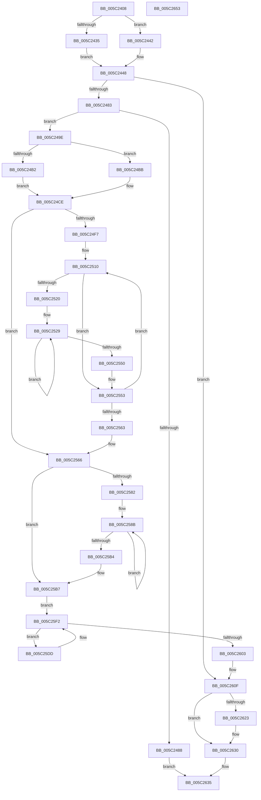

# KiSrcuInitializeTopology

- RVA: `0x005C2408`–`0x005C2654` (길이 `588` bytes)
- VA: `0x00000001405C2408`
- 실행 섹션: `.text`
- PDB 이름 있음: `예`; PDB Function 태그: `아니요`
- unwind 정보 RVA: `0x000CA900`
- 디코드: `152`개 명령, `588/588` bytes 표시
- 미해석 바이트: `0` (있으면 어셈블리에 `.byte`로 보존)

> 이 문서는 커널 이미지의 기계어와 PDB 기호를 분석해 생성했습니다. 4번과 5번은 함수 원형과 자료형을 바이너리 사용 방식에서 추정한 C 해석이며 원본 소스 복구 결과는 아닙니다.

## 1. Dependencies

- 직접 호출 지점: **7**; 고유 호출 대상: **6**
- 직접 호출자로 확인된 함수: **1**
- RIP 상대 이미지 참조: **19**

### Outgoing calls
- `0x005C245E` → [ExAllocatePool2](../../poolcode/B8/ExAllocatePool2_function_00B820F0.md) (function, `0x00B820F0`)
- `0x005C246D` → [KeAcquireSpinLockRaiseToDpc](../20/KeAcquireSpinLockRaiseToDpc_function_00208470.md) (function, `0x00208470`)
- `0x005C2492` → [KeReleaseSpinLock](../39/KeReleaseSpinLock_function_00392BA0.md) (function, `0x00392BA0`)
- `0x005C25ED` → [KiSrcuProcessorAddToTopologyTree](KiSrcuProcessorAddToTopologyTree_function_005C2A7C.md) (function, `0x005C2A7C`)
- `0x005C25FA` → [KeEnumerateNextProcessor](../41/KeEnumerateNextProcessor_function_00415480.md) (function, `0x00415480`)
- `0x005C2619` → [KeReleaseSpinLock](../39/KeReleaseSpinLock_function_00392BA0.md) (function, `0x00392BA0`)
- `0x005C262B` → [ExFreePoolWithTag](../../poolcode/B8/ExFreePoolWithTag_function_00B82870.md) (function, `0x00B82870`)

### Direct callers
- [KeSrcuAllocate](KeSrcuAllocate_function_005C1C40.md) at `0x005C1C61`

### Static image references
- `0x005C2427` → RVA `0x00FC6AE8` (`ALMOSTRO`; read)
- `0x005C2463` → RVA `0x00F10E38` (`.data`; read)
- `0x005C2475` → RVA `0x00F10E40` (`.data`; read)
- `0x005C249E` → RVA `0x00F10E41` (`.data`; write)
- `0x005C24A5` → RVA `0x00F10E44` (`.data`; write)
- `0x005C24B2` → RVA `0x00F10E42` (`.data`; write)
- `0x005C24BB` → RVA `0x00F10E45` (`.data`; write)
- `0x005C24C7` → RVA `0x00F10E43` (`.data`; write)
- `0x005C24D2` → RVA `0x00F10E48` (`.data`; write)
- `0x005C24D9` → RVA `0x00F10E50` (`.data`; write)
- `0x005C24E7` → RVA `0x00F10E58` (`.data`; write)
- `0x005C24F7` → RVA `0x00F10E45` (`.data`; read)
- `0x005C24FE` → RVA `0x00F10E58` (`.data`; read)
- `0x005C2505` → RVA `0x00F10E42` (`.data`; read)
- `0x005C256A` → RVA `0x00000000` (`image boundary/outside`; read)
- `0x005C258B` → RVA `0x00F10E48` (`.data`; read)
- `0x005C25B7` → RVA `0x00FC7128` (`ALMOSTRO`; read)
- `0x005C25C2` → RVA `0x00FC7120` (`ALMOSTRO`; read)
- `0x005C2608` → RVA `0x00F10E40` (`.data`; write)

## 2. Other-region calls and transfers

- 다른 실행 섹션으로 향하는 call: **2**
  - `0x005C245E` → [ExAllocatePool2](../../poolcode/B8/ExAllocatePool2_function_00B820F0.md) (`.text` → `POOLCODE`)
  - `0x005C262B` → [ExFreePoolWithTag](../../poolcode/B8/ExFreePoolWithTag_function_00B82870.md) (`.text` → `POOLCODE`)
- 별도 외부 분기/꼬리 이동을 확인하지 못했습니다.

## 3. Assembly (complete function range)

```asm
005C2408  48 89 5C 24 10                  mov qword ptr [rsp + 0x10], rbx
005C240D  48 89 74 24 18                  mov qword ptr [rsp + 0x18], rsi
005C2412  48 89 7C 24 20                  mov qword ptr [rsp + 0x20], rdi
005C2417  55                              push rbp
005C2418  41 54                           push r12
005C241A  41 55                           push r13
005C241C  41 56                           push r14
005C241E  41 57                           push r15
005C2420  48 8B EC                        mov rbp, rsp
005C2423  48 83 EC 40                     sub rsp, 0x40
005C2427  8B 3D BB 46 A0 00               mov edi, dword ptr [rip + 0xa046bb]
005C242D  45 33 ED                        xor r13d, r13d
005C2430  83 FF 40                        cmp edi, 0x40
005C2433  76 0D                           jbe 0x1405c2442
005C2435  48 8D 5F 3F                     lea rbx, [rdi + 0x3f]
005C2439  40 B6 02                        mov sil, 2
005C243C  48 C1 EB 06                     shr rbx, 6
005C2440  EB 06                           jmp 0x1405c2448
005C2442  41 8B DD                        mov ebx, r13d
005C2445  40 B6 01                        mov sil, 1
005C2448  8D 43 01                        lea eax, [rbx + 1]
005C244B  B9 40 00 00 00                  mov ecx, 0x40
005C2450  48 8D 14 47                     lea rdx, [rdi + rax*2]
005C2454  41 B8 53 52 63 75               mov r8d, 0x75635253
005C245A  48 C1 E2 03                     shl rdx, 3
005C245E  E8 8D FC 5B 00                  call 0x140b820f0
005C2463  48 8D 0D CE E9 94 00            lea rcx, [rip + 0x94e9ce]
005C246A  4C 8B F0                        mov r14, rax
005C246D  E8 FE 5F C4 FF                  call 0x140208470
005C2472  44 8A E0                        mov r12b, al
005C2475  8A 05 C5 E9 94 00               mov al, byte ptr [rip + 0x94e9c5]
005C247B  84 C0                           test al, al
005C247D  0F 85 8C 01 00 00               jne 0x1405c260f
005C2483  4D 85 F6                        test r14, r14
005C2486  75 16                           jne 0x1405c249e
005C2488  41 8A D4                        mov dl, r12b
005C248B  48 8D 0D A6 E9 94 00            lea rcx, [rip + 0x94e9a6]
005C2492  E8 09 07 DD FF                  call 0x140392ba0
005C2497  33 C0                           xor eax, eax
005C2499  E9 97 01 00 00                  jmp 0x1405c2635
005C249E  40 88 35 9C E9 94 00            mov byte ptr [rip + 0x94e99c], sil
005C24A5  C6 05 98 E9 94 00 01            mov byte ptr [rip + 0x94e998], 1
005C24AC  40 80 FE 01                     cmp sil, 1
005C24B0  75 09                           jne 0x1405c24bb
005C24B2  40 88 3D 89 E9 94 00            mov byte ptr [rip + 0x94e989], dil
005C24B9  EB 13                           jmp 0x1405c24ce
005C24BB  88 1D 84 E9 94 00               mov byte ptr [rip + 0x94e984], bl
005C24C1  88 1D 7B E9 94 00               mov byte ptr [rip + 0x94e97b], bl
005C24C7  C6 05 75 E9 94 00 40            mov byte ptr [rip + 0x94e975], 0x40
005C24CE  49 8D 04 FE                     lea rax, [r14 + rdi*8]
005C24D2  4C 89 35 6F E9 94 00            mov qword ptr [rip + 0x94e96f], r14
005C24D9  48 89 05 70 E9 94 00            mov qword ptr [rip + 0x94e970], rax
005C24E0  4D 8B F5                        mov r14, r13
005C24E3  48 83 C0 10                     add rax, 0x10
005C24E7  48 89 05 6A E9 94 00            mov qword ptr [rip + 0x94e96a], rax
005C24EE  40 0F B6 C6                     movzx eax, sil
005C24F2  83 F8 01                        cmp eax, 1
005C24F5  76 6F                           jbe 0x1405c2566
005C24F7  4C 8D 05 47 E9 94 00            lea r8, [rip + 0x94e947]
005C24FE  4C 8D 0D 53 E9 94 00            lea r9, [rip + 0x94e953]
005C2505  4C 8D 15 36 E9 94 00            lea r10, [rip + 0x94e936]
005C250C  44 8D 58 FF                     lea r11d, [rax - 1]
005C2510  44 21 75 30                     and dword ptr [rbp + 0x30], r14d
005C2514  45 0F B6 2A                     movzx r13d, byte ptr [r10]
005C2518  49 8B 01                        mov rax, qword ptr [r9]
005C251B  45 38 30                        cmp byte ptr [r8], r14b
005C251E  76 33                           jbe 0x1405c2553
005C2520  33 C9                           xor ecx, ecx
005C2522  48 8D 58 08                     lea rbx, [rax + 8]
005C2526  45 33 FF                        xor r15d, r15d
005C2529  8B C1                           mov eax, ecx
005C252B  33 D2                           xor edx, edx
005C252D  41 F7 F5                        div r13d
005C2530  B8 01 00 00 00                  mov eax, 1
005C2535  8B CA                           mov ecx, edx
005C2537  48 D3 E0                        shl rax, cl
005C253A  41 8D 4F 01                     lea ecx, [r15 + 1]
005C253E  48 89 03                        mov qword ptr [rbx], rax
005C2541  44 8B F9                        mov r15d, ecx
005C2544  41 0F B6 00                     movzx eax, byte ptr [r8]
005C2548  48 8D 5B 10                     lea rbx, [rbx + 0x10]
005C254C  3B C8                           cmp ecx, eax
005C254E  72 D9                           jb 0x1405c2529
005C2550  89 4D 30                        mov dword ptr [rbp + 0x30], ecx
005C2553  49 FF C2                        inc r10
005C2556  49 83 C1 08                     add r9, 8
005C255A  49 FF C0                        inc r8
005C255D  49 83 EB 01                     sub r11, 1
005C2561  75 AD                           jne 0x1405c2510
005C2563  45 33 ED                        xor r13d, r13d
005C2566  40 0F B6 C6                     movzx eax, sil
005C256A  48 8D 1D 8F DA A3 FF            lea rbx, [rip - 0x5c2571]
005C2571  44 89 6D 30                     mov dword ptr [rbp + 0x30], r13d
005C2575  44 0F B6 9C 18 41 0E F1 00      movzx r11d, byte ptr [rax + rbx + 0xf10e41]
005C257E  85 FF                           test edi, edi
005C2580  74 35                           je 0x1405c25b7
005C2582  4D 8B CD                        mov r9, r13
005C2585  41 8B C5                        mov eax, r13d
005C2588  45 8B D5                        mov r10d, r13d
005C258B  4C 8B 05 B6 E8 94 00            mov r8, qword ptr [rip + 0x94e8b6]
005C2592  33 D2                           xor edx, edx
005C2594  41 F7 F3                        div r11d
005C2597  B8 01 00 00 00                  mov eax, 1
005C259C  8B CA                           mov ecx, edx
005C259E  48 D3 E0                        shl rax, cl
005C25A1  4B 89 04 01                     mov qword ptr [r9 + r8], rax
005C25A5  41 8D 42 01                     lea eax, [r10 + 1]
005C25A9  4D 8D 49 08                     lea r9, [r9 + 8]
005C25AD  44 8B D0                        mov r10d, eax
005C25B0  3B C7                           cmp eax, edi
005C25B2  72 D7                           jb 0x1405c258b
005C25B4  89 45 30                        mov dword ptr [rbp + 0x30], eax
005C25B7  48 8B 05 6A 4B A0 00            mov rax, qword ptr [rip + 0xa04b6a]
005C25BE  48 89 45 E8                     mov qword ptr [rbp - 0x18], rax
005C25C2  48 8D 05 57 4B A0 00            lea rax, [rip + 0xa04b57]
005C25C9  48 89 45 E0                     mov qword ptr [rbp - 0x20], rax
005C25CD  44 89 6D F2                     mov dword ptr [rbp - 0xe], r13d
005C25D1  66 44 89 6D F6                  mov word ptr [rbp - 0xa], r13w
005C25D6  66 44 89 6D F0                  mov word ptr [rbp - 0x10], r13w
005C25DB  EB 15                           jmp 0x1405c25f2
005C25DD  8B 4D 30                        mov ecx, dword ptr [rbp + 0x30]
005C25E0  BA 01 00 00 00                  mov edx, 1
005C25E5  48 8B 8C CB 40 8C FC 00         mov rcx, qword ptr [rbx + rcx*8 + 0xfc8c40]
005C25ED  E8 8A 04 00 00                  call 0x1405c2a7c
005C25F2  48 8D 55 E0                     lea rdx, [rbp - 0x20]
005C25F6  48 8D 4D 30                     lea rcx, [rbp + 0x30]
005C25FA  E8 81 2E E5 FF                  call 0x140415480
005C25FF  85 C0                           test eax, eax
005C2601  74 DA                           je 0x1405c25dd
005C2603  F0 44 09 2C 24                  lock or dword ptr [rsp], r13d
005C2608  C6 05 31 E8 94 00 01            mov byte ptr [rip + 0x94e831], 1
005C260F  41 8A D4                        mov dl, r12b
005C2612  48 8D 0D 1F E8 94 00            lea rcx, [rip + 0x94e81f]
005C2619  E8 82 05 DD FF                  call 0x140392ba0
005C261E  4D 85 F6                        test r14, r14
005C2621  74 0D                           je 0x1405c2630
005C2623  BA 53 52 63 75                  mov edx, 0x75635253
005C2628  49 8B CE                        mov rcx, r14
005C262B  E8 40 02 5C 00                  call 0x140b82870
005C2630  B8 01 00 00 00                  mov eax, 1
005C2635  4C 8D 5C 24 40                  lea r11, [rsp + 0x40]
005C263A  49 8B 5B 38                     mov rbx, qword ptr [r11 + 0x38]
005C263E  49 8B 73 40                     mov rsi, qword ptr [r11 + 0x40]
005C2642  49 8B 7B 48                     mov rdi, qword ptr [r11 + 0x48]
005C2646  49 8B E3                        mov rsp, r11
005C2649  41 5F                           pop r15
005C264B  41 5E                           pop r14
005C264D  41 5D                           pop r13
005C264F  41 5C                           pop r12
005C2651  5D                              pop rbp
005C2652  C3                              ret
005C2653  CC                              int3
```

## 4. C-style interpretation (structured pseudocode)

```c
__int64 __fastcall KiSrcuInitializeTopology(void)
{
    __int64 result;
    __int64 v_r10;
    __int64 v_r11;
    __int64 v_r13;
    __int64 v_r15;
    __int64 v_rbx;
    __int64 v_rsp;
    unsigned __int64 v_stack_m28;
    unsigned __int16 v_stack_m32;
    unsigned int v_stack_m36;
    unsigned __int16 v_stack_m38;
    unsigned __int64 v_stack_m40;
    unsigned __int64 v_stack_m48;
    unsigned int v_stack_m68;
    unsigned __int64 v_stack_p10;
    unsigned __int64 v_stack_p18;
    unsigned __int64 v_stack_p20;
    unsigned int v_stack_p8;

    v_stack_p10 = v_rbx;
    v_stack_p18 = v_rsi;
    v_stack_p20 = v_rdi;
    v_rsp = (v_rsp) - (64);
    v_r13 = 0;
    if (((unsigned int)((unsigned int)(*(unsigned int *)(v_rip + 10503867)))) <= 64) goto loc_005C2442;
    v_rbx = ((unsigned int)(*(unsigned int *)(v_rip + 10503867)) + 63) >> (6);
    goto loc_005C2448;
loc_005C2442:
loc_005C2448:
    a2 = ((unsigned int)(*(unsigned int *)(v_rip + 10503867)) + 0 + 1 * 2) << (3);
    result = ExAllocatePool2(64, a2, (unsigned int)(0x75635253ULL), a4);
    result = KeAcquireSpinLockRaiseToDpc(v_rip + 9759182, a2, (unsigned int)(0x75635253ULL), a4);
    if ((unsigned __int8)(*(unsigned __int8 *)(v_rip + 9759173)) != 0) goto loc_005C260F;
    if (result != 0) goto loc_005C249E;
    result = KeReleaseSpinLock(v_rip + 9759142, (unsigned __int8)((unsigned __int8)(result)), (unsigned int)(0x75635253ULL), a4);
    result = 0;
    goto loc_005C2635;
loc_005C249E:
    *(unsigned __int8 *)(v_rip + 9759132) = 1;
    *(unsigned __int8 *)(v_rip + 9759128) = 1;
    if (1 != 1) goto loc_005C24BB;
    *(unsigned __int8 *)(v_rip + 9759113) = (unsigned __int8)((unsigned int)(*(unsigned int *)(v_rip + 10503867)));
    goto loc_005C24CE;
loc_005C24BB:
    *(unsigned __int8 *)(v_rip + 9759108) = 0;
    *(unsigned __int8 *)(v_rip + 9759099) = 0;
    *(unsigned __int8 *)(v_rip + 9759093) = 64;
loc_005C24CE:
    *(unsigned __int64 *)(v_rip + 9759087) = 0;
    *(unsigned __int64 *)(v_rip + 9759088) = result + (unsigned int)(*(unsigned int *)(v_rip + 10503867)) * 8;
    result = (result + (unsigned int)(*(unsigned int *)(v_rip + 10503867)) * 8) + (16);
    *(unsigned __int64 *)(v_rip + 9759082) = result;
    if (1 <= 1) goto loc_005C2566;
loc_005C2510:
    if ((*(unsigned __int8 *)(v_rip + 9759047)) <= 0) goto loc_005C2553;
    a1 = 0;
    v_r15 = 0;
loc_005C2529:
    a2 = 0;
    result = (1) << (0);
    *(unsigned __int64 *)(*(unsigned __int64 *)(v_rip + 9759059) + 8) = result;
    if (((unsigned int)(v_r15 + 1)) < ((unsigned int)(*(unsigned __int8 *)(v_rip + 9759047)))) goto loc_005C2529;
    v_stack_p8 = (unsigned int)(v_r15 + 1);
loc_005C2553:
    v_r10 = (v_rip + 9759030) + 1;
    a4 = (v_rip + 9759059) + (8);
    a3 = (v_rip + 9759047) + 1;
    v_r11 = (1 - 1) - (1);
    if (condition_is_not_equal) goto loc_005C2510;
    v_r13 = 0;
loc_005C2566:
    v_stack_p8 = 0;
    if ((unsigned int)((unsigned int)(*(unsigned int *)(v_rip + 10503867))) == 0) goto loc_005C25B7;
loc_005C258B:
    a2 = 0;
    result = (1) << (0);
    *(unsigned __int64 *)(0 + *(unsigned __int64 *)(v_rip + 9758902) * 1) = result;
    if (((unsigned int)(0 + 1)) < ((unsigned int)((unsigned int)(*(unsigned int *)(v_rip + 10503867))))) goto loc_005C258B;
    v_stack_p8 = (unsigned int)(0 + 1);
loc_005C25B7:
    v_stack_m40 = *(unsigned __int64 *)(v_rip + 10505066);
    v_stack_m48 = v_rip + 10505047;
    v_stack_m36 = 0;
    v_stack_m32 = 0;
    v_stack_m38 = 0;
    goto loc_005C25F2;
loc_005C25DD:
    result = KiSrcuProcessorAddToTopologyTree(*(unsigned __int64 *)(v_rip - 6038897 + (unsigned int)(v_stack_p8) * 8 + 16550976), 1, *(unsigned __int64 *)(v_rip + 9758902), 0 + 8);
loc_005C25F2:
    result = KeEnumerateNextProcessor(v_stack_p8, v_stack_m48, *(unsigned __int64 *)(v_rip + 9758902), 0 + 8);
    if ((unsigned int)(result) == 0) goto loc_005C25DD;
    *(unsigned __int8 *)(v_rip + 9758769) = 1;
loc_005C260F:
    result = KeReleaseSpinLock(v_rip + 9758751, (unsigned __int8)((unsigned __int8)(result)), *(unsigned __int64 *)(v_rip + 9758902), 0 + 8);
    if (0 != 0) {
        a2 = 0x75635253ULL;
        a1 = 0;
        result = ExFreePoolWithTag(a1, a2, *(unsigned __int64 *)(v_rip + 9758902), 0 + 8);
    }
loc_005C2635:
    return 1;
}
```

## 5. (Beta) C Style

```c
void KiSrcuInitializeTopology(void)
{
    int64_t result;
    int64_t local_r10;
    int64_t local_r11;
    int64_t local_r13;
    int64_t local_r15;
    int64_t local_rbx;
    int64_t local_rsp;
    uint64_t v_stack_m28;
    uint16_t v_stack_m32;
    uint32_t v_stack_m36;
    uint16_t v_stack_m38;
    uint64_t v_stack_m40;
    uint64_t v_stack_m48;
    uint32_t v_stack_m68;
    uint64_t v_stack_p10;
    uint64_t v_stack_p18;
    uint64_t v_stack_p20;
    uint32_t v_stack_p8;

    v_stack_p10 = local_rbx;
    v_stack_p18 = local_rsi;
    v_stack_p20 = local_rdi;
    local_rsp = (local_rsp) - (64);
    local_r13 = 0;
    if (((uint32_t)((uint32_t)(*(uint32_t *)(v_rip + 0xA046BB)))) <= 64) goto loc_005C2442;
    local_rbx = ((uint32_t)(*(uint32_t *)(v_rip + 0xA046BB)) + 63) >> (6);
    goto loc_005C2448;
loc_005C2442:
loc_005C2448:
    a2 = ((uint32_t)(*(uint32_t *)(v_rip + 0xA046BB)) + 0 + 1 * 2) << (3);
    result = ExAllocatePool2(64, a2, (uint32_t)(0x75635253ULL), a4);
    result = KeAcquireSpinLockRaiseToDpc(v_rip + 9759182, a2, (uint32_t)(0x75635253ULL), a4);
    if ((uint8_t)(*(uint8_t *)(v_rip + 0x94E9C5)) != 0) goto loc_005C260F;
    if (result != 0) goto loc_005C249E;
    result = KeReleaseSpinLock(v_rip + 9759142, (uint8_t)((uint8_t)(result)), (uint32_t)(0x75635253ULL), a4);
    result = 0;
    goto loc_005C2635;
loc_005C249E:
    *(uint8_t *)(v_rip + 0x94E99C) = 1;
    *(uint8_t *)(v_rip + 0x94E998) = 1;
    if (1 != 1) goto loc_005C24BB;
    *(uint8_t *)(v_rip + 0x94E989) = (uint8_t)((uint32_t)(*(uint32_t *)(v_rip + 0xA046BB)));
    goto loc_005C24CE;
loc_005C24BB:
    *(uint8_t *)(v_rip + 0x94E984) = 0;
    *(uint8_t *)(v_rip + 0x94E97B) = 0;
    *(uint8_t *)(v_rip + 0x94E975) = 64;
loc_005C24CE:
    *(uint64_t *)(v_rip + 0x94E96F) = 0;
    *(uint64_t *)(v_rip + 0x94E970) = result + (uint32_t)(*(uint32_t *)(v_rip + 0xA046BB)) * 8;
    result = (result + (uint32_t)(*(uint32_t *)(v_rip + 0xA046BB)) * 8) + (16);
    *(uint64_t *)(v_rip + 0x94E96A) = result;
    if (1 <= 1) goto loc_005C2566;
loc_005C2510:
    if ((*(uint8_t *)(v_rip + 0x94E947)) <= 0) goto loc_005C2553;
    a1 = 0;
    local_r15 = 0;
loc_005C2529:
    a2 = 0;
    result = (1) << (0);
    *(uint64_t *)(*(uint64_t *)(v_rip + 0x94E953) + 0x8) = result;
    if (((uint32_t)(local_r15 + 1)) < ((uint32_t)(*(uint8_t *)(v_rip + 0x94E947)))) goto loc_005C2529;
    v_stack_p8 = (uint32_t)(local_r15 + 1);
loc_005C2553:
    local_r10 = (v_rip + 9759030) + 1;
    a4 = (v_rip + 9759059) + (8);
    a3 = (v_rip + 9759047) + 1;
    local_r11 = (1 - 1) - (1);
    if (condition_is_not_equal) goto loc_005C2510;
    local_r13 = 0;
loc_005C2566:
    v_stack_p8 = 0;
    if ((uint32_t)((uint32_t)(*(uint32_t *)(v_rip + 0xA046BB))) == 0) goto loc_005C25B7;
loc_005C258B:
    a2 = 0;
    result = (1) << (0);
    *(uint64_t *)(0 + *(uint64_t *)(v_rip + 0x94E8B6) * 1) = result;
    if (((uint32_t)(0 + 1)) < ((uint32_t)((uint32_t)(*(uint32_t *)(v_rip + 0xA046BB))))) goto loc_005C258B;
    v_stack_p8 = (uint32_t)(0 + 1);
loc_005C25B7:
    v_stack_m40 = *(uint64_t *)(v_rip + 0xA04B6A);
    v_stack_m48 = v_rip + 10505047;
    v_stack_m36 = 0;
    v_stack_m32 = 0;
    v_stack_m38 = 0;
    goto loc_005C25F2;
loc_005C25DD:
    result = KiSrcuProcessorAddToTopologyTree(*(uint64_t *)(v_rip - 0x5C2571 + (uint32_t)(v_stack_p8) * 8 + 0xFC8C40), 1, *(uint64_t *)(v_rip + 0x94E8B6), 0 + 8);
loc_005C25F2:
    result = KeEnumerateNextProcessor(v_stack_p8, v_stack_m48, *(uint64_t *)(v_rip + 0x94E8B6), 0 + 8);
    if ((uint32_t)(result) == 0) goto loc_005C25DD;
    *(uint8_t *)(v_rip + 0x94E831) = 1;
loc_005C260F:
    result = KeReleaseSpinLock(v_rip + 9758751, (uint8_t)((uint8_t)(result)), *(uint64_t *)(v_rip + 0x94E8B6), 0 + 8);
    if (0 != 0) {
        a2 = 0x75635253ULL;
        a1 = 0;
        result = ExFreePoolWithTag(a1, a2, *(uint64_t *)(v_rip + 0x94E8B6), 0 + 8);
    }
loc_005C2635:
    return 1;
}
```

## 6. Execution-region graph

[열기: 2D/3D 그래프와 함수 탐색 컨트롤 패널](../../../control-panel.html?section=text&rva=0x005C2408&view=graph)

- 2D 그래프는 위에서 아래로 흐르고, 3D 그래프는 빈 공간을 드래그해 회전합니다. Shift+드래그는 이동, 휠은 확대·축소, 함수 노드 선택은 대상 보고서 이동입니다.

### Static fallback


