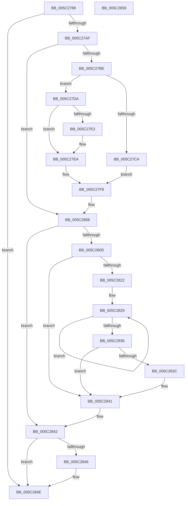

# KiSrcuNotifyGracePeriodStartedOnCpu

- RVA: `0x005C2788`–`0x005C285A` (길이 `210` bytes)
- VA: `0x00000001405C2788`
- 실행 섹션: `.text`
- PDB 이름 있음: `예`; PDB Function 태그: `아니요`
- unwind 정보 RVA: `0x0005CAAC`
- 디코드: `60`개 명령, `210/210` bytes 표시
- 미해석 바이트: `0` (있으면 어셈블리에 `.byte`로 보존)

> 이 문서는 커널 이미지의 기계어와 PDB 기호를 분석해 생성했습니다. 4번과 5번은 함수 원형과 자료형을 바이너리 사용 방식에서 추정한 C 해석이며 원본 소스 복구 결과는 아닙니다.

## 1. Dependencies

- 직접 호출 지점: **3**; 고유 호출 대상: **3**
- 직접 호출자로 확인된 함수: **2**
- RIP 상대 이미지 참조: **0**

### Outgoing calls
- `0x005C27B1` → [KeDisableInterrupts](../21/KeDisableInterrupts_function_00217BE0.md) (function, `0x00217BE0`)
- `0x005C283C` → [KiRemoveSystemWorkPriorityKick](../26/KiRemoveSystemWorkPriorityKick_function_002631D0.md) (function, `0x002631D0`)
- `0x005C2849` → [KiSrcuCheckQuiescent](../43/KiSrcuCheckQuiescent_function_0043C700.md) (function, `0x0043C700`)

### Direct callers
- [KiSrcuProcessorInitialize](../4F/KiSrcuProcessorInitialize_function_004FA6C4.md) at `0x004FA73C`
- [KiSrcuNotifyWorkerDpcRoutine](KiSrcuNotifyWorkerDpcRoutine_function_005C28D0.md) at `0x005C29B1`

### Static image references
- 디코드된 RIP-relative 메모리 참조가 없습니다.

## 2. Other-region calls and transfers

- 다른 실행 섹션으로 향하는 call: **0**
- 별도 외부 분기/꼬리 이동을 확인하지 못했습니다.

## 3. Assembly (complete function range)

```asm
005C2788  48 89 5C 24 08                  mov qword ptr [rsp + 8], rbx
005C278D  57                              push rdi
005C278E  48 83 EC 20                     sub rsp, 0x20
005C2792  44 8B 42 24                     mov r8d, dword ptr [rdx + 0x24]
005C2796  48 8B FA                        mov rdi, rdx
005C2799  49 C1 E0 06                     shl r8, 6
005C279D  49 83 C0 08                     add r8, 8
005C27A1  4C 03 41 20                     add r8, qword ptr [rcx + 0x20]
005C27A5  49 83 38 00                     cmp qword ptr [r8], 0
005C27A9  0F 85 9F 00 00 00               jne 0x1405c284e
005C27AF  33 DB                           xor ebx, ebx
005C27B1  E8 2A 54 C5 FF                  call 0x140217be0
005C27B6  44 8A C8                        mov r9b, al
005C27B9  49 39 18                        cmp qword ptr [r8], rbx
005C27BC  75 4A                           jne 0x1405c2808
005C27BE  48 8B 8F F8 38 00 00            mov rcx, qword ptr [rdi + 0x38f8]
005C27C5  48 85 C9                        test rcx, rcx
005C27C8  75 10                           jne 0x1405c27da
005C27CA  4D 89 40 08                     mov qword ptr [r8 + 8], r8
005C27CE  4D 89 00                        mov qword ptr [r8], r8
005C27D1  4C 89 87 F8 38 00 00            mov qword ptr [rdi + 0x38f8], r8
005C27D8  EB 1E                           jmp 0x1405c27f8
005C27DA  48 8B 41 08                     mov rax, qword ptr [rcx + 8]
005C27DE  48 39 08                        cmp qword ptr [rax], rcx
005C27E1  74 07                           je 0x1405c27ea
005C27E3  B9 03 00 00 00                  mov ecx, 3
005C27E8  CD 29                           int 0x29
005C27EA  49 89 08                        mov qword ptr [r8], rcx
005C27ED  49 89 40 08                     mov qword ptr [r8 + 8], rax
005C27F1  4C 89 00                        mov qword ptr [rax], r8
005C27F4  4C 89 41 08                     mov qword ptr [rcx + 8], r8
005C27F8  8A 87 E7 38 00 00               mov al, byte ptr [rdi + 0x38e7]
005C27FE  B9 01 00 00 00                  mov ecx, 1
005C2803  84 C0                           test al, al
005C2805  0F 45 D9                        cmovne ebx, ecx
005C2808  45 84 C9                        test r9b, r9b
005C280B  74 35                           je 0x1405c2842
005C280D  65 48 8B 0C 25 20 00 00 00      mov rcx, qword ptr gs:[0x20]
005C2816  4C 8B 81 B8 8E 00 00            mov r8, qword ptr [rcx + 0x8eb8]
005C281D  4D 85 C0                        test r8, r8
005C2820  74 1F                           je 0x1405c2841
005C2822  41 0F 0D 08                     prefetchw byte ptr [r8]
005C2826  41 8B 00                        mov eax, dword ptr [r8]
005C2829  8B D0                           mov edx, eax
005C282B  0F BA F2 15                     btr edx, 0x15
005C282F  F0 41 0F B1 10                  lock cmpxchg dword ptr [r8], edx
005C2834  75 F3                           jne 0x1405c2829
005C2836  0F BA E0 15                     bt eax, 0x15
005C283A  73 05                           jae 0x1405c2841
005C283C  E8 8F 09 CA FF                  call 0x1402631d0
005C2841  FB                              sti
005C2842  85 DB                           test ebx, ebx
005C2844  74 08                           je 0x1405c284e
005C2846  48 8B CF                        mov rcx, rdi
005C2849  E8 B2 9E E7 FF                  call 0x14043c700
005C284E  48 8B 5C 24 30                  mov rbx, qword ptr [rsp + 0x30]
005C2853  48 83 C4 20                     add rsp, 0x20
005C2857  5F                              pop rdi
005C2858  C3                              ret
005C2859  CC                              int3
```

## 4. C-style interpretation (structured pseudocode)

```c
__int64 __fastcall KiSrcuNotifyGracePeriodStartedOnCpu(__int64 a1, __int64 a2)
{
    __int64 result;
    __int64 v_rbx;
    __int64 v_rsp;
    unsigned __int64 v_stack_p8;

    v_stack_p8 = v_rbx;
    v_rsp = (v_rsp) - (32);
    a3 = ((unsigned int)(*(unsigned int *)(a2 + 36))) << (6);
    a3 = (a3) + (8);
    a3 = (a3) + (*(unsigned __int64 *)(a1 + 32));
    if ((*(unsigned __int64 *)(a3)) != 0) goto loc_005C284E;
    v_rbx = 0;
    result = KeDisableInterrupts(a1, a2, a3, a4);
    if ((*(unsigned __int64 *)(a3)) != 0) goto loc_005C2808;
    if (*(unsigned __int64 *)(a2 + 14584) != 0) goto loc_005C27DA;
    *(unsigned __int64 *)(a3 + 8) = a3;
    *(unsigned __int64 *)(a3) = a3;
    *(unsigned __int64 *)(a2 + 14584) = a3;
    goto loc_005C27F8;
loc_005C27DA:
    if ((*(unsigned __int64 *)(*(unsigned __int64 *)(*(unsigned __int64 *)(a2 + 14584) + 8))) != (*(unsigned __int64 *)(a2 + 14584))) {
        a1 = 3;
    }
    *(unsigned __int64 *)(a3) = a1;
    *(unsigned __int64 *)(a3 + 8) = *(unsigned __int64 *)(*(unsigned __int64 *)(a2 + 14584) + 8);
    *(unsigned __int64 *)(*(unsigned __int64 *)(*(unsigned __int64 *)(a2 + 14584) + 8)) = a3;
    *(unsigned __int64 *)(a1 + 8) = a3;
loc_005C27F8:
    if ((unsigned __int8)(*(unsigned __int8 *)(a2 + 14567)) != 0) { v_rbx = 1; }
loc_005C2808:
    if ((unsigned __int8)((unsigned __int8)(result)) == 0) goto loc_005C2842;
    if (*(unsigned __int64 *)(*(unsigned __int64 *)(gs_base + (0 + 32)) + 36536) == 0) goto loc_005C2841;
loc_005C2829:
    if (*(unsigned __int64 *)(*(unsigned __int64 *)(gs_base + (0 + 32)) + 36536) != 0) goto loc_005C2829;
    result = (unsigned int)(*(unsigned int *)(*(unsigned __int64 *)(*(unsigned __int64 *)(gs_base + (0 + 32)) + 36536)));
    if (!(condition_is_above_or_equal)) {
        result = KiRemoveSystemWorkPriorityKick(*(unsigned __int64 *)(gs_base + (0 + 32)), (unsigned int)((unsigned int)((unsigned int)(*(unsigned int *)(*(unsigned __int64 *)(*(unsigned __int64 *)(gs_base + (0 + 32)) + 36536))))), *(unsigned __int64 *)(*(unsigned __int64 *)(gs_base + (0 + 32)) + 36536), (unsigned __int8)(result));
    }
loc_005C2842:
    if ((unsigned int)(v_rbx) != 0) {
        a1 = a2;
        result = KiSrcuCheckQuiescent(a1, (unsigned int)((unsigned int)((unsigned int)(*(unsigned int *)(*(unsigned __int64 *)(*(unsigned __int64 *)(gs_base + (0 + 32)) + 36536))))), *(unsigned __int64 *)(*(unsigned __int64 *)(gs_base + (0 + 32)) + 36536), (unsigned __int8)(result));
    }
    v_rsp = (v_rsp) + (32);
    return result;
}
```

## 5. (Beta) C Style

```c
int64_t KiSrcuNotifyGracePeriodStartedOnCpu(void *Arg1, void *Arg2)
{
    uint8_t *arg1 = (uint8_t *)Arg1;
    uint8_t *arg2 = (uint8_t *)Arg2;

    int64_t result;
    int64_t local_rbx;
    int64_t local_rsp;
    uint64_t v_stack_p8;

    v_stack_p8 = local_rbx;
    local_rsp = (local_rsp) - (32);
    a3 = ((uint32_t)(*(uint32_t *)(arg2 + 0x24))) << (6);
    a3 = (a3) + (8);
    a3 = (a3) + (*(uint64_t *)(arg1 + 0x20));
    if ((*(uint64_t *)(a3)) != 0) goto loc_005C284E;
    local_rbx = 0;
    result = KeDisableInterrupts(Arg1, Arg2, a3, a4);
    if ((*(uint64_t *)(a3)) != 0) goto loc_005C2808;
    if (*(uint64_t *)(arg2 + 0x38F8) != 0) goto loc_005C27DA;
    *(uint64_t *)(a3 + 0x8) = a3;
    *(uint64_t *)(a3) = a3;
    *(uint64_t *)(arg2 + 0x38F8) = a3;
    goto loc_005C27F8;
loc_005C27DA:
    if ((*(uint64_t *)(*(uint64_t *)(*(uint64_t *)(arg2 + 0x38F8) + 0x8))) != (*(uint64_t *)(arg2 + 0x38F8))) {
        Arg1 = 3;
    }
    *(void **)(a3) = Arg1;
    *(uint64_t *)(a3 + 0x8) = *(uint64_t *)(*(uint64_t *)(arg2 + 0x38F8) + 0x8);
    *(uint64_t *)(*(uint64_t *)(*(uint64_t *)(arg2 + 0x38F8) + 0x8)) = a3;
    *(uint64_t *)(arg1 + 0x8) = a3;
loc_005C27F8:
    if ((uint8_t)(*(uint8_t *)(arg2 + 0x38E7)) != 0) { local_rbx = 1; }
loc_005C2808:
    if ((uint8_t)((uint8_t)(result)) == 0) goto loc_005C2842;
    if (*(uint64_t *)(*(uint64_t *)(gs_base + (0 + 0x20)) + 0x8EB8) == 0) goto loc_005C2841;
loc_005C2829:
    if (*(uint64_t *)(*(uint64_t *)(gs_base + (0 + 0x20)) + 0x8EB8) != 0) goto loc_005C2829;
    result = (uint32_t)(*(uint32_t *)(*(uint64_t *)(*(uint64_t *)(gs_base + (0 + 0x20)) + 0x8EB8)));
    if (!(condition_is_above_or_equal)) {
        result = KiRemoveSystemWorkPriorityKick(*(uint64_t *)(gs_base + (0 + 0x20)), (uint32_t)((uint32_t)((uint32_t)(*(uint32_t *)(*(uint64_t *)(*(uint64_t *)(gs_base + (0 + 0x20)) + 0x8EB8))))), *(uint64_t *)(*(uint64_t *)(gs_base + (0 + 0x20)) + 0x8EB8), (uint8_t)(result));
    }
loc_005C2842:
    if ((uint32_t)(local_rbx) != 0) {
        Arg1 = Arg2;
        result = KiSrcuCheckQuiescent(Arg1, (uint32_t)((uint32_t)((uint32_t)(*(uint32_t *)(*(uint64_t *)(*(uint64_t *)(gs_base + (0 + 0x20)) + 0x8EB8))))), *(uint64_t *)(*(uint64_t *)(gs_base + (0 + 0x20)) + 0x8EB8), (uint8_t)(result));
    }
    local_rsp = (local_rsp) + (32);
    return result;
}
```

### 관측된 메모리 오프셋

구조체 형식이 확인되지 않은 접근은 인자 기준의 오프셋으로만 기록했습니다.

| 기준 인자 | 오프셋 표현 | 폭 (bit) | 접근 |
|---|---:|---:|---|
| `Arg1` | `+ 0x20` | `64` | `R` |
| `Arg2` | `+ 0x24` | `32` | `R` |
| `Arg2` | `+ 0x38E7` | `8` | `R` |
| `Arg2` | `+ 0x38F8` | `64` | `R` |
| `Arg2` | `+ 0x38F8` | `64` | `W` |

## 6. Execution-region graph

[열기: 2D/3D 그래프와 함수 탐색 컨트롤 패널](../../../control-panel.html?section=text&rva=0x005C2788&view=graph)

- 2D 그래프는 위에서 아래로 흐르고, 3D 그래프는 빈 공간을 드래그해 회전합니다. Shift+드래그는 이동, 휠은 확대·축소, 함수 노드 선택은 대상 보고서 이동입니다.

### Static fallback


