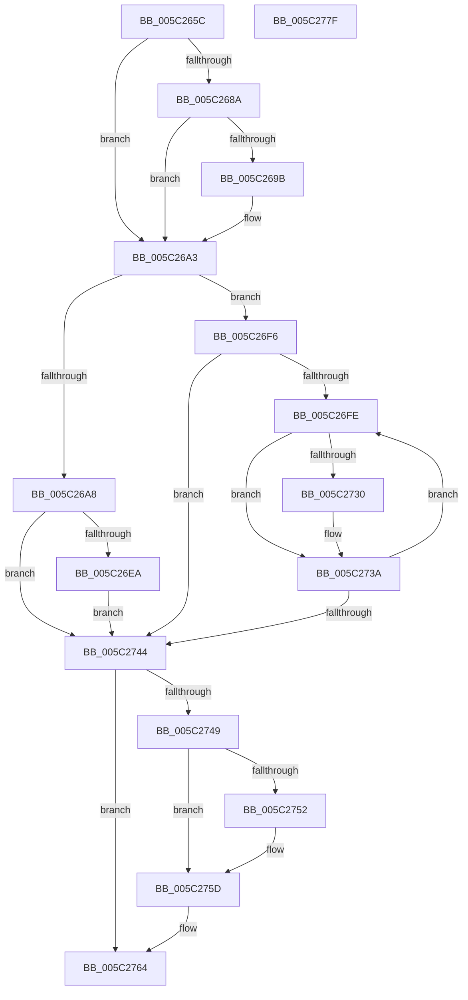

# KiSrcuNotifyGracePeriodStarted

- RVA: `0x005C265C`–`0x005C2780` (길이 `292` bytes)
- VA: `0x00000001405C265C`
- 실행 섹션: `.text`
- PDB 이름 있음: `예`; PDB Function 태그: `아니요`
- unwind 정보 RVA: `0x000CA938`
- 디코드: `79`개 명령, `292/292` bytes 표시
- 미해석 바이트: `0` (있으면 어셈블리에 `.byte`로 보존)

> 이 문서는 커널 이미지의 기계어와 PDB 기호를 분석해 생성했습니다. 4번과 5번은 함수 원형과 자료형을 바이너리 사용 방식에서 추정한 C 해석이며 원본 소스 복구 결과는 아닙니다.

## 1. Dependencies

- 직접 호출 지점: **6**; 고유 호출 대상: **4**
- 직접 호출자로 확인된 함수: **2**
- RIP 상대 이미지 참조: **1**

### Outgoing calls
- `0x005C269E` → [KiRaiseIrqlProcessIrqlFlags](../4F/KiRaiseIrqlProcessIrqlFlags_function_004F56FC.md) (function, `0x004F56FC`)
- `0x005C26E1` → [KiSrcuNotifyWorkerAcquire](KiSrcuNotifyWorkerAcquire_function_005C2860.md) (function, `0x005C2860`)
- `0x005C26EF` → [KiSrcuNotifyWorkerSelectAndQueue](KiSrcuNotifyWorkerSelectAndQueue_function_005C29D4.md) (function, `0x005C29D4`)
- `0x005C2727` → [KiSrcuNotifyWorkerAcquire](KiSrcuNotifyWorkerAcquire_function_005C2860.md) (function, `0x005C2860`)
- `0x005C2735` → [KiSrcuNotifyWorkerSelectAndQueue](KiSrcuNotifyWorkerSelectAndQueue_function_005C29D4.md) (function, `0x005C29D4`)
- `0x005C2758` → [KiLowerIrqlProcessIrqlFlags](../4F/KiLowerIrqlProcessIrqlFlags_function_004F5698.md) (function, `0x004F5698`)

### Direct callers
- [KiSrcuReportQuiescent](KiSrcuReportQuiescent_function_005C2C08.md) at `0x005C2D18`
- [KiSrcuReportQuiescent](KiSrcuReportQuiescent_function_005C2C08.md) at `0x005C2D96`
- [KiSrcuReportQuiescent](KiSrcuReportQuiescent_function_005C2C08.md) at `0x005C2DAC`
- [KiSrcuStartGracePeriod](KiSrcuStartGracePeriod_function_005C2E3C.md) at `0x005C2E9F`

### Static image references
- `0x005C2692` → RVA `0x00FC6D20` (`ALMOSTRO`; read)

## 2. Other-region calls and transfers

- 다른 실행 섹션으로 향하는 call: **0**
- 별도 외부 분기/꼬리 이동을 확인하지 못했습니다.

## 3. Assembly (complete function range)

```asm
005C265C  48 8B C4                        mov rax, rsp
005C265F  48 89 58 08                     mov qword ptr [rax + 8], rbx
005C2663  48 89 70 10                     mov qword ptr [rax + 0x10], rsi
005C2667  48 89 78 18                     mov qword ptr [rax + 0x18], rdi
005C266B  4C 89 60 20                     mov qword ptr [rax + 0x20], r12
005C266F  41 56                           push r14
005C2671  48 83 EC 20                     sub rsp, 0x20
005C2675  48 8B FA                        mov rdi, rdx
005C2678  48 8B F1                        mov rsi, rcx
005C267B  44 0F 20 C3                     mov rbx, cr8
005C267F  41 BC 02 00 00 00               mov r12d, 2
005C2685  41 3A DC                        cmp bl, r12b
005C2688  73 19                           jae 0x1405c26a3
005C268A  44 0F 20 C1                     mov rcx, cr8
005C268E  45 0F 22 C4                     mov cr8, r12
005C2692  83 3D 87 46 A0 00 00            cmp dword ptr [rip + 0xa04687], 0
005C2699  74 08                           je 0x1405c26a3
005C269B  41 8A D4                        mov dl, r12b
005C269E  E8 59 30 F3 FF                  call 0x1404f56fc
005C26A3  48 85 FF                        test rdi, rdi
005C26A6  74 4E                           je 0x1405c26f6
005C26A8  48 2B 7E 20                     sub rdi, qword ptr [rsi + 0x20]
005C26AC  33 D2                           xor edx, edx
005C26AE  48 C1 FF 06                     sar rdi, 6
005C26B2  41 B8 01 00 00 00               mov r8d, 1
005C26B8  8B C7                           mov eax, edi
005C26BA  F7 B6 94 00 00 00               div dword ptr [rsi + 0x94]
005C26C0  BA 01 00 00 00                  mov edx, 1
005C26C5  4C 8D 34 80                     lea r14, [rax + rax*4]
005C26C9  49 C1 E6 04                     shl r14, 4
005C26CD  4C 03 B6 98 00 00 00            add r14, qword ptr [rsi + 0x98]
005C26D4  41 2B 7E 40                     sub edi, dword ptr [r14 + 0x40]
005C26D8  40 8A CF                        mov cl, dil
005C26DB  41 D3 E0                        shl r8d, cl
005C26DE  49 8B CE                        mov rcx, r14
005C26E1  E8 7A 01 00 00                  call 0x1405c2860
005C26E6  85 C0                           test eax, eax
005C26E8  74 5A                           je 0x1405c2744
005C26EA  33 D2                           xor edx, edx
005C26EC  49 8B CE                        mov rcx, r14
005C26EF  E8 E0 02 00 00                  call 0x1405c29d4
005C26F4  EB 4E                           jmp 0x1405c2744
005C26F6  39 BE 90 00 00 00               cmp dword ptr [rsi + 0x90], edi
005C26FC  76 46                           jbe 0x1405c2744
005C26FE  8B 8E 94 00 00 00               mov ecx, dword ptr [rsi + 0x94]
005C2704  4C 8D 34 BF                     lea r14, [rdi + rdi*4]
005C2708  41 B8 01 00 00 00               mov r8d, 1
005C270E  49 C1 E6 04                     shl r14, 4
005C2712  4C 03 B6 98 00 00 00            add r14, qword ptr [rsi + 0x98]
005C2719  BA 01 00 00 00                  mov edx, 1
005C271E  41 D3 E0                        shl r8d, cl
005C2721  49 8B CE                        mov rcx, r14
005C2724  41 FF C8                        dec r8d
005C2727  E8 34 01 00 00                  call 0x1405c2860
005C272C  85 C0                           test eax, eax
005C272E  74 0A                           je 0x1405c273a
005C2730  33 D2                           xor edx, edx
005C2732  49 8B CE                        mov rcx, r14
005C2735  E8 9A 02 00 00                  call 0x1405c29d4
005C273A  FF C7                           inc edi
005C273C  3B BE 90 00 00 00               cmp edi, dword ptr [rsi + 0x90]
005C2742  72 BA                           jb 0x1405c26fe
005C2744  41 3A DC                        cmp bl, r12b
005C2747  73 1B                           jae 0x1405c2764
005C2749  83 3D D0 45 A0 00 00            cmp dword ptr [rip + 0xa045d0], 0
005C2750  74 0B                           je 0x1405c275d
005C2752  44 0F 20 C1                     mov rcx, cr8
005C2756  8A D3                           mov dl, bl
005C2758  E8 3B 2F F3 FF                  call 0x1404f5698
005C275D  0F B6 C3                        movzx eax, bl
005C2760  44 0F 22 C0                     mov cr8, rax
005C2764  48 8B 5C 24 30                  mov rbx, qword ptr [rsp + 0x30]
005C2769  48 8B 74 24 38                  mov rsi, qword ptr [rsp + 0x38]
005C276E  48 8B 7C 24 40                  mov rdi, qword ptr [rsp + 0x40]
005C2773  4C 8B 64 24 48                  mov r12, qword ptr [rsp + 0x48]
005C2778  48 83 C4 20                     add rsp, 0x20
005C277C  41 5E                           pop r14
005C277E  C3                              ret
005C277F  CC                              int3
```

## 4. C-style interpretation (structured pseudocode)

```c
__int64 __fastcall KiSrcuNotifyGracePeriodStarted(__int64 a1, __int64 a2)
{
    __int64 result;
    __int64 v_r14;
    __int64 v_rdi;
    __int64 v_rsp;
    unsigned __int64 v_stack_p10;
    unsigned __int64 v_stack_p18;
    unsigned __int64 v_stack_p20;
    unsigned __int64 v_stack_p8;

    *(unsigned __int64 *)(v_rsp + 8) = v_rbx;
    *(unsigned __int64 *)(v_rsp + 16) = v_rsi;
    *(unsigned __int64 *)(v_rsp + 24) = v_rdi;
    *(unsigned __int64 *)(v_rsp + 32) = v_r12;
    v_rsp = (v_rsp) - (32);
    if (((unsigned __int8)(v_cr8)) >= 2) goto loc_005C26A3;
    result = v_rsp;
    if ((*(unsigned int *)(v_rip + 10503815)) != 0) {
        a2 = 2;
        result = KiRaiseIrqlProcessIrqlFlags(v_cr8, a2, a3, a4);
    }
    if (a2 == 0) goto loc_005C26F6;
    v_rdi = (a2) - (*(unsigned __int64 *)(a1 + 32));
    a2 = 0;
    v_rdi = (v_rdi) >> (6);
    v_r14 = ((unsigned int)((unsigned int)(v_rdi)) + (unsigned int)((unsigned int)(v_rdi)) * 4) << (4);
    v_r14 = (v_r14) + (*(unsigned __int64 *)(a1 + 152));
    v_rdi = (unsigned int)((v_rdi) - (*(unsigned int *)(v_r14 + 64)));
    a3 = (unsigned int)((1) << ((unsigned __int8)((unsigned __int8)(v_rdi))));
    result = KiSrcuNotifyWorkerAcquire(v_r14, 1, a3, a4);
    if ((unsigned int)(result) == 0) goto loc_005C2744;
    a2 = 0;
    result = KiSrcuNotifyWorkerSelectAndQueue(v_r14, a2, a3, a4);
    goto loc_005C2744;
loc_005C26F6:
    if ((*(unsigned int *)(a1 + 144)) <= ((unsigned int)(v_rdi))) goto loc_005C2744;
loc_005C26FE:
    v_r14 = (v_rdi + v_rdi * 4) << (4);
    v_r14 = (v_r14) + (*(unsigned __int64 *)(a1 + 152));
    a3 = (unsigned int)((1) << ((unsigned __int8)((unsigned int)(*(unsigned int *)(a1 + 148)))));
    a3 = (unsigned int)((a3) - 1);
    result = KiSrcuNotifyWorkerAcquire(v_r14, 1, a3, a4);
    if ((unsigned int)(result) != 0) {
        a2 = 0;
        a1 = v_r14;
        result = KiSrcuNotifyWorkerSelectAndQueue(a1, a2, a3, a4);
    }
    v_rdi = (unsigned int)((v_rdi) + 1);
    if (((unsigned int)(v_rdi)) < (*(unsigned int *)(a1 + 144))) goto loc_005C26FE;
loc_005C2744:
    if (((unsigned __int8)(v_cr8)) >= 2) goto loc_005C2764;
    if ((*(unsigned int *)(v_rip + 10503632)) != 0) {
        a1 = 2;
        a2 = (unsigned __int8)(v_cr8);
        result = KiLowerIrqlProcessIrqlFlags(a1, a2, a3, a4);
    }
loc_005C2764:
    v_rsp = (v_rsp) + (32);
    return (unsigned __int8)(v_cr8);
}
```

## 5. (Beta) C Style

```c
int64_t KiSrcuNotifyGracePeriodStarted(void *Arg1, int64_t Arg2)
{
    uint8_t *arg1 = (uint8_t *)Arg1;

    int64_t result;
    int64_t local_r14;
    int64_t local_rdi;
    int64_t local_rsp;
    uint64_t v_stack_p10;
    uint64_t v_stack_p18;
    uint64_t v_stack_p20;
    uint64_t v_stack_p8;

    *(uint64_t *)(local_rsp + 0x8) = local_rbx;
    *(uint64_t *)(local_rsp + 0x10) = local_rsi;
    *(uint64_t *)(local_rsp + 0x18) = local_rdi;
    *(uint64_t *)(local_rsp + 0x20) = local_r12;
    local_rsp = (local_rsp) - (32);
    if (((uint8_t)(v_cr8)) >= 2) goto loc_005C26A3;
    result = local_rsp;
    if ((*(uint32_t *)(v_rip + 0xA04687)) != 0) {
        Arg2 = 2;
        result = KiRaiseIrqlProcessIrqlFlags(v_cr8, Arg2, a3, a4);
    }
    if (Arg2 == 0) goto loc_005C26F6;
    local_rdi = (Arg2) - (*(uint64_t *)(arg1 + 0x20));
    Arg2 = 0;
    local_rdi = (local_rdi) >> (6);
    local_r14 = ((uint32_t)((uint32_t)(local_rdi)) + (uint32_t)((uint32_t)(local_rdi)) * 4) << (4);
    local_r14 = (local_r14) + (*(uint64_t *)(arg1 + 0x98));
    local_rdi = (uint32_t)((local_rdi) - (*(uint32_t *)(local_r14 + 0x40)));
    a3 = (uint32_t)((1) << ((uint8_t)((uint8_t)(local_rdi))));
    result = KiSrcuNotifyWorkerAcquire(local_r14, 1, a3, a4);
    if ((uint32_t)(result) == 0) goto loc_005C2744;
    Arg2 = 0;
    result = KiSrcuNotifyWorkerSelectAndQueue(local_r14, Arg2, a3, a4);
    goto loc_005C2744;
loc_005C26F6:
    if ((*(uint32_t *)(arg1 + 0x90)) <= ((uint32_t)(local_rdi))) goto loc_005C2744;
loc_005C26FE:
    local_r14 = (local_rdi + local_rdi * 4) << (4);
    local_r14 = (local_r14) + (*(uint64_t *)(arg1 + 0x98));
    a3 = (uint32_t)((1) << ((uint8_t)((uint32_t)(*(uint32_t *)(arg1 + 0x94)))));
    a3 = (uint32_t)((a3) - 1);
    result = KiSrcuNotifyWorkerAcquire(local_r14, 1, a3, a4);
    if ((uint32_t)(result) != 0) {
        Arg2 = 0;
        Arg1 = local_r14;
        result = KiSrcuNotifyWorkerSelectAndQueue(Arg1, Arg2, a3, a4);
    }
    local_rdi = (uint32_t)((local_rdi) + 1);
    if (((uint32_t)(local_rdi)) < (*(uint32_t *)(arg1 + 0x90))) goto loc_005C26FE;
loc_005C2744:
    if (((uint8_t)(v_cr8)) >= 2) goto loc_005C2764;
    if ((*(uint32_t *)(v_rip + 0xA045D0)) != 0) {
        Arg1 = 2;
        Arg2 = (uint8_t)(v_cr8);
        result = KiLowerIrqlProcessIrqlFlags(Arg1, Arg2, a3, a4);
    }
loc_005C2764:
    local_rsp = (local_rsp) + (32);
    return (uint8_t)(v_cr8);
}
```

### 관측된 메모리 오프셋

구조체 형식이 확인되지 않은 접근은 인자 기준의 오프셋으로만 기록했습니다.

| 기준 인자 | 오프셋 표현 | 폭 (bit) | 접근 |
|---|---:|---:|---|
| `Arg1` | `+ 0x20` | `64` | `R` |
| `Arg1` | `+ 0x90` | `32` | `R` |
| `Arg1` | `+ 0x94` | `32` | `R` |
| `Arg1` | `+ 0x98` | `64` | `R` |

## 6. Execution-region graph

[열기: 2D/3D 그래프와 함수 탐색 컨트롤 패널](../../../control-panel.html?section=text&rva=0x005C265C&view=graph)

- 2D 그래프는 위에서 아래로 흐르고, 3D 그래프는 빈 공간을 드래그해 회전합니다. Shift+드래그는 이동, 휠은 확대·축소, 함수 노드 선택은 대상 보고서 이동입니다.

### Static fallback


