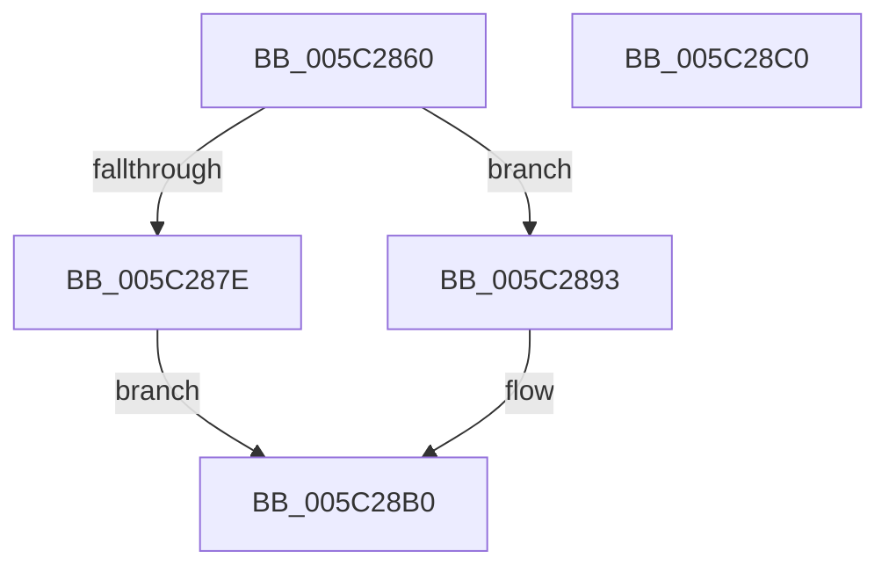

# KiSrcuNotifyWorkerAcquire

- RVA: `0x005C2860`–`0x005C28C1` (길이 `97` bytes)
- VA: `0x00000001405C2860`
- 실행 섹션: `.text`
- PDB 이름 있음: `예`; PDB Function 태그: `아니요`
- unwind 정보 RVA: `0x00060BC4`
- 디코드: `31`개 명령, `97/97` bytes 표시
- 미해석 바이트: `0` (있으면 어셈블리에 `.byte`로 보존)

> 이 문서는 커널 이미지의 기계어와 PDB 기호를 분석해 생성했습니다. 4번과 5번은 함수 원형과 자료형을 바이너리 사용 방식에서 추정한 C 해석이며 원본 소스 복구 결과는 아닙니다.

## 1. Dependencies

- 직접 호출 지점: **1**; 고유 호출 대상: **1**
- 직접 호출자로 확인된 함수: **2**
- RIP 상대 이미지 참조: **0**

### Outgoing calls
- `0x005C28A6` → [KeRemoveQueueDpcEx](../46/KeRemoveQueueDpcEx_function_0046CDC0.md) (function, `0x0046CDC0`)

### Direct callers
- [KeSrcuFree](KeSrcuFree_function_005C1F60.md) at `0x005C2002`
- [KiSrcuNotifyGracePeriodStarted](KiSrcuNotifyGracePeriodStarted_function_005C265C.md) at `0x005C26E1`
- [KiSrcuNotifyGracePeriodStarted](KiSrcuNotifyGracePeriodStarted_function_005C265C.md) at `0x005C2727`

### Static image references
- 디코드된 RIP-relative 메모리 참조가 없습니다.

## 2. Other-region calls and transfers

- 다른 실행 섹션으로 향하는 call: **0**
- 별도 외부 분기/꼬리 이동을 확인하지 못했습니다.

## 3. Assembly (complete function range)

```asm
005C2860  48 89 5C 24 08                  mov qword ptr [rsp + 8], rbx
005C2865  48 89 74 24 10                  mov qword ptr [rsp + 0x10], rsi
005C286A  57                              push rdi
005C286B  48 83 EC 20                     sub rsp, 0x20
005C286F  BE 01 00 00 00                  mov esi, 1
005C2874  41 8B F8                        mov edi, r8d
005C2877  48 8B D9                        mov rbx, rcx
005C287A  3B D6                           cmp edx, esi
005C287C  75 15                           jne 0x1405c2893
005C287E  F0 09 79 44                     lock or dword ptr [rcx + 0x44], edi
005C2882  33 C0                           xor eax, eax
005C2884  F0 0F B1 71 48                  lock cmpxchg dword ptr [rcx + 0x48], esi
005C2889  8D 4E FF                        lea ecx, [rsi - 1]
005C288C  0F 94 C1                        sete cl
005C288F  8B C1                           mov eax, ecx
005C2891  EB 1D                           jmp 0x1405c28b0
005C2893  B9 02 00 00 00                  mov ecx, 2
005C2898  40 8A D6                        mov dl, sil
005C289B  87 4B 48                        xchg dword ptr [rbx + 0x48], ecx
005C289E  33 C9                           xor ecx, ecx
005C28A0  87 4B 44                        xchg dword ptr [rbx + 0x44], ecx
005C28A3  48 8B CB                        mov rcx, rbx
005C28A6  E8 15 A5 EA FF                  call 0x14046cdc0
005C28AB  87 7B 44                        xchg dword ptr [rbx + 0x44], edi
005C28AE  8B C6                           mov eax, esi
005C28B0  48 8B 5C 24 30                  mov rbx, qword ptr [rsp + 0x30]
005C28B5  48 8B 74 24 38                  mov rsi, qword ptr [rsp + 0x38]
005C28BA  48 83 C4 20                     add rsp, 0x20
005C28BE  5F                              pop rdi
005C28BF  C3                              ret
005C28C0  CC                              int3
```

## 4. C-style interpretation (structured pseudocode)

```c
__int64 __fastcall KiSrcuNotifyWorkerAcquire(__int64 a1, int a2, int a3)
{
    __int64 result;
    __int64 v_rsp;
    unsigned __int64 v_stack_p10;
    unsigned __int64 v_stack_p8;

    v_stack_p8 = v_rbx;
    v_stack_p10 = v_rsi;
    v_rsp = (v_rsp) - (32);
    if (a2 != 1) goto loc_005C2893;
    result = 0;
    a1 = (condition_is_equal) ? 1 : 0;
    goto loc_005C28B0;
loc_005C2893:
    a1 = 0;
    result = KeRemoveQueueDpcEx(0, 1, a3, a4);
loc_005C28B0:
    v_rsp = (v_rsp) + (32);
    return 1;
}
```

## 5. (Beta) C Style

```c
int64_t KiSrcuNotifyWorkerAcquire(void *Arg1, int32_t Arg2, int32_t Arg3)
{
    uint8_t *arg1 = (uint8_t *)Arg1;

    int64_t result;
    int64_t local_rsp;
    uint64_t v_stack_p10;
    uint64_t v_stack_p8;

    v_stack_p8 = local_rbx;
    v_stack_p10 = local_rsi;
    local_rsp = (local_rsp) - (32);
    if (Arg2 != 1) goto loc_005C2893;
    result = 0;
    Arg1 = (condition_is_equal) ? 1 : 0;
    goto loc_005C28B0;
loc_005C2893:
    Arg1 = 0;
    result = KeRemoveQueueDpcEx(0, 1, Arg3, a4);
loc_005C28B0:
    local_rsp = (local_rsp) + (32);
    return 1;
}
```

### 관측된 메모리 오프셋

구조체 형식이 확인되지 않은 접근은 인자 기준의 오프셋으로만 기록했습니다.

| 기준 인자 | 오프셋 표현 | 폭 (bit) | 접근 |
|---|---:|---:|---|
| `Arg1` | `+ 0x44` | `32` | `R/W` |
| `Arg1` | `+ 0x48` | `32` | `R` |
| `Arg1` | `+ 0x48` | `32` | `R/W` |

## 6. Execution-region graph

[열기: 2D/3D 그래프와 함수 탐색 컨트롤 패널](../../../control-panel.html?section=text&rva=0x005C2860&view=graph)

- 2D 그래프는 위에서 아래로 흐르고, 3D 그래프는 빈 공간을 드래그해 회전합니다. Shift+드래그는 이동, 휠은 확대·축소, 함수 노드 선택은 대상 보고서 이동입니다.

### Static fallback


