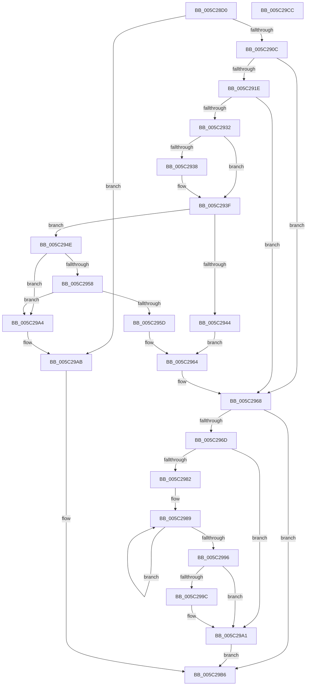

# KiSrcuNotifyWorkerDpcRoutine

- RVA: `0x005C28D0`–`0x005C29CD` (길이 `253` bytes)
- VA: `0x00000001405C28D0`
- 실행 섹션: `.text`
- PDB 이름 있음: `예`; PDB Function 태그: `아니요`
- unwind 정보 RVA: `0x0005CAAC`
- 디코드: `72`개 명령, `253/253` bytes 표시
- 미해석 바이트: `0` (있으면 어셈블리에 `.byte`로 보존)

> 이 문서는 커널 이미지의 기계어와 PDB 기호를 분석해 생성했습니다. 4번과 5번은 함수 원형과 자료형을 바이너리 사용 방식에서 추정한 C 해석이며 원본 소스 복구 결과는 아닙니다.

## 1. Dependencies

- 직접 호출 지점: **4**; 고유 호출 대상: **4**
- 직접 호출자로 확인된 함수: **0**
- RIP 상대 이미지 참조: **0**

### Outgoing calls
- `0x005C290C` → [KeDisableInterrupts](../21/KeDisableInterrupts_function_00217BE0.md) (function, `0x00217BE0`)
- `0x005C299C` → [KiRemoveSystemWorkPriorityKick](../26/KiRemoveSystemWorkPriorityKick_function_002631D0.md) (function, `0x002631D0`)
- `0x005C29B1` → [KiSrcuNotifyGracePeriodStartedOnCpu](KiSrcuNotifyGracePeriodStartedOnCpu_function_005C2788.md) (function, `0x005C2788`)
- `0x005C29BC` → [KiSrcuNotifyWorkerSelectAndQueue](KiSrcuNotifyWorkerSelectAndQueue_function_005C29D4.md) (function, `0x005C29D4`)

### Direct callers
- 이 함수 시작 RVA로 연결되는 직접 call은 확인되지 않았습니다. 간접 호출은 완전히 역산할 수 없습니다.

### Static image references
- 디코드된 RIP-relative 메모리 참조가 없습니다.

## 2. Other-region calls and transfers

- 다른 실행 섹션으로 향하는 call: **0**
- 별도 외부 분기/꼬리 이동을 확인하지 못했습니다.

## 3. Assembly (complete function range)

```asm
005C28D0  48 89 5C 24 08                  mov qword ptr [rsp + 8], rbx
005C28D5  57                              push rdi
005C28D6  48 83 EC 20                     sub rsp, 0x20
005C28DA  65 4C 8B 14 25 20 00 00 00      mov r10, qword ptr gs:[0x20]
005C28E3  49 8B D8                        mov rbx, r8
005C28E6  B8 01 00 00 00                  mov eax, 1
005C28EB  49 8B F9                        mov rdi, r9
005C28EE  4C 8B DA                        mov r11, rdx
005C28F1  45 8B 42 24                     mov r8d, dword ptr [r10 + 0x24]
005C28F5  41 8B C8                        mov ecx, r8d
005C28F8  2B 4B 40                        sub ecx, dword ptr [rbx + 0x40]
005C28FB  D3 E0                           shl eax, cl
005C28FD  F7 D0                           not eax
005C28FF  F0 21 43 44                     lock and dword ptr [rbx + 0x44], eax
005C2903  4D 85 C9                        test r9, r9
005C2906  0F 84 9F 00 00 00               je 0x1405c29ab
005C290C  E8 CF 52 C5 FF                  call 0x140217be0
005C2911  49 83 BA F8 38 00 00 00         cmp qword ptr [r10 + 0x38f8], 0
005C2919  44 8A C8                        mov r9b, al
005C291C  74 4A                           je 0x1405c2968
005C291E  49 C1 E0 06                     shl r8, 6
005C2922  4D 03 43 20                     add r8, qword ptr [r11 + 0x20]
005C2926  49 8D 48 08                     lea rcx, [r8 + 8]
005C292A  48 8B 11                        mov rdx, qword ptr [rcx]
005C292D  48 85 D2                        test rdx, rdx
005C2930  74 36                           je 0x1405c2968
005C2932  49 83 38 00                     cmp qword ptr [r8], 0
005C2936  74 07                           je 0x1405c293f
005C2938  B9 0E 00 00 00                  mov ecx, 0xe
005C293D  CD 29                           int 0x29
005C293F  48 3B D1                        cmp rdx, rcx
005C2942  75 0A                           jne 0x1405c294e
005C2944  49 83 A2 F8 38 00 00 00         and qword ptr [r10 + 0x38f8], 0
005C294C  EB 16                           jmp 0x1405c2964
005C294E  48 8B 41 08                     mov rax, qword ptr [rcx + 8]
005C2952  48 39 4A 08                     cmp qword ptr [rdx + 8], rcx
005C2956  75 4C                           jne 0x1405c29a4
005C2958  48 39 08                        cmp qword ptr [rax], rcx
005C295B  75 47                           jne 0x1405c29a4
005C295D  48 89 10                        mov qword ptr [rax], rdx
005C2960  48 89 42 08                     mov qword ptr [rdx + 8], rax
005C2964  48 83 21 00                     and qword ptr [rcx], 0
005C2968  45 84 C9                        test r9b, r9b
005C296B  74 49                           je 0x1405c29b6
005C296D  65 48 8B 0C 25 20 00 00 00      mov rcx, qword ptr gs:[0x20]
005C2976  4C 8B 81 B8 8E 00 00            mov r8, qword ptr [rcx + 0x8eb8]
005C297D  4D 85 C0                        test r8, r8
005C2980  74 1F                           je 0x1405c29a1
005C2982  41 0F 0D 08                     prefetchw byte ptr [r8]
005C2986  41 8B 00                        mov eax, dword ptr [r8]
005C2989  8B D0                           mov edx, eax
005C298B  0F BA F2 15                     btr edx, 0x15
005C298F  F0 41 0F B1 10                  lock cmpxchg dword ptr [r8], edx
005C2994  75 F3                           jne 0x1405c2989
005C2996  0F BA E0 15                     bt eax, 0x15
005C299A  73 05                           jae 0x1405c29a1
005C299C  E8 2F 08 CA FF                  call 0x1402631d0
005C29A1  FB                              sti
005C29A2  EB 12                           jmp 0x1405c29b6
005C29A4  B9 03 00 00 00                  mov ecx, 3
005C29A9  CD 29                           int 0x29
005C29AB  49 8B D2                        mov rdx, r10
005C29AE  49 8B CB                        mov rcx, r11
005C29B1  E8 D2 FD FF FF                  call 0x1405c2788
005C29B6  48 8B D7                        mov rdx, rdi
005C29B9  48 8B CB                        mov rcx, rbx
005C29BC  E8 13 00 00 00                  call 0x1405c29d4
005C29C1  48 8B 5C 24 30                  mov rbx, qword ptr [rsp + 0x30]
005C29C6  48 83 C4 20                     add rsp, 0x20
005C29CA  5F                              pop rdi
005C29CB  C3                              ret
005C29CC  CC                              int3
```

## 4. C-style interpretation (structured pseudocode)

```c
__int64 __fastcall KiSrcuNotifyWorkerDpcRoutine(__int64 a1, __int64 a2, __int64 a3, __int64 a4)
{
    __int64 result;
    __int64 v_rsp;
    unsigned __int64 v_stack_p8;

    v_stack_p8 = v_rbx;
    v_rsp = (v_rsp) - (32);
    a1 = (unsigned int)(((unsigned int)((unsigned int)((unsigned int)(*(unsigned int *)(*(unsigned __int64 *)(gs_base + (0 + 32)) + 36))))) - (*(unsigned int *)(a3 + 64)));
    result = (unsigned int)((1) << ((unsigned __int8)(a1)));
    result = (unsigned int)(~(result));
    if (a4 == 0) goto loc_005C29AB;
    result = KeDisableInterrupts(a1, a2, (unsigned int)(*(unsigned int *)(*(unsigned __int64 *)(gs_base + (0 + 32)) + 36)), a4);
    if ((*(unsigned __int64 *)(*(unsigned __int64 *)(gs_base + (0 + 32)) + 14584)) == 0) goto loc_005C2968;
    a3 = ((unsigned int)(*(unsigned int *)(*(unsigned __int64 *)(gs_base + (0 + 32)) + 36))) << (6);
    a3 = (a3) + (*(unsigned __int64 *)(a2 + 32));
    if (*(unsigned __int64 *)(a3 + 8) == 0) goto loc_005C2968;
    if ((*(unsigned __int64 *)(a3)) != 0) {
        a1 = 14;
    }
    if ((*(unsigned __int64 *)(a3 + 8)) != a1) goto loc_005C294E;
    goto loc_005C2964;
loc_005C294E:
    if ((*(unsigned __int64 *)(*(unsigned __int64 *)(a3 + 8) + 8)) != a1) goto loc_005C29A4;
    if ((*(unsigned __int64 *)(*(unsigned __int64 *)(a1 + 8))) != a1) goto loc_005C29A4;
    *(unsigned __int64 *)(*(unsigned __int64 *)(a1 + 8)) = *(unsigned __int64 *)(a3 + 8);
    *(unsigned __int64 *)(*(unsigned __int64 *)(a3 + 8) + 8) = *(unsigned __int64 *)(a1 + 8);
loc_005C2964:
loc_005C2968:
    if ((unsigned __int8)((unsigned __int8)(result)) == 0) goto loc_005C29B6;
    if (*(unsigned __int64 *)(*(unsigned __int64 *)(gs_base + (0 + 32)) + 36536) == 0) goto loc_005C29A1;
loc_005C2989:
    if (*(unsigned __int64 *)(*(unsigned __int64 *)(gs_base + (0 + 32)) + 36536) != 0) goto loc_005C2989;
    result = (unsigned int)(*(unsigned int *)(*(unsigned __int64 *)(*(unsigned __int64 *)(gs_base + (0 + 32)) + 36536)));
    if (!(condition_is_above_or_equal)) {
        result = KiRemoveSystemWorkPriorityKick(*(unsigned __int64 *)(gs_base + (0 + 32)), (unsigned int)((unsigned int)((unsigned int)(*(unsigned int *)(*(unsigned __int64 *)(*(unsigned __int64 *)(gs_base + (0 + 32)) + 36536))))), *(unsigned __int64 *)(*(unsigned __int64 *)(gs_base + (0 + 32)) + 36536), (unsigned __int8)(result));
    }
    goto loc_005C29B6;
loc_005C29A4:
loc_005C29AB:
    result = KiSrcuNotifyGracePeriodStartedOnCpu(a2, *(unsigned __int64 *)(gs_base + (0 + 32)), *(unsigned __int64 *)(*(unsigned __int64 *)(gs_base + (0 + 32)) + 36536), (unsigned __int8)(result));
loc_005C29B6:
    result = KiSrcuNotifyWorkerSelectAndQueue(a3, a4, *(unsigned __int64 *)(*(unsigned __int64 *)(gs_base + (0 + 32)) + 36536), (unsigned __int8)(result));
    v_rsp = (v_rsp) + (32);
    return result;
}
```

## 5. (Beta) C Style

```c
int64_t KiSrcuNotifyWorkerDpcRoutine(int64_t Arg1, int64_t Arg2, void *Arg3, int64_t Arg4)
{
    uint8_t *arg3 = (uint8_t *)Arg3;

    int64_t result;
    int64_t local_rsp;
    uint64_t v_stack_p8;

    v_stack_p8 = local_rbx;
    local_rsp = (local_rsp) - (32);
    Arg1 = (uint32_t)(((uint32_t)((uint32_t)((uint32_t)(*(uint32_t *)(*(uint64_t *)(gs_base + (0 + 0x20)) + 0x24))))) - (*(uint32_t *)(arg3 + 0x40)));
    result = (uint32_t)((1) << ((uint8_t)(Arg1)));
    result = (uint32_t)(~(result));
    if (Arg4 == 0) goto loc_005C29AB;
    result = KeDisableInterrupts(Arg1, Arg2, (uint32_t)(*(uint32_t *)(*(uint64_t *)(gs_base + (0 + 0x20)) + 0x24)), Arg4);
    if ((*(uint64_t *)(*(uint64_t *)(gs_base + (0 + 0x20)) + 0x38F8)) == 0) goto loc_005C2968;
    Arg3 = ((uint32_t)(*(uint32_t *)(*(uint64_t *)(gs_base + (0 + 0x20)) + 0x24))) << (6);
    Arg3 = (Arg3) + (*(uint64_t *)(Arg2 + 0x20));
    if (*(uint64_t *)(arg3 + 0x8) == 0) goto loc_005C2968;
    if ((*(uint64_t *)(arg3)) != 0) {
        Arg1 = 14;
    }
    if ((*(uint64_t *)(arg3 + 0x8)) != Arg1) goto loc_005C294E;
    goto loc_005C2964;
loc_005C294E:
    if ((*(uint64_t *)(*(uint64_t *)(arg3 + 0x8) + 0x8)) != Arg1) goto loc_005C29A4;
    if ((*(uint64_t *)(*(uint64_t *)(Arg1 + 0x8))) != Arg1) goto loc_005C29A4;
    *(uint64_t *)(*(uint64_t *)(Arg1 + 0x8)) = *(uint64_t *)(arg3 + 0x8);
    *(uint64_t *)(*(uint64_t *)(arg3 + 0x8) + 0x8) = *(uint64_t *)(Arg1 + 0x8);
loc_005C2964:
loc_005C2968:
    if ((uint8_t)((uint8_t)(result)) == 0) goto loc_005C29B6;
    if (*(uint64_t *)(*(uint64_t *)(gs_base + (0 + 0x20)) + 0x8EB8) == 0) goto loc_005C29A1;
loc_005C2989:
    if (*(uint64_t *)(*(uint64_t *)(gs_base + (0 + 0x20)) + 0x8EB8) != 0) goto loc_005C2989;
    result = (uint32_t)(*(uint32_t *)(*(uint64_t *)(*(uint64_t *)(gs_base + (0 + 0x20)) + 0x8EB8)));
    if (!(condition_is_above_or_equal)) {
        result = KiRemoveSystemWorkPriorityKick(*(uint64_t *)(gs_base + (0 + 0x20)), (uint32_t)((uint32_t)((uint32_t)(*(uint32_t *)(*(uint64_t *)(*(uint64_t *)(gs_base + (0 + 0x20)) + 0x8EB8))))), *(uint64_t *)(*(uint64_t *)(gs_base + (0 + 0x20)) + 0x8EB8), (uint8_t)(result));
    }
    goto loc_005C29B6;
loc_005C29A4:
loc_005C29AB:
    result = KiSrcuNotifyGracePeriodStartedOnCpu(Arg2, *(uint64_t *)(gs_base + (0 + 0x20)), *(uint64_t *)(*(uint64_t *)(gs_base + (0 + 0x20)) + 0x8EB8), (uint8_t)(result));
loc_005C29B6:
    result = KiSrcuNotifyWorkerSelectAndQueue(Arg3, Arg4, *(uint64_t *)(*(uint64_t *)(gs_base + (0 + 0x20)) + 0x8EB8), (uint8_t)(result));
    local_rsp = (local_rsp) + (32);
    return result;
}
```

### 관측된 메모리 오프셋

구조체 형식이 확인되지 않은 접근은 인자 기준의 오프셋으로만 기록했습니다.

| 기준 인자 | 오프셋 표현 | 폭 (bit) | 접근 |
|---|---:|---:|---|
| `Arg3` | `+ 0x40` | `32` | `R` |
| `Arg3` | `+ 0x44` | `32` | `R/W` |

## 6. Execution-region graph

[열기: 2D/3D 그래프와 함수 탐색 컨트롤 패널](../../../control-panel.html?section=text&rva=0x005C28D0&view=graph)

- 2D 그래프는 위에서 아래로 흐르고, 3D 그래프는 빈 공간을 드래그해 회전합니다. Shift+드래그는 이동, 휠은 확대·축소, 함수 노드 선택은 대상 보고서 이동입니다.

### Static fallback


