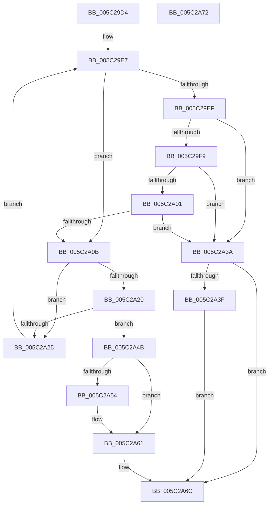

# KiSrcuNotifyWorkerSelectAndQueue

- RVA: `0x005C29D4`–`0x005C2A73` (길이 `159` bytes)
- VA: `0x00000001405C29D4`
- 실행 섹션: `.text`
- PDB 이름 있음: `예`; PDB Function 태그: `아니요`
- unwind 정보 RVA: `0x0005CF00`
- 디코드: `51`개 명령, `159/159` bytes 표시
- 미해석 바이트: `0` (있으면 어셈블리에 `.byte`로 보존)

> 이 문서는 커널 이미지의 기계어와 PDB 기호를 분석해 생성했습니다. 4번과 5번은 함수 원형과 자료형을 바이너리 사용 방식에서 추정한 C 해석이며 원본 소스 복구 결과는 아닙니다.

## 1. Dependencies

- 직접 호출 지점: **2**; 고유 호출 대상: **2**
- 직접 호출자로 확인된 함수: **3**
- RIP 상대 이미지 참조: **2**

### Outgoing calls
- `0x005C2A44` → [KeSignalGate](../2C/KeSignalGate_function_002C748C.md) (function, `0x002C748C`)
- `0x005C2A67` → [KeInsertQueueDpc](../20/KeInsertQueueDpc_function_00207C50.md) (function, `0x00207C50`)

### Direct callers
- [KeSrcuFree](KeSrcuFree_function_005C1F60.md) at `0x005C202C`
- [KiSrcuNotifyGracePeriodStarted](KiSrcuNotifyGracePeriodStarted_function_005C265C.md) at `0x005C26EF`
- [KiSrcuNotifyGracePeriodStarted](KiSrcuNotifyGracePeriodStarted_function_005C265C.md) at `0x005C2735`
- [KiSrcuNotifyWorkerDpcRoutine](KiSrcuNotifyWorkerDpcRoutine_function_005C28D0.md) at `0x005C29BC`

### Static image references
- `0x005C2A18` → RVA `0x00FC6AE8` (`ALMOSTRO`; read)
- `0x005C2A20` → RVA `0x00FC8C40` (`ALMOSTRO`; read)

## 2. Other-region calls and transfers

- 다른 실행 섹션으로 향하는 call: **0**
- 별도 외부 분기/꼬리 이동을 확인하지 못했습니다.

## 3. Assembly (complete function range)

```asm
005C29D4  40 53                           push rbx
005C29D6  48 83 EC 20                     sub rsp, 0x20
005C29DA  45 33 DB                        xor r11d, r11d
005C29DD  4C 8B C2                        mov r8, rdx
005C29E0  4C 8B C9                        mov r9, rcx
005C29E3  41 8D 5B 01                     lea ebx, [r11 + 1]
005C29E7  41 8B 49 44                     mov ecx, dword ptr [r9 + 0x44]
005C29EB  85 C9                           test ecx, ecx
005C29ED  75 1C                           jne 0x1405c2a0b
005C29EF  8B C3                           mov eax, ebx
005C29F1  F0 45 0F B1 59 48               lock cmpxchg dword ptr [r9 + 0x48], r11d
005C29F7  75 41                           jne 0x1405c2a3a
005C29F9  41 8B 49 44                     mov ecx, dword ptr [r9 + 0x44]
005C29FD  85 C9                           test ecx, ecx
005C29FF  74 39                           je 0x1405c2a3a
005C2A01  33 C0                           xor eax, eax
005C2A03  F0 41 0F B1 59 48               lock cmpxchg dword ptr [r9 + 0x48], ebx
005C2A09  75 2F                           jne 0x1405c2a3a
005C2A0B  41 8B 51 40                     mov edx, dword ptr [r9 + 0x40]
005C2A0F  0F BC C9                        bsf ecx, ecx
005C2A12  03 D1                           add edx, ecx
005C2A14  89 4C 24 38                     mov dword ptr [rsp + 0x38], ecx
005C2A18  3B 15 CA 40 A0 00               cmp edx, dword ptr [rip + 0xa040ca]
005C2A1E  73 0D                           jae 0x1405c2a2d
005C2A20  4C 8D 15 19 62 A0 00            lea r10, [rip + 0xa06219]
005C2A27  4D 39 1C D2                     cmp qword ptr [r10 + rdx*8], r11
005C2A2B  75 1E                           jne 0x1405c2a4b
005C2A2D  8B C3                           mov eax, ebx
005C2A2F  D3 E0                           shl eax, cl
005C2A31  F7 D0                           not eax
005C2A33  F0 41 21 41 44                  lock and dword ptr [r9 + 0x44], eax
005C2A38  EB AD                           jmp 0x1405c29e7
005C2A3A  4D 85 C0                        test r8, r8
005C2A3D  74 2D                           je 0x1405c2a6c
005C2A3F  33 D2                           xor edx, edx
005C2A41  49 8B C8                        mov rcx, r8
005C2A44  E8 43 4A D0 FF                  call 0x1402c748c
005C2A49  EB 21                           jmp 0x1405c2a6c
005C2A4B  49 8B 41 38                     mov rax, qword ptr [r9 + 0x38]
005C2A4F  48 85 C0                        test rax, rax
005C2A52  75 0D                           jne 0x1405c2a61
005C2A54  B8 00 08 00 00                  mov eax, 0x800
005C2A59  66 03 D0                        add dx, ax
005C2A5C  66 41 89 51 02                  mov word ptr [r9 + 2], dx
005C2A61  49 8B D1                        mov rdx, r9
005C2A64  49 8B C9                        mov rcx, r9
005C2A67  E8 E4 51 C4 FF                  call 0x140207c50
005C2A6C  48 83 C4 20                     add rsp, 0x20
005C2A70  5B                              pop rbx
005C2A71  C3                              ret
005C2A72  CC                              int3
```

## 4. C-style interpretation (structured pseudocode)

```c
__int64 __fastcall KiSrcuNotifyWorkerSelectAndQueue(__int64 a1, __int64 a2)
{
    __int64 result;
    __int64 v_r11;
    __int64 v_rsp;
    unsigned int v_stack_p10;

    v_rsp = (v_rsp) - (32);
    v_r11 = 0;
loc_005C29E7:
    if ((unsigned int)((unsigned int)(*(unsigned int *)(a1 + 68))) != 0) goto loc_005C2A0B;
    if ((unsigned int)((unsigned int)(*(unsigned int *)(a1 + 68))) != 0) goto loc_005C2A3A;
    if ((unsigned int)((unsigned int)(*(unsigned int *)(a1 + 68))) == 0) goto loc_005C2A3A;
    result = 0;
    if (condition_is_not_equal) goto loc_005C2A3A;
loc_005C2A0B:
    a2 = (unsigned int)(((unsigned int)(*(unsigned int *)(a1 + 64))) + ((unsigned int)((unsigned int)(*(unsigned int *)(a1 + 68)))));
    v_stack_p10 = (unsigned int)((unsigned int)(*(unsigned int *)(a1 + 68)));
    if (((unsigned int)(a2)) >= (*(unsigned int *)(v_rip + 10502346))) goto loc_005C2A2D;
    if ((*(unsigned __int64 *)(v_rip + 10510873 + a2 * 8)) != 0) goto loc_005C2A4B;
loc_005C2A2D:
    result = (unsigned int)(((unsigned int)((unsigned int)(v_r11 + 1))) << ((unsigned __int8)((unsigned int)(*(unsigned int *)(a1 + 68)))));
    result = (unsigned int)(~(result));
    goto loc_005C29E7;
loc_005C2A3A:
    if (a2 == 0) goto loc_005C2A6C;
    a2 = 0;
    result = KeSignalGate(0, a2, a2, a1);
    goto loc_005C2A6C;
loc_005C2A4B:
    result = *(unsigned __int64 *)(a1 + 56);
    if (*(unsigned __int64 *)(a1 + 56) == 0) {
        result = 0x800ULL;
        a2 = (unsigned __int16)((a2) + ((unsigned __int16)(result)));
        *(unsigned __int16 *)(a1 + 2) = (unsigned __int16)(a2);
    }
    result = KeInsertQueueDpc(a1, a1, a2, a1);
loc_005C2A6C:
    v_rsp = (v_rsp) + (32);
    return result;
}
```

## 5. (Beta) C Style

```c
int64_t KiSrcuNotifyWorkerSelectAndQueue(void *Arg1, int64_t Arg2)
{
    uint8_t *arg1 = (uint8_t *)Arg1;

    int64_t result;
    int64_t local_r11;
    int64_t local_rsp;
    uint32_t v_stack_p10;

    local_rsp = (local_rsp) - (32);
    local_r11 = 0;
loc_005C29E7:
    if ((uint32_t)((uint32_t)(*(uint32_t *)(arg1 + 0x44))) != 0) goto loc_005C2A0B;
    if ((uint32_t)((uint32_t)(*(uint32_t *)(arg1 + 0x44))) != 0) goto loc_005C2A3A;
    if ((uint32_t)((uint32_t)(*(uint32_t *)(arg1 + 0x44))) == 0) goto loc_005C2A3A;
    result = 0;
    if (condition_is_not_equal) goto loc_005C2A3A;
loc_005C2A0B:
    Arg2 = (uint32_t)(((uint32_t)(*(uint32_t *)(arg1 + 0x40))) + ((uint32_t)((uint32_t)(*(uint32_t *)(arg1 + 0x44)))));
    v_stack_p10 = (uint32_t)((uint32_t)(*(uint32_t *)(arg1 + 0x44)));
    if (((uint32_t)(Arg2)) >= (*(uint32_t *)(v_rip + 0xA040CA))) goto loc_005C2A2D;
    if ((*(uint64_t *)(v_rip + 0xA06219 + Arg2 * 8)) != 0) goto loc_005C2A4B;
loc_005C2A2D:
    result = (uint32_t)(((uint32_t)((uint32_t)(local_r11 + 1))) << ((uint8_t)((uint32_t)(*(uint32_t *)(arg1 + 0x44)))));
    result = (uint32_t)(~(result));
    goto loc_005C29E7;
loc_005C2A3A:
    if (Arg2 == 0) goto loc_005C2A6C;
    Arg2 = 0;
    result = KeSignalGate(0, Arg2, Arg2, Arg1);
    goto loc_005C2A6C;
loc_005C2A4B:
    result = *(uint64_t *)(arg1 + 0x38);
    if (*(uint64_t *)(arg1 + 0x38) == 0) {
        result = 0x800ULL;
        Arg2 = (uint16_t)((Arg2) + ((uint16_t)(result)));
        *(uint16_t *)(arg1 + 0x2) = (uint16_t)(Arg2);
    }
    result = KeInsertQueueDpc(Arg1, Arg1, Arg2, Arg1);
loc_005C2A6C:
    local_rsp = (local_rsp) + (32);
    return result;
}
```

### 관측된 메모리 오프셋

구조체 형식이 확인되지 않은 접근은 인자 기준의 오프셋으로만 기록했습니다.

| 기준 인자 | 오프셋 표현 | 폭 (bit) | 접근 |
|---|---:|---:|---|
| `Arg1` | `+ 0x2` | `16` | `W` |
| `Arg1` | `+ 0x38` | `64` | `R` |
| `Arg1` | `+ 0x40` | `32` | `R` |
| `Arg1` | `+ 0x44` | `32` | `R` |
| `Arg1` | `+ 0x44` | `32` | `R/W` |
| `Arg1` | `+ 0x48` | `32` | `R` |

## 6. Execution-region graph

[열기: 2D/3D 그래프와 함수 탐색 컨트롤 패널](../../../control-panel.html?section=text&rva=0x005C29D4&view=graph)

- 2D 그래프는 위에서 아래로 흐르고, 3D 그래프는 빈 공간을 드래그해 회전합니다. Shift+드래그는 이동, 휠은 확대·축소, 함수 노드 선택은 대상 보고서 이동입니다.

### Static fallback


