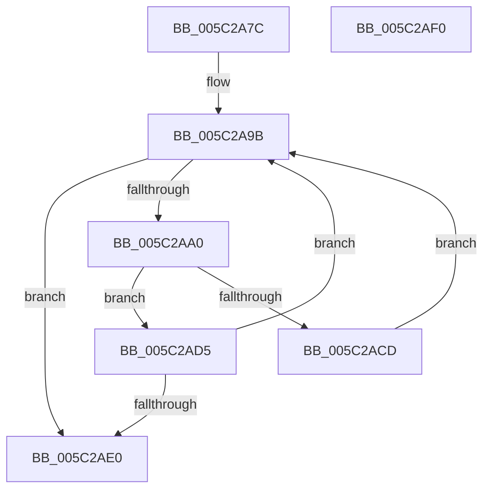

# KiSrcuProcessorAddToTopologyTree

- RVA: `0x005C2A7C`–`0x005C2AF1` (길이 `117` bytes)
- VA: `0x00000001405C2A7C`
- 실행 섹션: `.text`
- PDB 이름 있음: `예`; PDB Function 태그: `아니요`
- unwind 정보 RVA: `0x000950EC`
- 디코드: `34`개 명령, `117/117` bytes 표시
- 미해석 바이트: `0` (있으면 어셈블리에 `.byte`로 보존)

> 이 문서는 커널 이미지의 기계어와 PDB 기호를 분석해 생성했습니다. 4번과 5번은 함수 원형과 자료형을 바이너리 사용 방식에서 추정한 C 해석이며 원본 소스 복구 결과는 아닙니다.

## 1. Dependencies

- 직접 호출 지점: **0**; 고유 호출 대상: **0**
- 직접 호출자로 확인된 함수: **2**
- RIP 상대 이미지 참조: **2**

### Outgoing calls
- 직접 디코드된 call 명령이 없습니다.

### Direct callers
- [KiSrcuProcessorInitialize](../4F/KiSrcuProcessorInitialize_function_004FA6C4.md) at `0x004FA6FA`
- [KiSrcuInitializeTopology](KiSrcuInitializeTopology_function_005C2408.md) at `0x005C25ED`

### Static image references
- `0x005C2A89` → RVA `0x00F10E20` (`.data`; read)
- `0x005C2A90` → RVA `0x00F10E41` (`.data`; read)

## 2. Other-region calls and transfers

- 다른 실행 섹션으로 향하는 call: **0**
- 별도 외부 분기/꼬리 이동을 확인하지 못했습니다.

## 3. Assembly (complete function range)

```asm
005C2A7C  48 89 5C 24 08                  mov qword ptr [rsp + 8], rbx
005C2A81  48 89 7C 24 10                  mov qword ptr [rsp + 0x10], rdi
005C2A86  8B 59 24                        mov ebx, dword ptr [rcx + 0x24]
005C2A89  48 8D 3D 90 E3 94 00            lea rdi, [rip + 0x94e390]
005C2A90  44 0F B6 15 A9 E3 94 00         movzx r10d, byte ptr [rip + 0x94e3a9]
005C2A98  44 8B DA                        mov r11d, edx
005C2A9B  45 85 D2                        test r10d, r10d
005C2A9E  74 40                           je 0x1405c2ae0
005C2AA0  41 FF CA                        dec r10d
005C2AA3  33 D2                           xor edx, edx
005C2AA5  8B C3                           mov eax, ebx
005C2AA7  41 0F B6 4C 3A 22               movzx ecx, byte ptr [r10 + rdi + 0x22]
005C2AAD  F7 F1                           div ecx
005C2AAF  44 8B C8                        mov r9d, eax
005C2AB2  8B CA                           mov ecx, edx
005C2AB4  49 C1 E1 04                     shl r9, 4
005C2AB8  B8 01 00 00 00                  mov eax, 1
005C2ABD  4E 03 4C D7 30                  add r9, qword ptr [rdi + r10*8 + 0x30]
005C2AC2  48 D3 E0                        shl rax, cl
005C2AC5  49 8B 09                        mov rcx, qword ptr [r9]
005C2AC8  45 85 DB                        test r11d, r11d
005C2ACB  74 08                           je 0x1405c2ad5
005C2ACD  48 0B C8                        or rcx, rax
005C2AD0  49 89 09                        mov qword ptr [r9], rcx
005C2AD3  EB C6                           jmp 0x1405c2a9b
005C2AD5  48 F7 D0                        not rax
005C2AD8  48 23 C1                        and rax, rcx
005C2ADB  49 89 01                        mov qword ptr [r9], rax
005C2ADE  74 BB                           je 0x1405c2a9b
005C2AE0  F0 83 0C 24 00                  lock or dword ptr [rsp], 0
005C2AE5  48 8B 5C 24 08                  mov rbx, qword ptr [rsp + 8]
005C2AEA  48 8B 7C 24 10                  mov rdi, qword ptr [rsp + 0x10]
005C2AEF  C3                              ret
005C2AF0  CC                              int3
```

## 4. C-style interpretation (structured pseudocode)

```c
__int64 __fastcall KiSrcuProcessorAddToTopologyTree(__int64 a1, int a2)
{
    __int64 result;
    __int64 v_r10;
    unsigned int v_stack_p0;
    unsigned __int64 v_stack_p10;
    unsigned __int64 v_stack_p8;

    v_stack_p8 = v_rbx;
    v_stack_p10 = v_rdi;
loc_005C2A9B:
    if ((unsigned int)(*(unsigned __int8 *)(v_rip + 9757609)) == 0) goto loc_005C2AE0;
    v_r10 = (unsigned int)((*(unsigned __int8 *)(v_rip + 9757609)) - 1);
    a2 = 0;
    a4 = ((unsigned int)((unsigned int)((unsigned int)((unsigned int)((unsigned int)(*(unsigned int *)(a1 + 36))))))) << (4);
    a4 = (a4) + (*(unsigned __int64 *)(v_rip + 9757584 + v_r10 * 8 + 48));
    result = (1) << (0);
    if ((unsigned int)((unsigned int)(a2)) == 0) goto loc_005C2AD5;
    a1 = (*(unsigned __int64 *)(a4)) | (result);
    *(unsigned __int64 *)(a4) = a1;
    goto loc_005C2A9B;
loc_005C2AD5:
    result = ~(result);
    result = (result) & (a1);
    *(unsigned __int64 *)(a4) = result;
    if (condition_is_equal) goto loc_005C2A9B;
loc_005C2AE0:
    return result;
}
```

## 5. (Beta) C Style

```c
int64_t KiSrcuProcessorAddToTopologyTree(void *Arg1, int32_t Arg2)
{
    uint8_t *arg1 = (uint8_t *)Arg1;

    int64_t result;
    int64_t local_r10;
    uint32_t v_stack_p0;
    uint64_t v_stack_p10;
    uint64_t v_stack_p8;

    v_stack_p8 = local_rbx;
    v_stack_p10 = local_rdi;
loc_005C2A9B:
    if ((uint32_t)(*(uint8_t *)(v_rip + 0x94E3A9)) == 0) goto loc_005C2AE0;
    local_r10 = (uint32_t)((*(uint8_t *)(v_rip + 0x94E3A9)) - 1);
    Arg2 = 0;
    a4 = ((uint32_t)((uint32_t)((uint32_t)((uint32_t)((uint32_t)(*(uint32_t *)(arg1 + 0x24))))))) << (4);
    a4 = (a4) + (*(uint64_t *)(v_rip + 0x94E390 + local_r10 * 8 + 0x30));
    result = (1) << (0);
    if ((uint32_t)((uint32_t)(Arg2)) == 0) goto loc_005C2AD5;
    Arg1 = (*(uint64_t *)(a4)) | (result);
    *(void **)(a4) = Arg1;
    goto loc_005C2A9B;
loc_005C2AD5:
    result = ~(result);
    result = (result) & (Arg1);
    *(uint64_t *)(a4) = result;
    if (condition_is_equal) goto loc_005C2A9B;
loc_005C2AE0:
    return result;
}
```

### 관측된 메모리 오프셋

구조체 형식이 확인되지 않은 접근은 인자 기준의 오프셋으로만 기록했습니다.

| 기준 인자 | 오프셋 표현 | 폭 (bit) | 접근 |
|---|---:|---:|---|
| `Arg1` | `+ 0x24` | `32` | `R` |

## 6. Execution-region graph

[열기: 2D/3D 그래프와 함수 탐색 컨트롤 패널](../../../control-panel.html?section=text&rva=0x005C2A7C&view=graph)

- 2D 그래프는 위에서 아래로 흐르고, 3D 그래프는 빈 공간을 드래그해 회전합니다. Shift+드래그는 이동, 휠은 확대·축소, 함수 노드 선택은 대상 보고서 이동입니다.

### Static fallback


