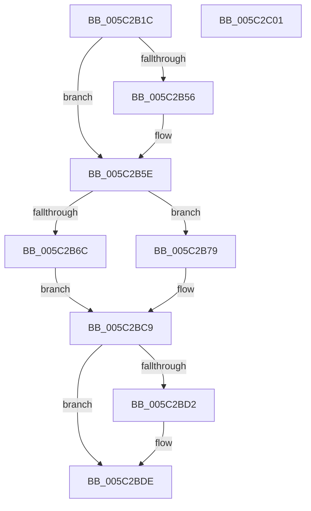

# KiSrcuReadUnlockRemote

- RVA: `0x005C2B1C`–`0x005C2C02` (길이 `230` bytes)
- VA: `0x00000001405C2B1C`
- 실행 섹션: `.text`
- PDB 이름 있음: `예`; PDB Function 태그: `아니요`
- unwind 정보 RVA: `0x0005D7BC`
- 디코드: `58`개 명령, `230/230` bytes 표시
- 미해석 바이트: `0` (있으면 어셈블리에 `.byte`로 보존)

> 이 문서는 커널 이미지의 기계어와 PDB 기호를 분석해 생성했습니다. 4번과 5번은 함수 원형과 자료형을 바이너리 사용 방식에서 추정한 C 해석이며 원본 소스 복구 결과는 아닙니다.

## 1. Dependencies

- 직접 호출 지점: **7**; 고유 호출 대상: **7**
- 직접 호출자로 확인된 함수: **1**
- RIP 상대 이미지 참조: **2**

### Outgoing calls
- `0x005C2B59` → [KiRaiseIrqlProcessIrqlFlags](../4F/KiRaiseIrqlProcessIrqlFlags_function_004F56FC.md) (function, `0x004F56FC`)
- `0x005C2B72` → [KeSrcuReadUnlock](KeSrcuReadUnlock_function_005C2140.md) (function, `0x005C2140`)
- `0x005C2B96` → [memset](../6C/memset_function_006C6C40.md) (function, `0x006C6C40`)
- `0x005C2BA0` → [KeAddProcessorAffinityEx](../25/KeAddProcessorAffinityEx_function_0025B6F0.md) (function, `0x0025B6F0`)
- `0x005C2BBF` → [KiIpiSendPacket](../47/KiIpiSendPacket_function_004711DC.md) (function, `0x004711DC`)
- `0x005C2BC4` → [KiIpiStallOnPacketTargets](../47/KiIpiStallOnPacketTargets_function_004718D8.md) (function, `0x004718D8`)
- `0x005C2BD9` → [KiLowerIrqlProcessIrqlFlags](../4F/KiLowerIrqlProcessIrqlFlags_function_004F5698.md) (function, `0x004F5698`)

### Direct callers
- [KeSrcuReadUnlock](KeSrcuReadUnlock_function_005C2140.md) at `0x005C21B5`

### Static image references
- `0x005C2B4D` → RVA `0x00FC6D20` (`ALMOSTRO`; read)
- `0x005C2BAB` → RVA `0x005C2B00` (`KiSrcuReadUnlockIpi`; read)

## 2. Other-region calls and transfers

- 다른 실행 섹션으로 향하는 call: **0**
- 별도 외부 분기/꼬리 이동을 확인하지 못했습니다.

## 3. Assembly (complete function range)

```asm
005C2B1C  48 8B C4                        mov rax, rsp
005C2B1F  48 89 58 08                     mov qword ptr [rax + 8], rbx
005C2B23  48 89 68 10                     mov qword ptr [rax + 0x10], rbp
005C2B27  48 89 70 18                     mov qword ptr [rax + 0x18], rsi
005C2B2B  48 89 78 20                     mov qword ptr [rax + 0x20], rdi
005C2B2F  41 56                           push r14
005C2B31  48 83 EC 30                     sub rsp, 0x30
005C2B35  8B 02                           mov eax, dword ptr [rdx]
005C2B37  48 8B F2                        mov rsi, rdx
005C2B3A  0F B7 E8                        movzx ebp, ax
005C2B3D  4C 8B F1                        mov r14, rcx
005C2B40  44 0F 20 C7                     mov rdi, cr8
005C2B44  BA 0C 00 00 00                  mov edx, 0xc
005C2B49  44 0F 22 C2                     mov cr8, rdx
005C2B4D  83 3D CC 41 A0 00 00            cmp dword ptr [rip + 0xa041cc], 0
005C2B54  74 08                           je 0x1405c2b5e
005C2B56  40 8A CF                        mov cl, dil
005C2B59  E8 9E 2B F3 FF                  call 0x1404f56fc
005C2B5E  65 48 8B 1C 25 20 00 00 00      mov rbx, qword ptr gs:[0x20]
005C2B67  39 6B 24                        cmp dword ptr [rbx + 0x24], ebp
005C2B6A  75 0D                           jne 0x1405c2b79
005C2B6C  48 8B D6                        mov rdx, rsi
005C2B6F  49 8B CE                        mov rcx, r14
005C2B72  E8 C9 F5 FF FF                  call 0x1405c2140
005C2B77  EB 50                           jmp 0x1405c2bc9
005C2B79  48 81 C3 B8 2D 00 00            add rbx, 0x2db8
005C2B80  33 D2                           xor edx, edx
005C2B82  41 B8 00 01 00 00               mov r8d, 0x100
005C2B88  83 63 04 00                     and dword ptr [rbx + 4], 0
005C2B8C  48 8D 4B 08                     lea rcx, [rbx + 8]
005C2B90  C7 03 01 00 20 00               mov dword ptr [rbx], 0x200001
005C2B96  E8 A5 40 10 00                  call 0x1406c6c40
005C2B9B  8B D5                           mov edx, ebp
005C2B9D  48 8B CB                        mov rcx, rbx
005C2BA0  E8 4B 8B C9 FF                  call 0x14025b6f0
005C2BA5  48 83 64 24 28 00               and qword ptr [rsp + 0x28], 0
005C2BAB  4C 8D 05 4E FF FF FF            lea r8, [rip - 0xb2]
005C2BB2  4D 8B CE                        mov r9, r14
005C2BB5  48 89 74 24 20                  mov qword ptr [rsp + 0x20], rsi
005C2BBA  48 8B D3                        mov rdx, rbx
005C2BBD  33 C9                           xor ecx, ecx
005C2BBF  E8 18 E6 EA FF                  call 0x1404711dc
005C2BC4  E8 0F ED EA FF                  call 0x1404718d8
005C2BC9  83 3D 50 41 A0 00 00            cmp dword ptr [rip + 0xa04150], 0
005C2BD0  74 0C                           je 0x1405c2bde
005C2BD2  40 8A D7                        mov dl, dil
005C2BD5  44 0F 20 C1                     mov rcx, cr8
005C2BD9  E8 BA 2A F3 FF                  call 0x1404f5698
005C2BDE  40 0F B6 C7                     movzx eax, dil
005C2BE2  44 0F 22 C0                     mov cr8, rax
005C2BE6  48 8B 5C 24 40                  mov rbx, qword ptr [rsp + 0x40]
005C2BEB  48 8B 6C 24 48                  mov rbp, qword ptr [rsp + 0x48]
005C2BF0  48 8B 74 24 50                  mov rsi, qword ptr [rsp + 0x50]
005C2BF5  48 8B 7C 24 58                  mov rdi, qword ptr [rsp + 0x58]
005C2BFA  48 83 C4 30                     add rsp, 0x30
005C2BFE  41 5E                           pop r14
005C2C00  C3                              ret
005C2C01  CC                              int3
```

## 4. C-style interpretation (structured pseudocode)

```c
__int64 __fastcall KiSrcuReadUnlockRemote(__int64 a1, __int64 a2)
{
    __int64 result;
    __int64 v_rbx;
    __int64 v_rsp;
    unsigned __int64 v_stack_m10;
    unsigned __int64 v_stack_m18;
    unsigned __int64 v_stack_p10;
    unsigned __int64 v_stack_p18;
    unsigned __int64 v_stack_p20;
    unsigned __int64 v_stack_p8;

    *(unsigned __int64 *)(v_rsp + 8) = v_rbx;
    *(unsigned __int64 *)(v_rsp + 16) = v_rbp;
    *(unsigned __int64 *)(v_rsp + 24) = v_rsi;
    *(unsigned __int64 *)(v_rsp + 32) = v_rdi;
    v_rsp = (v_rsp) - (48);
    result = (unsigned int)(*(unsigned int *)(a2));
    if ((*(unsigned int *)(v_rip + 10502604)) != 0) {
        a1 = (unsigned __int8)(v_cr8);
        result = KiRaiseIrqlProcessIrqlFlags(a1, 12, a3, a4);
    }
    if ((*(unsigned int *)(*(unsigned __int64 *)(gs_base + (0 + 32)) + 36)) != ((unsigned int)((unsigned __int16)((unsigned int)(*(unsigned int *)(a2)))))) goto loc_005C2B79;
    result = KeSrcuReadUnlock(a1, a2, a3, a4);
    goto loc_005C2BC9;
loc_005C2B79:
    v_rbx = (*(unsigned __int64 *)(gs_base + (0 + 32))) + (0x2DB8ULL);
    a2 = 0;
    *(unsigned int *)(v_rbx) = 0x200001ULL;
    result = memset(v_rbx + 8, a2, 256, a4);
    result = KeAddProcessorAffinityEx(v_rbx, (unsigned int)((unsigned int)((unsigned __int16)((unsigned int)(*(unsigned int *)(a2))))), 256, a4);
    v_stack_m18 = 0;
    a1 = 0;
    result = KiIpiSendPacket(a1, v_rbx, v_rip - 178, a1);
    result = KiIpiStallOnPacketTargets(a1, v_rbx, v_rip - 178, a1);
loc_005C2BC9:
    if ((*(unsigned int *)(v_rip + 10502480)) != 0) {
        a2 = (unsigned __int8)(v_cr8);
        a1 = 12;
        result = KiLowerIrqlProcessIrqlFlags(a1, a2, v_rip - 178, a1);
    }
    v_rsp = (v_rsp) + (48);
    return (unsigned __int8)(v_cr8);
}
```

## 5. (Beta) C Style

```c
int64_t KiSrcuReadUnlockRemote(int64_t Arg1, void *Arg2)
{
    uint8_t *arg2 = (uint8_t *)Arg2;

    int64_t result;
    int64_t local_rbx;
    int64_t local_rsp;
    uint64_t v_stack_m10;
    uint64_t v_stack_m18;
    uint64_t v_stack_p10;
    uint64_t v_stack_p18;
    uint64_t v_stack_p20;
    uint64_t v_stack_p8;

    *(uint64_t *)(local_rsp + 0x8) = local_rbx;
    *(uint64_t *)(local_rsp + 0x10) = local_rbp;
    *(uint64_t *)(local_rsp + 0x18) = local_rsi;
    *(uint64_t *)(local_rsp + 0x20) = local_rdi;
    local_rsp = (local_rsp) - (48);
    result = (uint32_t)(*(uint32_t *)(arg2));
    if ((*(uint32_t *)(v_rip + 0xA041CC)) != 0) {
        Arg1 = (uint8_t)(v_cr8);
        result = KiRaiseIrqlProcessIrqlFlags(Arg1, 12, a3, a4);
    }
    if ((*(uint32_t *)(*(uint64_t *)(gs_base + (0 + 0x20)) + 0x24)) != ((uint32_t)((uint16_t)((uint32_t)(*(uint32_t *)(arg2)))))) goto loc_005C2B79;
    result = KeSrcuReadUnlock(Arg1, Arg2, a3, a4);
    goto loc_005C2BC9;
loc_005C2B79:
    local_rbx = (*(uint64_t *)(gs_base + (0 + 0x20))) + (0x2DB8ULL);
    Arg2 = 0;
    *(uint32_t *)(local_rbx) = 0x200001ULL;
    result = memset(local_rbx + 8, Arg2, 256, a4);
    result = KeAddProcessorAffinityEx(local_rbx, (uint32_t)((uint32_t)((uint16_t)((uint32_t)(*(uint32_t *)(arg2))))), 256, a4);
    v_stack_m18 = 0;
    Arg1 = 0;
    result = KiIpiSendPacket(Arg1, local_rbx, v_rip - 178, Arg1);
    result = KiIpiStallOnPacketTargets(Arg1, local_rbx, v_rip - 178, Arg1);
loc_005C2BC9:
    if ((*(uint32_t *)(v_rip + 0xA04150)) != 0) {
        Arg2 = (uint8_t)(v_cr8);
        Arg1 = 12;
        result = KiLowerIrqlProcessIrqlFlags(Arg1, Arg2, v_rip - 178, Arg1);
    }
    local_rsp = (local_rsp) + (48);
    return (uint8_t)(v_cr8);
}
```

### 관측된 메모리 오프셋

구조체 형식이 확인되지 않은 접근은 인자 기준의 오프셋으로만 기록했습니다.

| 기준 인자 | 오프셋 표현 | 폭 (bit) | 접근 |
|---|---:|---:|---|
| `Arg2` | `+ 0x0` | `32` | `R` |

## 6. Execution-region graph

[열기: 2D/3D 그래프와 함수 탐색 컨트롤 패널](../../../control-panel.html?section=text&rva=0x005C2B1C&view=graph)

- 2D 그래프는 위에서 아래로 흐르고, 3D 그래프는 빈 공간을 드래그해 회전합니다. Shift+드래그는 이동, 휠은 확대·축소, 함수 노드 선택은 대상 보고서 이동입니다.

### Static fallback


