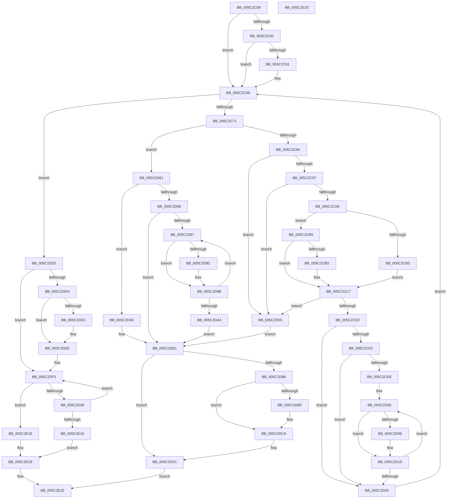

# KiSrcuReportQuiescent

- RVA: `0x005C2C08`–`0x005C2E34` (길이 `556` bytes)
- VA: `0x00000001405C2C08`
- 실행 섹션: `.text`
- PDB 이름 있음: `예`; PDB Function 태그: `아니요`
- unwind 정보 RVA: `0x0008CF18`
- 디코드: `167`개 명령, `556/556` bytes 표시
- 미해석 바이트: `0` (있으면 어셈블리에 `.byte`로 보존)

> 이 문서는 커널 이미지의 기계어와 PDB 기호를 분석해 생성했습니다. 4번과 5번은 함수 원형과 자료형을 바이너리 사용 방식에서 추정한 C 해석이며 원본 소스 복구 결과는 아닙니다.

## 1. Dependencies

- 직접 호출 지점: **11**; 고유 호출 대상: **6**
- 직접 호출자로 확인된 함수: **9**
- RIP 상대 이미지 참조: **1**

### Outgoing calls
- `0x005C2C63` → [KiRaiseIrqlProcessIrqlFlags](../4F/KiRaiseIrqlProcessIrqlFlags_function_004F56FC.md) (function, `0x004F56FC`)
- `0x005C2C7D` → [KxTryToAcquireSpinLock](../46/KxTryToAcquireSpinLock_function_0046BE18.md) (function, `0x0046BE18`)
- `0x005C2CA1` → [KiRcuCompareGraceSequence](../4D/KiRcuCompareGraceSequence_function_004D6538.md) (function, `0x004D6538`)
- `0x005C2D18` → [KiSrcuNotifyGracePeriodStarted](KiSrcuNotifyGracePeriodStarted_function_005C265C.md) (function, `0x005C265C`)
- `0x005C2D34` → [KxReleaseSpinLock](../20/KxReleaseSpinLock_function_00206670.md) (function, `0x00206670`)
- `0x005C2D5A` → [KxReleaseSpinLock](../20/KxReleaseSpinLock_function_00206670.md) (function, `0x00206670`)
- `0x005C2D96` → [KiSrcuNotifyGracePeriodStarted](KiSrcuNotifyGracePeriodStarted_function_005C265C.md) (function, `0x005C265C`)
- `0x005C2DAC` → [KiSrcuNotifyGracePeriodStarted](KiSrcuNotifyGracePeriodStarted_function_005C265C.md) (function, `0x005C265C`)
- `0x005C2DC5` → [KiLowerIrqlProcessIrqlFlags](../4F/KiLowerIrqlProcessIrqlFlags_function_004F5698.md) (function, `0x004F5698`)
- `0x005C2DE9` → [KiLowerIrqlProcessIrqlFlags](../4F/KiLowerIrqlProcessIrqlFlags_function_004F5698.md) (function, `0x004F5698`)
- `0x005C2DFF` → [KiRcuCompareGraceSequence](../4D/KiRcuCompareGraceSequence_function_004D6538.md) (function, `0x004D6538`)

### Direct callers
- [sub_002099FA](../20/Unknown_function_002099FA.md) at `0x00209F1C`
- [sub_0020C2D4](../20/Unknown_function_0020C2D4.md) at `0x0020CE48`
- [sub_0020D8DF](../20/Unknown_function_0020D8DF.md) at `0x0020DE41`
- [KeWaitForSingleObject](../20/KeWaitForSingleObject_function_0020E6B0.md) at `0x0020F657`
- [sub_0021B161](../21/Unknown_function_0021B161.md) at `0x0021B3B0`
- [KeClockInterruptNotify](../39/KeClockInterruptNotify_function_0039A970.md) at `0x0039B219`
- [sub_003C6144](../3C/Unknown_function_003C6144.md) at `0x003C63AE`
- [sub_0043C8B6](../43/Unknown_function_0043C8B6.md) at `0x0043C8E5`
- [KeSrcuReadUnlock](KeSrcuReadUnlock_function_005C2140.md) at `0x005C2283`

### Static image references
- `0x005C2C58` → RVA `0x00FC6D20` (`ALMOSTRO`; read)

## 2. Other-region calls and transfers

- 다른 실행 섹션으로 향하는 call: **0**
- 별도 외부 분기/꼬리 이동을 확인하지 못했습니다.

## 3. Assembly (complete function range)

```asm
005C2C08  48 89 5C 24 20                  mov qword ptr [rsp + 0x20], rbx
005C2C0D  55                              push rbp
005C2C0E  56                              push rsi
005C2C0F  57                              push rdi
005C2C10  41 54                           push r12
005C2C12  41 55                           push r13
005C2C14  41 56                           push r14
005C2C16  41 57                           push r15
005C2C18  48 83 EC 20                     sub rsp, 0x20
005C2C1C  48 8B 41 30                     mov rax, qword ptr [rcx + 0x30]
005C2C20  48 8B F1                        mov rsi, rcx
005C2C23  4C 8B 69 38                     mov r13, qword ptr [rcx + 0x38]
005C2C27  41 BC 01 00 00 00               mov r12d, 1
005C2C2D  48 8B 79 28                     mov rdi, qword ptr [rcx + 0x28]
005C2C31  4C 8B FA                        mov r15, rdx
005C2C34  48 83 C1 20                     add rcx, 0x20
005C2C38  45 8B F4                        mov r14d, r12d
005C2C3B  48 8B 28                        mov rbp, qword ptr [rax]
005C2C3E  48 89 4C 24 68                  mov qword ptr [rsp + 0x68], rcx
005C2C43  44 0F 20 C3                     mov rbx, cr8
005C2C47  41 8D 44 24 01                  lea eax, [r12 + 1]
005C2C4C  3A D8                           cmp bl, al
005C2C4E  73 18                           jae 0x1405c2c68
005C2C50  44 0F 20 C1                     mov rcx, cr8
005C2C54  44 0F 22 C0                     mov cr8, rax
005C2C58  83 3D C1 40 A0 00 00            cmp dword ptr [rip + 0xa040c1], 0
005C2C5F  74 07                           je 0x1405c2c68
005C2C61  8A D0                           mov dl, al
005C2C63  E8 94 2A F3 FF                  call 0x1404f56fc
005C2C68  48 85 FF                        test rdi, rdi
005C2C6B  0F 84 64 01 00 00               je 0x1405c2dd5
005C2C71  48 8D 47 10                     lea rax, [rdi + 0x10]
005C2C75  48 8B C8                        mov rcx, rax
005C2C78  48 89 44 24 70                  mov qword ptr [rsp + 0x70], rax
005C2C7D  E8 96 91 EA FF                  call 0x14046be18
005C2C82  84 C0                           test al, al
005C2C84  0F 84 D7 00 00 00               je 0x1405c2d61
005C2C8A  4C 8B 47 28                     mov r8, qword ptr [rdi + 0x28]
005C2C8E  4C 85 C5                        test rbp, r8
005C2C91  0F 85 BE 00 00 00               jne 0x1405c2d55
005C2C97  4C 8B 4F 18                     mov r9, qword ptr [rdi + 0x18]
005C2C9B  49 8B CF                        mov rcx, r15
005C2C9E  49 8B D1                        mov rdx, r9
005C2CA1  E8 92 38 F1 FF                  call 0x1404d6538
005C2CA6  85 C0                           test eax, eax
005C2CA8  0F 88 A7 00 00 00               js 0x1405c2d55
005C2CAE  4D 85 C0                        test r8, r8
005C2CB1  75 06                           jne 0x1405c2cb9
005C2CB3  4C 89 7F 18                     mov qword ptr [rdi + 0x18], r15
005C2CB7  EB 0E                           jmp 0x1405c2cc7
005C2CB9  85 C0                           test eax, eax
005C2CBB  7E 0A                           jle 0x1405c2cc7
005C2CBD  4C 0B C5                        or r8, rbp
005C2CC0  4D 8B F9                        mov r15, r9
005C2CC3  4C 09 47 30                     or qword ptr [rdi + 0x30], r8
005C2CC7  48 8B 44 24 68                  mov rax, qword ptr [rsp + 0x68]
005C2CCC  4C 89 38                        mov qword ptr [rax], r15
005C2CCF  48 09 6F 28                     or qword ptr [rdi + 0x28], rbp
005C2CD3  48 8B 47 08                     mov rax, qword ptr [rdi + 8]
005C2CD7  48 8B 4F 28                     mov rcx, qword ptr [rdi + 0x28]
005C2CDB  48 3B 08                        cmp rcx, qword ptr [rax]
005C2CDE  75 75                           jne 0x1405c2d55
005C2CE0  45 85 F6                        test r14d, r14d
005C2CE3  74 41                           je 0x1405c2d26
005C2CE5  4C 8B 77 30                     mov r14, qword ptr [rdi + 0x30]
005C2CE9  4D 85 F6                        test r14, r14
005C2CEC  74 38                           je 0x1405c2d26
005C2CEE  48 8B 46 30                     mov rax, qword ptr [rsi + 0x30]
005C2CF2  48 8B EE                        mov rbp, rsi
005C2CF5  48 8B 08                        mov rcx, qword ptr [rax]
005C2CF8  48 0F BC C1                     bsf rax, rcx
005C2CFC  8B C8                           mov ecx, eax
005C2CFE  48 C1 E1 06                     shl rcx, 6
005C2D02  48 2B E9                        sub rbp, rcx
005C2D05  89 44 24 60                     mov dword ptr [rsp + 0x60], eax
005C2D09  45 84 F4                        test r12b, r14b
005C2D0C  74 0F                           je 0x1405c2d1d
005C2D0E  48 8B D5                        mov rdx, rbp
005C2D11  4C 89 7D 20                     mov qword ptr [rbp + 0x20], r15
005C2D15  49 8B CD                        mov rcx, r13
005C2D18  E8 3F F9 FF FF                  call 0x1405c265c
005C2D1D  48 83 C5 40                     add rbp, 0x40
005C2D21  49 D1 EE                        shr r14, 1
005C2D24  75 E3                           jne 0x1405c2d09
005C2D26  48 83 67 28 00                  and qword ptr [rdi + 0x28], 0
005C2D2B  48 8D 4F 10                     lea rcx, [rdi + 0x10]
005C2D2F  48 83 67 30 00                  and qword ptr [rdi + 0x30], 0
005C2D34  E8 37 39 C4 FF                  call 0x140206670
005C2D39  48 8D 47 20                     lea rax, [rdi + 0x20]
005C2D3D  45 33 F6                        xor r14d, r14d
005C2D40  48 89 44 24 68                  mov qword ptr [rsp + 0x68], rax
005C2D45  48 8B 47 08                     mov rax, qword ptr [rdi + 8]
005C2D49  48 8B 3F                        mov rdi, qword ptr [rdi]
005C2D4C  48 8B 68 08                     mov rbp, qword ptr [rax + 8]
005C2D50  E9 13 FF FF FF                  jmp 0x1405c2c68
005C2D55  48 8B 4C 24 70                  mov rcx, qword ptr [rsp + 0x70]
005C2D5A  E8 11 39 C4 FF                  call 0x140206670
005C2D5F  EB 50                           jmp 0x1405c2db1
005C2D61  45 85 F6                        test r14d, r14d
005C2D64  75 40                           jne 0x1405c2da6
005C2D66  48 8B 46 30                     mov rax, qword ptr [rsi + 0x30]
005C2D6A  48 8B 08                        mov rcx, qword ptr [rax]
005C2D6D  48 8B 47 08                     mov rax, qword ptr [rdi + 8]
005C2D71  48 0F BC C9                     bsf rcx, rcx
005C2D75  48 8B 38                        mov rdi, qword ptr [rax]
005C2D78  48 C1 E1 06                     shl rcx, 6
005C2D7C  48 2B F1                        sub rsi, rcx
005C2D7F  49 FF CF                        dec r15
005C2D82  48 85 FF                        test rdi, rdi
005C2D85  74 2A                           je 0x1405c2db1
005C2D87  41 84 FC                        test r12b, dil
005C2D8A  74 0F                           je 0x1405c2d9b
005C2D8C  48 8B D6                        mov rdx, rsi
005C2D8F  4C 89 7E 20                     mov qword ptr [rsi + 0x20], r15
005C2D93  49 8B CD                        mov rcx, r13
005C2D96  E8 C1 F8 FF FF                  call 0x1405c265c
005C2D9B  48 83 C6 40                     add rsi, 0x40
005C2D9F  48 D1 EF                        shr rdi, 1
005C2DA2  75 E3                           jne 0x1405c2d87
005C2DA4  EB 0B                           jmp 0x1405c2db1
005C2DA6  48 8B D6                        mov rdx, rsi
005C2DA9  49 8B CD                        mov rcx, r13
005C2DAC  E8 AB F8 FF FF                  call 0x1405c265c
005C2DB1  80 FB 02                        cmp bl, 2
005C2DB4  73 1B                           jae 0x1405c2dd1
005C2DB6  83 3D 63 3F A0 00 00            cmp dword ptr [rip + 0xa03f63], 0
005C2DBD  74 0B                           je 0x1405c2dca
005C2DBF  8A D3                           mov dl, bl
005C2DC1  44 0F 20 C1                     mov rcx, cr8
005C2DC5  E8 CE 28 F3 FF                  call 0x1404f5698
005C2DCA  0F B6 C3                        movzx eax, bl
005C2DCD  44 0F 22 C0                     mov cr8, rax
005C2DD1  33 C0                           xor eax, eax
005C2DD3  EB 49                           jmp 0x1405c2e1e
005C2DD5  80 FB 02                        cmp bl, 2
005C2DD8  73 1B                           jae 0x1405c2df5
005C2DDA  83 3D 3F 3F A0 00 00            cmp dword ptr [rip + 0xa03f3f], 0
005C2DE1  74 0B                           je 0x1405c2dee
005C2DE3  44 0F 20 C1                     mov rcx, cr8
005C2DE7  8A D3                           mov dl, bl
005C2DE9  E8 AA 28 F3 FF                  call 0x1404f5698
005C2DEE  0F B6 C3                        movzx eax, bl
005C2DF1  44 0F 22 C0                     mov cr8, rax
005C2DF5  4D 8B 45 30                     mov r8, qword ptr [r13 + 0x30]
005C2DF9  49 8B CF                        mov rcx, r15
005C2DFC  49 8B D0                        mov rdx, r8
005C2DFF  E8 34 37 F1 FF                  call 0x1404d6538
005C2E04  85 C0                           test eax, eax
005C2E06  7E 10                           jle 0x1405c2e18
005C2E08  49 8B C0                        mov rax, r8
005C2E0B  F0 4D 0F B1 7D 30               lock cmpxchg qword ptr [r13 + 0x30], r15
005C2E11  4C 3B C0                        cmp r8, rax
005C2E14  75 DF                           jne 0x1405c2df5
005C2E16  EB 03                           jmp 0x1405c2e1b
005C2E18  45 33 E4                        xor r12d, r12d
005C2E1B  41 8B C4                        mov eax, r12d
005C2E1E  48 8B 5C 24 78                  mov rbx, qword ptr [rsp + 0x78]
005C2E23  48 83 C4 20                     add rsp, 0x20
005C2E27  41 5F                           pop r15
005C2E29  41 5E                           pop r14
005C2E2B  41 5D                           pop r13
005C2E2D  41 5C                           pop r12
005C2E2F  5F                              pop rdi
005C2E30  5E                              pop rsi
005C2E31  5D                              pop rbp
005C2E32  C3                              ret
005C2E33  CC                              int3
```

## 4. C-style interpretation (structured pseudocode)

```c
__int64 __fastcall KiSrcuReportQuiescent(__int64 a1, __int64 a2)
{
    __int64 result;
    __int64 v_r12;
    __int64 v_r14;
    __int64 v_r15;
    __int64 v_rbp;
    __int64 v_rdi;
    __int64 v_rsi;
    __int64 v_rsp;
    unsigned __int64 v_stack_p10;
    unsigned __int64 v_stack_p18;
    unsigned __int64 v_stack_p20;
    unsigned int v_stack_p8;

    v_stack_p20 = v_rbx;
    v_rsp = (v_rsp) - (32);
    a1 = (a1) + (32);
    v_stack_p10 = a1;
    if (((unsigned __int8)(v_cr8)) >= ((unsigned __int8)(1 + 1))) goto loc_005C2C68;
    result = 1 + 1;
    if ((*(unsigned int *)(v_rip + 10502337)) != 0) {
        a2 = (unsigned __int8)(1 + 1);
        result = KiRaiseIrqlProcessIrqlFlags(v_cr8, a2, a3, a4);
    }
    if (*(unsigned __int64 *)(a1 + 40) == 0) goto loc_005C2DD5;
    v_stack_p18 = *(unsigned __int64 *)(a1 + 40) + 16;
    result = KxTryToAcquireSpinLock(*(unsigned __int64 *)(a1 + 40) + 16, a2, a3, a4);
    if ((unsigned __int8)(result) == 0) goto loc_005C2D61;
    if (((*(unsigned __int64 *)(*(unsigned __int64 *)(a1 + 48))) & (*(unsigned __int64 *)(*(unsigned __int64 *)(a1 + 40) + 40))) != 0) goto loc_005C2D55;
    result = KiRcuCompareGraceSequence(a2, *(unsigned __int64 *)(*(unsigned __int64 *)(a1 + 40) + 24), *(unsigned __int64 *)(*(unsigned __int64 *)(a1 + 40) + 40), *(unsigned __int64 *)(*(unsigned __int64 *)(a1 + 40) + 24));
    if (sign_flag) goto loc_005C2D55;
    if (*(unsigned __int64 *)(*(unsigned __int64 *)(a1 + 40) + 40) != 0) goto loc_005C2CB9;
    *(unsigned __int64 *)(*(unsigned __int64 *)(a1 + 40) + 24) = a2;
    goto loc_005C2CC7;
loc_005C2CB9:
    v_r15 = a2;
    if (!(condition_is_less_or_equal)) {
        a3 = (*(unsigned __int64 *)(*(unsigned __int64 *)(a1 + 40) + 40)) | (*(unsigned __int64 *)(*(unsigned __int64 *)(a1 + 48)));
        v_r15 = *(unsigned __int64 *)(*(unsigned __int64 *)(a1 + 40) + 24);
    }
    *(unsigned __int64 *)(v_stack_p10) = v_r15;
    if ((*(unsigned __int64 *)(*(unsigned __int64 *)(a1 + 40) + 40)) != (*(unsigned __int64 *)(*(unsigned __int64 *)(*(unsigned __int64 *)(a1 + 40) + 8)))) goto loc_005C2D55;
    if (1 == 0) goto loc_005C2D26;
    if (*(unsigned __int64 *)(*(unsigned __int64 *)(a1 + 40) + 48) == 0) goto loc_005C2D26;
    a1 = ((unsigned int)((unsigned int)(*(unsigned __int64 *)(a1 + 48)))) << (6);
    v_rbp = (a1) - (a1);
    v_stack_p8 = (unsigned int)(*(unsigned __int64 *)(a1 + 48));
loc_005C2D09:
    result = *(unsigned __int64 *)(a1 + 48);
    if (((1) & ((unsigned __int8)(*(unsigned __int64 *)(*(unsigned __int64 *)(a1 + 40) + 48)))) != 0) {
        a2 = v_rbp;
        *(unsigned __int64 *)(v_rbp + 32) = v_r15;
        a1 = *(unsigned __int64 *)(a1 + 56);
        result = KiSrcuNotifyGracePeriodStarted(a1, a2, a3, *(unsigned __int64 *)(*(unsigned __int64 *)(a1 + 40) + 24));
    }
    v_rbp = (v_rbp) + (64);
    v_r14 = (*(unsigned __int64 *)(*(unsigned __int64 *)(a1 + 40) + 48)) >> (1);
    if (condition_is_not_equal) goto loc_005C2D09;
loc_005C2D26:
    result = KxReleaseSpinLock(*(unsigned __int64 *)(a1 + 40) + 16, a2, a3, *(unsigned __int64 *)(*(unsigned __int64 *)(a1 + 40) + 24));
    v_r14 = 0;
    v_stack_p10 = *(unsigned __int64 *)(a1 + 40) + 32;
    goto loc_005C2C68;
loc_005C2D55:
    result = KxReleaseSpinLock(v_stack_p18, a2, a3, *(unsigned __int64 *)(*(unsigned __int64 *)(a1 + 40) + 24));
    goto loc_005C2DB1;
loc_005C2D61:
    if (0 != 0) goto loc_005C2DA6;
    a1 = (*(unsigned __int64 *)(*(unsigned __int64 *)(a1 + 48))) << (6);
    v_rsi = (a1) - (a1);
    v_r15 = (v_r15) - 1;
    if (*(unsigned __int64 *)(*(unsigned __int64 *)(*(unsigned __int64 *)(*(unsigned __int64 *)(a1 + 40)) + 8)) == 0) goto loc_005C2DB1;
loc_005C2D87:
    result = *(unsigned __int64 *)(*(unsigned __int64 *)(*(unsigned __int64 *)(a1 + 40)) + 8);
    if (((1) & ((unsigned __int8)(*(unsigned __int64 *)(*(unsigned __int64 *)(*(unsigned __int64 *)(*(unsigned __int64 *)(a1 + 40)) + 8))))) != 0) {
        a2 = v_rsi;
        *(unsigned __int64 *)(v_rsi + 32) = v_r15;
        a1 = *(unsigned __int64 *)(a1 + 56);
        result = KiSrcuNotifyGracePeriodStarted(a1, a2, a3, *(unsigned __int64 *)(*(unsigned __int64 *)(a1 + 40) + 24));
    }
    v_rsi = (v_rsi) + (64);
    v_rdi = (*(unsigned __int64 *)(*(unsigned __int64 *)(*(unsigned __int64 *)(*(unsigned __int64 *)(a1 + 40)) + 8))) >> (1);
    if (condition_is_not_equal) goto loc_005C2D87;
    goto loc_005C2DB1;
loc_005C2DA6:
    result = KiSrcuNotifyGracePeriodStarted(*(unsigned __int64 *)(a1 + 56), v_rsi, a3, *(unsigned __int64 *)(*(unsigned __int64 *)(a1 + 40) + 24));
loc_005C2DB1:
    if (((unsigned __int8)(v_cr8)) >= 2) goto loc_005C2DD1;
    if ((*(unsigned int *)(v_rip + 10501987)) != 0) {
        a2 = (unsigned __int8)(v_cr8);
        a1 = 1 + 1;
        result = KiLowerIrqlProcessIrqlFlags(a1, a2, a3, *(unsigned __int64 *)(*(unsigned __int64 *)(a1 + 40) + 24));
    }
loc_005C2DD1:
    result = 0;
    goto loc_005C2E1E;
loc_005C2DD5:
    if (((unsigned __int8)(v_cr8)) >= 2) goto loc_005C2DF5;
    if ((*(unsigned int *)(v_rip + 10501951)) != 0) {
        a1 = (unsigned __int8)(v_cr8);
        a2 = (unsigned __int8)(v_cr8);
        result = KiLowerIrqlProcessIrqlFlags(a1, a2, a3, *(unsigned __int64 *)(*(unsigned __int64 *)(a1 + 40) + 24));
    }
loc_005C2DF5:
    result = KiRcuCompareGraceSequence(v_r15, *(unsigned __int64 *)(*(unsigned __int64 *)(a1 + 56) + 48), *(unsigned __int64 *)(*(unsigned __int64 *)(a1 + 56) + 48), *(unsigned __int64 *)(*(unsigned __int64 *)(a1 + 40) + 24));
    if (condition_is_less_or_equal) goto loc_005C2E18;
    if ((*(unsigned __int64 *)(*(unsigned __int64 *)(a1 + 56) + 48)) != (*(unsigned __int64 *)(*(unsigned __int64 *)(a1 + 56) + 48))) goto loc_005C2DF5;
    goto loc_005C2E1B;
loc_005C2E18:
    v_r12 = 0;
loc_005C2E1B:
loc_005C2E1E:
    v_rsp = (v_rsp) + (32);
    return 0;
}
```

## 5. (Beta) C Style

```c
int64_t KiSrcuReportQuiescent(void *Arg1, int64_t Arg2)
{
    uint8_t *arg1 = (uint8_t *)Arg1;

    int64_t result;
    int64_t local_r12;
    int64_t local_r14;
    int64_t local_r15;
    int64_t local_rbp;
    int64_t local_rdi;
    int64_t local_rsi;
    int64_t local_rsp;
    uint64_t v_stack_p10;
    uint64_t v_stack_p18;
    uint64_t v_stack_p20;
    uint32_t v_stack_p8;

    v_stack_p20 = local_rbx;
    local_rsp = (local_rsp) - (32);
    Arg1 = (Arg1) + (32);
    v_stack_p10 = Arg1;
    if (((uint8_t)(v_cr8)) >= ((uint8_t)(1 + 1))) goto loc_005C2C68;
    result = 1 + 1;
    if ((*(uint32_t *)(v_rip + 0xA040C1)) != 0) {
        Arg2 = (uint8_t)(1 + 1);
        result = KiRaiseIrqlProcessIrqlFlags(v_cr8, Arg2, a3, a4);
    }
    if (*(uint64_t *)(arg1 + 0x28) == 0) goto loc_005C2DD5;
    v_stack_p18 = *(uint64_t *)(arg1 + 0x28) + 16;
    result = KxTryToAcquireSpinLock(*(uint64_t *)(arg1 + 0x28) + 16, Arg2, a3, a4);
    if ((uint8_t)(result) == 0) goto loc_005C2D61;
    if (((*(uint64_t *)(*(uint64_t *)(arg1 + 0x30))) & (*(uint64_t *)(*(uint64_t *)(arg1 + 0x28) + 0x28))) != 0) goto loc_005C2D55;
    result = KiRcuCompareGraceSequence(Arg2, *(uint64_t *)(*(uint64_t *)(arg1 + 0x28) + 0x18), *(uint64_t *)(*(uint64_t *)(arg1 + 0x28) + 0x28), *(uint64_t *)(*(uint64_t *)(arg1 + 0x28) + 0x18));
    if (sign_flag) goto loc_005C2D55;
    if (*(uint64_t *)(*(uint64_t *)(arg1 + 0x28) + 0x28) != 0) goto loc_005C2CB9;
    *(uint64_t *)(*(uint64_t *)(arg1 + 0x28) + 0x18) = Arg2;
    goto loc_005C2CC7;
loc_005C2CB9:
    local_r15 = Arg2;
    if (!(condition_is_less_or_equal)) {
        a3 = (*(uint64_t *)(*(uint64_t *)(arg1 + 0x28) + 0x28)) | (*(uint64_t *)(*(uint64_t *)(arg1 + 0x30)));
        local_r15 = *(uint64_t *)(*(uint64_t *)(arg1 + 0x28) + 0x18);
    }
    *(uint64_t *)(v_stack_p10) = local_r15;
    if ((*(uint64_t *)(*(uint64_t *)(arg1 + 0x28) + 0x28)) != (*(uint64_t *)(*(uint64_t *)(*(uint64_t *)(arg1 + 0x28) + 0x8)))) goto loc_005C2D55;
    if (1 == 0) goto loc_005C2D26;
    if (*(uint64_t *)(*(uint64_t *)(arg1 + 0x28) + 0x30) == 0) goto loc_005C2D26;
    Arg1 = ((uint32_t)((uint32_t)(*(uint64_t *)(arg1 + 0x30)))) << (6);
    local_rbp = (Arg1) - (Arg1);
    v_stack_p8 = (uint32_t)(*(uint64_t *)(arg1 + 0x30));
loc_005C2D09:
    result = *(uint64_t *)(arg1 + 0x30);
    if (((1) & ((uint8_t)(*(uint64_t *)(*(uint64_t *)(arg1 + 0x28) + 0x30)))) != 0) {
        Arg2 = local_rbp;
        *(uint64_t *)(local_rbp + 0x20) = local_r15;
        Arg1 = *(uint64_t *)(arg1 + 0x38);
        result = KiSrcuNotifyGracePeriodStarted(Arg1, Arg2, a3, *(uint64_t *)(*(uint64_t *)(arg1 + 0x28) + 0x18));
    }
    local_rbp = (local_rbp) + (64);
    local_r14 = (*(uint64_t *)(*(uint64_t *)(arg1 + 0x28) + 0x30)) >> (1);
    if (condition_is_not_equal) goto loc_005C2D09;
loc_005C2D26:
    result = KxReleaseSpinLock(*(uint64_t *)(arg1 + 0x28) + 16, Arg2, a3, *(uint64_t *)(*(uint64_t *)(arg1 + 0x28) + 0x18));
    local_r14 = 0;
    v_stack_p10 = *(uint64_t *)(arg1 + 0x28) + 32;
    goto loc_005C2C68;
loc_005C2D55:
    result = KxReleaseSpinLock(v_stack_p18, Arg2, a3, *(uint64_t *)(*(uint64_t *)(arg1 + 0x28) + 0x18));
    goto loc_005C2DB1;
loc_005C2D61:
    if (0 != 0) goto loc_005C2DA6;
    Arg1 = (*(uint64_t *)(*(uint64_t *)(arg1 + 0x30))) << (6);
    local_rsi = (Arg1) - (Arg1);
    local_r15 = (local_r15) - 1;
    if (*(uint64_t *)(*(uint64_t *)(*(uint64_t *)(*(uint64_t *)(arg1 + 0x28)) + 0x8)) == 0) goto loc_005C2DB1;
loc_005C2D87:
    result = *(uint64_t *)(*(uint64_t *)(*(uint64_t *)(arg1 + 0x28)) + 0x8);
    if (((1) & ((uint8_t)(*(uint64_t *)(*(uint64_t *)(*(uint64_t *)(*(uint64_t *)(arg1 + 0x28)) + 0x8))))) != 0) {
        Arg2 = local_rsi;
        *(uint64_t *)(local_rsi + 0x20) = local_r15;
        Arg1 = *(uint64_t *)(arg1 + 0x38);
        result = KiSrcuNotifyGracePeriodStarted(Arg1, Arg2, a3, *(uint64_t *)(*(uint64_t *)(arg1 + 0x28) + 0x18));
    }
    local_rsi = (local_rsi) + (64);
    local_rdi = (*(uint64_t *)(*(uint64_t *)(*(uint64_t *)(*(uint64_t *)(arg1 + 0x28)) + 0x8))) >> (1);
    if (condition_is_not_equal) goto loc_005C2D87;
    goto loc_005C2DB1;
loc_005C2DA6:
    result = KiSrcuNotifyGracePeriodStarted(*(uint64_t *)(arg1 + 0x38), local_rsi, a3, *(uint64_t *)(*(uint64_t *)(arg1 + 0x28) + 0x18));
loc_005C2DB1:
    if (((uint8_t)(v_cr8)) >= 2) goto loc_005C2DD1;
    if ((*(uint32_t *)(v_rip + 0xA03F63)) != 0) {
        Arg2 = (uint8_t)(v_cr8);
        Arg1 = 1 + 1;
        result = KiLowerIrqlProcessIrqlFlags(Arg1, Arg2, a3, *(uint64_t *)(*(uint64_t *)(arg1 + 0x28) + 0x18));
    }
loc_005C2DD1:
    result = 0;
    goto loc_005C2E1E;
loc_005C2DD5:
    if (((uint8_t)(v_cr8)) >= 2) goto loc_005C2DF5;
    if ((*(uint32_t *)(v_rip + 0xA03F3F)) != 0) {
        Arg1 = (uint8_t)(v_cr8);
        Arg2 = (uint8_t)(v_cr8);
        result = KiLowerIrqlProcessIrqlFlags(Arg1, Arg2, a3, *(uint64_t *)(*(uint64_t *)(arg1 + 0x28) + 0x18));
    }
loc_005C2DF5:
    result = KiRcuCompareGraceSequence(local_r15, *(uint64_t *)(*(uint64_t *)(arg1 + 0x38) + 0x30), *(uint64_t *)(*(uint64_t *)(arg1 + 0x38) + 0x30), *(uint64_t *)(*(uint64_t *)(arg1 + 0x28) + 0x18));
    if (condition_is_less_or_equal) goto loc_005C2E18;
    if ((*(uint64_t *)(*(uint64_t *)(arg1 + 0x38) + 0x30)) != (*(uint64_t *)(*(uint64_t *)(arg1 + 0x38) + 0x30))) goto loc_005C2DF5;
    goto loc_005C2E1B;
loc_005C2E18:
    local_r12 = 0;
loc_005C2E1B:
loc_005C2E1E:
    local_rsp = (local_rsp) + (32);
    return 0;
}
```

### 관측된 메모리 오프셋

구조체 형식이 확인되지 않은 접근은 인자 기준의 오프셋으로만 기록했습니다.

| 기준 인자 | 오프셋 표현 | 폭 (bit) | 접근 |
|---|---:|---:|---|
| `Arg1` | `+ 0x20` | `64` | `W` |
| `Arg1` | `+ 0x28` | `64` | `R` |
| `Arg1` | `+ 0x30` | `64` | `R` |
| `Arg1` | `+ 0x38` | `64` | `R` |

## 6. Execution-region graph

[열기: 2D/3D 그래프와 함수 탐색 컨트롤 패널](../../../control-panel.html?section=text&rva=0x005C2C08&view=graph)

- 2D 그래프는 위에서 아래로 흐르고, 3D 그래프는 빈 공간을 드래그해 회전합니다. Shift+드래그는 이동, 휠은 확대·축소, 함수 노드 선택은 대상 보고서 이동입니다.

### Static fallback


