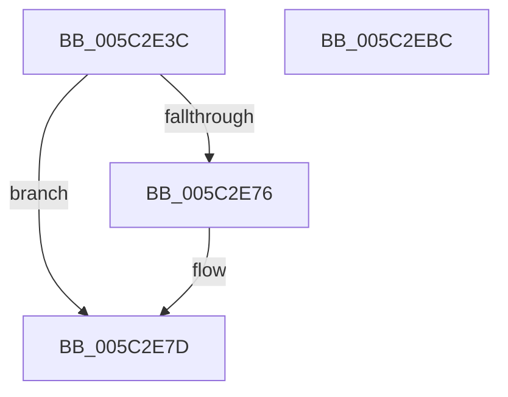

# KiSrcuStartGracePeriod

- RVA: `0x005C2E3C`–`0x005C2EBD` (길이 `129` bytes)
- VA: `0x00000001405C2E3C`
- 실행 섹션: `.text`
- PDB 이름 있음: `예`; PDB Function 태그: `아니요`
- unwind 정보 RVA: `0x00060BC4`
- 디코드: `37`개 명령, `129/129` bytes 표시
- 미해석 바이트: `0` (있으면 어셈블리에 `.byte`로 보존)

> 이 문서는 커널 이미지의 기계어와 PDB 기호를 분석해 생성했습니다. 4번과 5번은 함수 원형과 자료형을 바이너리 사용 방식에서 추정한 C 해석이며 원본 소스 복구 결과는 아닙니다.

## 1. Dependencies

- 직접 호출 지점: **4**; 고유 호출 대상: **4**
- 직접 호출자로 확인된 함수: **1**
- RIP 상대 이미지 참조: **0**

### Outgoing calls
- `0x005C2E55` → [KeAcquireSpinLockRaiseToDpc](../20/KeAcquireSpinLockRaiseToDpc_function_00208470.md) (function, `0x00208470`)
- `0x005C2E95` → [KeReleaseSpinLock](../39/KeReleaseSpinLock_function_00392BA0.md) (function, `0x00392BA0`)
- `0x005C2E9F` → [KiSrcuNotifyGracePeriodStarted](KiSrcuNotifyGracePeriodStarted_function_005C265C.md) (function, `0x005C265C`)
- `0x005C2EA7` → [KiSrcuFlushCompleted](KiSrcuFlushCompleted_function_005C22B4.md) (function, `0x005C22B4`)

### Direct callers
- [KeSrcuSynchronize](../../page/74/KeSrcuSynchronize_function_00747230.md) at `0x0074725D`

### Static image references
- 디코드된 RIP-relative 메모리 참조가 없습니다.

## 2. Other-region calls and transfers

- 다른 실행 섹션으로 향하는 call: **0**
- 별도 외부 분기/꼬리 이동을 확인하지 못했습니다.

## 3. Assembly (complete function range)

```asm
005C2E3C  48 89 5C 24 08                  mov qword ptr [rsp + 8], rbx
005C2E41  48 89 74 24 10                  mov qword ptr [rsp + 0x10], rsi
005C2E46  57                              push rdi
005C2E47  48 83 EC 20                     sub rsp, 0x20
005C2E4B  48 8B D9                        mov rbx, rcx
005C2E4E  48 8B FA                        mov rdi, rdx
005C2E51  48 83 C1 28                     add rcx, 0x28
005C2E55  E8 16 56 C4 FF                  call 0x140208470
005C2E5A  0F 0D 4B 38                     prefetchw byte ptr [rbx + 0x38]
005C2E5E  48 8B 53 38                     mov rdx, qword ptr [rbx + 0x38]
005C2E62  48 8D 4B 40                     lea rcx, [rbx + 0x40]
005C2E66  48 FF C2                        inc rdx
005C2E69  48 89 57 10                     mov qword ptr [rdi + 0x10], rdx
005C2E6D  4C 8B 41 08                     mov r8, qword ptr [rcx + 8]
005C2E71  49 39 08                        cmp qword ptr [r8], rcx
005C2E74  74 07                           je 0x1405c2e7d
005C2E76  B9 03 00 00 00                  mov ecx, 3
005C2E7B  CD 29                           int 0x29
005C2E7D  48 89 0F                        mov qword ptr [rdi], rcx
005C2E80  4C 89 47 08                     mov qword ptr [rdi + 8], r8
005C2E84  49 89 38                        mov qword ptr [r8], rdi
005C2E87  48 89 79 08                     mov qword ptr [rcx + 8], rdi
005C2E8B  48 8D 4B 28                     lea rcx, [rbx + 0x28]
005C2E8F  48 89 53 38                     mov qword ptr [rbx + 0x38], rdx
005C2E93  8A D0                           mov dl, al
005C2E95  E8 06 FD DC FF                  call 0x140392ba0
005C2E9A  33 D2                           xor edx, edx
005C2E9C  48 8B CB                        mov rcx, rbx
005C2E9F  E8 B8 F7 FF FF                  call 0x1405c265c
005C2EA4  48 8B CB                        mov rcx, rbx
005C2EA7  E8 08 F4 FF FF                  call 0x1405c22b4
005C2EAC  48 8B 5C 24 30                  mov rbx, qword ptr [rsp + 0x30]
005C2EB1  48 8B 74 24 38                  mov rsi, qword ptr [rsp + 0x38]
005C2EB6  48 83 C4 20                     add rsp, 0x20
005C2EBA  5F                              pop rdi
005C2EBB  C3                              ret
005C2EBC  CC                              int3
```

## 4. C-style interpretation (structured pseudocode)

```c
__int64 __fastcall KiSrcuStartGracePeriod(__int64 a1, __int64 a2)
{
    __int64 result;
    __int64 v_rsp;
    unsigned __int64 v_stack_p10;
    unsigned __int64 v_stack_p8;

    v_stack_p8 = v_rbx;
    v_stack_p10 = v_rsi;
    v_rsp = (v_rsp) - (32);
    a1 = (a1) + (40);
    result = KeAcquireSpinLockRaiseToDpc(a1, a2, a3, a4);
    a2 = (*(unsigned __int64 *)(a1 + 56)) + 1;
    *(unsigned __int64 *)(a2 + 16) = a2;
    if ((*(unsigned __int64 *)(*(unsigned __int64 *)(a1 + 64 + 8))) != (a1 + 64)) {
        a1 = 3;
    }
    *(unsigned __int64 *)(a2) = a1;
    *(unsigned __int64 *)(a2 + 8) = *(unsigned __int64 *)(a1 + 64 + 8);
    *(unsigned __int64 *)(*(unsigned __int64 *)(a1 + 64 + 8)) = a2;
    *(unsigned __int64 *)(a1 + 8) = a2;
    *(unsigned __int64 *)(a1 + 56) = a2;
    result = KeReleaseSpinLock(a1 + 40, (unsigned __int8)(result), *(unsigned __int64 *)(a1 + 64 + 8), a4);
    a2 = 0;
    result = KiSrcuNotifyGracePeriodStarted(a1, a2, *(unsigned __int64 *)(a1 + 64 + 8), a4);
    result = KiSrcuFlushCompleted(a1, a2, *(unsigned __int64 *)(a1 + 64 + 8), a4);
    v_rsp = (v_rsp) + (32);
    return result;
}
```

## 5. (Beta) C Style

```c
int64_t KiSrcuStartGracePeriod(void *Arg1, void *Arg2)
{
    uint8_t *arg1 = (uint8_t *)Arg1;
    uint8_t *arg2 = (uint8_t *)Arg2;

    int64_t result;
    int64_t local_rsp;
    uint64_t v_stack_p10;
    uint64_t v_stack_p8;

    v_stack_p8 = local_rbx;
    v_stack_p10 = local_rsi;
    local_rsp = (local_rsp) - (32);
    Arg1 = (Arg1) + (40);
    result = KeAcquireSpinLockRaiseToDpc(Arg1, Arg2, a3, a4);
    Arg2 = (*(uint64_t *)(arg1 + 0x38)) + 1;
    *(void **)(arg2 + 0x10) = Arg2;
    if ((*(uint64_t *)(*(uint64_t *)(arg1 + 0x40 + 0x8))) != (Arg1 + 64)) {
        Arg1 = 3;
    }
    *(void **)(arg2) = Arg1;
    *(uint64_t *)(arg2 + 0x8) = *(uint64_t *)(arg1 + 0x40 + 0x8);
    *(void **)(*(uint64_t *)(arg1 + 0x40 + 0x8)) = Arg2;
    *(void **)(arg1 + 0x8) = Arg2;
    *(void **)(arg1 + 0x38) = Arg2;
    result = KeReleaseSpinLock(Arg1 + 40, (uint8_t)(result), *(uint64_t *)(arg1 + 0x40 + 0x8), a4);
    Arg2 = 0;
    result = KiSrcuNotifyGracePeriodStarted(Arg1, Arg2, *(uint64_t *)(arg1 + 0x40 + 0x8), a4);
    result = KiSrcuFlushCompleted(Arg1, Arg2, *(uint64_t *)(arg1 + 0x40 + 0x8), a4);
    local_rsp = (local_rsp) + (32);
    return result;
}
```

### 관측된 메모리 오프셋

구조체 형식이 확인되지 않은 접근은 인자 기준의 오프셋으로만 기록했습니다.

| 기준 인자 | 오프셋 표현 | 폭 (bit) | 접근 |
|---|---:|---:|---|
| `Arg1` | `+ 0x8` | `64` | `R` |
| `Arg1` | `+ 0x28` | `64` | `R` |
| `Arg1` | `+ 0x38` | `8` | `R` |
| `Arg1` | `+ 0x38` | `64` | `R` |
| `Arg1` | `+ 0x38` | `64` | `W` |
| `Arg1` | `+ 0x40` | `64` | `R` |
| `Arg2` | `+ 0x0` | `64` | `W` |
| `Arg2` | `+ 0x8` | `64` | `W` |
| `Arg2` | `+ 0x10` | `64` | `W` |

## 6. Execution-region graph

[열기: 2D/3D 그래프와 함수 탐색 컨트롤 패널](../../../control-panel.html?section=text&rva=0x005C2E3C&view=graph)

- 2D 그래프는 위에서 아래로 흐르고, 3D 그래프는 빈 공간을 드래그해 회전합니다. Shift+드래그는 이동, 휠은 확대·축소, 함수 노드 선택은 대상 보고서 이동입니다.

### Static fallback


