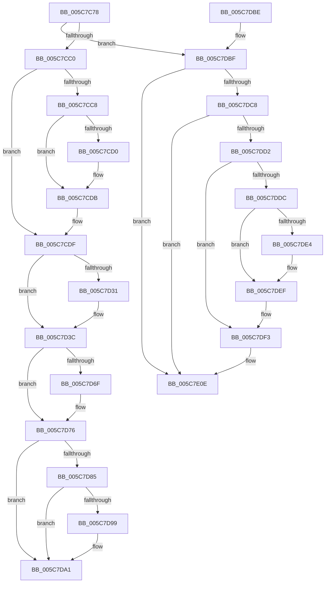

# KiStallBugcheckThread

- RVA: `0x005C7C78`–`0x005C7E15` (길이 `413` bytes)
- VA: `0x00000001405C7C78`
- 실행 섹션: `.text`
- PDB 이름 있음: `예`; PDB Function 태그: `아니요`
- unwind 정보 RVA: `0x000CABA4`
- 디코드: `105`개 명령, `413/413` bytes 표시
- 미해석 바이트: `0` (있으면 어셈블리에 `.byte`로 보존)

> 이 문서는 커널 이미지의 기계어와 PDB 기호를 분석해 생성했습니다. 4번과 5번은 함수 원형과 자료형을 바이너리 사용 방식에서 추정한 C 해석이며 원본 소스 복구 결과는 아닙니다.

## 1. Dependencies

- 직접 호출 지점: **10**; 고유 호출 대상: **7**
- 직접 호출자로 확인된 함수: **1**
- RIP 상대 이미지 참조: **6**

### Outgoing calls
- `0x005C7CD6` → [KiLowerIrqlProcessIrqlFlags](../4F/KiLowerIrqlProcessIrqlFlags_function_004F5698.md) (function, `0x004F5698`)
- `0x005C7D24` → [KeSetSystemGroupAffinityThread](../39/KeSetSystemGroupAffinityThread_function_00399140.md) (function, `0x00399140`)
- `0x005C7D37` → [KiLowerIrqlProcessIrqlFlags](../4F/KiLowerIrqlProcessIrqlFlags_function_004F5698.md) (function, `0x004F5698`)
- `0x005C7D5A` → [KeWaitForSingleObject](../20/KeWaitForSingleObject_function_0020E6B0.md) (function, `0x0020E6B0`)
- `0x005C7D71` → [KiRaiseIrqlProcessIrqlFlags](../4F/KiRaiseIrqlProcessIrqlFlags_function_004F56FC.md) (function, `0x004F56FC`)
- `0x005C7D7B` → [KeRevertToUserGroupAffinityThread](../39/KeRevertToUserGroupAffinityThread_function_00398EC0.md) (function, `0x00398EC0`)
- `0x005C7D9C` → [KiRaiseIrqlProcessIrqlFlags](../4F/KiRaiseIrqlProcessIrqlFlags_function_004F56FC.md) (function, `0x004F56FC`)
- `0x005C7DA9` → [_security_check_cookie](../6A/_security_check_cookie_function_006AC640.md) (function, `0x006AC640`)
- `0x005C7DEA` → [KiLowerIrqlProcessIrqlFlags](../4F/KiLowerIrqlProcessIrqlFlags_function_004F5698.md) (function, `0x004F5698`)
- `0x005C7E01` → [RtlRaiseException](../5E/RtlRaiseException_function_005E6B00.md) (function, `0x005E6B00`)

### Direct callers
- [KiScheduleBugcheckRecovery](KiScheduleBugcheckRecovery_function_005C7B20.md) at `0x005C7BAA`

### Static image references
- `0x005C7C87` → RVA `0x00E0A740` (`.data`; read)
- `0x005C7CC8` → RVA `0x00FC6D20` (`ALMOSTRO`; read)
- `0x005C7CF0` → RVA `0x00F231B0` (`.data`; read)
- `0x005C7D40` → RVA `0x00F109B7` (`.data`; read/write)
- `0x005C7D46` → RVA `0x00F10980` (`.data`; read)
- `0x005C7DFA` → RVA `0x00E0B200` (`.data`; read)

## 2. Other-region calls and transfers

- 다른 실행 섹션으로 향하는 call: **0**
- 별도 외부 분기/꼬리 이동을 확인하지 못했습니다.

## 3. Assembly (complete function range)

```asm
005C7C78  48 89 5C 24 08                  mov qword ptr [rsp + 8], rbx
005C7C7D  48 89 74 24 10                  mov qword ptr [rsp + 0x10], rsi
005C7C82  57                              push rdi
005C7C83  48 83 EC 60                     sub rsp, 0x60
005C7C87  48 8B 05 B2 2A 84 00            mov rax, qword ptr [rip + 0x842ab2]
005C7C8E  48 33 C4                        xor rax, rsp
005C7C91  48 89 44 24 50                  mov qword ptr [rsp + 0x50], rax
005C7C96  65 48 8B 0C 25 20 00 00 00      mov rcx, qword ptr gs:[0x20]
005C7C9F  0F 57 C0                        xorps xmm0, xmm0
005C7CA2  0F 57 C9                        xorps xmm1, xmm1
005C7CA5  0F 11 44 24 30                  movups xmmword ptr [rsp + 0x30], xmm0
005C7CAA  0F 11 4C 24 40                  movups xmmword ptr [rsp + 0x40], xmm1
005C7CAF  44 0F 20 C7                     mov rdi, cr8
005C7CB3  8A 51 20                        mov dl, byte ptr [rcx + 0x20]
005C7CB6  33 F6                           xor esi, esi
005C7CB8  84 D2                           test dl, dl
005C7CBA  0F 85 FF 00 00 00               jne 0x1405c7dbf
005C7CC0  8D 5E 02                        lea ebx, [rsi + 2]
005C7CC3  40 3A FB                        cmp dil, bl
005C7CC6  76 17                           jbe 0x1405c7cdf
005C7CC8  39 35 52 F0 9F 00               cmp dword ptr [rip + 0x9ff052], esi
005C7CCE  74 0B                           je 0x1405c7cdb
005C7CD0  44 0F 20 C1                     mov rcx, cr8
005C7CD4  8A D3                           mov dl, bl
005C7CD6  E8 BD D9 F2 FF                  call 0x1404f5698
005C7CDB  44 0F 22 C3                     mov cr8, rbx
005C7CDF  65 48 8B 04 25 20 00 00 00      mov rax, qword ptr gs:[0x20]
005C7CE8  48 8D 54 24 40                  lea rdx, [rsp + 0x40]
005C7CED  8B 48 24                        mov ecx, dword ptr [rax + 0x24]
005C7CF0  48 8B 05 B9 B4 95 00            mov rax, qword ptr [rip + 0x95b4b9]
005C7CF7  8B 0C 88                        mov ecx, dword ptr [rax + rcx*4]
005C7CFA  33 C0                           xor eax, eax
005C7CFC  89 44 24 3A                     mov dword ptr [rsp + 0x3a], eax
005C7D00  66 89 44 24 3E                  mov word ptr [rsp + 0x3e], ax
005C7D05  8B C1                           mov eax, ecx
005C7D07  C1 E8 06                        shr eax, 6
005C7D0A  83 E1 3F                        and ecx, 0x3f
005C7D0D  66 89 44 24 38                  mov word ptr [rsp + 0x38], ax
005C7D12  B8 01 00 00 00                  mov eax, 1
005C7D17  48 D3 E0                        shl rax, cl
005C7D1A  48 8D 4C 24 30                  lea rcx, [rsp + 0x30]
005C7D1F  48 89 44 24 30                  mov qword ptr [rsp + 0x30], rax
005C7D24  E8 17 14 DD FF                  call 0x140399140
005C7D29  39 35 F1 EF 9F 00               cmp dword ptr [rip + 0x9feff1], esi
005C7D2F  74 0B                           je 0x1405c7d3c
005C7D31  44 0F 20 C1                     mov rcx, cr8
005C7D35  33 D2                           xor edx, edx
005C7D37  E8 5C D9 F2 FF                  call 0x1404f5698
005C7D3C  44 0F 22 C6                     mov cr8, rsi
005C7D40  08 1D 71 8C 94 00               or byte ptr [rip + 0x948c71], bl
005C7D46  48 8D 0D 33 8C 94 00            lea rcx, [rip + 0x948c33]
005C7D4D  45 33 C9                        xor r9d, r9d
005C7D50  48 89 74 24 20                  mov qword ptr [rsp + 0x20], rsi
005C7D55  45 33 C0                        xor r8d, r8d
005C7D58  33 D2                           xor edx, edx
005C7D5A  E8 51 69 C4 FF                  call 0x14020e6b0
005C7D5F  44 0F 20 C1                     mov rcx, cr8
005C7D63  44 0F 22 C3                     mov cr8, rbx
005C7D67  39 35 B3 EF 9F 00               cmp dword ptr [rip + 0x9fefb3], esi
005C7D6D  74 07                           je 0x1405c7d76
005C7D6F  8A D3                           mov dl, bl
005C7D71  E8 86 D9 F2 FF                  call 0x1404f56fc
005C7D76  48 8D 4C 24 40                  lea rcx, [rsp + 0x40]
005C7D7B  E8 40 11 DD FF                  call 0x140398ec0
005C7D80  40 3A FB                        cmp dil, bl
005C7D83  76 1C                           jbe 0x1405c7da1
005C7D85  44 0F 20 C1                     mov rcx, cr8
005C7D89  40 0F B6 C7                     movzx eax, dil
005C7D8D  44 0F 22 C0                     mov cr8, rax
005C7D91  39 35 89 EF 9F 00               cmp dword ptr [rip + 0x9fef89], esi
005C7D97  74 08                           je 0x1405c7da1
005C7D99  40 8A D7                        mov dl, dil
005C7D9C  E8 5B D9 F2 FF                  call 0x1404f56fc
005C7DA1  48 8B 4C 24 50                  mov rcx, qword ptr [rsp + 0x50]
005C7DA6  48 33 CC                        xor rcx, rsp
005C7DA9  E8 92 48 0E 00                  call 0x1406ac640
005C7DAE  48 8B 5C 24 70                  mov rbx, qword ptr [rsp + 0x70]
005C7DB3  48 8B 74 24 78                  mov rsi, qword ptr [rsp + 0x78]
005C7DB8  48 83 C4 60                     add rsp, 0x60
005C7DBC  5F                              pop rdi
005C7DBD  C3                              ret
005C7DBE  CC                              int3
005C7DBF  B8 01 00 00 00                  mov eax, 1
005C7DC4  3A D0                           cmp dl, al
005C7DC6  75 46                           jne 0x1405c7e0e
005C7DC8  8A 81 BA 38 00 00               mov al, byte ptr [rcx + 0x38ba]
005C7DCE  84 C0                           test al, al
005C7DD0  74 3C                           je 0x1405c7e0e
005C7DD2  BB 02 00 00 00                  mov ebx, 2
005C7DD7  40 3A FB                        cmp dil, bl
005C7DDA  76 17                           jbe 0x1405c7df3
005C7DDC  39 35 3E EF 9F 00               cmp dword ptr [rip + 0x9fef3e], esi
005C7DE2  74 0B                           je 0x1405c7def
005C7DE4  44 0F 20 C1                     mov rcx, cr8
005C7DE8  8A D3                           mov dl, bl
005C7DEA  E8 A9 D8 F2 FF                  call 0x1404f5698
005C7DEF  44 0F 22 C3                     mov cr8, rbx
005C7DF3  80 0D BD 8B 94 00 04            or byte ptr [rip + 0x948bbd], 4
005C7DFA  48 8D 0D FF 33 84 00            lea rcx, [rip + 0x8433ff]
005C7E01  E8 FA EC 01 00                  call 0x1405e6b00
005C7E06  CC                              int3
005C7E07  B9 38 00 00 00                  mov ecx, 0x38
005C7E0C  CD 29                           int 0x29
005C7E0E  B9 04 00 00 00                  mov ecx, 4
005C7E13  CD 29                           int 0x29
```

## 4. C-style interpretation (structured pseudocode)

```c
__int64 __fastcall KiStallBugcheckThread(__int64 a1, __int64 a2, int a3, int a4)
{
    __int64 result;
    __int64 v_rsi;
    __int64 v_rsp;
    unsigned __int64 v_stack_m18;
    unsigned __int64 v_stack_m28;
    unsigned __int16 v_stack_m2A;
    unsigned int v_stack_m2E;
    unsigned __int16 v_stack_m30;
    unsigned __int64 v_stack_m38;
    unsigned __int64 v_stack_m48;
    unsigned __int64 v_stack_p10;
    unsigned __int64 v_stack_p8;

    v_stack_p8 = v_rbx;
    v_stack_p10 = v_rsi;
    v_rsp = (v_rsp) - (96);
    result = (*(unsigned __int64 *)(v_rip + 8661682)) ^ (v_rsp);
    v_stack_m18 = result;
    v_stack_m38 = v_xmm0;
    v_stack_m28 = v_xmm1;
    v_rsi = 0;
    if ((unsigned __int8)(*(unsigned __int8 *)(*(unsigned __int64 *)(gs_base + (0 + 32)) + 32)) != 0) goto loc_005C7DBF;
    if (((unsigned __int8)(v_cr8)) <= ((unsigned __int8)(v_rsi + 2))) goto loc_005C7CDF;
    if ((*(unsigned int *)(v_rip + 10481746)) != 0) {
        a1 = v_cr8;
        a2 = (unsigned __int8)(v_rsi + 2);
        result = KiLowerIrqlProcessIrqlFlags(a1, a2, a3, a4);
    }
loc_005C7CDF:
    result = 0;
    v_stack_m2E = 0;
    v_stack_m2A = 0;
    result = (unsigned int)(((unsigned int)((unsigned int)((unsigned int)(*(unsigned int *)(*(unsigned __int64 *)(v_rip + 9811129) + (unsigned int)(*(unsigned int *)(*(unsigned __int64 *)(gs_base + (0 + 32)) + 36)) * 4))))) >> (6));
    a1 = (unsigned int)(((unsigned int)(*(unsigned int *)(*(unsigned __int64 *)(v_rip + 9811129) + (unsigned int)(*(unsigned int *)(*(unsigned __int64 *)(gs_base + (0 + 32)) + 36)) * 4))) & (63));
    v_stack_m30 = (unsigned __int16)(result);
    result = (1) << ((unsigned __int8)(a1));
    v_stack_m38 = result;
    result = KeSetSystemGroupAffinityThread(v_stack_m38, v_stack_m28, a3, a4);
    if ((*(unsigned int *)(v_rip + 10481649)) != 0) {
        a1 = v_rsi + 2;
        a2 = 0;
        result = KiLowerIrqlProcessIrqlFlags(a1, a2, a3, a4);
    }
    a4 = 0;
    v_stack_m48 = 0;
    a3 = 0;
    a2 = 0;
    result = KeWaitForSingleObject(v_rip + 9735219, a2, a3, a4);
    if ((*(unsigned int *)(v_rip + 10481587)) != 0) {
        a2 = (unsigned __int8)(v_rsi + 2);
        result = KiRaiseIrqlProcessIrqlFlags(0, a2, a3, a4);
    }
    result = KeRevertToUserGroupAffinityThread(v_stack_m28, a2, a3, a4);
    if (((unsigned __int8)(v_cr8)) <= ((unsigned __int8)(v_rsi + 2))) goto loc_005C7DA1;
    result = (unsigned __int8)(v_cr8);
    if ((*(unsigned int *)(v_rip + 10481545)) != 0) {
        a2 = (unsigned __int8)(v_cr8);
        result = KiRaiseIrqlProcessIrqlFlags(v_rsi + 2, a2, a3, a4);
    }
    a1 = (v_stack_m18) ^ (v_rsp);
    result = _security_check_cookie(a1, a2, a3, a4);
    v_rsp = (v_rsp) + (96);
    return result;
loc_005C7DBF:
    if (((unsigned __int8)(a2)) != 1) goto loc_005C7E0E;
    if ((unsigned __int8)(*(unsigned __int8 *)(a1 + 14522)) == 0) goto loc_005C7E0E;
    if (((unsigned __int8)(v_cr8)) <= 2) goto loc_005C7DF3;
    result = *(unsigned __int8 *)(a1 + 14522);
    if ((*(unsigned int *)(v_rip + 10481470)) != ((unsigned int)(v_stack_p10))) {
        a1 = (unsigned __int8)(v_cr8);
        a2 = 2;
        result = KiLowerIrqlProcessIrqlFlags(a1, a2, a3, a4);
    }
loc_005C7DF3:
    result = RtlRaiseException(v_rip + 8664063, a2, a3, a4);
loc_005C7E0E:
    return result;
}
```

## 5. (Beta) C Style

```c
int64_t KiStallBugcheckThread(int64_t Arg1, int64_t Arg2, int32_t Arg3, int32_t Arg4)
{
    int64_t result;
    int64_t local_rsi;
    int64_t local_rsp;
    uint64_t v_stack_m18;
    uint64_t v_stack_m28;
    uint16_t v_stack_m2A;
    uint32_t v_stack_m2E;
    uint16_t v_stack_m30;
    uint64_t v_stack_m38;
    uint64_t v_stack_m48;
    uint64_t v_stack_p10;
    uint64_t v_stack_p8;

    v_stack_p8 = local_rbx;
    v_stack_p10 = local_rsi;
    local_rsp = (local_rsp) - (96);
    result = (*(uint64_t *)(v_rip + 0x842AB2)) ^ (local_rsp);
    v_stack_m18 = result;
    v_stack_m38 = v_xmm0;
    v_stack_m28 = v_xmm1;
    local_rsi = 0;
    if ((uint8_t)(*(uint8_t *)(*(uint64_t *)(gs_base + (0 + 0x20)) + 0x20)) != 0) goto loc_005C7DBF;
    if (((uint8_t)(v_cr8)) <= ((uint8_t)(local_rsi + 2))) goto loc_005C7CDF;
    if ((*(uint32_t *)(v_rip + 0x9FF052)) != 0) {
        Arg1 = v_cr8;
        Arg2 = (uint8_t)(local_rsi + 2);
        result = KiLowerIrqlProcessIrqlFlags(Arg1, Arg2, Arg3, Arg4);
    }
loc_005C7CDF:
    result = 0;
    v_stack_m2E = 0;
    v_stack_m2A = 0;
    result = (uint32_t)(((uint32_t)((uint32_t)((uint32_t)(*(uint32_t *)(*(uint64_t *)(v_rip + 0x95B4B9) + (uint32_t)(*(uint32_t *)(*(uint64_t *)(gs_base + (0 + 0x20)) + 0x24)) * 4))))) >> (6));
    Arg1 = (uint32_t)(((uint32_t)(*(uint32_t *)(*(uint64_t *)(v_rip + 0x95B4B9) + (uint32_t)(*(uint32_t *)(*(uint64_t *)(gs_base + (0 + 0x20)) + 0x24)) * 4))) & (63));
    v_stack_m30 = (uint16_t)(result);
    result = (1) << ((uint8_t)(Arg1));
    v_stack_m38 = result;
    result = KeSetSystemGroupAffinityThread(v_stack_m38, v_stack_m28, Arg3, Arg4);
    if ((*(uint32_t *)(v_rip + 0x9FEFF1)) != 0) {
        Arg1 = local_rsi + 2;
        Arg2 = 0;
        result = KiLowerIrqlProcessIrqlFlags(Arg1, Arg2, Arg3, Arg4);
    }
    Arg4 = 0;
    v_stack_m48 = 0;
    Arg3 = 0;
    Arg2 = 0;
    result = KeWaitForSingleObject(v_rip + 9735219, Arg2, Arg3, Arg4);
    if ((*(uint32_t *)(v_rip + 0x9FEFB3)) != 0) {
        Arg2 = (uint8_t)(local_rsi + 2);
        result = KiRaiseIrqlProcessIrqlFlags(0, Arg2, Arg3, Arg4);
    }
    result = KeRevertToUserGroupAffinityThread(v_stack_m28, Arg2, Arg3, Arg4);
    if (((uint8_t)(v_cr8)) <= ((uint8_t)(local_rsi + 2))) goto loc_005C7DA1;
    result = (uint8_t)(v_cr8);
    if ((*(uint32_t *)(v_rip + 0x9FEF89)) != 0) {
        Arg2 = (uint8_t)(v_cr8);
        result = KiRaiseIrqlProcessIrqlFlags(local_rsi + 2, Arg2, Arg3, Arg4);
    }
    Arg1 = (v_stack_m18) ^ (local_rsp);
    result = _security_check_cookie(Arg1, Arg2, Arg3, Arg4);
    local_rsp = (local_rsp) + (96);
    return result;
loc_005C7DBF:
    if (((uint8_t)(Arg2)) != 1) goto loc_005C7E0E;
    if ((uint8_t)(*(uint8_t *)(Arg1 + 0x38BA)) == 0) goto loc_005C7E0E;
    if (((uint8_t)(v_cr8)) <= 2) goto loc_005C7DF3;
    result = *(uint8_t *)(Arg1 + 0x38BA);
    if ((*(uint32_t *)(v_rip + 0x9FEF3E)) != ((uint32_t)(v_stack_p10))) {
        Arg1 = (uint8_t)(v_cr8);
        Arg2 = 2;
        result = KiLowerIrqlProcessIrqlFlags(Arg1, Arg2, Arg3, Arg4);
    }
loc_005C7DF3:
    result = RtlRaiseException(v_rip + 8664063, Arg2, Arg3, Arg4);
loc_005C7E0E:
    return result;
}
```

## 6. Execution-region graph

[열기: 2D/3D 그래프와 함수 탐색 컨트롤 패널](../../../control-panel.html?section=text&rva=0x005C7C78&view=graph)

- 2D 그래프는 위에서 아래로 흐르고, 3D 그래프는 빈 공간을 드래그해 회전합니다. Shift+드래그는 이동, 휠은 확대·축소, 함수 노드 선택은 대상 보고서 이동입니다.

### Static fallback


