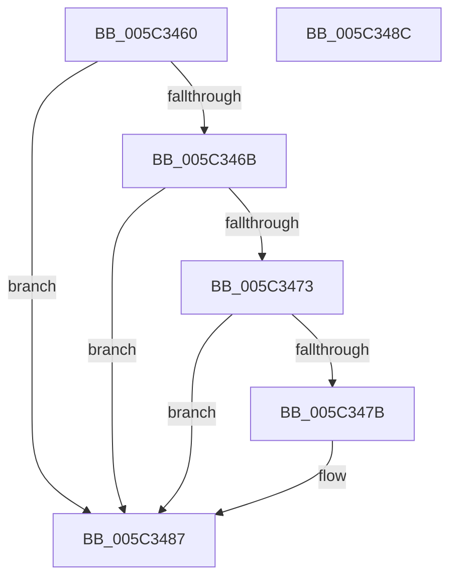

# KiStartDebugAccumulation

- RVA: `0x005C3460`–`0x005C348D` (길이 `45` bytes)
- VA: `0x00000001405C3460`
- 실행 섹션: `.text`
- PDB 이름 있음: `예`; PDB Function 태그: `아니요`
- unwind 정보 RVA: `0x0005C788`
- 디코드: `14`개 명령, `45/45` bytes 표시
- 미해석 바이트: `0` (있으면 어셈블리에 `.byte`로 보존)

> 이 문서는 커널 이미지의 기계어와 PDB 기호를 분석해 생성했습니다. 4번과 5번은 함수 원형과 자료형을 바이너리 사용 방식에서 추정한 C 해석이며 원본 소스 복구 결과는 아닙니다.

## 1. Dependencies

- 직접 호출 지점: **1**; 고유 호출 대상: **1**
- 직접 호출자로 확인된 함수: **2**
- RIP 상대 이미지 참조: **1**

### Outgoing calls
- `0x005C3482` → [KiUpdateTotalCyclesCurrentThread](../37/KiUpdateTotalCyclesCurrentThread_function_0037DE40.md) (function, `0x0037DE40`)

### Direct callers
- [KeFreezeExecution](../4D/KeFreezeExecution_function_004DFA40.md) at `0x004DFB76`
- [KiFreezeTargetExecution](KiFreezeTargetExecution_function_005C30A0.md) at `0x005C315B`

### Static image references
- `0x005C3473` → RVA `0x00F0BD23` (`.data`; read)

## 2. Other-region calls and transfers

- 다른 실행 섹션으로 향하는 call: **0**
- 별도 외부 분기/꼬리 이동을 확인하지 못했습니다.

## 3. Assembly (complete function range)

```asm
005C3460  48 83 EC 28                     sub rsp, 0x28
005C3464  33 C0                           xor eax, eax
005C3466  38 41 20                        cmp byte ptr [rcx + 0x20], al
005C3469  75 1C                           jne 0x1405c3487
005C346B  38 81 DC 86 00 00               cmp byte ptr [rcx + 0x86dc], al
005C3471  74 14                           je 0x1405c3487
005C3473  38 05 AA 88 94 00               cmp byte ptr [rip + 0x9488aa], al
005C3479  75 0C                           jne 0x1405c3487
005C347B  48 8B 51 08                     mov rdx, qword ptr [rcx + 8]
005C347F  45 33 C0                        xor r8d, r8d
005C3482  E8 B9 A9 DB FF                  call 0x14037de40
005C3487  48 83 C4 28                     add rsp, 0x28
005C348B  C3                              ret
005C348C  CC                              int3
```

## 4. C-style interpretation (structured pseudocode)

```c
__int64 __fastcall KiStartDebugAccumulation(__int64 a1, __int64 a2, int a3)
{
    __int64 result;
    __int64 v_rsp;

    v_rsp = (v_rsp) - (40);
    result = 0;
    if ((*(unsigned __int8 *)(a1 + 32)) != 0) goto loc_005C3487;
    if ((*(unsigned __int8 *)(a1 + 34524)) == 0) goto loc_005C3487;
    if ((*(unsigned __int8 *)(v_rip + 9734314)) == 0) {
        a2 = *(unsigned __int64 *)(a1 + 8);
        a3 = 0;
        result = KiUpdateTotalCyclesCurrentThread(a1, a2, a3, a4);
    }
    v_rsp = (v_rsp) + (40);
    return result;
}
```

## 5. (Beta) C Style

```c
int64_t KiStartDebugAccumulation(void *Arg1, int64_t Arg2, int32_t Arg3)
{
    uint8_t *arg1 = (uint8_t *)Arg1;

    int64_t result;
    int64_t local_rsp;

    local_rsp = (local_rsp) - (40);
    result = 0;
    if ((*(uint8_t *)(arg1 + 0x20)) != 0) goto loc_005C3487;
    if ((*(uint8_t *)(arg1 + 0x86DC)) == 0) goto loc_005C3487;
    if ((*(uint8_t *)(v_rip + 0x9488AA)) == 0) {
        Arg2 = *(uint64_t *)(arg1 + 0x8);
        Arg3 = 0;
        result = KiUpdateTotalCyclesCurrentThread(Arg1, Arg2, Arg3, a4);
    }
    local_rsp = (local_rsp) + (40);
    return result;
}
```

### 관측된 메모리 오프셋

구조체 형식이 확인되지 않은 접근은 인자 기준의 오프셋으로만 기록했습니다.

| 기준 인자 | 오프셋 표현 | 폭 (bit) | 접근 |
|---|---:|---:|---|
| `Arg1` | `+ 0x8` | `64` | `R` |
| `Arg1` | `+ 0x20` | `8` | `R` |
| `Arg1` | `+ 0x86DC` | `8` | `R` |

## 6. Execution-region graph

[열기: 2D/3D 그래프와 함수 탐색 컨트롤 패널](../../../control-panel.html?section=text&rva=0x005C3460&view=graph)

- 2D 그래프는 위에서 아래로 흐르고, 3D 그래프는 빈 공간을 드래그해 회전합니다. Shift+드래그는 이동, 휠은 확대·축소, 함수 노드 선택은 대상 보고서 이동입니다.

### Static fallback


