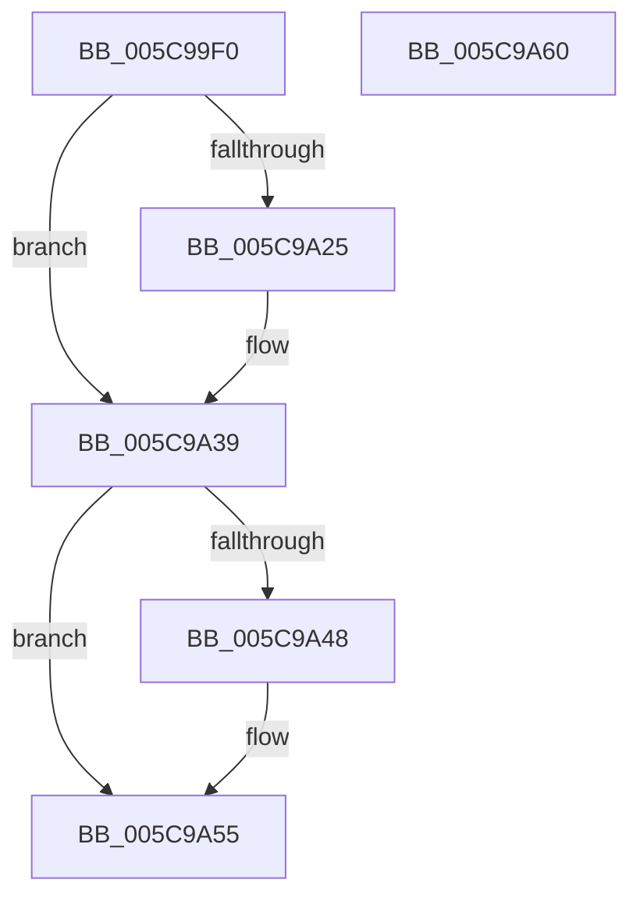

# KiStartForceParkSingleDutyCycleTimerCallback

- RVA: `0x005C99F0`–`0x005C9A61` (길이 `113` bytes)
- VA: `0x00000001405C99F0`
- 실행 섹션: `.text`
- PDB 이름 있음: `예`; PDB Function 태그: `아니요`
- unwind 정보 RVA: `0x0005CAAC`
- 디코드: `30`개 명령, `113/113` bytes 표시
- 미해석 바이트: `0` (있으면 어셈블리에 `.byte`로 보존)

> 이 문서는 커널 이미지의 기계어와 PDB 기호를 분석해 생성했습니다. 4번과 5번은 함수 원형과 자료형을 바이너리 사용 방식에서 추정한 C 해석이며 원본 소스 복구 결과는 아닙니다.

## 1. Dependencies

- 직접 호출 지점: **3**; 고유 호출 대상: **3**
- 직접 호출자로 확인된 함수: **0**
- RIP 상대 이미지 참조: **0**

### Outgoing calls
- `0x005C9A0D` → [KiAcquirePrcbLocksForIsolationUnit](../30/KiAcquirePrcbLocksForIsolationUnit_function_0030ED60.md) (function, `0x0030ED60`)
- `0x005C9A3E` → [KiReleasePrcbLocksForIsolationUnit](../39/KiReleasePrcbLocksForIsolationUnit_function_00399C50.md) (function, `0x00399C50`)
- `0x005C9A50` → [KeInsertQueueDpc](../20/KeInsertQueueDpc_function_00207C50.md) (function, `0x00207C50`)

### Direct callers
- 이 함수 시작 RVA로 연결되는 직접 call은 확인되지 않았습니다. 간접 호출은 완전히 역산할 수 없습니다.

### Static image references
- 디코드된 RIP-relative 메모리 참조가 없습니다.

## 2. Other-region calls and transfers

- 다른 실행 섹션으로 향하는 call: **0**
- 별도 외부 분기/꼬리 이동을 확인하지 못했습니다.

## 3. Assembly (complete function range)

```asm
005C99F0  48 89 5C 24 08                  mov qword ptr [rsp + 8], rbx
005C99F5  57                              push rdi
005C99F6  48 83 EC 20                     sub rsp, 0x20
005C99FA  48 83 64 24 38 00               and qword ptr [rsp + 0x38], 0
005C9A00  4C 8D 44 24 38                  lea r8, [rsp + 0x38]
005C9A05  48 8B DA                        mov rbx, rdx
005C9A08  33 D2                           xor edx, edx
005C9A0A  48 8B CB                        mov rcx, rbx
005C9A0D  E8 4E 53 D4 FF                  call 0x14030ed60
005C9A12  48 8B 9B F0 86 00 00            mov rbx, qword ptr [rbx + 0x86f0]
005C9A19  40 32 FF                        xor dil, dil
005C9A1C  83 BB 50 01 00 00 01            cmp dword ptr [rbx + 0x150], 1
005C9A23  75 14                           jne 0x1405c9a39
005C9A25  B8 02 00 00 00                  mov eax, 2
005C9A2A  40 B7 01                        mov dil, 1
005C9A2D  89 83 50 01 00 00               mov dword ptr [rbx + 0x150], eax
005C9A33  89 83 54 01 00 00               mov dword ptr [rbx + 0x154], eax
005C9A39  48 8D 4C 24 38                  lea rcx, [rsp + 0x38]
005C9A3E  E8 0D 02 DD FF                  call 0x140399c50
005C9A43  40 84 FF                        test dil, dil
005C9A46  74 0D                           je 0x1405c9a55
005C9A48  45 33 C0                        xor r8d, r8d
005C9A4B  33 D2                           xor edx, edx
005C9A4D  48 8B CB                        mov rcx, rbx
005C9A50  E8 FB E1 C3 FF                  call 0x140207c50
005C9A55  48 8B 5C 24 30                  mov rbx, qword ptr [rsp + 0x30]
005C9A5A  48 83 C4 20                     add rsp, 0x20
005C9A5E  5F                              pop rdi
005C9A5F  C3                              ret
005C9A60  CC                              int3
```

## 4. C-style interpretation (structured pseudocode)

```c
__int64 __fastcall KiStartForceParkSingleDutyCycleTimerCallback(__int64 a1, __int64 a2)
{
    __int64 result;
    __int64 v_rdi;
    __int64 v_rsp;
    unsigned __int64 v_stack_p10;
    unsigned __int64 v_stack_p8;

    v_stack_p8 = v_rbx;
    v_rsp = (v_rsp) - (32);
    a2 = 0;
    result = KiAcquirePrcbLocksForIsolationUnit(0, a2, v_stack_p10, a4);
    v_rdi = 0;
    if ((*(unsigned int *)(*(unsigned __int64 *)(a2 + 34544) + 336)) == 1) {
        result = 2;
        v_rdi = 1;
        *(unsigned int *)(*(unsigned __int64 *)(a2 + 34544) + 336) = (unsigned int)(result);
        *(unsigned int *)(*(unsigned __int64 *)(a2 + 34544) + 340) = (unsigned int)(result);
    }
    result = KiReleasePrcbLocksForIsolationUnit(v_stack_p10, a2, v_stack_p10, a4);
    if ((unsigned __int8)(v_rdi) != 0) {
        a3 = 0;
        a2 = 0;
        a1 = *(unsigned __int64 *)(a2 + 34544);
        result = KeInsertQueueDpc(a1, a2, a3, a4);
    }
    v_rsp = (v_rsp) + (32);
    return result;
}
```

## 5. (Beta) C Style

```c
int64_t KiStartForceParkSingleDutyCycleTimerCallback(int64_t Arg1, void *Arg2)
{
    uint8_t *arg2 = (uint8_t *)Arg2;

    int64_t result;
    int64_t local_rdi;
    int64_t local_rsp;
    uint64_t v_stack_p10;
    uint64_t v_stack_p8;

    v_stack_p8 = local_rbx;
    local_rsp = (local_rsp) - (32);
    Arg2 = 0;
    result = KiAcquirePrcbLocksForIsolationUnit(0, Arg2, v_stack_p10, a4);
    local_rdi = 0;
    if ((*(uint32_t *)(*(uint64_t *)(arg2 + 0x86F0) + 0x150)) == 1) {
        result = 2;
        local_rdi = 1;
        *(uint32_t *)(*(uint64_t *)(arg2 + 0x86F0) + 0x150) = (uint32_t)(result);
        *(uint32_t *)(*(uint64_t *)(arg2 + 0x86F0) + 0x154) = (uint32_t)(result);
    }
    result = KiReleasePrcbLocksForIsolationUnit(v_stack_p10, Arg2, v_stack_p10, a4);
    if ((uint8_t)(local_rdi) != 0) {
        a3 = 0;
        Arg2 = 0;
        Arg1 = *(uint64_t *)(arg2 + 0x86F0);
        result = KeInsertQueueDpc(Arg1, Arg2, a3, a4);
    }
    local_rsp = (local_rsp) + (32);
    return result;
}
```

### 관측된 메모리 오프셋

구조체 형식이 확인되지 않은 접근은 인자 기준의 오프셋으로만 기록했습니다.

| 기준 인자 | 오프셋 표현 | 폭 (bit) | 접근 |
|---|---:|---:|---|
| `Arg2` | `+ 0x86F0` | `64` | `R` |

## 6. Execution-region graph

[열기: 2D/3D 그래프와 함수 탐색 컨트롤 패널](../../../control-panel.html?section=text&rva=0x005C99F0&view=graph)

- 2D 그래프는 위에서 아래로 흐르고, 3D 그래프는 빈 공간을 드래그해 회전합니다. Shift+드래그는 이동, 휠은 확대·축소, 함수 노드 선택은 대상 보고서 이동입니다.

### Static fallback


