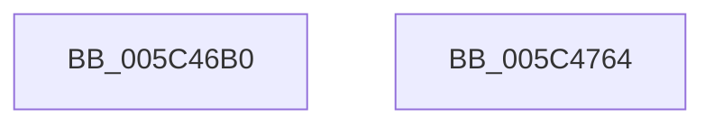

# KiStartIdleThread

- RVA: `0x005C46B0`–`0x005C4765` (길이 `181` bytes)
- VA: `0x00000001405C46B0`
- 실행 섹션: `.text`
- PDB 이름 있음: `예`; PDB Function 태그: `아니요`
- unwind 정보 RVA: `0x000CA9E0`
- 디코드: `42`개 명령, `181/181` bytes 표시
- 미해석 바이트: `0` (있으면 어셈블리에 `.byte`로 보존)

> 이 문서는 커널 이미지의 기계어와 PDB 기호를 분석해 생성했습니다. 4번과 5번은 함수 원형과 자료형을 바이너리 사용 방식에서 추정한 C 해석이며 원본 소스 복구 결과는 아닙니다.

## 1. Dependencies

- 직접 호출 지점: **5**; 고유 호출 대상: **5**
- 직접 호출자로 확인된 함수: **2**
- RIP 상대 이미지 참조: **2**

### Outgoing calls
- `0x005C46D3` → [memset](../6C/memset_function_006C6C40.md) (function, `0x006C6C40`)
- `0x005C4719` → [KiInitializeContextThread](../3D/KiInitializeContextThread_function_003D6400.md) (function, `0x003D6400`)
- `0x005C4724` → [KiStartPrcbThread](../5B/KiStartPrcbThread_function_005B941C.md) (function, `0x005B941C`)
- `0x005C473E` → [KeInterlockedSetProcessorAffinityEx](../35/KeInterlockedSetProcessorAffinityEx_function_00352560.md) (function, `0x00352560`)
- `0x005C474D` → [KiInitializePriorityState](KiInitializePriorityState_function_005C4480.md) (function, `0x005C4480`)

### Direct callers
- [KiInitializeAndStartInitialThread](KiInitializeAndStartInitialThread_function_005C42A4.md) at `0x005C4453`
- [KiInitializeKernel](../../pagelk/B6/KiInitializeKernel_function_00B68D20.md) at `0x00B694FE`

### Static image references
- `0x005C46D8` → RVA `0x006B2910` (`KiIdleLoop`; read)
- `0x005C4737` → RVA `0x00FCFF80` (`CACHEALI`; read)

## 2. Other-region calls and transfers

- 다른 실행 섹션으로 향하는 call: **0**
- 별도 외부 분기/꼬리 이동을 확인하지 못했습니다.

## 3. Assembly (complete function range)

```asm
005C46B0  48 89 5C 24 08                  mov qword ptr [rsp + 8], rbx
005C46B5  48 89 74 24 10                  mov qword ptr [rsp + 0x10], rsi
005C46BA  57                              push rdi
005C46BB  48 83 EC 70                     sub rsp, 0x70
005C46BF  48 8B F2                        mov rsi, rdx
005C46C2  49 8B D8                        mov rbx, r8
005C46C5  33 D2                           xor edx, edx
005C46C7  48 8B F9                        mov rdi, rcx
005C46CA  48 8D 4C 24 20                  lea rcx, [rsp + 0x20]
005C46CF  44 8D 42 48                     lea r8d, [rdx + 0x48]
005C46D3  E8 68 25 10 00                  call 0x1406c6c40
005C46D8  48 8D 05 31 E2 0E 00            lea rax, [rip + 0xee231]
005C46DF  48 89 5C 24 20                  mov qword ptr [rsp + 0x20], rbx
005C46E4  48 89 44 24 28                  mov qword ptr [rsp + 0x28], rax
005C46E9  48 8D 54 24 20                  lea rdx, [rsp + 0x20]
005C46EE  48 8B 87 20 02 00 00            mov rax, qword ptr [rdi + 0x220]
005C46F5  48 8B CF                        mov rcx, rdi
005C46F8  48 89 44 24 50                  mov qword ptr [rsp + 0x50], rax
005C46FD  48 8B 86 C0 00 00 00            mov rax, qword ptr [rsi + 0xc0]
005C4704  C7 44 24 5C 02 00 00 00         mov dword ptr [rsp + 0x5c], 2
005C470C  44 0F B7 80 8A 00 00 00         movzx r8d, word ptr [rax + 0x8a]
005C4714  44 89 44 24 58                  mov dword ptr [rsp + 0x58], r8d
005C4719  E8 E2 1C E1 FF                  call 0x1403d6400
005C471E  48 8B D6                        mov rdx, rsi
005C4721  48 8B CF                        mov rcx, rdi
005C4724  E8 F3 4C FF FF                  call 0x1405b941c
005C4729  C6 87 84 01 00 00 02            mov byte ptr [rdi + 0x184], 2
005C4730  C6 47 71 01                     mov byte ptr [rdi + 0x71], 1
005C4734  8B 56 24                        mov edx, dword ptr [rsi + 0x24]
005C4737  48 8B 0D 42 B8 A0 00            mov rcx, qword ptr [rip + 0xa0b842]
005C473E  E8 1D DE D8 FF                  call 0x140352560
005C4743  48 8B 4E 38                     mov rcx, qword ptr [rsi + 0x38]
005C4747  4C 8B C7                        mov r8, rdi
005C474A  48 8B D6                        mov rdx, rsi
005C474D  E8 2E FD FF FF                  call 0x1405c4480
005C4752  4C 8D 5C 24 70                  lea r11, [rsp + 0x70]
005C4757  49 8B 5B 10                     mov rbx, qword ptr [r11 + 0x10]
005C475B  49 8B 73 18                     mov rsi, qword ptr [r11 + 0x18]
005C475F  49 8B E3                        mov rsp, r11
005C4762  5F                              pop rdi
005C4763  C3                              ret
005C4764  CC                              int3
```

## 4. C-style interpretation (structured pseudocode)

```c
__int64 __fastcall KiStartIdleThread(__int64 a1, __int64 a2, __int64 a3)
{
    __int64 result;
    __int64 v_rsp;
    unsigned int v_stack_m1C;
    unsigned int v_stack_m20;
    unsigned __int64 v_stack_m28;
    unsigned __int64 v_stack_m50;
    unsigned __int64 v_stack_m58;
    unsigned __int64 v_stack_m8;
    unsigned __int64 v_stack_p10;
    unsigned __int64 v_stack_p8;

    v_stack_p8 = v_rbx;
    v_stack_p10 = v_rsi;
    v_rsp = (v_rsp) - (112);
    a2 = 0;
    result = memset(v_stack_m58, a2, a2 + 72, a4);
    v_stack_m58 = a3;
    v_stack_m50 = v_rip + 975409;
    v_stack_m28 = *(unsigned __int64 *)(a1 + 544);
    v_stack_m1C = 2;
    v_stack_m20 = (unsigned int)(*(unsigned __int16 *)(*(unsigned __int64 *)(a2 + 192) + 138));
    result = KiInitializeContextThread(a1, v_stack_m58, *(unsigned __int16 *)(*(unsigned __int64 *)(a2 + 192) + 138), a4);
    result = KiStartPrcbThread(a1, 0, *(unsigned __int16 *)(*(unsigned __int64 *)(a2 + 192) + 138), a4);
    *(unsigned __int8 *)(a1 + 388) = 2;
    *(unsigned __int8 *)(a1 + 113) = 1;
    result = KeInterlockedSetProcessorAffinityEx(*(unsigned __int64 *)(v_rip + 10532930), (unsigned int)(*(unsigned int *)(a2 + 36)), *(unsigned __int16 *)(*(unsigned __int64 *)(a2 + 192) + 138), a4);
    result = KiInitializePriorityState(*(unsigned __int64 *)(a2 + 56), 0, a1, a4);
    return result;
}
```

## 5. (Beta) C Style

```c
int64_t KiStartIdleThread(void *Arg1, void *Arg2, int64_t Arg3)
{
    uint8_t *arg1 = (uint8_t *)Arg1;
    uint8_t *arg2 = (uint8_t *)Arg2;

    int64_t result;
    int64_t local_rsp;
    uint32_t v_stack_m1C;
    uint32_t v_stack_m20;
    uint64_t v_stack_m28;
    uint64_t v_stack_m50;
    uint64_t v_stack_m58;
    uint64_t v_stack_m8;
    uint64_t v_stack_p10;
    uint64_t v_stack_p8;

    v_stack_p8 = local_rbx;
    v_stack_p10 = local_rsi;
    local_rsp = (local_rsp) - (112);
    Arg2 = 0;
    result = memset(v_stack_m58, Arg2, Arg2 + 72, a4);
    v_stack_m58 = Arg3;
    v_stack_m50 = v_rip + 975409;
    v_stack_m28 = *(uint64_t *)(arg1 + 0x220);
    v_stack_m1C = 2;
    v_stack_m20 = (uint32_t)(*(uint16_t *)(*(uint64_t *)(arg2 + 0xC0) + 0x8A));
    result = KiInitializeContextThread(Arg1, v_stack_m58, *(uint16_t *)(*(uint64_t *)(arg2 + 0xC0) + 0x8A), a4);
    result = KiStartPrcbThread(Arg1, 0, *(uint16_t *)(*(uint64_t *)(arg2 + 0xC0) + 0x8A), a4);
    *(uint8_t *)(arg1 + 0x184) = 2;
    *(uint8_t *)(arg1 + 0x71) = 1;
    result = KeInterlockedSetProcessorAffinityEx(*(uint64_t *)(v_rip + 0xA0B842), (uint32_t)(*(uint32_t *)(arg2 + 0x24)), *(uint16_t *)(*(uint64_t *)(arg2 + 0xC0) + 0x8A), a4);
    result = KiInitializePriorityState(*(uint64_t *)(arg2 + 0x38), 0, Arg1, a4);
    return result;
}
```

### 관측된 메모리 오프셋

구조체 형식이 확인되지 않은 접근은 인자 기준의 오프셋으로만 기록했습니다.

| 기준 인자 | 오프셋 표현 | 폭 (bit) | 접근 |
|---|---:|---:|---|
| `Arg1` | `+ 0x71` | `8` | `W` |
| `Arg1` | `+ 0x184` | `8` | `W` |
| `Arg1` | `+ 0x220` | `64` | `R` |
| `Arg2` | `+ 0x24` | `32` | `R` |
| `Arg2` | `+ 0x38` | `64` | `R` |
| `Arg2` | `+ 0xC0` | `64` | `R` |

## 6. Execution-region graph

[열기: 2D/3D 그래프와 함수 탐색 컨트롤 패널](../../../control-panel.html?section=text&rva=0x005C46B0&view=graph)

- 2D 그래프는 위에서 아래로 흐르고, 3D 그래프는 빈 공간을 드래그해 회전합니다. Shift+드래그는 이동, 휠은 확대·축소, 함수 노드 선택은 대상 보고서 이동입니다.

### Static fallback


