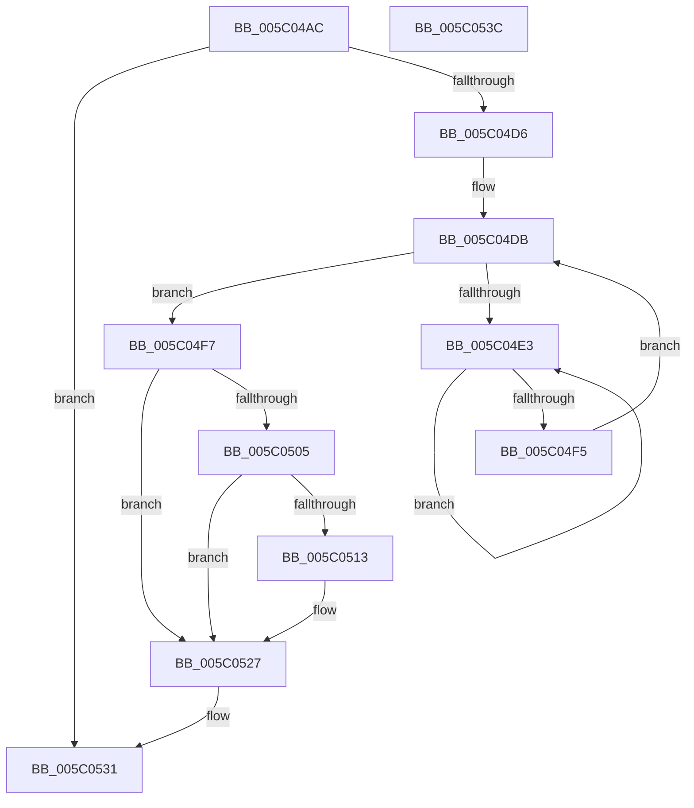

# KiSynchronizeIdleIsolationDomainEntry

- RVA: `0x005C04AC`–`0x005C053D` (길이 `145` bytes)
- VA: `0x00000001405C04AC`
- 실행 섹션: `.text`
- PDB 이름 있음: `예`; PDB Function 태그: `아니요`
- unwind 정보 RVA: `0x00068D5C`
- 디코드: `38`개 명령, `145/145` bytes 표시
- 미해석 바이트: `0` (있으면 어셈블리에 `.byte`로 보존)

> 이 문서는 커널 이미지의 기계어와 PDB 기호를 분석해 생성했습니다. 4번과 5번은 함수 원형과 자료형을 바이너리 사용 방식에서 추정한 C 해석이며 원본 소스 복구 결과는 아닙니다.

## 1. Dependencies

- 직접 호출 지점: **1**; 고유 호출 대상: **1**
- 직접 호출자로 확인된 함수: **1**
- RIP 상대 이미지 참조: **0**

### Outgoing calls
- `0x005C04E8` → [KeYieldProcessorEx](../3F/KeYieldProcessorEx_function_003FBD00.md) (function, `0x003FBD00`)

### Direct callers
- [KiExecuteSmtIsolationThread](KiExecuteSmtIsolationThread_function_005C4070.md) at `0x005C41A4`

### Static image references
- 디코드된 RIP-relative 메모리 참조가 없습니다.

## 2. Other-region calls and transfers

- 다른 실행 섹션으로 향하는 call: **0**
- 별도 외부 분기/꼬리 이동을 확인하지 못했습니다.

## 3. Assembly (complete function range)

```asm
005C04AC  48 89 5C 24 10                  mov qword ptr [rsp + 0x10], rbx
005C04B1  57                              push rdi
005C04B2  48 83 EC 20                     sub rsp, 0x20
005C04B6  65 48 8B 0C 25 20 00 00 00      mov rcx, qword ptr gs:[0x20]
005C04BF  48 8B 81 58 8E 00 00            mov rax, qword ptr [rcx + 0x8e58]
005C04C6  8B B9 B4 AE 00 00               mov edi, dword ptr [rcx + 0xaeb4]
005C04CC  48 8B 58 28                     mov rbx, qword ptr [rax + 0x28]
005C04D0  80 7B 18 01                     cmp byte ptr [rbx + 0x18], 1
005C04D4  74 5B                           je 0x1405c0531
005C04D6  83 64 24 30 00                  and dword ptr [rsp + 0x30], 0
005C04DB  F0 48 0F BA 2B 00               lock bts qword ptr [rbx], 0
005C04E1  73 14                           jae 0x1405c04f7
005C04E3  48 8D 4C 24 30                  lea rcx, [rsp + 0x30]
005C04E8  E8 13 B8 E3 FF                  call 0x1403fbd00
005C04ED  48 8B 03                        mov rax, qword ptr [rbx]
005C04F0  48 85 C0                        test rax, rax
005C04F3  75 EE                           jne 0x1405c04e3
005C04F5  EB E4                           jmp 0x1405c04db
005C04F7  FE 43 19                        inc byte ptr [rbx + 0x19]
005C04FA  48 83 7B 10 01                  cmp qword ptr [rbx + 0x10], 1
005C04FF  0F B6 43 19                     movzx eax, byte ptr [rbx + 0x19]
005C0503  74 22                           je 0x1405c0527
005C0505  0F B6 4B 1A                     movzx ecx, byte ptr [rbx + 0x1a]
005C0509  03 C8                           add ecx, eax
005C050B  0F B6 43 18                     movzx eax, byte ptr [rbx + 0x18]
005C050F  3B C1                           cmp eax, ecx
005C0511  75 14                           jne 0x1405c0527
005C0513  48 8B 43 10                     mov rax, qword ptr [rbx + 0x10]
005C0517  48 89 43 08                     mov qword ptr [rbx + 8], rax
005C051B  C6 43 1A 00                     mov byte ptr [rbx + 0x1a], 0
005C051F  48 C7 43 10 01 00 00 00         mov qword ptr [rbx + 0x10], 1
005C0527  C6 44 1F 1C 01                  mov byte ptr [rdi + rbx + 0x1c], 1
005C052C  F0 48 83 23 00                  lock and qword ptr [rbx], 0
005C0531  48 8B 5C 24 38                  mov rbx, qword ptr [rsp + 0x38]
005C0536  48 83 C4 20                     add rsp, 0x20
005C053A  5F                              pop rdi
005C053B  C3                              ret
005C053C  CC                              int3
```

## 4. C-style interpretation (structured pseudocode)

```c
__int64 __fastcall KiSynchronizeIdleIsolationDomainEntry(void)
{
    __int64 result;
    __int64 v_rsp;
    unsigned __int64 v_stack_p10;
    unsigned int v_stack_p8;

    v_stack_p10 = v_rbx;
    v_rsp = (v_rsp) - (32);
    if ((*(unsigned __int8 *)(*(unsigned __int64 *)(*(unsigned __int64 *)(*(unsigned __int64 *)(gs_base + (0 + 32)) + 36440) + 40) + 24)) == 1) goto loc_005C0531;
loc_005C04DB:
    if ((*(unsigned __int8 *)(*(unsigned __int64 *)(*(unsigned __int64 *)(*(unsigned __int64 *)(gs_base + (0 + 32)) + 36440) + 40) + 24)) >= 1) goto loc_005C04F7;
loc_005C04E3:
    result = KeYieldProcessorEx(v_stack_p8, a2, a3, a4);
    if (*(unsigned __int64 *)(*(unsigned __int64 *)(*(unsigned __int64 *)(*(unsigned __int64 *)(gs_base + (0 + 32)) + 36440) + 40)) != 0) goto loc_005C04E3;
    goto loc_005C04DB;
loc_005C04F7:
    if ((*(unsigned __int64 *)(*(unsigned __int64 *)(*(unsigned __int64 *)(*(unsigned __int64 *)(gs_base + (0 + 32)) + 36440) + 40) + 16)) == 1) goto loc_005C0527;
    a1 = (unsigned int)((*(unsigned __int8 *)(*(unsigned __int64 *)(*(unsigned __int64 *)(*(unsigned __int64 *)(gs_base + (0 + 32)) + 36440) + 40) + 26)) + ((unsigned int)(*(unsigned __int8 *)(*(unsigned __int64 *)(*(unsigned __int64 *)(*(unsigned __int64 *)(gs_base + (0 + 32)) + 36440) + 40) + 25))));
    result = *(unsigned __int8 *)(*(unsigned __int64 *)(*(unsigned __int64 *)(*(unsigned __int64 *)(gs_base + (0 + 32)) + 36440) + 40) + 24);
    if (((unsigned int)(*(unsigned __int8 *)(*(unsigned __int64 *)(*(unsigned __int64 *)(*(unsigned __int64 *)(gs_base + (0 + 32)) + 36440) + 40) + 24))) == ((unsigned int)(a1))) {
        result = *(unsigned __int64 *)(*(unsigned __int64 *)(*(unsigned __int64 *)(*(unsigned __int64 *)(gs_base + (0 + 32)) + 36440) + 40) + 16);
        *(unsigned __int64 *)(*(unsigned __int64 *)(*(unsigned __int64 *)(*(unsigned __int64 *)(gs_base + (0 + 32)) + 36440) + 40) + 8) = result;
        *(unsigned __int8 *)(*(unsigned __int64 *)(*(unsigned __int64 *)(*(unsigned __int64 *)(gs_base + (0 + 32)) + 36440) + 40) + 26) = 0;
        *(unsigned __int64 *)(*(unsigned __int64 *)(*(unsigned __int64 *)(*(unsigned __int64 *)(gs_base + (0 + 32)) + 36440) + 40) + 16) = 1;
    }
    *(unsigned __int8 *)((unsigned int)(*(unsigned int *)(*(unsigned __int64 *)(gs_base + (0 + 32)) + 44724)) + *(unsigned __int64 *)(*(unsigned __int64 *)(*(unsigned __int64 *)(gs_base + (0 + 32)) + 36440) + 40) * 1 + 28) = 1;
loc_005C0531:
    v_rsp = (v_rsp) + (32);
    return result;
}
```

## 5. (Beta) C Style

```c
void KiSynchronizeIdleIsolationDomainEntry(void)
{
    int64_t result;
    int64_t local_rsp;
    uint64_t v_stack_p10;
    uint32_t v_stack_p8;

    v_stack_p10 = local_rbx;
    local_rsp = (local_rsp) - (32);
    if ((*(uint8_t *)(*(uint64_t *)(*(uint64_t *)(*(uint64_t *)(gs_base + (0 + 0x20)) + 0x8E58) + 0x28) + 0x18)) == 1) goto loc_005C0531;
loc_005C04DB:
    if ((*(uint8_t *)(*(uint64_t *)(*(uint64_t *)(*(uint64_t *)(gs_base + (0 + 0x20)) + 0x8E58) + 0x28) + 0x18)) >= 1) goto loc_005C04F7;
loc_005C04E3:
    result = KeYieldProcessorEx(v_stack_p8, a2, a3, a4);
    if (*(uint64_t *)(*(uint64_t *)(*(uint64_t *)(*(uint64_t *)(gs_base + (0 + 0x20)) + 0x8E58) + 0x28)) != 0) goto loc_005C04E3;
    goto loc_005C04DB;
loc_005C04F7:
    if ((*(uint64_t *)(*(uint64_t *)(*(uint64_t *)(*(uint64_t *)(gs_base + (0 + 0x20)) + 0x8E58) + 0x28) + 0x10)) == 1) goto loc_005C0527;
    a1 = (uint32_t)((*(uint8_t *)(*(uint64_t *)(*(uint64_t *)(*(uint64_t *)(gs_base + (0 + 0x20)) + 0x8E58) + 0x28) + 0x1A)) + ((uint32_t)(*(uint8_t *)(*(uint64_t *)(*(uint64_t *)(*(uint64_t *)(gs_base + (0 + 0x20)) + 0x8E58) + 0x28) + 0x19))));
    result = *(uint8_t *)(*(uint64_t *)(*(uint64_t *)(*(uint64_t *)(gs_base + (0 + 0x20)) + 0x8E58) + 0x28) + 0x18);
    if (((uint32_t)(*(uint8_t *)(*(uint64_t *)(*(uint64_t *)(*(uint64_t *)(gs_base + (0 + 0x20)) + 0x8E58) + 0x28) + 0x18))) == ((uint32_t)(a1))) {
        result = *(uint64_t *)(*(uint64_t *)(*(uint64_t *)(*(uint64_t *)(gs_base + (0 + 0x20)) + 0x8E58) + 0x28) + 0x10);
        *(uint64_t *)(*(uint64_t *)(*(uint64_t *)(*(uint64_t *)(gs_base + (0 + 0x20)) + 0x8E58) + 0x28) + 0x8) = result;
        *(uint8_t *)(*(uint64_t *)(*(uint64_t *)(*(uint64_t *)(gs_base + (0 + 0x20)) + 0x8E58) + 0x28) + 0x1A) = 0;
        *(uint64_t *)(*(uint64_t *)(*(uint64_t *)(*(uint64_t *)(gs_base + (0 + 0x20)) + 0x8E58) + 0x28) + 0x10) = 1;
    }
    *(uint8_t *)((uint32_t)(*(uint32_t *)(*(uint64_t *)(gs_base + (0 + 0x20)) + 0xAEB4)) + *(uint64_t *)(*(uint64_t *)(*(uint64_t *)(gs_base + (0 + 0x20)) + 0x8E58) + 0x28) * 1 + 0x1C) = 1;
loc_005C0531:
    local_rsp = (local_rsp) + (32);
    return result;
}
```

## 6. Execution-region graph

[열기: 2D/3D 그래프와 함수 탐색 컨트롤 패널](../../../control-panel.html?section=text&rva=0x005C04AC&view=graph)

- 2D 그래프는 위에서 아래로 흐르고, 3D 그래프는 빈 공간을 드래그해 회전합니다. Shift+드래그는 이동, 휠은 확대·축소, 함수 노드 선택은 대상 보고서 이동입니다.

### Static fallback


