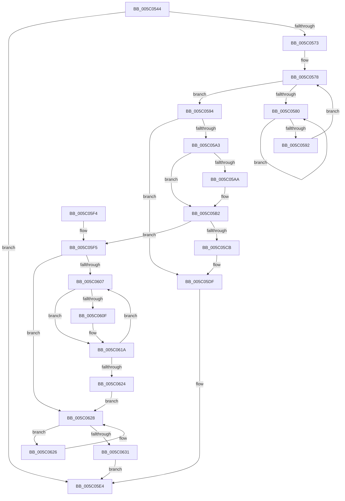

# KiSynchronizeIdleIsolationDomainExit

- RVA: `0x005C0544`–`0x005C0637` (길이 `243` bytes)
- VA: `0x00000001405C0544`
- 실행 섹션: `.text`
- PDB 이름 있음: `예`; PDB Function 태그: `아니요`
- unwind 정보 RVA: `0x000CA570`
- 디코드: `67`개 명령, `243/243` bytes 표시
- 미해석 바이트: `0` (있으면 어셈블리에 `.byte`로 보존)

> 이 문서는 커널 이미지의 기계어와 PDB 기호를 분석해 생성했습니다. 4번과 5번은 함수 원형과 자료형을 바이너리 사용 방식에서 추정한 C 해석이며 원본 소스 복구 결과는 아닙니다.

## 1. Dependencies

- 직접 호출 지점: **2**; 고유 호출 대상: **2**
- 직접 호출자로 확인된 함수: **1**
- RIP 상대 이미지 참조: **0**

### Outgoing calls
- `0x005C0585` → [KeYieldProcessorEx](../3F/KeYieldProcessorEx_function_003FBD00.md) (function, `0x003FBD00`)
- `0x005C0615` → [KiSendSoftwareInterrupt](../25/KiSendSoftwareInterrupt_function_00250A30.md) (function, `0x00250A30`)

### Direct callers
- [KiExecuteSmtIsolationThread](KiExecuteSmtIsolationThread_function_005C4070.md) at `0x005C4219`

### Static image references
- 디코드된 RIP-relative 메모리 참조가 없습니다.

## 2. Other-region calls and transfers

- 다른 실행 섹션으로 향하는 call: **0**
- 별도 외부 분기/꼬리 이동을 확인하지 못했습니다.

## 3. Assembly (complete function range)

```asm
005C0544  48 89 5C 24 10                  mov qword ptr [rsp + 0x10], rbx
005C0549  48 89 74 24 18                  mov qword ptr [rsp + 0x18], rsi
005C054E  57                              push rdi
005C054F  48 83 EC 20                     sub rsp, 0x20
005C0553  65 48 8B 0C 25 20 00 00 00      mov rcx, qword ptr gs:[0x20]
005C055C  48 8B 81 58 8E 00 00            mov rax, qword ptr [rcx + 0x8e58]
005C0563  8B B1 B4 AE 00 00               mov esi, dword ptr [rcx + 0xaeb4]
005C0569  48 8B 58 28                     mov rbx, qword ptr [rax + 0x28]
005C056D  80 7B 18 01                     cmp byte ptr [rbx + 0x18], 1
005C0571  74 71                           je 0x1405c05e4
005C0573  83 64 24 30 00                  and dword ptr [rsp + 0x30], 0
005C0578  F0 48 0F BA 2B 00               lock bts qword ptr [rbx], 0
005C057E  73 14                           jae 0x1405c0594
005C0580  48 8D 4C 24 30                  lea rcx, [rsp + 0x30]
005C0585  E8 76 B7 E3 FF                  call 0x1403fbd00
005C058A  48 8B 03                        mov rax, qword ptr [rbx]
005C058D  48 85 C0                        test rax, rax
005C0590  75 EE                           jne 0x1405c0580
005C0592  EB E4                           jmp 0x1405c0578
005C0594  FE 4B 19                        dec byte ptr [rbx + 0x19]
005C0597  C6 44 1E 1C 00                  mov byte ptr [rsi + rbx + 0x1c], 0
005C059C  48 83 7B 08 00                  cmp qword ptr [rbx + 8], 0
005C05A1  74 3C                           je 0x1405c05df
005C05A3  48 83 7B 10 01                  cmp qword ptr [rbx + 0x10], 1
005C05A8  75 08                           jne 0x1405c05b2
005C05AA  48 C7 43 10 00 00 00 00         mov qword ptr [rbx + 0x10], 0
005C05B2  8A 43 1A                        mov al, byte ptr [rbx + 0x1a]
005C05B5  0F B6 4B 19                     movzx ecx, byte ptr [rbx + 0x19]
005C05B9  FE C0                           inc al
005C05BB  0F B6 D0                        movzx edx, al
005C05BE  0F B6 43 18                     movzx eax, byte ptr [rbx + 0x18]
005C05C2  03 CA                           add ecx, edx
005C05C4  88 53 1A                        mov byte ptr [rbx + 0x1a], dl
005C05C7  3B C1                           cmp eax, ecx
005C05C9  75 2A                           jne 0x1405c05f5
005C05CB  48 C7 43 08 00 00 00 00         mov qword ptr [rbx + 8], 0
005C05D3  C6 43 1A 00                     mov byte ptr [rbx + 0x1a], 0
005C05D7  48 C7 43 10 01 00 00 00         mov qword ptr [rbx + 0x10], 1
005C05DF  F0 48 83 23 00                  lock and qword ptr [rbx], 0
005C05E4  48 8B 5C 24 38                  mov rbx, qword ptr [rsp + 0x38]
005C05E9  48 8B 74 24 40                  mov rsi, qword ptr [rsp + 0x40]
005C05EE  48 83 C4 20                     add rsp, 0x20
005C05F2  5F                              pop rdi
005C05F3  C3                              ret
005C05F4  CC                              int3
005C05F5  C6 44 1E 1C 02                  mov byte ptr [rsi + rbx + 0x1c], 2
005C05FA  F0 48 83 23 00                  lock and qword ptr [rbx], 0
005C05FF  33 FF                           xor edi, edi
005C0601  40 38 7B 18                     cmp byte ptr [rbx + 0x18], dil
005C0605  76 21                           jbe 0x1405c0628
005C0607  8A 44 1F 1C                     mov al, byte ptr [rdi + rbx + 0x1c]
005C060B  A8 03                           test al, 3
005C060D  75 0B                           jne 0x1405c061a
005C060F  8B 4C FB 20                     mov ecx, dword ptr [rbx + rdi*8 + 0x20]
005C0613  B2 01                           mov dl, 1
005C0615  E8 16 04 C9 FF                  call 0x140250a30
005C061A  0F B6 43 18                     movzx eax, byte ptr [rbx + 0x18]
005C061E  FF C7                           inc edi
005C0620  3B F8                           cmp edi, eax
005C0622  72 E3                           jb 0x1405c0607
005C0624  EB 02                           jmp 0x1405c0628
005C0626  F3 90                           pause
005C0628  48 8B 43 08                     mov rax, qword ptr [rbx + 8]
005C062C  48 85 C0                        test rax, rax
005C062F  75 F5                           jne 0x1405c0626
005C0631  88 44 1E 1C                     mov byte ptr [rsi + rbx + 0x1c], al
005C0635  EB AD                           jmp 0x1405c05e4
```

## 4. C-style interpretation (structured pseudocode)

```c
__int64 __fastcall KiSynchronizeIdleIsolationDomainExit(void)
{
    __int64 result;
    __int64 v_rdi;
    __int64 v_rsp;
    unsigned __int64 v_stack_p10;
    unsigned __int64 v_stack_p18;
    unsigned int v_stack_p8;

    v_stack_p10 = v_rbx;
    v_stack_p18 = v_rsi;
    v_rsp = (v_rsp) - (32);
    if ((*(unsigned __int8 *)(*(unsigned __int64 *)(*(unsigned __int64 *)(*(unsigned __int64 *)(gs_base + (0 + 32)) + 36440) + 40) + 24)) == 1) goto loc_005C05E4;
loc_005C0578:
    if ((*(unsigned __int8 *)(*(unsigned __int64 *)(*(unsigned __int64 *)(*(unsigned __int64 *)(gs_base + (0 + 32)) + 36440) + 40) + 24)) >= 1) goto loc_005C0594;
loc_005C0580:
    result = KeYieldProcessorEx(v_stack_p8, a2, a3, a4);
    if (*(unsigned __int64 *)(*(unsigned __int64 *)(*(unsigned __int64 *)(*(unsigned __int64 *)(gs_base + (0 + 32)) + 36440) + 40)) != 0) goto loc_005C0580;
    goto loc_005C0578;
loc_005C0594:
    *(unsigned __int8 *)((unsigned int)(*(unsigned int *)(*(unsigned __int64 *)(gs_base + (0 + 32)) + 44724)) + *(unsigned __int64 *)(*(unsigned __int64 *)(*(unsigned __int64 *)(gs_base + (0 + 32)) + 36440) + 40) * 1 + 28) = 0;
    if ((*(unsigned __int64 *)(*(unsigned __int64 *)(*(unsigned __int64 *)(*(unsigned __int64 *)(gs_base + (0 + 32)) + 36440) + 40) + 8)) == 0) goto loc_005C05DF;
    if ((*(unsigned __int64 *)(*(unsigned __int64 *)(*(unsigned __int64 *)(*(unsigned __int64 *)(gs_base + (0 + 32)) + 36440) + 40) + 16)) == 1) {
        *(unsigned __int64 *)(*(unsigned __int64 *)(*(unsigned __int64 *)(*(unsigned __int64 *)(gs_base + (0 + 32)) + 36440) + 40) + 16) = 0;
    }
    result = (unsigned __int8)((*(unsigned __int8 *)(*(unsigned __int64 *)(*(unsigned __int64 *)(*(unsigned __int64 *)(gs_base + (0 + 32)) + 36440) + 40) + 26)) + 1);
    a1 = (unsigned int)((*(unsigned __int8 *)(*(unsigned __int64 *)(*(unsigned __int64 *)(*(unsigned __int64 *)(gs_base + (0 + 32)) + 36440) + 40) + 25)) + ((unsigned int)((unsigned __int8)(result))));
    *(unsigned __int8 *)(*(unsigned __int64 *)(*(unsigned __int64 *)(*(unsigned __int64 *)(gs_base + (0 + 32)) + 36440) + 40) + 26) = (unsigned __int8)((unsigned __int8)(result));
    if (((unsigned int)(*(unsigned __int8 *)(*(unsigned __int64 *)(*(unsigned __int64 *)(*(unsigned __int64 *)(gs_base + (0 + 32)) + 36440) + 40) + 24))) != ((unsigned int)(a1))) goto loc_005C05F5;
    *(unsigned __int64 *)(*(unsigned __int64 *)(*(unsigned __int64 *)(*(unsigned __int64 *)(gs_base + (0 + 32)) + 36440) + 40) + 8) = 0;
    *(unsigned __int8 *)(*(unsigned __int64 *)(*(unsigned __int64 *)(*(unsigned __int64 *)(gs_base + (0 + 32)) + 36440) + 40) + 26) = 0;
    *(unsigned __int64 *)(*(unsigned __int64 *)(*(unsigned __int64 *)(*(unsigned __int64 *)(gs_base + (0 + 32)) + 36440) + 40) + 16) = 1;
loc_005C05DF:
loc_005C05E4:
    v_rsp = (v_rsp) + (32);
    return *(unsigned __int8 *)(*(unsigned __int64 *)(*(unsigned __int64 *)(*(unsigned __int64 *)(gs_base + (0 + 32)) + 36440) + 40) + 24);
loc_005C05F5:
    *(unsigned __int8 *)(v_stack_p18 + v_stack_p10 * 1 + 28) = 2;
    v_rdi = 0;
    if ((*(unsigned __int8 *)(v_stack_p10 + 24)) <= 0) goto loc_005C0628;
loc_005C0607:
    result = *(unsigned __int8 *)(v_rdi + v_stack_p10 * 1 + 28);
    if ((((unsigned __int8)(*(unsigned __int8 *)(v_rdi + v_stack_p10 * 1 + 28))) & (3)) == 0) {
        a1 = *(unsigned int *)(v_stack_p10 + v_rdi * 8 + 32);
        a2 = 1;
        result = KiSendSoftwareInterrupt(a1, a2, a3, a4);
    }
    v_rdi = (unsigned int)((v_rdi) + 1);
    if (((unsigned int)(v_rdi)) < ((unsigned int)(*(unsigned __int8 *)(v_stack_p10 + 24)))) goto loc_005C0607;
    goto loc_005C0628;
loc_005C0626:
loc_005C0628:
    if (*(unsigned __int64 *)(v_stack_p10 + 8) != 0) goto loc_005C0626;
    *(unsigned __int8 *)(v_stack_p18 + v_stack_p10 * 1 + 28) = (unsigned __int8)(*(unsigned __int64 *)(v_stack_p10 + 8));
    goto loc_005C05E4;
}
```

## 5. (Beta) C Style

```c
void KiSynchronizeIdleIsolationDomainExit(void)
{
    int64_t result;
    int64_t local_rdi;
    int64_t local_rsp;
    uint64_t v_stack_p10;
    uint64_t v_stack_p18;
    uint32_t v_stack_p8;

    v_stack_p10 = local_rbx;
    v_stack_p18 = local_rsi;
    local_rsp = (local_rsp) - (32);
    if ((*(uint8_t *)(*(uint64_t *)(*(uint64_t *)(*(uint64_t *)(gs_base + (0 + 0x20)) + 0x8E58) + 0x28) + 0x18)) == 1) goto loc_005C05E4;
loc_005C0578:
    if ((*(uint8_t *)(*(uint64_t *)(*(uint64_t *)(*(uint64_t *)(gs_base + (0 + 0x20)) + 0x8E58) + 0x28) + 0x18)) >= 1) goto loc_005C0594;
loc_005C0580:
    result = KeYieldProcessorEx(v_stack_p8, a2, a3, a4);
    if (*(uint64_t *)(*(uint64_t *)(*(uint64_t *)(*(uint64_t *)(gs_base + (0 + 0x20)) + 0x8E58) + 0x28)) != 0) goto loc_005C0580;
    goto loc_005C0578;
loc_005C0594:
    *(uint8_t *)((uint32_t)(*(uint32_t *)(*(uint64_t *)(gs_base + (0 + 0x20)) + 0xAEB4)) + *(uint64_t *)(*(uint64_t *)(*(uint64_t *)(gs_base + (0 + 0x20)) + 0x8E58) + 0x28) * 1 + 0x1C) = 0;
    if ((*(uint64_t *)(*(uint64_t *)(*(uint64_t *)(*(uint64_t *)(gs_base + (0 + 0x20)) + 0x8E58) + 0x28) + 0x8)) == 0) goto loc_005C05DF;
    if ((*(uint64_t *)(*(uint64_t *)(*(uint64_t *)(*(uint64_t *)(gs_base + (0 + 0x20)) + 0x8E58) + 0x28) + 0x10)) == 1) {
        *(uint64_t *)(*(uint64_t *)(*(uint64_t *)(*(uint64_t *)(gs_base + (0 + 0x20)) + 0x8E58) + 0x28) + 0x10) = 0;
    }
    result = (uint8_t)((*(uint8_t *)(*(uint64_t *)(*(uint64_t *)(*(uint64_t *)(gs_base + (0 + 0x20)) + 0x8E58) + 0x28) + 0x1A)) + 1);
    a1 = (uint32_t)((*(uint8_t *)(*(uint64_t *)(*(uint64_t *)(*(uint64_t *)(gs_base + (0 + 0x20)) + 0x8E58) + 0x28) + 0x19)) + ((uint32_t)((uint8_t)(result))));
    *(uint8_t *)(*(uint64_t *)(*(uint64_t *)(*(uint64_t *)(gs_base + (0 + 0x20)) + 0x8E58) + 0x28) + 0x1A) = (uint8_t)((uint8_t)(result));
    if (((uint32_t)(*(uint8_t *)(*(uint64_t *)(*(uint64_t *)(*(uint64_t *)(gs_base + (0 + 0x20)) + 0x8E58) + 0x28) + 0x18))) != ((uint32_t)(a1))) goto loc_005C05F5;
    *(uint64_t *)(*(uint64_t *)(*(uint64_t *)(*(uint64_t *)(gs_base + (0 + 0x20)) + 0x8E58) + 0x28) + 0x8) = 0;
    *(uint8_t *)(*(uint64_t *)(*(uint64_t *)(*(uint64_t *)(gs_base + (0 + 0x20)) + 0x8E58) + 0x28) + 0x1A) = 0;
    *(uint64_t *)(*(uint64_t *)(*(uint64_t *)(*(uint64_t *)(gs_base + (0 + 0x20)) + 0x8E58) + 0x28) + 0x10) = 1;
loc_005C05DF:
loc_005C05E4:
    local_rsp = (local_rsp) + (32);
    return *(uint8_t *)(*(uint64_t *)(*(uint64_t *)(*(uint64_t *)(gs_base + (0 + 0x20)) + 0x8E58) + 0x28) + 0x18);
loc_005C05F5:
    *(uint8_t *)(v_stack_p18 + v_stack_p10 * 1 + 0x1C) = 2;
    local_rdi = 0;
    if ((*(uint8_t *)(v_stack_p10 + 0x18)) <= 0) goto loc_005C0628;
loc_005C0607:
    result = *(uint8_t *)(local_rdi + v_stack_p10 * 1 + 0x1C);
    if ((((uint8_t)(*(uint8_t *)(local_rdi + v_stack_p10 * 1 + 0x1C))) & (3)) == 0) {
        a1 = *(uint32_t *)(v_stack_p10 + local_rdi * 8 + 0x20);
        a2 = 1;
        result = KiSendSoftwareInterrupt(a1, a2, a3, a4);
    }
    local_rdi = (uint32_t)((local_rdi) + 1);
    if (((uint32_t)(local_rdi)) < ((uint32_t)(*(uint8_t *)(v_stack_p10 + 0x18)))) goto loc_005C0607;
    goto loc_005C0628;
loc_005C0626:
loc_005C0628:
    if (*(uint64_t *)(v_stack_p10 + 0x8) != 0) goto loc_005C0626;
    *(uint8_t *)(v_stack_p18 + v_stack_p10 * 1 + 0x1C) = (uint8_t)(*(uint64_t *)(v_stack_p10 + 0x8));
    goto loc_005C05E4;
}
```

## 6. Execution-region graph

[열기: 2D/3D 그래프와 함수 탐색 컨트롤 패널](../../../control-panel.html?section=text&rva=0x005C0544&view=graph)

- 2D 그래프는 위에서 아래로 흐르고, 3D 그래프는 빈 공간을 드래그해 회전합니다. Shift+드래그는 이동, 휠은 확대·축소, 함수 노드 선택은 대상 보고서 이동입니다.

### Static fallback


