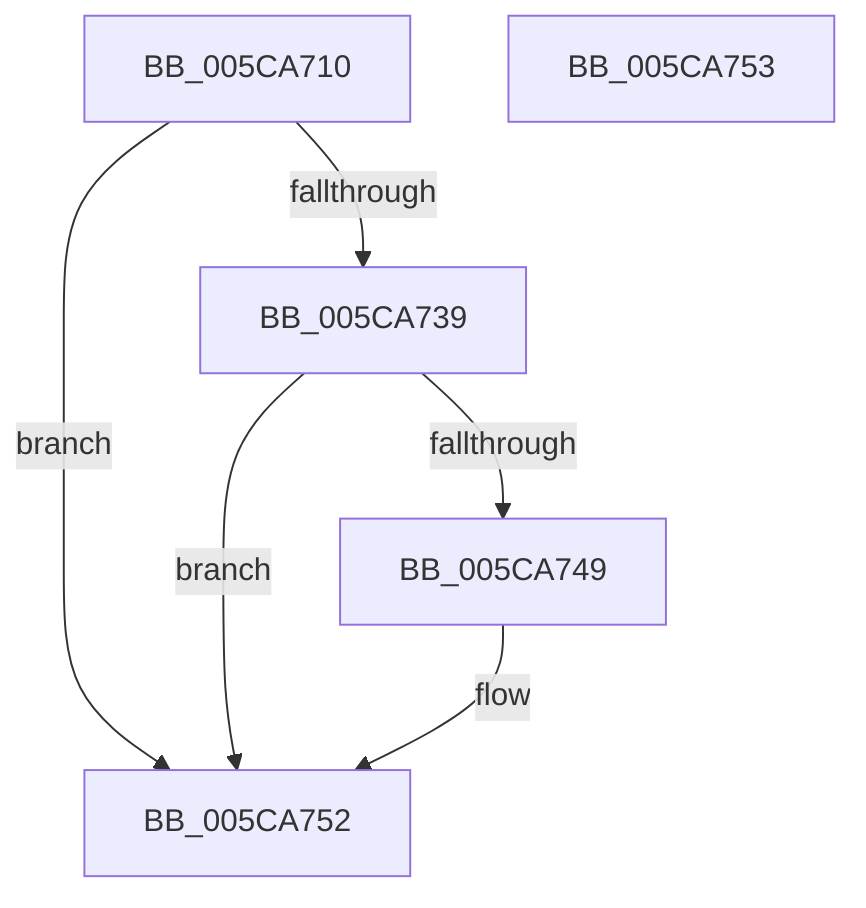

# KiSynchronizeSecurityDomainTarget

- RVA: `0x005CA710`–`0x005CA754` (길이 `68` bytes)
- VA: `0x00000001405CA710`
- 실행 섹션: `.text`
- PDB 이름 있음: `예`; PDB Function 태그: `아니요`
- unwind 정보 RVA: `0x000DB714`
- 디코드: `12`개 명령, `68/68` bytes 표시
- 미해석 바이트: `0` (있으면 어셈블리에 `.byte`로 보존)

> 이 문서는 커널 이미지의 기계어와 PDB 기호를 분석해 생성했습니다. 4번과 5번은 함수 원형과 자료형을 바이너리 사용 방식에서 추정한 C 해석이며 원본 소스 복구 결과는 아닙니다.

## 1. Dependencies

- 직접 호출 지점: **0**; 고유 호출 대상: **0**
- 직접 호출자로 확인된 함수: **1**
- RIP 상대 이미지 참조: **0**

### Outgoing calls
- 직접 디코드된 call 명령이 없습니다.

### Direct callers
- [KeSynchronizeSecurityDomain](../4B/KeSynchronizeSecurityDomain_function_004B0FE0.md) at `0x004B114B`

### Static image references
- 디코드된 RIP-relative 메모리 참조가 없습니다.

## 2. Other-region calls and transfers

- 다른 실행 섹션으로 향하는 call: **0**
- 별도 외부 분기/꼬리 이동을 확인하지 못했습니다.

## 3. Assembly (complete function range)

```asm
005CA710  65 48 8B 04 25 88 01 00 00      mov rax, qword ptr gs:[0x188]
005CA719  65 48 8B 0C 25 20 00 00 00      mov rcx, qword ptr gs:[0x20]
005CA722  48 8B 90 B8 00 00 00            mov rdx, qword ptr [rax + 0xb8]
005CA729  0F 0D 89 E0 06 00 00            prefetchw byte ptr [rcx + 0x6e0]
005CA730  F6 81 E0 06 00 00 04            test byte ptr [rcx + 0x6e0], 4
005CA737  74 19                           je 0x1405ca752
005CA739  48 8B 82 60 07 00 00            mov rax, qword ptr [rdx + 0x760]
005CA740  48 3B 81 D0 06 00 00            cmp rax, qword ptr [rcx + 0x6d0]
005CA747  74 09                           je 0x1405ca752
005CA749  66 F0 83 89 E0 06 00 00 02      lock or word ptr [rcx + 0x6e0], 2
005CA752  C3                              ret
005CA753  CC                              int3
```

## 4. C-style interpretation (structured pseudocode)

```c
__int64 __fastcall KiSynchronizeSecurityDomainTarget(void)
{
    if (((*(unsigned __int8 *)(*(unsigned __int64 *)(gs_base + (0 + 32)) + 1760)) & (4)) == 0) goto loc_005CA752;
    if ((*(unsigned __int64 *)(*(unsigned __int64 *)(*(unsigned __int64 *)(gs_base + (0 + 392)) + 184) + 1888)) != (*(unsigned __int64 *)(*(unsigned __int64 *)(gs_base + (0 + 32)) + 1744))) {
    }
    return *(unsigned __int64 *)(*(unsigned __int64 *)(*(unsigned __int64 *)(gs_base + (0 + 392)) + 184) + 1888);
}
```

## 5. (Beta) C Style

```c
void KiSynchronizeSecurityDomainTarget(void)
{
    if (((*(uint8_t *)(*(uint64_t *)(gs_base + (0 + 0x20)) + 0x6E0)) & (4)) == 0) goto loc_005CA752;
    if ((*(uint64_t *)(*(uint64_t *)(*(uint64_t *)(gs_base + (0 + 0x188)) + 0xB8) + 0x760)) != (*(uint64_t *)(*(uint64_t *)(gs_base + (0 + 0x20)) + 0x6D0))) {
    }
    return *(uint64_t *)(*(uint64_t *)(*(uint64_t *)(gs_base + (0 + 0x188)) + 0xB8) + 0x760);
}
```

## 6. Execution-region graph

[열기: 2D/3D 그래프와 함수 탐색 컨트롤 패널](../../../control-panel.html?section=text&rva=0x005CA710&view=graph)

- 2D 그래프는 위에서 아래로 흐르고, 3D 그래프는 빈 공간을 드래그해 회전합니다. Shift+드래그는 이동, 휠은 확대·축소, 함수 노드 선택은 대상 보고서 이동입니다.

### Static fallback


