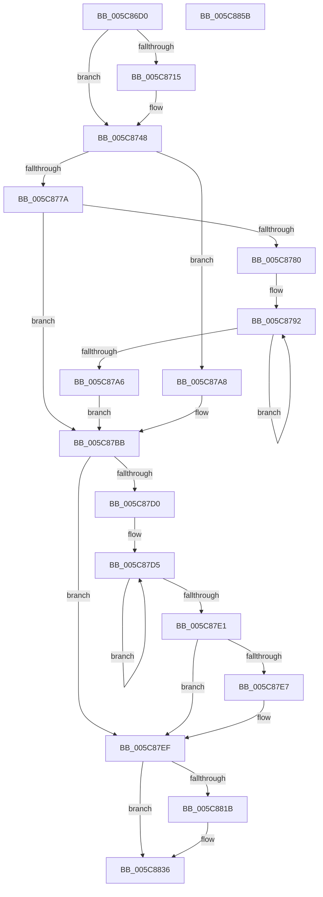

# KiTimerExpirationDpc

- RVA: `0x005C86D0`–`0x005C885C` (길이 `396` bytes)
- VA: `0x00000001405C86D0`
- 실행 섹션: `.text`
- PDB 이름 있음: `예`; PDB Function 태그: `아니요`
- unwind 정보 RVA: `0x000CABF0`
- 디코드: `90`개 명령, `396/396` bytes 표시
- 미해석 바이트: `0` (있으면 어셈블리에 `.byte`로 보존)

> 이 문서는 커널 이미지의 기계어와 PDB 기호를 분석해 생성했습니다. 4번과 5번은 함수 원형과 자료형을 바이너리 사용 방식에서 추정한 C 해석이며 원본 소스 복구 결과는 아닙니다.

## 1. Dependencies

- 직접 호출 지점: **6**; 고유 호출 대상: **6**
- 직접 호출자로 확인된 함수: **0**
- RIP 상대 이미지 참조: **4**

### Outgoing calls
- `0x005C8704` → [memset](../6C/memset_function_006C6C40.md) (function, `0x006C6C40`)
- `0x005C8743` → [EtwTraceKernelEvent](../23/EtwTraceKernelEvent_function_00235350.md) (function, `0x00235350`)
- `0x005C87EA` → [KiRemoveSystemWorkPriorityKick](../26/KiRemoveSystemWorkPriorityKick_function_002631D0.md) (function, `0x002631D0`)
- `0x005C8805` → [KiTimerExpiration](../23/KiTimerExpiration_function_00234840.md) (function, `0x00234840`)
- `0x005C8831` → [KiTimer2Expiration](../3A/KiTimer2Expiration_function_003A1880.md) (function, `0x003A1880`)
- `0x005C8841` → [_security_check_cookie](../6A/_security_check_cookie_function_006AC640.md) (function, `0x006AC640`)

### Direct callers
- 이 함수 시작 RVA로 연결되는 직접 call은 확인되지 않았습니다. 간접 호출은 완전히 역산할 수 없습니다.

### Static image references
- `0x005C86E2` → RVA `0x00E0A740` (`.data`; read)
- `0x005C8709` → RVA `0x00FC6B08` (`ALMOSTRO`; read)
- `0x005C8771` → RVA `0x00FC5030` (`ALMOSTRO`; read)
- `0x005C8792` → RVA `0x00FC8C40` (`ALMOSTRO`; read)

## 2. Other-region calls and transfers

- 다른 실행 섹션으로 향하는 call: **0**
- 별도 외부 분기/꼬리 이동을 확인하지 못했습니다.

## 3. Assembly (complete function range)

```asm
005C86D0  48 89 5C 24 08                  mov qword ptr [rsp + 8], rbx
005C86D5  48 89 74 24 10                  mov qword ptr [rsp + 0x10], rsi
005C86DA  57                              push rdi
005C86DB  48 81 EC E0 01 00 00            sub rsp, 0x1e0
005C86E2  48 8B 05 57 20 84 00            mov rax, qword ptr [rip + 0x842057]
005C86E9  48 33 C4                        xor rax, rsp
005C86EC  48 89 84 24 D0 01 00 00         mov qword ptr [rsp + 0x1d0], rax
005C86F4  49 8B F0                        mov rsi, r8
005C86F7  48 8D 4C 24 40                  lea rcx, [rsp + 0x40]
005C86FC  41 B8 90 01 00 00               mov r8d, 0x190
005C8702  33 D2                           xor edx, edx
005C8704  E8 37 E5 0F 00                  call 0x1406c6c40
005C8709  F7 05 F5 E3 9F 00 00 00 02 00   test dword ptr [rip + 0x9fe3f5], 0x20000
005C8713  74 33                           je 0x1405c8748
005C8715  48 83 64 24 30 00               and qword ptr [rsp + 0x30], 0
005C871B  48 8D 4C 24 30                  lea rcx, [rsp + 0x30]
005C8720  83 64 24 38 00                  and dword ptr [rsp + 0x38], 0
005C8725  41 B9 56 0F 00 00               mov r9d, 0xf56
005C872B  83 64 24 3C 00                  and dword ptr [rsp + 0x3c], 0
005C8730  BA 01 00 00 00                  mov edx, 1
005C8735  41 B8 00 00 02 40               mov r8d, 0x40020000
005C873B  C7 44 24 20 02 0A 50 00         mov dword ptr [rsp + 0x20], 0x500a02
005C8743  E8 08 CC C6 FF                  call 0x140235350
005C8748  65 48 8B 1C 25 20 00 00 00      mov rbx, qword ptr gs:[0x20]
005C8751  48 B8 14 00 00 00 80 F7 FF FF   movabs rax, 0xfffff78000000014
005C875B  48 8B 00                        mov rax, qword ptr [rax]
005C875E  48 89 44 24 48                  mov qword ptr [rsp + 0x48], rax
005C8763  FA                              cli
005C8764  48 BF 08 00 00 00 80 F7 FF FF   movabs rdi, 0xfffff78000000008
005C876E  48 8B 3F                        mov rdi, qword ptr [rdi]
005C8771  83 3D B8 C8 9F 00 00            cmp dword ptr [rip + 0x9fc8b8], 0
005C8778  74 2E                           je 0x1405c87a8
005C877A  80 7B 21 00                     cmp byte ptr [rbx + 0x21], 0
005C877E  74 3B                           je 0x1405c87bb
005C8780  48 8B CF                        mov rcx, rdi
005C8783  BA 10 83 00 00                  mov edx, 0x8310
005C8788  48 C1 E9 12                     shr rcx, 0x12
005C878C  41 B8 02 00 00 00               mov r8d, 2
005C8792  48 8B 05 A7 04 A0 00            mov rax, qword ptr [rip + 0xa004a7]
005C8799  89 0C 02                        mov dword ptr [rdx + rax], ecx
005C879C  48 8D 52 04                     lea rdx, [rdx + 4]
005C87A0  49 83 E8 01                     sub r8, 1
005C87A4  75 EC                           jne 0x1405c8792
005C87A6  EB 13                           jmp 0x1405c87bb
005C87A8  48 8B C7                        mov rax, rdi
005C87AB  48 C1 E8 12                     shr rax, 0x12
005C87AF  89 83 10 83 00 00               mov dword ptr [rbx + 0x8310], eax
005C87B5  89 83 14 83 00 00               mov dword ptr [rbx + 0x8314], eax
005C87BB  65 4C 8B 04 25 20 00 00 00      mov r8, qword ptr gs:[0x20]
005C87C4  49 8B 90 B8 8E 00 00            mov rdx, qword ptr [r8 + 0x8eb8]
005C87CB  48 85 D2                        test rdx, rdx
005C87CE  74 1F                           je 0x1405c87ef
005C87D0  0F 0D 0A                        prefetchw byte ptr [rdx]
005C87D3  8B 02                           mov eax, dword ptr [rdx]
005C87D5  8B C8                           mov ecx, eax
005C87D7  0F BA F1 15                     btr ecx, 0x15
005C87DB  F0 0F B1 0A                     lock cmpxchg dword ptr [rdx], ecx
005C87DF  75 F4                           jne 0x1405c87d5
005C87E1  0F BA E0 15                     bt eax, 0x15
005C87E5  73 08                           jae 0x1405c87ef
005C87E7  49 8B C8                        mov rcx, r8
005C87EA  E8 E1 A9 C9 FF                  call 0x1402631d0
005C87EF  FB                              sti
005C87F0  48 8D 44 24 40                  lea rax, [rsp + 0x40]
005C87F5  41 B1 01                        mov r9b, 1
005C87F8  4C 8B C7                        mov r8, rdi
005C87FB  48 89 44 24 20                  mov qword ptr [rsp + 0x20], rax
005C8800  8B D6                           mov edx, esi
005C8802  48 8B CB                        mov rcx, rbx
005C8805  E8 36 C0 C6 FF                  call 0x140234840
005C880A  48 C7 83 60 38 00 00 00 00 00 00  mov qword ptr [rbx + 0x3860], 0
005C8815  80 7B 21 00                     cmp byte ptr [rbx + 0x21], 0
005C8819  74 1B                           je 0x1405c8836
005C881B  41 B1 01                        mov r9b, 1
005C881E  48 8D 44 24 40                  lea rax, [rsp + 0x40]
005C8823  45 8A C1                        mov r8b, r9b
005C8826  48 89 44 24 20                  mov qword ptr [rsp + 0x20], rax
005C882B  48 8B D7                        mov rdx, rdi
005C882E  48 8B CB                        mov rcx, rbx
005C8831  E8 4A 90 DD FF                  call 0x1403a1880
005C8836  48 8B 8C 24 D0 01 00 00         mov rcx, qword ptr [rsp + 0x1d0]
005C883E  48 33 CC                        xor rcx, rsp
005C8841  E8 FA 3D 0E 00                  call 0x1406ac640
005C8846  4C 8D 9C 24 E0 01 00 00         lea r11, [rsp + 0x1e0]
005C884E  49 8B 5B 10                     mov rbx, qword ptr [r11 + 0x10]
005C8852  49 8B 73 18                     mov rsi, qword ptr [r11 + 0x18]
005C8856  49 8B E3                        mov rsp, r11
005C8859  5F                              pop rdi
005C885A  C3                              ret
005C885B  CC                              int3
```

## 4. C-style interpretation (structured pseudocode)

```c
__int64 __fastcall KiTimerExpirationDpc(__int64 a1, int a2, __int64 a3)
{
    __int64 result;
    __int64 v_rsp;
    unsigned __int64 v_stack_m18;
    unsigned __int64 v_stack_m1A0;
    unsigned __int64 v_stack_m1A8;
    unsigned int v_stack_m1AC;
    unsigned int v_stack_m1B0;
    unsigned __int64 v_stack_m1B8;
    unsigned int v_stack_m1C8;
    unsigned __int64 v_stack_m8;
    unsigned __int64 v_stack_p10;
    unsigned __int64 v_stack_p8;

    v_stack_p8 = v_rbx;
    v_stack_p10 = v_rsi;
    v_rsp = (v_rsp) - (480);
    result = (*(unsigned __int64 *)(v_rip + 8659031)) ^ (v_rsp);
    v_stack_m18 = result;
    a2 = 0;
    result = memset(v_stack_m1A8, a2, 400, a4);
    if (((*(unsigned int *)(v_rip + 10478581)) & (0x20000ULL)) != 0) {
        a1 = v_stack_m1B8;
        a4 = 0xF56ULL;
        a2 = 1;
        a3 = 0x40020000ULL;
        v_stack_m1C8 = 0x500A02ULL;
        result = EtwTraceKernelEvent(a1, a2, a3, a4);
    }
    v_stack_m1A0 = *(unsigned __int64 *)(result);
    if ((*(unsigned int *)(v_rip + 10471608)) == 0) goto loc_005C87A8;
    if ((*(unsigned __int8 *)(*(unsigned __int64 *)(gs_base + (0 + 32)) + 33)) == 0) goto loc_005C87BB;
    a1 = (*(unsigned __int64 *)(v_rdi)) >> (18);
loc_005C8792:
    *(unsigned int *)((unsigned int)(0x8310ULL) + *(unsigned __int64 *)(v_rip + 10486951) * 1) = (unsigned int)(a1);
    a3 = (2) - (1);
    if (condition_is_not_equal) goto loc_005C8792;
    goto loc_005C87BB;
loc_005C87A8:
    result = (*(unsigned __int64 *)(v_rdi)) >> (18);
    *(unsigned int *)(*(unsigned __int64 *)(gs_base + (0 + 32)) + 33552) = (unsigned int)(result);
    *(unsigned int *)(*(unsigned __int64 *)(gs_base + (0 + 32)) + 33556) = (unsigned int)(result);
loc_005C87BB:
    if (*(unsigned __int64 *)(*(unsigned __int64 *)(gs_base + (0 + 32)) + 36536) == 0) goto loc_005C87EF;
loc_005C87D5:
    if (*(unsigned __int64 *)(*(unsigned __int64 *)(gs_base + (0 + 32)) + 36536) != 0) goto loc_005C87D5;
    result = (unsigned int)(*(unsigned int *)(*(unsigned __int64 *)(*(unsigned __int64 *)(gs_base + (0 + 32)) + 36536)));
    if (!(condition_is_above_or_equal)) {
        a1 = *(unsigned __int64 *)(gs_base + (0 + 32));
        result = KiRemoveSystemWorkPriorityKick(a1, *(unsigned __int64 *)(*(unsigned __int64 *)(gs_base + (0 + 32)) + 36536), *(unsigned __int64 *)(gs_base + (0 + 32)), a4);
    }
    v_stack_m1C8 = v_stack_m1A8;
    result = KiTimerExpiration(*(unsigned __int64 *)(gs_base + (0 + 32)), (unsigned int)((unsigned int)(a3)), *(unsigned __int64 *)(v_rdi), 1);
    *(unsigned __int64 *)(*(unsigned __int64 *)(gs_base + (0 + 32)) + 14432) = 0;
    if ((*(unsigned __int8 *)(*(unsigned __int64 *)(gs_base + (0 + 32)) + 33)) != 0) {
        a4 = 1;
        result = v_stack_m1A8;
        a3 = (unsigned __int8)(a4);
        v_stack_m1C8 = result;
        a2 = *(unsigned __int64 *)(v_rdi);
        a1 = *(unsigned __int64 *)(gs_base + (0 + 32));
        result = KiTimer2Expiration(a1, a2, a3, a4);
    }
    a1 = (v_stack_m18) ^ (v_rsp);
    result = _security_check_cookie(a1, a2, a3, a4);
    return result;
}
```

## 5. (Beta) C Style

```c
int64_t KiTimerExpirationDpc(int64_t Arg1, int32_t Arg2, int64_t Arg3)
{
    int64_t result;
    int64_t local_rsp;
    uint64_t v_stack_m18;
    uint64_t v_stack_m1A0;
    uint64_t v_stack_m1A8;
    uint32_t v_stack_m1AC;
    uint32_t v_stack_m1B0;
    uint64_t v_stack_m1B8;
    uint32_t v_stack_m1C8;
    uint64_t v_stack_m8;
    uint64_t v_stack_p10;
    uint64_t v_stack_p8;

    v_stack_p8 = local_rbx;
    v_stack_p10 = local_rsi;
    local_rsp = (local_rsp) - (480);
    result = (*(uint64_t *)(v_rip + 0x842057)) ^ (local_rsp);
    v_stack_m18 = result;
    Arg2 = 0;
    result = memset(v_stack_m1A8, Arg2, 400, a4);
    if (((*(uint32_t *)(v_rip + 0x9FE3F5)) & (0x20000ULL)) != 0) {
        Arg1 = v_stack_m1B8;
        a4 = 0xF56ULL;
        Arg2 = 1;
        Arg3 = 0x40020000ULL;
        v_stack_m1C8 = 0x500A02ULL;
        result = EtwTraceKernelEvent(Arg1, Arg2, Arg3, a4);
    }
    v_stack_m1A0 = *(uint64_t *)(result);
    if ((*(uint32_t *)(v_rip + 0x9FC8B8)) == 0) goto loc_005C87A8;
    if ((*(uint8_t *)(*(uint64_t *)(gs_base + (0 + 0x20)) + 0x21)) == 0) goto loc_005C87BB;
    Arg1 = (*(uint64_t *)(local_rdi)) >> (18);
loc_005C8792:
    *(uint32_t *)((uint32_t)(0x8310ULL) + *(uint64_t *)(v_rip + 0xA004A7) * 1) = (uint32_t)(Arg1);
    Arg3 = (2) - (1);
    if (condition_is_not_equal) goto loc_005C8792;
    goto loc_005C87BB;
loc_005C87A8:
    result = (*(uint64_t *)(local_rdi)) >> (18);
    *(uint32_t *)(*(uint64_t *)(gs_base + (0 + 0x20)) + 0x8310) = (uint32_t)(result);
    *(uint32_t *)(*(uint64_t *)(gs_base + (0 + 0x20)) + 0x8314) = (uint32_t)(result);
loc_005C87BB:
    if (*(uint64_t *)(*(uint64_t *)(gs_base + (0 + 0x20)) + 0x8EB8) == 0) goto loc_005C87EF;
loc_005C87D5:
    if (*(uint64_t *)(*(uint64_t *)(gs_base + (0 + 0x20)) + 0x8EB8) != 0) goto loc_005C87D5;
    result = (uint32_t)(*(uint32_t *)(*(uint64_t *)(*(uint64_t *)(gs_base + (0 + 0x20)) + 0x8EB8)));
    if (!(condition_is_above_or_equal)) {
        Arg1 = *(uint64_t *)(gs_base + (0 + 0x20));
        result = KiRemoveSystemWorkPriorityKick(Arg1, *(uint64_t *)(*(uint64_t *)(gs_base + (0 + 0x20)) + 0x8EB8), *(uint64_t *)(gs_base + (0 + 0x20)), a4);
    }
    v_stack_m1C8 = v_stack_m1A8;
    result = KiTimerExpiration(*(uint64_t *)(gs_base + (0 + 0x20)), (uint32_t)((uint32_t)(Arg3)), *(uint64_t *)(local_rdi), 1);
    *(uint64_t *)(*(uint64_t *)(gs_base + (0 + 0x20)) + 0x3860) = 0;
    if ((*(uint8_t *)(*(uint64_t *)(gs_base + (0 + 0x20)) + 0x21)) != 0) {
        a4 = 1;
        result = v_stack_m1A8;
        Arg3 = (uint8_t)(a4);
        v_stack_m1C8 = result;
        Arg2 = *(uint64_t *)(local_rdi);
        Arg1 = *(uint64_t *)(gs_base + (0 + 0x20));
        result = KiTimer2Expiration(Arg1, Arg2, Arg3, a4);
    }
    Arg1 = (v_stack_m18) ^ (local_rsp);
    result = _security_check_cookie(Arg1, Arg2, Arg3, a4);
    return result;
}
```

## 6. Execution-region graph

[열기: 2D/3D 그래프와 함수 탐색 컨트롤 패널](../../../control-panel.html?section=text&rva=0x005C86D0&view=graph)

- 2D 그래프는 위에서 아래로 흐르고, 3D 그래프는 빈 공간을 드래그해 회전합니다. Shift+드래그는 이동, 휠은 확대·축소, 함수 노드 선택은 대상 보고서 이동입니다.

### Static fallback


