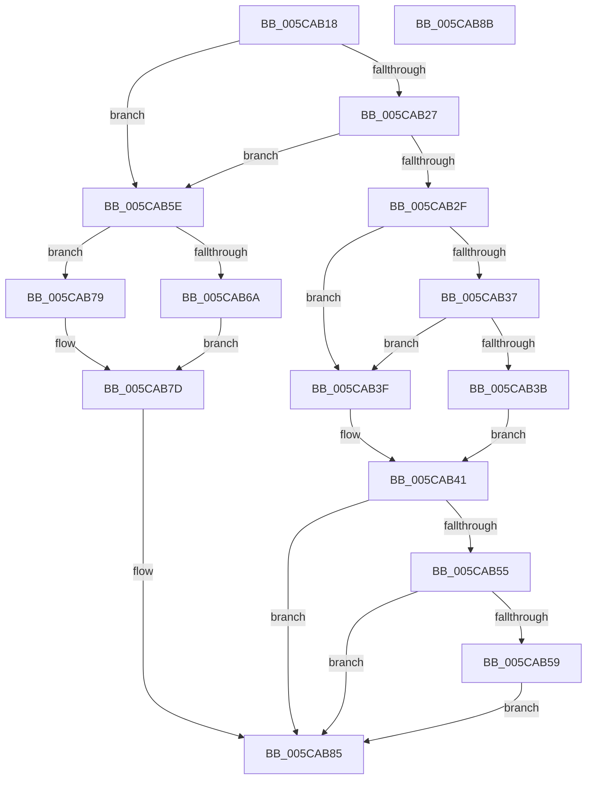

# KiTpWriteBreakpoint

- RVA: `0x005CAB18`–`0x005CAB8C` (길이 `116` bytes)
- VA: `0x00000001405CAB18`
- 실행 섹션: `.text`
- PDB 이름 있음: `예`; PDB Function 태그: `아니요`
- unwind 정보 RVA: `0x00064C80`
- 디코드: `40`개 명령, `116/116` bytes 표시
- 미해석 바이트: `0` (있으면 어셈블리에 `.byte`로 보존)

> 이 문서는 커널 이미지의 기계어와 PDB 기호를 분석해 생성했습니다. 4번과 5번은 함수 원형과 자료형을 바이너리 사용 방식에서 추정한 C 해석이며 원본 소스 복구 결과는 아닙니다.

## 1. Dependencies

- 직접 호출 지점: **2**; 고유 호출 대상: **2**
- 직접 호출자로 확인된 함수: **2**
- RIP 상대 이미지 참조: **1**

### Outgoing calls
- `0x005CAB4B` → [MmWriteSystemImageTracepoint](../68/MmWriteSystemImageTracepoint_function_00684150.md) (function, `0x00684150`)
- `0x005CAB80` → [KiTpWriteMemory](KiTpWriteMemory_function_005CAB94.md) (function, `0x005CAB94`)

### Direct callers
- [KiTpHandleTrap](../4F/KiTpHandleTrap_function_004F86B0.md) at `0x004F87AD`
- [KiTpHandleTrap](../4F/KiTpHandleTrap_function_004F86B0.md) at `0x004F88CB`
- [KeSetTracepoint](../../page/74/KeSetTracepoint_function_00747F80.md) at `0x0074844F`
- [KeSetTracepoint](../../page/74/KeSetTracepoint_function_00747F80.md) at `0x007484E3`

### Static image references
- `0x005CAB27` → RVA `0x00FC6A84` (`ALMOSTRO`; read)

## 2. Other-region calls and transfers

- 다른 실행 섹션으로 향하는 call: **0**
- 별도 외부 분기/꼬리 이동을 확인하지 못했습니다.

## 3. Assembly (complete function range)

```asm
005CAB18  40 53                           push rbx
005CAB1A  48 83 EC 30                     sub rsp, 0x30
005CAB1E  8A C2                           mov al, dl
005CAB20  8A 51 32                        mov dl, byte ptr [rcx + 0x32]
005CAB23  84 D2                           test dl, dl
005CAB25  75 37                           jne 0x1405cab5e
005CAB27  38 15 57 BF 9F 00               cmp byte ptr [rip + 0x9fbf57], dl
005CAB2D  74 2F                           je 0x1405cab5e
005CAB2F  48 8D 59 31                     lea rbx, [rcx + 0x31]
005CAB33  84 C0                           test al, al
005CAB35  74 08                           je 0x1405cab3f
005CAB37  38 13                           cmp byte ptr [rbx], dl
005CAB39  75 04                           jne 0x1405cab3f
005CAB3B  B2 01                           mov dl, 1
005CAB3D  EB 02                           jmp 0x1405cab41
005CAB3F  33 D2                           xor edx, edx
005CAB41  48 8B 49 08                     mov rcx, qword ptr [rcx + 8]
005CAB45  4D 8B C8                        mov r9, r8
005CAB48  44 8A C0                        mov r8b, al
005CAB4B  E8 00 96 0B 00                  call 0x140684150
005CAB50  80 3B 00                        cmp byte ptr [rbx], 0
005CAB53  75 30                           jne 0x1405cab85
005CAB55  85 C0                           test eax, eax
005CAB57  78 2C                           js 0x1405cab85
005CAB59  C6 03 01                        mov byte ptr [rbx], 1
005CAB5C  EB 27                           jmp 0x1405cab85
005CAB5E  4C 8B 41 08                     mov r8, qword ptr [rcx + 8]
005CAB62  4C 8B 51 10                     mov r10, qword ptr [rcx + 0x10]
005CAB66  84 C0                           test al, al
005CAB68  74 0F                           je 0x1405cab79
005CAB6A  C7 44 24 40 CC 00 00 00         mov dword ptr [rsp + 0x40], 0xcc
005CAB72  4C 8D 4C 24 40                  lea r9, [rsp + 0x40]
005CAB77  EB 04                           jmp 0x1405cab7d
005CAB79  4C 8D 49 33                     lea r9, [rcx + 0x33]
005CAB7D  49 8B CA                        mov rcx, r10
005CAB80  E8 0F 00 00 00                  call 0x1405cab94
005CAB85  48 83 C4 30                     add rsp, 0x30
005CAB89  5B                              pop rbx
005CAB8A  C3                              ret
005CAB8B  CC                              int3
```

## 4. C-style interpretation (structured pseudocode)

```c
__int64 __fastcall KiTpWriteBreakpoint(__int64 a1, unsigned __int8 a2, __int64 a3)
{
    __int64 result;
    __int64 v_rsp;
    unsigned int v_stack_p8;

    v_rsp = (v_rsp) - (48);
    if ((unsigned __int8)(*(unsigned __int8 *)(a1 + 50)) != 0) goto loc_005CAB5E;
    if ((*(unsigned __int8 *)(v_rip + 10469207)) == ((unsigned __int8)(*(unsigned __int8 *)(a1 + 50)))) goto loc_005CAB5E;
    if (a2 == 0) goto loc_005CAB3F;
    if ((*(unsigned __int8 *)(a1 + 49)) != ((unsigned __int8)(*(unsigned __int8 *)(a1 + 50)))) goto loc_005CAB3F;
    goto loc_005CAB41;
loc_005CAB3F:
    a2 = 0;
loc_005CAB41:
    result = MmWriteSystemImageTracepoint(*(unsigned __int64 *)(a1 + 8), a2, 0, a3);
    if ((*(unsigned __int8 *)(a1 + 49)) != 0) goto loc_005CAB85;
    if (sign_flag) goto loc_005CAB85;
    *(unsigned __int8 *)(a1 + 49) = 1;
    goto loc_005CAB85;
loc_005CAB5E:
    if ((unsigned __int8)(result) == 0) goto loc_005CAB79;
    v_stack_p8 = 204;
    goto loc_005CAB7D;
loc_005CAB79:
loc_005CAB7D:
    result = KiTpWriteMemory(*(unsigned __int64 *)(*(unsigned __int64 *)(a1 + 8) + 16), a2, *(unsigned __int64 *)(*(unsigned __int64 *)(a1 + 8) + 8), *(unsigned __int64 *)(a1 + 8) + 51);
loc_005CAB85:
    v_rsp = (v_rsp) + (48);
    return result;
}
```

## 5. (Beta) C Style

```c
int64_t KiTpWriteBreakpoint(void *Arg1, uint8_t Arg2, int64_t Arg3)
{
    uint8_t *arg1 = (uint8_t *)Arg1;

    int64_t result;
    int64_t local_rsp;
    uint32_t v_stack_p8;

    local_rsp = (local_rsp) - (48);
    if ((uint8_t)(*(uint8_t *)(arg1 + 0x32)) != 0) goto loc_005CAB5E;
    if ((*(uint8_t *)(v_rip + 0x9FBF57)) == ((uint8_t)(*(uint8_t *)(arg1 + 0x32)))) goto loc_005CAB5E;
    if (Arg2 == 0) goto loc_005CAB3F;
    if ((*(uint8_t *)(arg1 + 0x31)) != ((uint8_t)(*(uint8_t *)(arg1 + 0x32)))) goto loc_005CAB3F;
    goto loc_005CAB41;
loc_005CAB3F:
    Arg2 = 0;
loc_005CAB41:
    result = MmWriteSystemImageTracepoint(*(uint64_t *)(arg1 + 0x8), Arg2, 0, Arg3);
    if ((*(uint8_t *)(arg1 + 0x31)) != 0) goto loc_005CAB85;
    if (sign_flag) goto loc_005CAB85;
    *(uint8_t *)(arg1 + 0x31) = 1;
    goto loc_005CAB85;
loc_005CAB5E:
    if ((uint8_t)(result) == 0) goto loc_005CAB79;
    v_stack_p8 = 204;
    goto loc_005CAB7D;
loc_005CAB79:
loc_005CAB7D:
    result = KiTpWriteMemory(*(uint64_t *)(*(uint64_t *)(arg1 + 0x8) + 0x10), Arg2, *(uint64_t *)(*(uint64_t *)(arg1 + 0x8) + 0x8), *(uint64_t *)(arg1 + 0x8) + 51);
loc_005CAB85:
    local_rsp = (local_rsp) + (48);
    return result;
}
```

### 관측된 메모리 오프셋

구조체 형식이 확인되지 않은 접근은 인자 기준의 오프셋으로만 기록했습니다.

| 기준 인자 | 오프셋 표현 | 폭 (bit) | 접근 |
|---|---:|---:|---|
| `Arg1` | `+ 0x0` | `8` | `R` |
| `Arg1` | `+ 0x0` | `8` | `W` |
| `Arg1` | `+ 0x8` | `64` | `R` |
| `Arg1` | `+ 0x10` | `64` | `R` |
| `Arg1` | `+ 0x31` | `64` | `R` |
| `Arg1` | `+ 0x32` | `8` | `R` |
| `Arg1` | `+ 0x33` | `64` | `R` |

## 6. Execution-region graph

[열기: 2D/3D 그래프와 함수 탐색 컨트롤 패널](../../../control-panel.html?section=text&rva=0x005CAB18&view=graph)

- 2D 그래프는 위에서 아래로 흐르고, 3D 그래프는 빈 공간을 드래그해 회전합니다. Shift+드래그는 이동, 휠은 확대·축소, 함수 노드 선택은 대상 보고서 이동입니다.

### Static fallback


