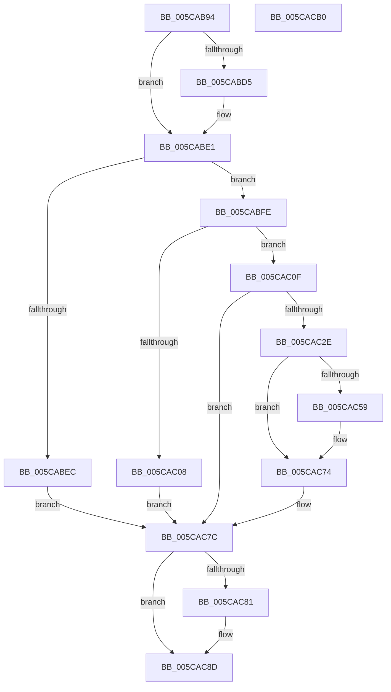

# KiTpWriteMemory

- RVA: `0x005CAB94`–`0x005CACB1` (길이 `285` bytes)
- VA: `0x00000001405CAB94`
- 실행 섹션: `.text`
- PDB 이름 있음: `예`; PDB Function 태그: `아니요`
- unwind 정보 RVA: `0x000CB2D0`
- 디코드: `86`개 명령, `285/285` bytes 표시
- 미해석 바이트: `0` (있으면 어셈블리에 `.byte`로 보존)

> 이 문서는 커널 이미지의 기계어와 PDB 기호를 분석해 생성했습니다. 4번과 5번은 함수 원형과 자료형을 바이너리 사용 방식에서 추정한 C 해석이며 원본 소스 복구 결과는 아닙니다.

## 1. Dependencies

- 직접 호출 지점: **9**; 고유 호출 대상: **7**
- 직접 호출자로 확인된 함수: **1**
- RIP 상대 이미지 참조: **2**

### Outgoing calls
- `0x005CABDC` → [KiStackAttachProcess](../21/KiStackAttachProcess_function_00216820.md) (function, `0x00216820`)
- `0x005CABF5` → [KiTpWriteUmMemory](KiTpWriteUmMemory_function_005CACB8.md) (function, `0x005CACB8`)
- `0x005CAC23` → [MmDbgCopyMemory](../68/MmDbgCopyMemory_function_006861E8.md) (function, `0x006861E8`)
- `0x005CAC32` → [KdEnterDebugger](../../pagekd/B8/KdEnterDebugger_function_00B8A96C.md) (function, `0x00B8A96C`)
- `0x005CAC4E` → [MmDbgCopyMemory](../68/MmDbgCopyMemory_function_006861E8.md) (function, `0x006861E8`)
- `0x005CAC6D` → [MmDbgCopyMemory](../68/MmDbgCopyMemory_function_006861E8.md) (function, `0x006861E8`)
- `0x005CAC77` → [KdExitDebugger](../../pagekd/B8/KdExitDebugger_function_00B85008.md) (function, `0x00B85008`)
- `0x005CAC88` → [KiUnstackDetachProcess](../21/KiUnstackDetachProcess_function_00217D30.md) (function, `0x00217D30`)
- `0x005CAC97` → [_security_check_cookie](../6A/_security_check_cookie_function_006AC640.md) (function, `0x006AC640`)

### Direct callers
- [KiTpWriteBreakpoint](KiTpWriteBreakpoint_function_005CAB18.md) at `0x005CAB80`

### Static image references
- `0x005CABA4` → RVA `0x00E0A740` (`.data`; read)
- `0x005CABFE` → RVA `0x00FC6C10` (`ALMOSTRO`; read)

## 2. Other-region calls and transfers

- 다른 실행 섹션으로 향하는 call: **2**
  - `0x005CAC32` → [KdEnterDebugger](../../pagekd/B8/KdEnterDebugger_function_00B8A96C.md) (`.text` → `PAGEKD`)
  - `0x005CAC77` → [KdExitDebugger](../../pagekd/B8/KdExitDebugger_function_00B85008.md) (`.text` → `PAGEKD`)
- 별도 외부 분기/꼬리 이동을 확인하지 못했습니다.

## 3. Assembly (complete function range)

```asm
005CAB94  48 89 5C 24 10                  mov qword ptr [rsp + 0x10], rbx
005CAB99  55                              push rbp
005CAB9A  56                              push rsi
005CAB9B  57                              push rdi
005CAB9C  41 56                           push r14
005CAB9E  41 57                           push r15
005CABA0  48 83 EC 70                     sub rsp, 0x70
005CABA4  48 8B 05 95 FB 83 00            mov rax, qword ptr [rip + 0x83fb95]
005CABAB  48 33 C4                        xor rax, rsp
005CABAE  48 89 44 24 60                  mov qword ptr [rsp + 0x60], rax
005CABB3  0F 57 C0                        xorps xmm0, xmm0
005CABB6  49 8B E9                        mov rbp, r9
005CABB9  49 8B F0                        mov rsi, r8
005CABBC  8A DA                           mov bl, dl
005CABBE  48 8B F9                        mov rdi, rcx
005CABC1  0F 11 44 24 30                  movups xmmword ptr [rsp + 0x30], xmm0
005CABC6  0F 11 44 24 40                  movups xmmword ptr [rsp + 0x40], xmm0
005CABCB  0F 11 44 24 50                  movups xmmword ptr [rsp + 0x50], xmm0
005CABD0  48 85 C9                        test rcx, rcx
005CABD3  74 0C                           je 0x1405cabe1
005CABD5  4C 8D 44 24 30                  lea r8, [rsp + 0x30]
005CABDA  33 D2                           xor edx, edx
005CABDC  E8 3F BC C4 FF                  call 0x140216820
005CABE1  41 BF 01 00 00 00               mov r15d, 1
005CABE7  41 3A DF                        cmp bl, r15b
005CABEA  75 12                           jne 0x1405cabfe
005CABEC  4C 8B C5                        mov r8, rbp
005CABEF  48 8B D6                        mov rdx, rsi
005CABF2  48 8B CF                        mov rcx, rdi
005CABF5  E8 BE 00 00 00                  call 0x1405cacb8
005CABFA  8B D8                           mov ebx, eax
005CABFC  EB 7E                           jmp 0x1405cac7c
005CABFE  8B 05 0C C0 9F 00               mov eax, dword ptr [rip + 0x9fc00c]
005CAC04  A8 04                           test al, 4
005CAC06  75 07                           jne 0x1405cac0f
005CAC08  BB 22 00 00 C0                  mov ebx, 0xc0000022
005CAC0D  EB 6D                           jmp 0x1405cac7c
005CAC0F  45 8B CF                        mov r9d, r15d
005CAC12  C7 44 24 20 81 00 00 00         mov dword ptr [rsp + 0x20], 0x81
005CAC1A  45 8B C7                        mov r8d, r15d
005CAC1D  48 8B D5                        mov rdx, rbp
005CAC20  48 8B CE                        mov rcx, rsi
005CAC23  E8 C0 B5 0B 00                  call 0x1406861e8
005CAC28  8B D8                           mov ebx, eax
005CAC2A  85 C0                           test eax, eax
005CAC2C  79 4E                           jns 0x1405cac7c
005CAC2E  33 D2                           xor edx, edx
005CAC30  33 C9                           xor ecx, ecx
005CAC32  E8 35 FD 5B 00                  call 0x140b8a96c
005CAC37  45 8B CF                        mov r9d, r15d
005CAC3A  C7 44 24 20 85 00 00 00         mov dword ptr [rsp + 0x20], 0x85
005CAC42  45 8B C7                        mov r8d, r15d
005CAC45  48 8B D5                        mov rdx, rbp
005CAC48  48 8B CE                        mov rcx, rsi
005CAC4B  44 8A F0                        mov r14b, al
005CAC4E  E8 95 B5 0B 00                  call 0x1406861e8
005CAC53  8B D8                           mov ebx, eax
005CAC55  85 C0                           test eax, eax
005CAC57  79 1B                           jns 0x1405cac74
005CAC59  45 8B CF                        mov r9d, r15d
005CAC5C  C7 44 24 20 C5 00 00 00         mov dword ptr [rsp + 0x20], 0xc5
005CAC64  45 8B C7                        mov r8d, r15d
005CAC67  48 8B D5                        mov rdx, rbp
005CAC6A  48 8B CE                        mov rcx, rsi
005CAC6D  E8 76 B5 0B 00                  call 0x1406861e8
005CAC72  8B D8                           mov ebx, eax
005CAC74  41 8A CE                        mov cl, r14b
005CAC77  E8 8C A3 5B 00                  call 0x140b85008
005CAC7C  48 85 FF                        test rdi, rdi
005CAC7F  74 0C                           je 0x1405cac8d
005CAC81  33 D2                           xor edx, edx
005CAC83  48 8D 4C 24 30                  lea rcx, [rsp + 0x30]
005CAC88  E8 A3 D0 C4 FF                  call 0x140217d30
005CAC8D  8B C3                           mov eax, ebx
005CAC8F  48 8B 4C 24 60                  mov rcx, qword ptr [rsp + 0x60]
005CAC94  48 33 CC                        xor rcx, rsp
005CAC97  E8 A4 19 0E 00                  call 0x1406ac640
005CAC9C  48 8B 9C 24 A8 00 00 00         mov rbx, qword ptr [rsp + 0xa8]
005CACA4  48 83 C4 70                     add rsp, 0x70
005CACA8  41 5F                           pop r15
005CACAA  41 5E                           pop r14
005CACAC  5F                              pop rdi
005CACAD  5E                              pop rsi
005CACAE  5D                              pop rbp
005CACAF  C3                              ret
005CACB0  CC                              int3
```

## 4. C-style interpretation (structured pseudocode)

```c
__int64 __fastcall KiTpWriteMemory(__int64 a1, int a2, __int64 a3, __int64 a4)
{
    __int64 result;
    __int64 v_rbx;
    __int64 v_rsp;
    unsigned __int64 v_stack_m38;
    unsigned __int64 v_stack_m48;
    unsigned __int64 v_stack_m58;
    unsigned __int64 v_stack_m68;
    unsigned int v_stack_m78;
    unsigned __int64 v_stack_p10;

    v_stack_p10 = v_rbx;
    v_rsp = (v_rsp) - (112);
    result = (*(unsigned __int64 *)(v_rip + 8649621)) ^ (v_rsp);
    v_stack_m38 = result;
    v_stack_m68 = v_xmm0;
    v_stack_m58 = v_xmm0;
    v_stack_m48 = v_xmm0;
    if (a1 != 0) {
        a3 = v_stack_m68;
        a2 = 0;
        result = KiStackAttachProcess(a1, a2, a3, a4);
    }
    if (((unsigned __int8)((unsigned __int8)(a2))) != 1) goto loc_005CABFE;
    result = KiTpWriteUmMemory(a1, a3, a4, a4);
    goto loc_005CAC7C;
loc_005CABFE:
    if ((((unsigned __int8)((unsigned int)(*(unsigned int *)(v_rip + 10469388)))) & (4)) != 0) goto loc_005CAC0F;
    goto loc_005CAC7C;
loc_005CAC0F:
    v_stack_m78 = 129;
    result = MmDbgCopyMemory(a3, a4, 1, 1);
    if (!sign_flag) goto loc_005CAC7C;
    a2 = 0;
    a1 = 0;
    result = KdEnterDebugger(a1, a2, 1, 1);
    v_stack_m78 = 133;
    result = MmDbgCopyMemory(a3, a4, 1, 1);
    v_rbx = (unsigned int)((unsigned int)(result));
    if (sign_flag) {
        a4 = 1;
        v_stack_m78 = 197;
        a3 = 1;
        a2 = a4;
        a1 = a3;
        result = MmDbgCopyMemory(a1, a2, a3, a4);
        v_rbx = (unsigned int)(result);
    }
    result = KdExitDebugger((unsigned __int8)((unsigned __int8)(result)), a2, a3, a4);
loc_005CAC7C:
    if (a1 != 0) {
        a2 = 0;
        a1 = v_stack_m68;
        result = KiUnstackDetachProcess(a1, a2, a3, a4);
    }
    a1 = (v_stack_m38) ^ (v_rsp);
    result = _security_check_cookie(a1, a2, a3, a4);
    v_rsp = (v_rsp) + (112);
    return result;
}
```

## 5. (Beta) C Style

```c
int64_t KiTpWriteMemory(int64_t Arg1, int32_t Arg2, int64_t Arg3, int64_t Arg4)
{
    int64_t result;
    int64_t local_rbx;
    int64_t local_rsp;
    uint64_t v_stack_m38;
    uint64_t v_stack_m48;
    uint64_t v_stack_m58;
    uint64_t v_stack_m68;
    uint32_t v_stack_m78;
    uint64_t v_stack_p10;

    v_stack_p10 = local_rbx;
    local_rsp = (local_rsp) - (112);
    result = (*(uint64_t *)(v_rip + 0x83FB95)) ^ (local_rsp);
    v_stack_m38 = result;
    v_stack_m68 = v_xmm0;
    v_stack_m58 = v_xmm0;
    v_stack_m48 = v_xmm0;
    if (Arg1 != 0) {
        Arg3 = v_stack_m68;
        Arg2 = 0;
        result = KiStackAttachProcess(Arg1, Arg2, Arg3, Arg4);
    }
    if (((uint8_t)((uint8_t)(Arg2))) != 1) goto loc_005CABFE;
    result = KiTpWriteUmMemory(Arg1, Arg3, Arg4, Arg4);
    goto loc_005CAC7C;
loc_005CABFE:
    if ((((uint8_t)((uint32_t)(*(uint32_t *)(v_rip + 0x9FC00C)))) & (4)) != 0) goto loc_005CAC0F;
    goto loc_005CAC7C;
loc_005CAC0F:
    v_stack_m78 = 129;
    result = MmDbgCopyMemory(Arg3, Arg4, 1, 1);
    if (!sign_flag) goto loc_005CAC7C;
    Arg2 = 0;
    Arg1 = 0;
    result = KdEnterDebugger(Arg1, Arg2, 1, 1);
    v_stack_m78 = 133;
    result = MmDbgCopyMemory(Arg3, Arg4, 1, 1);
    local_rbx = (uint32_t)((uint32_t)(result));
    if (sign_flag) {
        Arg4 = 1;
        v_stack_m78 = 197;
        Arg3 = 1;
        Arg2 = Arg4;
        Arg1 = Arg3;
        result = MmDbgCopyMemory(Arg1, Arg2, Arg3, Arg4);
        local_rbx = (uint32_t)(result);
    }
    result = KdExitDebugger((uint8_t)((uint8_t)(result)), Arg2, Arg3, Arg4);
loc_005CAC7C:
    if (Arg1 != 0) {
        Arg2 = 0;
        Arg1 = v_stack_m68;
        result = KiUnstackDetachProcess(Arg1, Arg2, Arg3, Arg4);
    }
    Arg1 = (v_stack_m38) ^ (local_rsp);
    result = _security_check_cookie(Arg1, Arg2, Arg3, Arg4);
    local_rsp = (local_rsp) + (112);
    return result;
}
```

## 6. Execution-region graph

[열기: 2D/3D 그래프와 함수 탐색 컨트롤 패널](../../../control-panel.html?section=text&rva=0x005CAB94&view=graph)

- 2D 그래프는 위에서 아래로 흐르고, 3D 그래프는 빈 공간을 드래그해 회전합니다. Shift+드래그는 이동, 휠은 확대·축소, 함수 노드 선택은 대상 보고서 이동입니다.

### Static fallback


