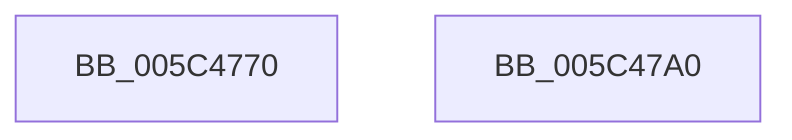

# KiTriggerForegroundBoostDpc

- RVA: `0x005C4770`–`0x005C47A1` (길이 `49` bytes)
- VA: `0x00000001405C4770`
- 실행 섹션: `.text`
- PDB 이름 있음: `예`; PDB Function 태그: `아니요`
- unwind 정보 RVA: `0x0005D2F4`
- 디코드: `11`개 명령, `49/49` bytes 표시
- 미해석 바이트: `0` (있으면 어셈블리에 `.byte`로 보존)

> 이 문서는 커널 이미지의 기계어와 PDB 기호를 분석해 생성했습니다. 4번과 5번은 함수 원형과 자료형을 바이너리 사용 방식에서 추정한 C 해석이며 원본 소스 복구 결과는 아닙니다.

## 1. Dependencies

- 직접 호출 지점: **1**; 고유 호출 대상: **1**
- 직접 호출자로 확인된 함수: **0**
- RIP 상대 이미지 참조: **1**

### Outgoing calls
- `0x005C4796` → [KeSetTimer2](../3A/KeSetTimer2_function_003A08E0.md) (function, `0x003A08E0`)

### Direct callers
- 이 함수 시작 RVA로 연결되는 직접 call은 확인되지 않았습니다. 간접 호출은 완전히 역산할 수 없습니다.

### Static image references
- `0x005C4785` → RVA `0x00F22C20` (`.data`; read)

## 2. Other-region calls and transfers

- 다른 실행 섹션으로 향하는 call: **0**
- 별도 외부 분기/꼬리 이동을 확인하지 못했습니다.

## 3. Assembly (complete function range)

```asm
005C4770  48 83 EC 38                     sub rsp, 0x38
005C4774  48 83 64 24 20 00               and qword ptr [rsp + 0x20], 0
005C477A  4C 8D 4C 24 20                  lea r9, [rsp + 0x20]
005C477F  48 83 4C 24 28 FF               or qword ptr [rsp + 0x28], 0xffffffffffffffff
005C4785  48 8D 0D 94 E4 95 00            lea rcx, [rip + 0x95e494]
005C478C  45 33 C0                        xor r8d, r8d
005C478F  48 C7 C2 10 B6 FD FF            mov rdx, 0xfffffffffffdb610
005C4796  E8 45 C1 DD FF                  call 0x1403a08e0
005C479B  48 83 C4 38                     add rsp, 0x38
005C479F  C3                              ret
005C47A0  CC                              int3
```

## 4. C-style interpretation (structured pseudocode)

```c
__int64 __fastcall KiTriggerForegroundBoostDpc(__int64 a1, __int64 a2, int a3)
{
    __int64 result;
    __int64 v_rsp;
    unsigned __int64 v_stack_m10;
    unsigned __int64 v_stack_m18;

    v_rsp = (v_rsp) - (56);
    a3 = 0;
    result = KeSetTimer2(v_rip + 9823380, 0xFFFFFFFFFFFDB610ULL, a3, v_stack_m18);
    v_rsp = (v_rsp) + (56);
    return result;
}
```

## 5. (Beta) C Style

```c
int64_t KiTriggerForegroundBoostDpc(int64_t Arg1, int64_t Arg2, int32_t Arg3)
{
    int64_t result;
    int64_t local_rsp;
    uint64_t v_stack_m10;
    uint64_t v_stack_m18;

    local_rsp = (local_rsp) - (56);
    Arg3 = 0;
    result = KeSetTimer2(v_rip + 9823380, 0xFFFFFFFFFFFDB610ULL, Arg3, v_stack_m18);
    local_rsp = (local_rsp) + (56);
    return result;
}
```

## 6. Execution-region graph

[열기: 2D/3D 그래프와 함수 탐색 컨트롤 패널](../../../control-panel.html?section=text&rva=0x005C4770&view=graph)

- 2D 그래프는 위에서 아래로 흐르고, 3D 그래프는 빈 공간을 드래그해 회전합니다. Shift+드래그는 이동, 휠은 확대·축소, 함수 노드 선택은 대상 보고서 이동입니다.

### Static fallback


