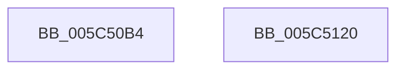

# KiUnshadowKernelSectionByAddress

- RVA: `0x005C50B4`–`0x005C5121` (길이 `109` bytes)
- VA: `0x00000001405C50B4`
- 실행 섹션: `.text`
- PDB 이름 있음: `예`; PDB Function 태그: `아니요`
- unwind 정보 RVA: `0x000805BC`
- 디코드: `29`개 명령, `109/109` bytes 표시
- 미해석 바이트: `0` (있으면 어셈블리에 `.byte`로 보존)

> 이 문서는 커널 이미지의 기계어와 PDB 기호를 분석해 생성했습니다. 4번과 5번은 함수 원형과 자료형을 바이너리 사용 방식에서 추정한 C 해석이며 원본 소스 복구 결과는 아닙니다.

## 1. Dependencies

- 직접 호출 지점: **3**; 고유 호출 대상: **3**
- 직접 호출자로 확인된 함수: **1**
- RIP 상대 이미지 참조: **2**

### Outgoing calls
- `0x005C50DA` → [RtlImageNtHeaderEx](../41/RtlImageNtHeaderEx_function_0041EAA0.md) (function, `0x0041EAA0`)
- `0x005C50F1` → [RtlSectionTableFromVirtualAddress](../43/RtlSectionTableFromVirtualAddress_function_00432CF0.md) (function, `0x00432CF0`)
- `0x005C5115` → [MmDeleteShadowMapping](../../page/80/MmDeleteShadowMapping_function_00807D00.md) (function, `0x00807D00`)

### Direct callers
- [KiShadowProcessorAllocation](../../pagelk/B6/KiShadowProcessorAllocation_function_00B6AE5C.md) at `0x00B6B098`

### Static image references
- `0x005C50C4` → RVA `0x00000000` (`image boundary/outside`; read)
- `0x005C50E4` → RVA `0x00BCB100` (`KiDivideErrorFaultShadow`; read)

## 2. Other-region calls and transfers

- 다른 실행 섹션으로 향하는 call: **1**
  - `0x005C5115` → [MmDeleteShadowMapping](../../page/80/MmDeleteShadowMapping_function_00807D00.md) (`.text` → `PAGE`)
- 별도 외부 분기/꼬리 이동을 확인하지 못했습니다.

## 3. Assembly (complete function range)

```asm
005C50B4  48 89 4C 24 08                  mov qword ptr [rsp + 8], rcx
005C50B9  53                              push rbx
005C50BA  48 83 EC 20                     sub rsp, 0x20
005C50BE  48 83 64 24 30 00               and qword ptr [rsp + 0x30], 0
005C50C4  48 8D 1D 35 AF A3 FF            lea rbx, [rip - 0x5c50cb]
005C50CB  45 33 C0                        xor r8d, r8d
005C50CE  4C 8D 4C 24 30                  lea r9, [rsp + 0x30]
005C50D3  48 8B D3                        mov rdx, rbx
005C50D6  41 8D 48 01                     lea ecx, [r8 + 1]
005C50DA  E8 C1 99 E5 FF                  call 0x14041eaa0
005C50DF  48 8B 4C 24 30                  mov rcx, qword ptr [rsp + 0x30]
005C50E4  4C 8D 05 15 60 60 00            lea r8, [rip + 0x606015]
005C50EB  44 2B C3                        sub r8d, ebx
005C50EE  48 8B D3                        mov rdx, rbx
005C50F1  E8 FA DB E6 FF                  call 0x140432cf0
005C50F6  8B 50 08                        mov edx, dword ptr [rax + 8]
005C50F9  8B 48 10                        mov ecx, dword ptr [rax + 0x10]
005C50FC  3B D1                           cmp edx, ecx
005C50FE  0F 46 D1                        cmovbe edx, ecx
005C5101  B9 00 F0 FF FF                  mov ecx, 0xfffff000
005C5106  81 C2 FF 0F 00 00               add edx, 0xfff
005C510C  48 23 D1                        and rdx, rcx
005C510F  8B 48 0C                        mov ecx, dword ptr [rax + 0xc]
005C5112  48 03 CB                        add rcx, rbx
005C5115  E8 E6 2B 24 00                  call 0x140807d00
005C511A  48 83 C4 20                     add rsp, 0x20
005C511E  5B                              pop rbx
005C511F  C3                              ret
005C5120  CC                              int3
```

## 4. C-style interpretation (structured pseudocode)

```c
__int64 __fastcall KiUnshadowKernelSectionByAddress(__int64 a1, __int64 a2, int a3)
{
    __int64 result;
    __int64 v_rsp;
    unsigned __int64 v_stack_p8;

    v_stack_p8 = a1;
    v_rsp = (v_rsp) - (32);
    a3 = 0;
    result = RtlImageNtHeaderEx(a3 + 1, v_rip - 6049995, a3, v_stack_p8);
    a3 = (unsigned int)((v_rip + 6316053) - ((unsigned int)(v_rip - 6049995)));
    result = RtlSectionTableFromVirtualAddress(v_stack_p8, v_rip - 6049995, a3, v_stack_p8);
    a2 = (unsigned int)(*(unsigned int *)(result + 8));
    if (((unsigned int)((unsigned int)(*(unsigned int *)(result + 8)))) <= ((unsigned int)((unsigned int)(*(unsigned int *)(result + 16))))) { a2 = (unsigned int)((unsigned int)(*(unsigned int *)(result + 16))); }
    a2 = (unsigned int)((a2) + (0xFFFULL));
    a2 = (a2) & ((unsigned int)(0xFFFFF000ULL));
    a1 = ((unsigned int)(*(unsigned int *)(result + 12))) + (v_rip - 6049995);
    result = MmDeleteShadowMapping(a1, a2, a3, v_stack_p8);
    v_rsp = (v_rsp) + (32);
    return result;
}
```

## 5. (Beta) C Style

```c
int64_t KiUnshadowKernelSectionByAddress(int64_t Arg1, int64_t Arg2, int32_t Arg3)
{
    int64_t result;
    int64_t local_rsp;
    uint64_t v_stack_p8;

    v_stack_p8 = Arg1;
    local_rsp = (local_rsp) - (32);
    Arg3 = 0;
    result = RtlImageNtHeaderEx(Arg3 + 1, v_rip - 6049995, Arg3, v_stack_p8);
    Arg3 = (uint32_t)((v_rip + 6316053) - ((uint32_t)(v_rip - 6049995)));
    result = RtlSectionTableFromVirtualAddress(v_stack_p8, v_rip - 6049995, Arg3, v_stack_p8);
    Arg2 = (uint32_t)(*(uint32_t *)(result + 0x8));
    if (((uint32_t)((uint32_t)(*(uint32_t *)(result + 0x8)))) <= ((uint32_t)((uint32_t)(*(uint32_t *)(result + 0x10))))) { Arg2 = (uint32_t)((uint32_t)(*(uint32_t *)(result + 0x10))); }
    Arg2 = (uint32_t)((Arg2) + (0xFFFULL));
    Arg2 = (Arg2) & ((uint32_t)(0xFFFFF000ULL));
    Arg1 = ((uint32_t)(*(uint32_t *)(result + 0xC))) + (v_rip - 6049995);
    result = MmDeleteShadowMapping(Arg1, Arg2, Arg3, v_stack_p8);
    local_rsp = (local_rsp) + (32);
    return result;
}
```

## 6. Execution-region graph

[열기: 2D/3D 그래프와 함수 탐색 컨트롤 패널](../../../control-panel.html?section=text&rva=0x005C50B4&view=graph)

- 2D 그래프는 위에서 아래로 흐르고, 3D 그래프는 빈 공간을 드래그해 회전합니다. Shift+드래그는 이동, 휠은 확대·축소, 함수 노드 선택은 대상 보고서 이동입니다.

### Static fallback


