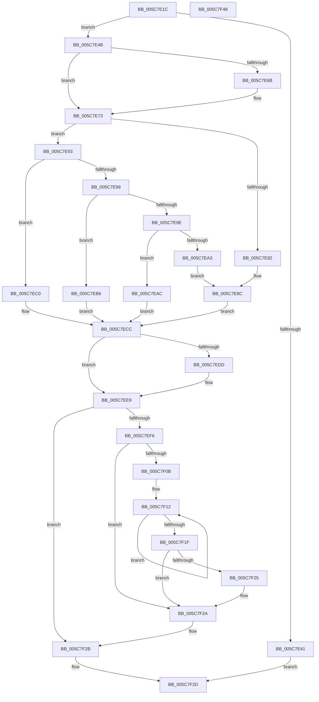

# KiUpdateBugcheckRecoveryProgress

- RVA: `0x005C7E1C`–`0x005C7F49` (길이 `301` bytes)
- VA: `0x00000001405C7E1C`
- 실행 섹션: `.text`
- PDB 이름 있음: `예`; PDB Function 태그: `아니요`
- unwind 정보 RVA: `0x0005E6B4`
- 디코드: `83`개 명령, `301/301` bytes 표시
- 미해석 바이트: `0` (있으면 어셈블리에 `.byte`로 보존)

> 이 문서는 커널 이미지의 기계어와 PDB 기호를 분석해 생성했습니다. 4번과 5번은 함수 원형과 자료형을 바이너리 사용 방식에서 추정한 C 해석이며 원본 소스 복구 결과는 아닙니다.

## 1. Dependencies

- 직접 호출 지점: **9**; 고유 호출 대상: **9**
- 직접 호출자로 확인된 함수: **3**
- RIP 상대 이미지 참조: **3**

### Outgoing calls
- `0x005C7E50` → [KeDisableInterrupts](../21/KeDisableInterrupts_function_00217BE0.md) (function, `0x00217BE0`)
- `0x005C7E6E` → [KiRaiseIrqlProcessIrqlFlags](../4F/KiRaiseIrqlProcessIrqlFlags_function_004F56FC.md) (function, `0x004F56FC`)
- `0x005C7E78` → [KiBugCheckRecoveryFreezeOtherProcessors](KiBugCheckRecoveryFreezeOtherProcessors_function_005C7120.md) (function, `0x005C7120`)
- `0x005C7EAF` → [IoSetBugCheckProgressFlag](../59/IoSetBugCheckProgressFlag_function_005931C0.md) (function, `0x005931C0`)
- `0x005C7EB9` → [IoSaveBugCheckProgress](../59/IoSaveBugCheckProgress_function_00592E10.md) (function, `0x00592E10`)
- `0x005C7EC7` → [IoSaveInitialBugCheckProgress](../59/IoSaveInitialBugCheckProgress_function_00593020.md) (function, `0x00593020`)
- `0x005C7ECF` → [KiSendThawExecution](../4E/KiSendThawExecution_function_004E2800.md) (function, `0x004E2800`)
- `0x005C7EE4` → [KiLowerIrqlProcessIrqlFlags](../4F/KiLowerIrqlProcessIrqlFlags_function_004F5698.md) (function, `0x004F5698`)
- `0x005C7F25` → [KiRemoveSystemWorkPriorityKick](../26/KiRemoveSystemWorkPriorityKick_function_002631D0.md) (function, `0x002631D0`)

### Direct callers
- [KiAttemptBugcheckRecovery](KiAttemptBugcheckRecovery_function_005C6D24.md) at `0x005C6E0F`
- [KiSaveBugcheckRecoveryProgress](KiSaveBugcheckRecoveryProgress_function_005C7AF0.md) at `0x005C7B0F`
- [KiSetBugCheckRecoveryProgressFlag](KiSetBugCheckRecoveryProgressFlag_function_005C7C48.md) at `0x005C7C67`

### Static image references
- `0x005C7E35` → RVA `0x00F10890` (`.data`; read)
- `0x005C7E63` → RVA `0x00FC6D20` (`ALMOSTRO`; read)
- `0x005C7E85` → RVA `0x00F10890` (`.data`; write)

## 2. Other-region calls and transfers

- 다른 실행 섹션으로 향하는 call: **0**
- 별도 외부 분기/꼬리 이동을 확인하지 못했습니다.

## 3. Assembly (complete function range)

```asm
005C7E1C  48 8B C4                        mov rax, rsp
005C7E1F  48 89 58 08                     mov qword ptr [rax + 8], rbx
005C7E23  48 89 68 10                     mov qword ptr [rax + 0x10], rbp
005C7E27  48 89 70 18                     mov qword ptr [rax + 0x18], rsi
005C7E2B  48 89 78 20                     mov qword ptr [rax + 0x20], rdi
005C7E2F  41 56                           push r14
005C7E31  48 83 EC 20                     sub rsp, 0x20
005C7E35  80 3D 54 8A 94 00 00            cmp byte ptr [rip + 0x948a54], 0
005C7E3C  48 8B F9                        mov rdi, rcx
005C7E3F  74 0A                           je 0x1405c7e4b
005C7E41  B8 01 00 00 C0                  mov eax, 0xc0000001
005C7E46  E9 E2 00 00 00                  jmp 0x1405c7f2d
005C7E4B  33 DB                           xor ebx, ebx
005C7E4D  40 B5 01                        mov bpl, 1
005C7E50  E8 8B FD C4 FF                  call 0x140217be0
005C7E55  44 8A F0                        mov r14b, al
005C7E58  44 0F 20 C6                     mov rsi, cr8
005C7E5C  8D 53 0F                        lea edx, [rbx + 0xf]
005C7E5F  44 0F 22 C2                     mov cr8, rdx
005C7E63  39 1D B7 EE 9F 00               cmp dword ptr [rip + 0x9feeb7], ebx
005C7E69  74 08                           je 0x1405c7e73
005C7E6B  40 8A CE                        mov cl, sil
005C7E6E  E8 89 D8 F2 FF                  call 0x1404f56fc
005C7E73  B9 40 42 0F 00                  mov ecx, 0xf4240
005C7E78  E8 A3 F2 FF FF                  call 0x1405c7120
005C7E7D  83 F8 01                        cmp eax, 1
005C7E80  76 11                           jbe 0x1405c7e93
005C7E82  40 32 ED                        xor bpl, bpl
005C7E85  C6 05 04 8A 94 00 01            mov byte ptr [rip + 0x948a04], 1
005C7E8C  BB 01 00 00 C0                  mov ebx, 0xc0000001
005C7E91  EB 39                           jmp 0x1405c7ecc
005C7E93  8B 0F                           mov ecx, dword ptr [rdi]
005C7E95  85 C9                           test ecx, ecx
005C7E97  74 27                           je 0x1405c7ec0
005C7E99  83 E9 01                        sub ecx, 1
005C7E9C  74 18                           je 0x1405c7eb6
005C7E9E  83 F9 01                        cmp ecx, 1
005C7EA1  74 09                           je 0x1405c7eac
005C7EA3  40 88 2D E6 89 94 00            mov byte ptr [rip + 0x9489e6], bpl
005C7EAA  EB E0                           jmp 0x1405c7e8c
005C7EAC  8B 4F 08                        mov ecx, dword ptr [rdi + 8]
005C7EAF  E8 0C B3 FC FF                  call 0x1405931c0
005C7EB4  EB 16                           jmp 0x1405c7ecc
005C7EB6  8B 4F 08                        mov ecx, dword ptr [rdi + 8]
005C7EB9  E8 52 AF FC FF                  call 0x140592e10
005C7EBE  EB 0C                           jmp 0x1405c7ecc
005C7EC0  48 8B 57 08                     mov rdx, qword ptr [rdi + 8]
005C7EC4  8B 4F 10                        mov ecx, dword ptr [rdi + 0x10]
005C7EC7  E8 54 B1 FC FF                  call 0x140593020
005C7ECC  40 8A CD                        mov cl, bpl
005C7ECF  E8 2C A9 F1 FF                  call 0x1404e2800
005C7ED4  83 3D 45 EE 9F 00 00            cmp dword ptr [rip + 0x9fee45], 0
005C7EDB  74 0C                           je 0x1405c7ee9
005C7EDD  44 0F 20 C1                     mov rcx, cr8
005C7EE1  40 8A D6                        mov dl, sil
005C7EE4  E8 AF D7 F2 FF                  call 0x1404f5698
005C7EE9  40 0F B6 C6                     movzx eax, sil
005C7EED  44 0F 22 C0                     mov cr8, rax
005C7EF1  45 84 F6                        test r14b, r14b
005C7EF4  74 35                           je 0x1405c7f2b
005C7EF6  65 48 8B 0C 25 20 00 00 00      mov rcx, qword ptr gs:[0x20]
005C7EFF  4C 8B 81 B8 8E 00 00            mov r8, qword ptr [rcx + 0x8eb8]
005C7F06  4D 85 C0                        test r8, r8
005C7F09  74 1F                           je 0x1405c7f2a
005C7F0B  41 0F 0D 08                     prefetchw byte ptr [r8]
005C7F0F  41 8B 00                        mov eax, dword ptr [r8]
005C7F12  8B D0                           mov edx, eax
005C7F14  0F BA F2 15                     btr edx, 0x15
005C7F18  F0 41 0F B1 10                  lock cmpxchg dword ptr [r8], edx
005C7F1D  75 F3                           jne 0x1405c7f12
005C7F1F  0F BA E0 15                     bt eax, 0x15
005C7F23  73 05                           jae 0x1405c7f2a
005C7F25  E8 A6 B2 C9 FF                  call 0x1402631d0
005C7F2A  FB                              sti
005C7F2B  8B C3                           mov eax, ebx
005C7F2D  48 8B 5C 24 30                  mov rbx, qword ptr [rsp + 0x30]
005C7F32  48 8B 6C 24 38                  mov rbp, qword ptr [rsp + 0x38]
005C7F37  48 8B 74 24 40                  mov rsi, qword ptr [rsp + 0x40]
005C7F3C  48 8B 7C 24 48                  mov rdi, qword ptr [rsp + 0x48]
005C7F41  48 83 C4 20                     add rsp, 0x20
005C7F45  41 5E                           pop r14
005C7F47  C3                              ret
005C7F48  CC                              int3
```

## 4. C-style interpretation (structured pseudocode)

```c
__int64 __fastcall KiUpdateBugcheckRecoveryProgress(__int64 a1)
{
    __int64 result;
    __int64 v_rbp;
    __int64 v_rbx;
    __int64 v_rsp;
    unsigned __int64 v_stack_p10;
    unsigned __int64 v_stack_p18;
    unsigned __int64 v_stack_p20;
    unsigned __int64 v_stack_p8;

    *(unsigned __int64 *)(v_rsp + 8) = v_rbx;
    *(unsigned __int64 *)(v_rsp + 16) = v_rbp;
    *(unsigned __int64 *)(v_rsp + 24) = v_rsi;
    *(unsigned __int64 *)(v_rsp + 32) = v_rdi;
    v_rsp = (v_rsp) - (32);
    if ((*(unsigned __int8 *)(v_rip + 9734740)) == 0) goto loc_005C7E4B;
    goto loc_005C7F2D;
loc_005C7E4B:
    v_rbx = 0;
    result = KeDisableInterrupts(a1, a2, a3, a4);
    if ((*(unsigned int *)(v_rip + 10481335)) != 0) {
        a1 = (unsigned __int8)(v_cr8);
        result = KiRaiseIrqlProcessIrqlFlags(a1, v_rbx + 15, a3, a4);
    }
    result = KiBugCheckRecoveryFreezeOtherProcessors((unsigned int)(0xF4240ULL), v_rbx + 15, a3, a4);
    if (((unsigned int)(result)) <= 1) goto loc_005C7E93;
    v_rbp = 0;
    *(unsigned __int8 *)(v_rip + 9734660) = 1;
loc_005C7E8C:
    goto loc_005C7ECC;
loc_005C7E93:
    if ((unsigned int)((unsigned int)(*(unsigned int *)(a1))) == 0) goto loc_005C7EC0;
    a1 = (unsigned int)(((unsigned int)(*(unsigned int *)(a1))) - (1));
    if (condition_is_equal) goto loc_005C7EB6;
    if (((unsigned int)(a1)) == 1) goto loc_005C7EAC;
    *(unsigned __int8 *)(v_rip + 9734630) = 0;
    goto loc_005C7E8C;
loc_005C7EAC:
    result = IoSetBugCheckProgressFlag((unsigned int)(*(unsigned int *)(a1 + 8)), v_rbx + 15, a3, a4);
    goto loc_005C7ECC;
loc_005C7EB6:
    result = IoSaveBugCheckProgress((unsigned int)(*(unsigned int *)(a1 + 8)), v_rbx + 15, a3, a4);
    goto loc_005C7ECC;
loc_005C7EC0:
    result = IoSaveInitialBugCheckProgress((unsigned int)(*(unsigned int *)(a1 + 16)), *(unsigned __int64 *)(a1 + 8), a3, a4);
loc_005C7ECC:
    result = KiSendThawExecution(0, *(unsigned __int64 *)(a1 + 8), a3, a4);
    if ((*(unsigned int *)(v_rip + 10481221)) != 0) {
        a1 = v_rbx + 15;
        a2 = (unsigned __int8)(v_cr8);
        result = KiLowerIrqlProcessIrqlFlags(a1, a2, a3, a4);
    }
    if ((unsigned __int8)((unsigned __int8)(result)) == 0) goto loc_005C7F2B;
    if (*(unsigned __int64 *)(*(unsigned __int64 *)(gs_base + (0 + 32)) + 36536) == 0) goto loc_005C7F2A;
loc_005C7F12:
    if (*(unsigned __int64 *)(*(unsigned __int64 *)(gs_base + (0 + 32)) + 36536) != 0) goto loc_005C7F12;
    result = (unsigned int)(*(unsigned int *)(*(unsigned __int64 *)(*(unsigned __int64 *)(gs_base + (0 + 32)) + 36536)));
    if (!(condition_is_above_or_equal)) {
        result = KiRemoveSystemWorkPriorityKick(*(unsigned __int64 *)(gs_base + (0 + 32)), (unsigned int)((unsigned int)((unsigned int)(*(unsigned int *)(*(unsigned __int64 *)(*(unsigned __int64 *)(gs_base + (0 + 32)) + 36536))))), *(unsigned __int64 *)(*(unsigned __int64 *)(gs_base + (0 + 32)) + 36536), a4);
    }
loc_005C7F2B:
loc_005C7F2D:
    v_rsp = (v_rsp) + (32);
    return (unsigned int)((unsigned int)((unsigned int)(0xC0000001ULL)));
}
```

## 5. (Beta) C Style

```c
int64_t KiUpdateBugcheckRecoveryProgress(void *Arg1)
{
    uint8_t *arg1 = (uint8_t *)Arg1;

    int64_t result;
    int64_t local_rbp;
    int64_t local_rbx;
    int64_t local_rsp;
    uint64_t v_stack_p10;
    uint64_t v_stack_p18;
    uint64_t v_stack_p20;
    uint64_t v_stack_p8;

    *(uint64_t *)(local_rsp + 0x8) = local_rbx;
    *(uint64_t *)(local_rsp + 0x10) = local_rbp;
    *(uint64_t *)(local_rsp + 0x18) = local_rsi;
    *(uint64_t *)(local_rsp + 0x20) = local_rdi;
    local_rsp = (local_rsp) - (32);
    if ((*(uint8_t *)(v_rip + 0x948A54)) == 0) goto loc_005C7E4B;
    goto loc_005C7F2D;
loc_005C7E4B:
    local_rbx = 0;
    result = KeDisableInterrupts(Arg1, a2, a3, a4);
    if ((*(uint32_t *)(v_rip + 0x9FEEB7)) != 0) {
        Arg1 = (uint8_t)(v_cr8);
        result = KiRaiseIrqlProcessIrqlFlags(Arg1, local_rbx + 15, a3, a4);
    }
    result = KiBugCheckRecoveryFreezeOtherProcessors((uint32_t)(0xF4240ULL), local_rbx + 15, a3, a4);
    if (((uint32_t)(result)) <= 1) goto loc_005C7E93;
    local_rbp = 0;
    *(uint8_t *)(v_rip + 0x948A04) = 1;
loc_005C7E8C:
    goto loc_005C7ECC;
loc_005C7E93:
    if ((uint32_t)((uint32_t)(*(uint32_t *)(arg1))) == 0) goto loc_005C7EC0;
    Arg1 = (uint32_t)(((uint32_t)(*(uint32_t *)(arg1))) - (1));
    if (condition_is_equal) goto loc_005C7EB6;
    if (((uint32_t)(Arg1)) == 1) goto loc_005C7EAC;
    *(uint8_t *)(v_rip + 0x9489E6) = 0;
    goto loc_005C7E8C;
loc_005C7EAC:
    result = IoSetBugCheckProgressFlag((uint32_t)(*(uint32_t *)(arg1 + 0x8)), local_rbx + 15, a3, a4);
    goto loc_005C7ECC;
loc_005C7EB6:
    result = IoSaveBugCheckProgress((uint32_t)(*(uint32_t *)(arg1 + 0x8)), local_rbx + 15, a3, a4);
    goto loc_005C7ECC;
loc_005C7EC0:
    result = IoSaveInitialBugCheckProgress((uint32_t)(*(uint32_t *)(arg1 + 0x10)), *(uint64_t *)(arg1 + 0x8), a3, a4);
loc_005C7ECC:
    result = KiSendThawExecution(0, *(uint64_t *)(arg1 + 0x8), a3, a4);
    if ((*(uint32_t *)(v_rip + 0x9FEE45)) != 0) {
        Arg1 = local_rbx + 15;
        a2 = (uint8_t)(v_cr8);
        result = KiLowerIrqlProcessIrqlFlags(Arg1, a2, a3, a4);
    }
    if ((uint8_t)((uint8_t)(result)) == 0) goto loc_005C7F2B;
    if (*(uint64_t *)(*(uint64_t *)(gs_base + (0 + 0x20)) + 0x8EB8) == 0) goto loc_005C7F2A;
loc_005C7F12:
    if (*(uint64_t *)(*(uint64_t *)(gs_base + (0 + 0x20)) + 0x8EB8) != 0) goto loc_005C7F12;
    result = (uint32_t)(*(uint32_t *)(*(uint64_t *)(*(uint64_t *)(gs_base + (0 + 0x20)) + 0x8EB8)));
    if (!(condition_is_above_or_equal)) {
        result = KiRemoveSystemWorkPriorityKick(*(uint64_t *)(gs_base + (0 + 0x20)), (uint32_t)((uint32_t)((uint32_t)(*(uint32_t *)(*(uint64_t *)(*(uint64_t *)(gs_base + (0 + 0x20)) + 0x8EB8))))), *(uint64_t *)(*(uint64_t *)(gs_base + (0 + 0x20)) + 0x8EB8), a4);
    }
loc_005C7F2B:
loc_005C7F2D:
    local_rsp = (local_rsp) + (32);
    return (uint32_t)((uint32_t)((uint32_t)(0xC0000001ULL)));
}
```

### 관측된 메모리 오프셋

구조체 형식이 확인되지 않은 접근은 인자 기준의 오프셋으로만 기록했습니다.

| 기준 인자 | 오프셋 표현 | 폭 (bit) | 접근 |
|---|---:|---:|---|
| `Arg1` | `+ 0x0` | `32` | `R` |
| `Arg1` | `+ 0x8` | `32` | `R` |
| `Arg1` | `+ 0x8` | `64` | `R` |
| `Arg1` | `+ 0x10` | `32` | `R` |

## 6. Execution-region graph

[열기: 2D/3D 그래프와 함수 탐색 컨트롤 패널](../../../control-panel.html?section=text&rva=0x005C7E1C&view=graph)

- 2D 그래프는 위에서 아래로 흐르고, 3D 그래프는 빈 공간을 드래그해 회전합니다. Shift+드래그는 이동, 휠은 확대·축소, 함수 노드 선택은 대상 보고서 이동입니다.

### Static fallback


