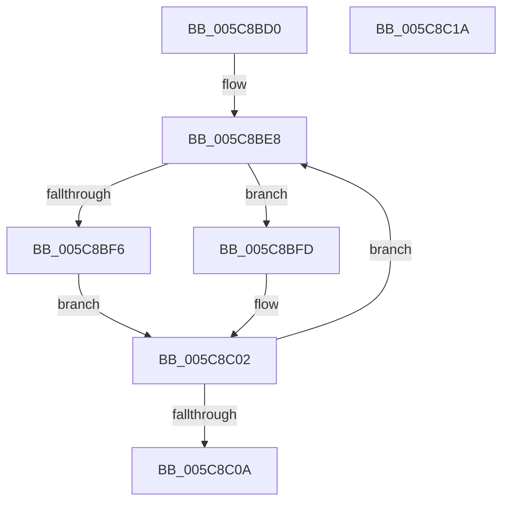

# KiUpdateChildrenCpuTarget

- RVA: `0x005C8BD0`–`0x005C8C1B` (길이 `75` bytes)
- VA: `0x00000001405C8BD0`
- 실행 섹션: `.text`
- PDB 이름 있음: `예`; PDB Function 태그: `아니요`
- unwind 정보 RVA: `0x00060BC4`
- 디코드: `24`개 명령, `75/75` bytes 표시
- 미해석 바이트: `0` (있으면 어셈블리에 `.byte`로 보존)

> 이 문서는 커널 이미지의 기계어와 PDB 기호를 분석해 생성했습니다. 4번과 5번은 함수 원형과 자료형을 바이너리 사용 방식에서 추정한 C 해석이며 원본 소스 복구 결과는 아닙니다.

## 1. Dependencies

- 직접 호출 지점: **2**; 고유 호출 대상: **2**
- 직접 호출자로 확인된 함수: **2**
- RIP 상대 이미지 참조: **0**

### Outgoing calls
- `0x005C8BF6` → [KiUpdateCpuTargetByWeight](../46/KiUpdateCpuTargetByWeight_function_0046E0E0.md) (function, `0x0046E0E0`)
- `0x005C8BFD` → [KiUpdateCpuTargetByRate](../46/KiUpdateCpuTargetByRate_function_0046D7E4.md) (function, `0x0046D7E4`)

### Direct callers
- [KiUpdateCpuTargetByRate](../46/KiUpdateCpuTargetByRate_function_0046D7E4.md) at `0x0046D950`
- [KiUpdateCpuTargetByWeight](../46/KiUpdateCpuTargetByWeight_function_0046E0E0.md) at `0x0046E259`

### Static image references
- 디코드된 RIP-relative 메모리 참조가 없습니다.

## 2. Other-region calls and transfers

- 다른 실행 섹션으로 향하는 call: **0**
- 별도 외부 분기/꼬리 이동을 확인하지 못했습니다.

## 3. Assembly (complete function range)

```asm
005C8BD0  48 89 5C 24 08                  mov qword ptr [rsp + 8], rbx
005C8BD5  48 89 74 24 10                  mov qword ptr [rsp + 0x10], rsi
005C8BDA  57                              push rdi
005C8BDB  48 83 EC 20                     sub rsp, 0x20
005C8BDF  48 8B 19                        mov rbx, qword ptr [rcx]
005C8BE2  40 8A F2                        mov sil, dl
005C8BE5  48 8B F9                        mov rdi, rcx
005C8BE8  48 8D 4B C8                     lea rcx, [rbx - 0x38]
005C8BEC  40 8A D6                        mov dl, sil
005C8BEF  8B 41 04                        mov eax, dword ptr [rcx + 4]
005C8BF2  A8 01                           test al, 1
005C8BF4  75 07                           jne 0x1405c8bfd
005C8BF6  E8 E5 54 EA FF                  call 0x14046e0e0
005C8BFB  EB 05                           jmp 0x1405c8c02
005C8BFD  E8 E2 4B EA FF                  call 0x14046d7e4
005C8C02  48 8B 1B                        mov rbx, qword ptr [rbx]
005C8C05  48 3B DF                        cmp rbx, rdi
005C8C08  75 DE                           jne 0x1405c8be8
005C8C0A  48 8B 5C 24 30                  mov rbx, qword ptr [rsp + 0x30]
005C8C0F  48 8B 74 24 38                  mov rsi, qword ptr [rsp + 0x38]
005C8C14  48 83 C4 20                     add rsp, 0x20
005C8C18  5F                              pop rdi
005C8C19  C3                              ret
005C8C1A  CC                              int3
```

## 4. C-style interpretation (structured pseudocode)

```c
__int64 __fastcall KiUpdateChildrenCpuTarget(__int64 a1, unsigned __int8 a2)
{
    __int64 result;
    __int64 v_rsp;
    unsigned __int64 v_stack_p10;
    unsigned __int64 v_stack_p8;

    v_stack_p8 = v_rbx;
    v_stack_p10 = v_rsi;
    v_rsp = (v_rsp) - (32);
loc_005C8BE8:
    if ((((unsigned __int8)((unsigned int)(*(unsigned int *)(*(unsigned __int64 *)(a1) - 56 + 4)))) & (1)) != 0) goto loc_005C8BFD;
    result = KiUpdateCpuTargetByWeight(*(unsigned __int64 *)(a1) - 56, a2, a3, a4);
    goto loc_005C8C02;
loc_005C8BFD:
    result = KiUpdateCpuTargetByRate(*(unsigned __int64 *)(a1) - 56, a2, a3, a4);
loc_005C8C02:
    if ((*(unsigned __int64 *)(*(unsigned __int64 *)(a1))) != a1) goto loc_005C8BE8;
    v_rsp = (v_rsp) + (32);
    return result;
}
```

## 5. (Beta) C Style

```c
int64_t KiUpdateChildrenCpuTarget(void *Arg1, uint8_t Arg2)
{
    uint8_t *arg1 = (uint8_t *)Arg1;

    int64_t result;
    int64_t local_rsp;
    uint64_t v_stack_p10;
    uint64_t v_stack_p8;

    v_stack_p8 = local_rbx;
    v_stack_p10 = local_rsi;
    local_rsp = (local_rsp) - (32);
loc_005C8BE8:
    if ((((uint8_t)((uint32_t)(*(uint32_t *)(*(uint64_t *)(arg1) - 0x38 + 0x4)))) & (1)) != 0) goto loc_005C8BFD;
    result = KiUpdateCpuTargetByWeight(*(uint64_t *)(arg1) - 56, Arg2, a3, a4);
    goto loc_005C8C02;
loc_005C8BFD:
    result = KiUpdateCpuTargetByRate(*(uint64_t *)(arg1) - 56, Arg2, a3, a4);
loc_005C8C02:
    if ((*(uint64_t *)(*(uint64_t *)(arg1))) != Arg1) goto loc_005C8BE8;
    local_rsp = (local_rsp) + (32);
    return result;
}
```

### 관측된 메모리 오프셋

구조체 형식이 확인되지 않은 접근은 인자 기준의 오프셋으로만 기록했습니다.

| 기준 인자 | 오프셋 표현 | 폭 (bit) | 접근 |
|---|---:|---:|---|
| `Arg1` | `+ 0x0` | `64` | `R` |

## 6. Execution-region graph

[열기: 2D/3D 그래프와 함수 탐색 컨트롤 패널](../../../control-panel.html?section=text&rva=0x005C8BD0&view=graph)

- 2D 그래프는 위에서 아래로 흐르고, 3D 그래프는 빈 공간을 드래그해 회전합니다. Shift+드래그는 이동, 휠은 확대·축소, 함수 노드 선택은 대상 보고서 이동입니다.

### Static fallback


