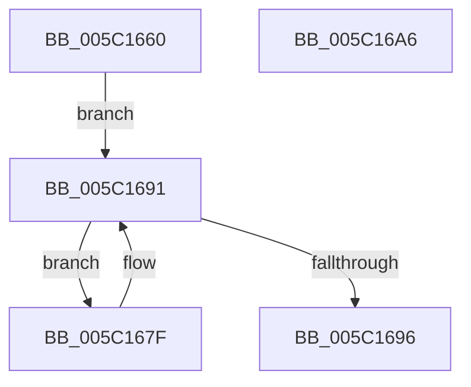

# KiUpdateThreadCpuSetAffinitiesProcess

- RVA: `0x005C1660`–`0x005C16A7` (길이 `71` bytes)
- VA: `0x00000001405C1660`
- 실행 섹션: `.text`
- PDB 이름 있음: `예`; PDB Function 태그: `아니요`
- unwind 정보 RVA: `0x00060BC4`
- 디코드: `21`개 명령, `71/71` bytes 표시
- 미해석 바이트: `0` (있으면 어셈블리에 `.byte`로 보존)

> 이 문서는 커널 이미지의 기계어와 PDB 기호를 분석해 생성했습니다. 4번과 5번은 함수 원형과 자료형을 바이너리 사용 방식에서 추정한 C 해석이며 원본 소스 복구 결과는 아닙니다.

## 1. Dependencies

- 직접 호출 지점: **1**; 고유 호출 대상: **1**
- 직접 호출자로 확인된 함수: **2**
- RIP 상대 이미지 참조: **0**

### Outgoing calls
- `0x005C1689` → [KiUpdateThreadCpuSetAffinitiesFromDpcLevel](../30/KiUpdateThreadCpuSetAffinitiesFromDpcLevel_function_003030C4.md) (function, `0x003030C4`)

### Direct callers
- [KeRecomputeCpuSetAffinityProcess](KeRecomputeCpuSetAffinityProcess_function_005C1078.md) at `0x005C109E`
- [KeSetCpuSetsProcess](KeSetCpuSetsProcess_function_005C10D4.md) at `0x005C1176`

### Static image references
- 디코드된 RIP-relative 메모리 참조가 없습니다.

## 2. Other-region calls and transfers

- 다른 실행 섹션으로 향하는 call: **0**
- 별도 외부 분기/꼬리 이동을 확인하지 못했습니다.

## 3. Assembly (complete function range)

```asm
005C1660  48 89 5C 24 08                  mov qword ptr [rsp + 8], rbx
005C1665  48 89 74 24 10                  mov qword ptr [rsp + 0x10], rsi
005C166A  57                              push rdi
005C166B  48 83 EC 20                     sub rsp, 0x20
005C166F  48 83 22 00                     and qword ptr [rdx], 0
005C1673  48 8D 79 30                     lea rdi, [rcx + 0x30]
005C1677  48 8B 1F                        mov rbx, qword ptr [rdi]
005C167A  48 8B F2                        mov rsi, rdx
005C167D  EB 12                           jmp 0x1405c1691
005C167F  48 8D 8B 08 FD FF FF            lea rcx, [rbx - 0x2f8]
005C1686  48 8B D6                        mov rdx, rsi
005C1689  E8 36 1A D4 FF                  call 0x1403030c4
005C168E  48 8B 1B                        mov rbx, qword ptr [rbx]
005C1691  48 3B DF                        cmp rbx, rdi
005C1694  75 E9                           jne 0x1405c167f
005C1696  48 8B 5C 24 30                  mov rbx, qword ptr [rsp + 0x30]
005C169B  48 8B 74 24 38                  mov rsi, qword ptr [rsp + 0x38]
005C16A0  48 83 C4 20                     add rsp, 0x20
005C16A4  5F                              pop rdi
005C16A5  C3                              ret
005C16A6  CC                              int3
```

## 4. C-style interpretation (structured pseudocode)

```c
__int64 __fastcall KiUpdateThreadCpuSetAffinitiesProcess(__int64 a1, __int64 a2)
{
    __int64 result;
    __int64 v_rsp;
    unsigned __int64 v_stack_p10;
    unsigned __int64 v_stack_p8;

    v_stack_p8 = v_rbx;
    v_stack_p10 = v_rsi;
    v_rsp = (v_rsp) - (32);
    goto loc_005C1691;
loc_005C167F:
    result = KiUpdateThreadCpuSetAffinitiesFromDpcLevel(*(unsigned __int64 *)(a1 + 48) - 760, a2, a3, a4);
loc_005C1691:
    if ((*(unsigned __int64 *)(*(unsigned __int64 *)(a1 + 48))) != (a1 + 48)) goto loc_005C167F;
    v_rsp = (v_rsp) + (32);
    return result;
}
```

## 5. (Beta) C Style

```c
int64_t KiUpdateThreadCpuSetAffinitiesProcess(void *Arg1, void *Arg2)
{
    uint8_t *arg1 = (uint8_t *)Arg1;
    uint8_t *arg2 = (uint8_t *)Arg2;

    int64_t result;
    int64_t local_rsp;
    uint64_t v_stack_p10;
    uint64_t v_stack_p8;

    v_stack_p8 = local_rbx;
    v_stack_p10 = local_rsi;
    local_rsp = (local_rsp) - (32);
    goto loc_005C1691;
loc_005C167F:
    result = KiUpdateThreadCpuSetAffinitiesFromDpcLevel(*(uint64_t *)(arg1 + 0x30) - 760, Arg2, a3, a4);
loc_005C1691:
    if ((*(uint64_t *)(*(uint64_t *)(arg1 + 0x30))) != (Arg1 + 48)) goto loc_005C167F;
    local_rsp = (local_rsp) + (32);
    return result;
}
```

### 관측된 메모리 오프셋

구조체 형식이 확인되지 않은 접근은 인자 기준의 오프셋으로만 기록했습니다.

| 기준 인자 | 오프셋 표현 | 폭 (bit) | 접근 |
|---|---:|---:|---|
| `Arg1` | `+ 0x0` | `64` | `R` |
| `Arg1` | `+ 0x30` | `64` | `R` |
| `Arg2` | `+ 0x0` | `64` | `R/W` |

## 6. Execution-region graph

[열기: 2D/3D 그래프와 함수 탐색 컨트롤 패널](../../../control-panel.html?section=text&rva=0x005C1660&view=graph)

- 2D 그래프는 위에서 아래로 흐르고, 3D 그래프는 빈 공간을 드래그해 회전합니다. Shift+드래그는 이동, 휠은 확대·축소, 함수 노드 선택은 대상 보고서 이동입니다.

### Static fallback


