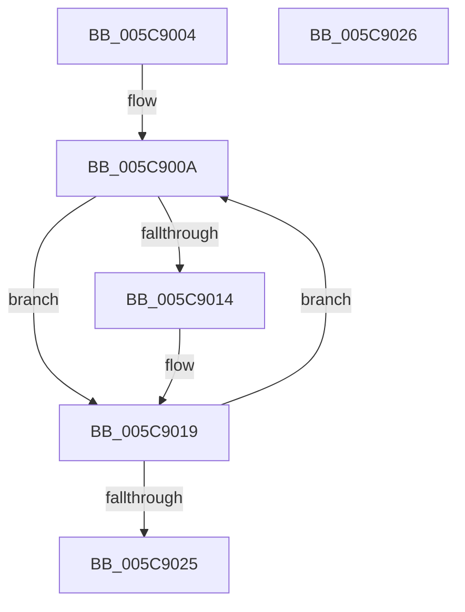

# KiWriteRankListMembersUnderLock

- RVA: `0x005C9004`–`0x005C9027` (길이 `35` bytes)
- VA: `0x00000001405C9004`
- 실행 섹션: `.text`
- PDB 이름 있음: `예`; PDB Function 태그: `아니요`
- unwind 정보 RVA: `0x000DB714`
- 디코드: `13`개 명령, `35/35` bytes 표시
- 미해석 바이트: `0` (있으면 어셈블리에 `.byte`로 보존)

> 이 문서는 커널 이미지의 기계어와 PDB 기호를 분석해 생성했습니다. 4번과 5번은 함수 원형과 자료형을 바이너리 사용 방식에서 추정한 C 해석이며 원본 소스 복구 결과는 아닙니다.

## 1. Dependencies

- 직접 호출 지점: **0**; 고유 호출 대상: **0**
- 직접 호출자로 확인된 함수: **1**
- RIP 상대 이미지 참조: **0**

### Outgoing calls
- 직접 디코드된 call 명령이 없습니다.

### Direct callers
- [KiCompleteKernelInit](../../pagelk/B6/KiCompleteKernelInit_function_00B66090.md) at `0x00B66313`
- [KiCompleteKernelInit](../../pagelk/B6/KiCompleteKernelInit_function_00B66090.md) at `0x00B66350`

### Static image references
- 디코드된 RIP-relative 메모리 참조가 없습니다.

## 2. Other-region calls and transfers

- 다른 실행 섹션으로 향하는 call: **0**
- 별도 외부 분기/꼬리 이동을 확인하지 못했습니다.

## 3. Assembly (complete function range)

```asm
005C9004  45 32 C9                        xor r9b, r9b
005C9007  48 2B D1                        sub rdx, rcx
005C900A  41 0F B6 C1                     movzx eax, r9b
005C900E  49 0F A3 C0                     bt r8, rax
005C9012  73 05                           jae 0x1405c9019
005C9014  8A 04 0A                        mov al, byte ptr [rdx + rcx]
005C9017  88 01                           mov byte ptr [rcx], al
005C9019  41 FE C1                        inc r9b
005C901C  48 FF C1                        inc rcx
005C901F  41 80 F9 40                     cmp r9b, 0x40
005C9023  72 E5                           jb 0x1405c900a
005C9025  C3                              ret
005C9026  CC                              int3
```

## 4. C-style interpretation (structured pseudocode)

```c
__int64 __fastcall KiWriteRankListMembersUnderLock(__int64 a1, __int64 a2, __int64 a3, unsigned __int8 a4)
{
    __int64 result;

    a4 = 0;
    a2 = (a2) - (a1);
loc_005C900A:
    result = 0;
    if (!(condition_is_above_or_equal)) {
        result = *(unsigned __int8 *)(a2 + a1 * 1);
        *(unsigned __int8 *)(a1) = (unsigned __int8)(result);
    }
    a4 = (unsigned __int8)((a4) + 1);
    a1 = (a1) + 1;
    if (a4 < 64) goto loc_005C900A;
    return result;
}
```

## 5. (Beta) C Style

```c
int64_t KiWriteRankListMembersUnderLock(int64_t Arg1, void *Arg2, int64_t Arg3, uint8_t Arg4)
{
    uint8_t *arg2 = (uint8_t *)Arg2;

    int64_t result;

    Arg4 = 0;
    Arg2 = (Arg2) - (Arg1);
loc_005C900A:
    result = 0;
    if (!(condition_is_above_or_equal)) {
        result = *(uint8_t *)(arg2 + Arg1 * 1);
        *(uint8_t *)(Arg1) = (uint8_t)(result);
    }
    Arg4 = (uint8_t)((Arg4) + 1);
    Arg1 = (Arg1) + 1;
    if (Arg4 < 64) goto loc_005C900A;
    return result;
}
```

### 관측된 메모리 오프셋

구조체 형식이 확인되지 않은 접근은 인자 기준의 오프셋으로만 기록했습니다.

| 기준 인자 | 오프셋 표현 | 폭 (bit) | 접근 |
|---|---:|---:|---|
| `Arg2` | `+ 0x0 + rcx*1` | `8` | `R` |

## 6. Execution-region graph

[열기: 2D/3D 그래프와 함수 탐색 컨트롤 패널](../../../control-panel.html?section=text&rva=0x005C9004&view=graph)

- 2D 그래프는 위에서 아래로 흐르고, 3D 그래프는 빈 공간을 드래그해 회전합니다. Shift+드래그는 이동, 휠은 확대·축소, 함수 노드 선택은 대상 보고서 이동입니다.

### Static fallback


