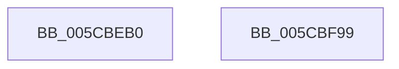

# KseDsCallbackHookAddDevice

- RVA: `0x005CBEB0`–`0x005CBF9A` (길이 `234` bytes)
- VA: `0x00000001405CBEB0`
- 실행 섹션: `.text`
- PDB 이름 있음: `예`; PDB Function 태그: `아니요`
- unwind 정보 RVA: `0x000CB5E8`
- 디코드: `55`개 명령, `234/234` bytes 표시
- 미해석 바이트: `0` (있으면 어셈블리에 `.byte`로 보존)

> 이 문서는 커널 이미지의 기계어와 PDB 기호를 분석해 생성했습니다. 4번과 5번은 함수 원형과 자료형을 바이너리 사용 방식에서 추정한 C 해석이며 원본 소스 복구 결과는 아닙니다.

## 1. Dependencies

- 직접 호출 지점: **6**; 고유 호출 대상: **5**
- 직접 호출자로 확인된 함수: **0**
- RIP 상대 이미지 참조: **3**

### Outgoing calls
- `0x005CBEF1` → [guard_dispatch_icall](../6B/guard_dispatch_icall_function_006BAAD0.md) (function, `0x006BAAD0`)
- `0x005CBF00` → [guard_dispatch_icall](../6B/guard_dispatch_icall_function_006BAAD0.md) (function, `0x006BAAD0`)
- `0x005CBF24` → [IoGetDeviceProperty](../../page/8F/IoGetDeviceProperty_function_008FA720.md) (function, `0x008FA720`)
- `0x005CBF40` → [RtlInitUnicodeString](../42/RtlInitUnicodeString_function_0042A780.md) (function, `0x0042A780`)
- `0x005CBF6D` → [KsepDsEventAddDevice](KsepDsEventAddDevice_function_005CC658.md) (function, `0x005CC658`)
- `0x005CBF7F` → [_security_check_cookie](../6A/_security_check_cookie_function_006AC640.md) (function, `0x006AC640`)

### Direct callers
- 이 함수 시작 RVA로 연결되는 직접 call은 확인되지 않았습니다. 간접 호출은 완전히 역산할 수 없습니다.

### Static image references
- `0x005CBEC2` → RVA `0x00E0A740` (`.data`; read)
- `0x005CBED4` → RVA `0x00E01668` (`.data`; read)
- `0x005CBF2B` → RVA `0x006CBDC0` (` ?? ::FNODOBFM::`string'`; read)

## 2. Other-region calls and transfers

- 다른 실행 섹션으로 향하는 call: **1**
  - `0x005CBF24` → [IoGetDeviceProperty](../../page/8F/IoGetDeviceProperty_function_008FA720.md) (`.text` → `PAGE`)
- 별도 외부 분기/꼬리 이동을 확인하지 못했습니다.

## 3. Assembly (complete function range)

```asm
005CBEB0  48 89 5C 24 18                  mov qword ptr [rsp + 0x18], rbx
005CBEB5  48 89 74 24 20                  mov qword ptr [rsp + 0x20], rsi
005CBEBA  57                              push rdi
005CBEBB  48 81 EC 70 04 00 00            sub rsp, 0x470
005CBEC2  48 8B 05 77 E8 83 00            mov rax, qword ptr [rip + 0x83e877]
005CBEC9  48 33 C4                        xor rax, rsp
005CBECC  48 89 84 24 60 04 00 00         mov qword ptr [rsp + 0x460], rax
005CBED4  48 8B 05 8D 57 83 00            mov rax, qword ptr [rip + 0x83578d]
005CBEDB  0F 57 C0                        xorps xmm0, xmm0
005CBEDE  83 64 24 40 00                  and dword ptr [rsp + 0x40], 0
005CBEE3  48 8B FA                        mov rdi, rdx
005CBEE6  48 8B F1                        mov rsi, rcx
005CBEE9  0F 11 44 24 48                  movups xmmword ptr [rsp + 0x48], xmm0
005CBEEE  48 8B 00                        mov rax, qword ptr [rax]
005CBEF1  E8 DA EB 0E 00                  call 0x1406baad0
005CBEF6  48 8B D7                        mov rdx, rdi
005CBEF9  48 8B CE                        mov rcx, rsi
005CBEFC  48 8B 40 18                     mov rax, qword ptr [rax + 0x18]
005CBF00  E8 CB EB 0E 00                  call 0x1406baad0
005CBF05  8B D8                           mov ebx, eax
005CBF07  4C 8D 4C 24 60                  lea r9, [rsp + 0x60]
005CBF0C  48 8D 44 24 40                  lea rax, [rsp + 0x40]
005CBF11  BA 01 00 00 00                  mov edx, 1
005CBF16  41 B8 00 04 00 00               mov r8d, 0x400
005CBF1C  48 89 44 24 20                  mov qword ptr [rsp + 0x20], rax
005CBF21  48 8B CF                        mov rcx, rdi
005CBF24  E8 F7 E7 32 00                  call 0x1408fa720
005CBF29  85 C0                           test eax, eax
005CBF2B  48 8D 0D 8E FE 0F 00            lea rcx, [rip + 0xffe8e]
005CBF32  48 8D 54 24 60                  lea rdx, [rsp + 0x60]
005CBF37  48 0F 48 D1                     cmovs rdx, rcx
005CBF3B  48 8D 4C 24 48                  lea rcx, [rsp + 0x48]
005CBF40  E8 3B E8 E5 FF                  call 0x14042a780
005CBF45  48 8B 46 30                     mov rax, qword ptr [rsi + 0x30]
005CBF49  48 8D 4C 24 48                  lea rcx, [rsp + 0x48]
005CBF4E  8B 56 20                        mov edx, dword ptr [rsi + 0x20]
005CBF51  48 83 C0 18                     add rax, 0x18
005CBF55  48 89 4C 24 30                  mov qword ptr [rsp + 0x30], rcx
005CBF5A  4C 8B CF                        mov r9, rdi
005CBF5D  48 8B 4E 18                     mov rcx, qword ptr [rsi + 0x18]
005CBF61  4C 8B C6                        mov r8, rsi
005CBF64  48 89 44 24 28                  mov qword ptr [rsp + 0x28], rax
005CBF69  89 5C 24 20                     mov dword ptr [rsp + 0x20], ebx
005CBF6D  E8 E6 06 00 00                  call 0x1405cc658
005CBF72  8B C3                           mov eax, ebx
005CBF74  48 8B 8C 24 60 04 00 00         mov rcx, qword ptr [rsp + 0x460]
005CBF7C  48 33 CC                        xor rcx, rsp
005CBF7F  E8 BC 06 0E 00                  call 0x1406ac640
005CBF84  4C 8D 9C 24 70 04 00 00         lea r11, [rsp + 0x470]
005CBF8C  49 8B 5B 20                     mov rbx, qword ptr [r11 + 0x20]
005CBF90  49 8B 73 28                     mov rsi, qword ptr [r11 + 0x28]
005CBF94  49 8B E3                        mov rsp, r11
005CBF97  5F                              pop rdi
005CBF98  C3                              ret
005CBF99  CC                              int3
```

## 4. C-style interpretation (structured pseudocode)

```c
__int64 __fastcall KseDsCallbackHookAddDevice(__int64 a1, __int64 a2)
{
    __int64 result;
    __int64 v_rsp;
    unsigned __int64 v_stack_m18;
    unsigned __int64 v_stack_m418;
    unsigned __int64 v_stack_m430;
    unsigned int v_stack_m438;
    unsigned __int64 v_stack_m448;
    unsigned __int64 v_stack_m450;
    unsigned __int64 v_stack_m458;
    unsigned __int64 v_stack_m8;
    unsigned __int64 v_stack_p18;
    unsigned __int64 v_stack_p20;

    v_stack_p18 = v_rbx;
    v_stack_p20 = v_rsi;
    v_rsp = (v_rsp) - (0x470ULL);
    result = (*(unsigned __int64 *)(v_rip + 8644727)) ^ (v_rsp);
    v_stack_m18 = result;
    v_stack_m430 = v_xmm0;
    result = guard_dispatch_icall(a1, a2, a3, a4);
    result = guard_dispatch_icall(a1, a2, a3, a4);
    v_stack_m458 = v_stack_m438;
    result = IoGetDeviceProperty(a2, 1, (unsigned int)(0x400ULL), v_stack_m418);
    a2 = v_stack_m418;
    if (sign_flag) { a2 = v_rip + 1048206; }
    result = RtlInitUnicodeString(v_stack_m430, a2, (unsigned int)(0x400ULL), v_stack_m418);
    result = (*(unsigned __int64 *)(a1 + 48)) + (24);
    v_stack_m448 = v_stack_m430;
    v_stack_m450 = result;
    v_stack_m458 = (unsigned int)((unsigned int)((unsigned int)(result)));
    result = KsepDsEventAddDevice(*(unsigned __int64 *)(a1 + 24), (unsigned int)(*(unsigned int *)(a1 + 32)), a1, a2);
    a1 = (v_stack_m18) ^ (v_rsp);
    result = _security_check_cookie(a1, (unsigned int)(*(unsigned int *)(a1 + 32)), a1, a2);
    return result;
}
```

## 5. (Beta) C Style

```c
int64_t KseDsCallbackHookAddDevice(void *Arg1, int64_t Arg2)
{
    uint8_t *arg1 = (uint8_t *)Arg1;

    int64_t result;
    int64_t local_rsp;
    uint64_t v_stack_m18;
    uint64_t v_stack_m418;
    uint64_t v_stack_m430;
    uint32_t v_stack_m438;
    uint64_t v_stack_m448;
    uint64_t v_stack_m450;
    uint64_t v_stack_m458;
    uint64_t v_stack_m8;
    uint64_t v_stack_p18;
    uint64_t v_stack_p20;

    v_stack_p18 = local_rbx;
    v_stack_p20 = local_rsi;
    local_rsp = (local_rsp) - (0x470ULL);
    result = (*(uint64_t *)(v_rip + 0x83E877)) ^ (local_rsp);
    v_stack_m18 = result;
    v_stack_m430 = v_xmm0;
    result = guard_dispatch_icall(Arg1, Arg2, a3, a4);
    result = guard_dispatch_icall(Arg1, Arg2, a3, a4);
    v_stack_m458 = v_stack_m438;
    result = IoGetDeviceProperty(Arg2, 1, (uint32_t)(0x400ULL), v_stack_m418);
    Arg2 = v_stack_m418;
    if (sign_flag) { Arg2 = v_rip + 1048206; }
    result = RtlInitUnicodeString(v_stack_m430, Arg2, (uint32_t)(0x400ULL), v_stack_m418);
    result = (*(uint64_t *)(arg1 + 0x30)) + (24);
    v_stack_m448 = v_stack_m430;
    v_stack_m450 = result;
    v_stack_m458 = (uint32_t)((uint32_t)((uint32_t)(result)));
    result = KsepDsEventAddDevice(*(uint64_t *)(arg1 + 0x18), (uint32_t)(*(uint32_t *)(arg1 + 0x20)), Arg1, Arg2);
    Arg1 = (v_stack_m18) ^ (local_rsp);
    result = _security_check_cookie(Arg1, (uint32_t)(*(uint32_t *)(arg1 + 0x20)), Arg1, Arg2);
    return result;
}
```

### 관측된 메모리 오프셋

구조체 형식이 확인되지 않은 접근은 인자 기준의 오프셋으로만 기록했습니다.

| 기준 인자 | 오프셋 표현 | 폭 (bit) | 접근 |
|---|---:|---:|---|
| `Arg1` | `+ 0x18` | `64` | `R` |
| `Arg1` | `+ 0x20` | `32` | `R` |
| `Arg1` | `+ 0x30` | `64` | `R` |

## 6. Execution-region graph

[열기: 2D/3D 그래프와 함수 탐색 컨트롤 패널](../../../control-panel.html?section=text&rva=0x005CBEB0&view=graph)

- 2D 그래프는 위에서 아래로 흐르고, 3D 그래프는 빈 공간을 드래그해 회전합니다. Shift+드래그는 이동, 휠은 확대·축소, 함수 노드 선택은 대상 보고서 이동입니다.

### Static fallback


