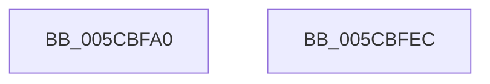

# KseDsCallbackHookDriverStartIo

- RVA: `0x005CBFA0`–`0x005CBFED` (길이 `77` bytes)
- VA: `0x00000001405CBFA0`
- 실행 섹션: `.text`
- PDB 이름 있음: `예`; PDB Function 태그: `아니요`
- unwind 정보 RVA: `0x0005CAAC`
- 디코드: `22`개 명령, `77/77` bytes 표시
- 미해석 바이트: `0` (있으면 어셈블리에 `.byte`로 보존)

> 이 문서는 커널 이미지의 기계어와 PDB 기호를 분석해 생성했습니다. 4번과 5번은 함수 원형과 자료형을 바이너리 사용 방식에서 추정한 C 해석이며 원본 소스 복구 결과는 아닙니다.

## 1. Dependencies

- 직접 호출 지점: **3**; 고유 호출 대상: **2**
- 직접 호출자로 확인된 함수: **0**
- RIP 상대 이미지 참조: **1**

### Outgoing calls
- `0x005CBFBE` → [guard_dispatch_icall](../6B/guard_dispatch_icall_function_006BAAD0.md) (function, `0x006BAAD0`)
- `0x005CBFCD` → [guard_dispatch_icall](../6B/guard_dispatch_icall_function_006BAAD0.md) (function, `0x006BAAD0`)
- `0x005CBFDC` → [KsepDsEventDriverStartIo](KsepDsEventDriverStartIo_function_005CCB7C.md) (function, `0x005CCB7C`)

### Direct callers
- 이 함수 시작 RVA로 연결되는 직접 call은 확인되지 않았습니다. 간접 호출은 완전히 역산할 수 없습니다.

### Static image references
- `0x005CBFAA` → RVA `0x00E01668` (`.data`; read)

## 2. Other-region calls and transfers

- 다른 실행 섹션으로 향하는 call: **0**
- 별도 외부 분기/꼬리 이동을 확인하지 못했습니다.

## 3. Assembly (complete function range)

```asm
005CBFA0  48 89 5C 24 08                  mov qword ptr [rsp + 8], rbx
005CBFA5  57                              push rdi
005CBFA6  48 83 EC 20                     sub rsp, 0x20
005CBFAA  48 8B 05 B7 56 83 00            mov rax, qword ptr [rip + 0x8356b7]
005CBFB1  48 8B F9                        mov rdi, rcx
005CBFB4  48 8B 49 08                     mov rcx, qword ptr [rcx + 8]
005CBFB8  48 8B DA                        mov rbx, rdx
005CBFBB  48 8B 00                        mov rax, qword ptr [rax]
005CBFBE  E8 0D EB 0E 00                  call 0x1406baad0
005CBFC3  48 8B D3                        mov rdx, rbx
005CBFC6  48 8B CF                        mov rcx, rdi
005CBFC9  48 8B 40 08                     mov rax, qword ptr [rax + 8]
005CBFCD  E8 FE EA 0E 00                  call 0x1406baad0
005CBFD2  48 8B 4F 08                     mov rcx, qword ptr [rdi + 8]
005CBFD6  4C 8B C3                        mov r8, rbx
005CBFD9  48 8B D7                        mov rdx, rdi
005CBFDC  E8 9B 0B 00 00                  call 0x1405ccb7c
005CBFE1  48 8B 5C 24 30                  mov rbx, qword ptr [rsp + 0x30]
005CBFE6  48 83 C4 20                     add rsp, 0x20
005CBFEA  5F                              pop rdi
005CBFEB  C3                              ret
005CBFEC  CC                              int3
```

## 4. C-style interpretation (structured pseudocode)

```c
__int64 __fastcall KseDsCallbackHookDriverStartIo(__int64 a1, __int64 a2)
{
    __int64 result;
    __int64 v_rsp;
    unsigned __int64 v_stack_p8;

    v_stack_p8 = v_rbx;
    v_rsp = (v_rsp) - (32);
    result = guard_dispatch_icall(*(unsigned __int64 *)(a1 + 8), a2, a3, a4);
    result = guard_dispatch_icall(a1, a2, a3, a4);
    result = KsepDsEventDriverStartIo(*(unsigned __int64 *)(a1 + 8), a1, a2, a4);
    v_rsp = (v_rsp) + (32);
    return result;
}
```

## 5. (Beta) C Style

```c
int64_t KseDsCallbackHookDriverStartIo(void *Arg1, int64_t Arg2)
{
    uint8_t *arg1 = (uint8_t *)Arg1;

    int64_t result;
    int64_t local_rsp;
    uint64_t v_stack_p8;

    v_stack_p8 = local_rbx;
    local_rsp = (local_rsp) - (32);
    result = guard_dispatch_icall(*(uint64_t *)(arg1 + 0x8), Arg2, a3, a4);
    result = guard_dispatch_icall(Arg1, Arg2, a3, a4);
    result = KsepDsEventDriverStartIo(*(uint64_t *)(arg1 + 0x8), Arg1, Arg2, a4);
    local_rsp = (local_rsp) + (32);
    return result;
}
```

### 관측된 메모리 오프셋

구조체 형식이 확인되지 않은 접근은 인자 기준의 오프셋으로만 기록했습니다.

| 기준 인자 | 오프셋 표현 | 폭 (bit) | 접근 |
|---|---:|---:|---|
| `Arg1` | `+ 0x8` | `64` | `R` |

## 6. Execution-region graph

[열기: 2D/3D 그래프와 함수 탐색 컨트롤 패널](../../../control-panel.html?section=text&rva=0x005CBFA0&view=graph)

- 2D 그래프는 위에서 아래로 흐르고, 3D 그래프는 빈 공간을 드래그해 회전합니다. Shift+드래그는 이동, 휠은 확대·축소, 함수 노드 선택은 대상 보고서 이동입니다.

### Static fallback


