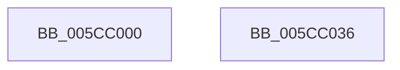

# KseDsCallbackHookDriverUnload

- RVA: `0x005CC000`–`0x005CC037` (길이 `55` bytes)
- VA: `0x00000001405CC000`
- 실행 섹션: `.text`
- PDB 이름 있음: `예`; PDB Function 태그: `아니요`
- unwind 정보 RVA: `0x0005CF00`
- 디코드: `16`개 명령, `55/55` bytes 표시
- 미해석 바이트: `0` (있으면 어셈블리에 `.byte`로 보존)

> 이 문서는 커널 이미지의 기계어와 PDB 기호를 분석해 생성했습니다. 4번과 5번은 함수 원형과 자료형을 바이너리 사용 방식에서 추정한 C 해석이며 원본 소스 복구 결과는 아닙니다.

## 1. Dependencies

- 직접 호출 지점: **3**; 고유 호출 대상: **2**
- 직접 호출자로 확인된 함수: **0**
- RIP 상대 이미지 참조: **1**

### Outgoing calls
- `0x005CC013` → [guard_dispatch_icall](../6B/guard_dispatch_icall_function_006BAAD0.md) (function, `0x006BAAD0`)
- `0x005CC01F` → [guard_dispatch_icall](../6B/guard_dispatch_icall_function_006BAAD0.md) (function, `0x006BAAD0`)
- `0x005CC02B` → [KsepDsEventDriverUnload](KsepDsEventDriverUnload_function_005CCC44.md) (function, `0x005CCC44`)

### Direct callers
- 이 함수 시작 RVA로 연결되는 직접 call은 확인되지 않았습니다. 간접 호출은 완전히 역산할 수 없습니다.

### Static image references
- `0x005CC006` → RVA `0x00E01668` (`.data`; read)

## 2. Other-region calls and transfers

- 다른 실행 섹션으로 향하는 call: **0**
- 별도 외부 분기/꼬리 이동을 확인하지 못했습니다.

## 3. Assembly (complete function range)

```asm
005CC000  40 53                           push rbx
005CC002  48 83 EC 20                     sub rsp, 0x20
005CC006  48 8B 05 5B 56 83 00            mov rax, qword ptr [rip + 0x83565b]
005CC00D  48 8B D9                        mov rbx, rcx
005CC010  48 8B 00                        mov rax, qword ptr [rax]
005CC013  E8 B8 EA 0E 00                  call 0x1406baad0
005CC018  48 8B CB                        mov rcx, rbx
005CC01B  48 8B 40 10                     mov rax, qword ptr [rax + 0x10]
005CC01F  E8 AC EA 0E 00                  call 0x1406baad0
005CC024  48 8B 53 18                     mov rdx, qword ptr [rbx + 0x18]
005CC028  48 8B CB                        mov rcx, rbx
005CC02B  E8 14 0C 00 00                  call 0x1405ccc44
005CC030  48 83 C4 20                     add rsp, 0x20
005CC034  5B                              pop rbx
005CC035  C3                              ret
005CC036  CC                              int3
```

## 4. C-style interpretation (structured pseudocode)

```c
__int64 __fastcall KseDsCallbackHookDriverUnload(__int64 a1)
{
    __int64 result;
    __int64 v_rsp;

    v_rsp = (v_rsp) - (32);
    result = guard_dispatch_icall(a1, a2, a3, a4);
    result = guard_dispatch_icall(a1, a2, a3, a4);
    result = KsepDsEventDriverUnload(a1, *(unsigned __int64 *)(a1 + 24), a3, a4);
    v_rsp = (v_rsp) + (32);
    return result;
}
```

## 5. (Beta) C Style

```c
int64_t KseDsCallbackHookDriverUnload(void *Arg1)
{
    uint8_t *arg1 = (uint8_t *)Arg1;

    int64_t result;
    int64_t local_rsp;

    local_rsp = (local_rsp) - (32);
    result = guard_dispatch_icall(Arg1, a2, a3, a4);
    result = guard_dispatch_icall(Arg1, a2, a3, a4);
    result = KsepDsEventDriverUnload(Arg1, *(uint64_t *)(arg1 + 0x18), a3, a4);
    local_rsp = (local_rsp) + (32);
    return result;
}
```

### 관측된 메모리 오프셋

구조체 형식이 확인되지 않은 접근은 인자 기준의 오프셋으로만 기록했습니다.

| 기준 인자 | 오프셋 표현 | 폭 (bit) | 접근 |
|---|---:|---:|---|
| `Arg1` | `+ 0x18` | `64` | `R` |

## 6. Execution-region graph

[열기: 2D/3D 그래프와 함수 탐색 컨트롤 패널](../../../control-panel.html?section=text&rva=0x005CC000&view=graph)

- 2D 그래프는 위에서 아래로 흐르고, 3D 그래프는 빈 공간을 드래그해 회전합니다. Shift+드래그는 이동, 휠은 확대·축소, 함수 노드 선택은 대상 보고서 이동입니다.

### Static fallback


