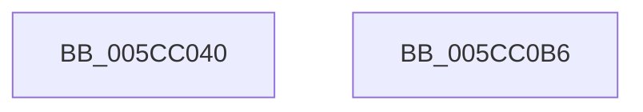

# KseDsCallbackHookIrpDeviceControlFunction

- RVA: `0x005CC040`–`0x005CC0B7` (길이 `119` bytes)
- VA: `0x00000001405CC040`
- 실행 섹션: `.text`
- PDB 이름 있음: `예`; PDB Function 태그: `아니요`
- unwind 정보 RVA: `0x00066400`
- 디코드: `32`개 명령, `119/119` bytes 표시
- 미해석 바이트: `0` (있으면 어셈블리에 `.byte`로 보존)

> 이 문서는 커널 이미지의 기계어와 PDB 기호를 분석해 생성했습니다. 4번과 5번은 함수 원형과 자료형을 바이너리 사용 방식에서 추정한 C 해석이며 원본 소스 복구 결과는 아닙니다.

## 1. Dependencies

- 직접 호출 지점: **3**; 고유 호출 대상: **2**
- 직접 호출자로 확인된 함수: **0**
- RIP 상대 이미지 참조: **1**

### Outgoing calls
- `0x005CC072` → [guard_dispatch_icall](../6B/guard_dispatch_icall_function_006BAAD0.md) (function, `0x006BAAD0`)
- `0x005CC082` → [guard_dispatch_icall](../6B/guard_dispatch_icall_function_006BAAD0.md) (function, `0x006BAAD0`)
- `0x005CC09A` → [KsepDsEventDataIrp](KsepDsEventDataIrp_function_005CC780.md) (function, `0x005CC780`)

### Direct callers
- 이 함수 시작 RVA로 연결되는 직접 call은 확인되지 않았습니다. 간접 호출은 완전히 역산할 수 없습니다.

### Static image references
- `0x005CC068` → RVA `0x00E01668` (`.data`; read)

## 2. Other-region calls and transfers

- 다른 실행 섹션으로 향하는 call: **0**
- 별도 외부 분기/꼬리 이동을 확인하지 못했습니다.

## 3. Assembly (complete function range)

```asm
005CC040  48 89 5C 24 08                  mov qword ptr [rsp + 8], rbx
005CC045  48 89 6C 24 10                  mov qword ptr [rsp + 0x10], rbp
005CC04A  48 89 74 24 18                  mov qword ptr [rsp + 0x18], rsi
005CC04F  57                              push rdi
005CC050  48 83 EC 30                     sub rsp, 0x30
005CC054  48 8B 82 B8 00 00 00            mov rax, qword ptr [rdx + 0xb8]
005CC05B  48 8B E9                        mov rbp, rcx
005CC05E  48 8B 49 08                     mov rcx, qword ptr [rcx + 8]
005CC062  48 8B F2                        mov rsi, rdx
005CC065  0F B6 38                        movzx edi, byte ptr [rax]
005CC068  48 8B 05 F9 55 83 00            mov rax, qword ptr [rip + 0x8355f9]
005CC06F  48 8B 00                        mov rax, qword ptr [rax]
005CC072  E8 59 EA 0E 00                  call 0x1406baad0
005CC077  48 8B D6                        mov rdx, rsi
005CC07A  48 8B CD                        mov rcx, rbp
005CC07D  48 8B 44 F8 20                  mov rax, qword ptr [rax + rdi*8 + 0x20]
005CC082  E8 49 EA 0E 00                  call 0x1406baad0
005CC087  48 8B 4D 08                     mov rcx, qword ptr [rbp + 8]
005CC08B  44 8B CF                        mov r9d, edi
005CC08E  4C 8B C6                        mov r8, rsi
005CC091  89 44 24 20                     mov dword ptr [rsp + 0x20], eax
005CC095  48 8B D5                        mov rdx, rbp
005CC098  8B D8                           mov ebx, eax
005CC09A  E8 E1 06 00 00                  call 0x1405cc780
005CC09F  48 8B 6C 24 48                  mov rbp, qword ptr [rsp + 0x48]
005CC0A4  8B C3                           mov eax, ebx
005CC0A6  48 8B 5C 24 40                  mov rbx, qword ptr [rsp + 0x40]
005CC0AB  48 8B 74 24 50                  mov rsi, qword ptr [rsp + 0x50]
005CC0B0  48 83 C4 30                     add rsp, 0x30
005CC0B4  5F                              pop rdi
005CC0B5  C3                              ret
005CC0B6  CC                              int3
```

## 4. C-style interpretation (structured pseudocode)

```c
__int64 __fastcall KseDsCallbackHookIrpDeviceControlFunction(__int64 a1, __int64 a2)
{
    __int64 result;
    __int64 v_rsp;
    unsigned int v_stack_m18;
    unsigned __int64 v_stack_p10;
    unsigned __int64 v_stack_p18;
    unsigned __int64 v_stack_p8;

    v_stack_p8 = v_rbx;
    v_stack_p10 = v_rbp;
    v_stack_p18 = v_rsi;
    v_rsp = (v_rsp) - (48);
    result = guard_dispatch_icall(*(unsigned __int64 *)(a1 + 8), a2, a3, a4);
    result = guard_dispatch_icall(a1, a2, a3, a4);
    v_stack_m18 = (unsigned int)(result);
    result = KsepDsEventDataIrp(*(unsigned __int64 *)(a1 + 8), a1, a2, (unsigned int)((unsigned int)(*(unsigned __int8 *)(*(unsigned __int64 *)(a2 + 184)))));
    v_rsp = (v_rsp) + (48);
    return (unsigned int)((unsigned int)((unsigned int)((unsigned int)(result))));
}
```

## 5. (Beta) C Style

```c
int64_t KseDsCallbackHookIrpDeviceControlFunction(void *Arg1, void *Arg2)
{
    uint8_t *arg1 = (uint8_t *)Arg1;
    uint8_t *arg2 = (uint8_t *)Arg2;

    int64_t result;
    int64_t local_rsp;
    uint32_t v_stack_m18;
    uint64_t v_stack_p10;
    uint64_t v_stack_p18;
    uint64_t v_stack_p8;

    v_stack_p8 = local_rbx;
    v_stack_p10 = local_rbp;
    v_stack_p18 = local_rsi;
    local_rsp = (local_rsp) - (48);
    result = guard_dispatch_icall(*(uint64_t *)(arg1 + 0x8), Arg2, a3, a4);
    result = guard_dispatch_icall(Arg1, Arg2, a3, a4);
    v_stack_m18 = (uint32_t)(result);
    result = KsepDsEventDataIrp(*(uint64_t *)(arg1 + 0x8), Arg1, Arg2, (uint32_t)((uint32_t)(*(uint8_t *)(*(uint64_t *)(arg2 + 0xB8)))));
    local_rsp = (local_rsp) + (48);
    return (uint32_t)((uint32_t)((uint32_t)((uint32_t)(result))));
}
```

### 관측된 메모리 오프셋

구조체 형식이 확인되지 않은 접근은 인자 기준의 오프셋으로만 기록했습니다.

| 기준 인자 | 오프셋 표현 | 폭 (bit) | 접근 |
|---|---:|---:|---|
| `Arg1` | `+ 0x8` | `64` | `R` |
| `Arg2` | `+ 0xB8` | `64` | `R` |

## 6. Execution-region graph

[열기: 2D/3D 그래프와 함수 탐색 컨트롤 패널](../../../control-panel.html?section=text&rva=0x005CC040&view=graph)

- 2D 그래프는 위에서 아래로 흐르고, 3D 그래프는 빈 공간을 드래그해 회전합니다. Shift+드래그는 이동, 휠은 확대·축소, 함수 노드 선택은 대상 보고서 이동입니다.

### Static fallback


