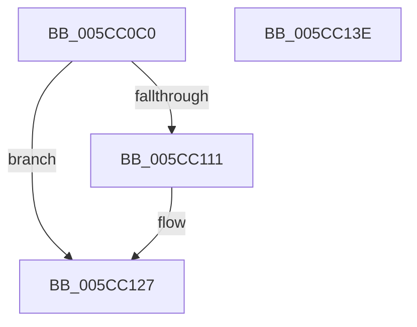

# KseDsCallbackHookIrpFunction

- RVA: `0x005CC0C0`–`0x005CC13F` (길이 `127` bytes)
- VA: `0x00000001405CC0C0`
- 실행 섹션: `.text`
- PDB 이름 있음: `예`; PDB Function 태그: `아니요`
- unwind 정보 RVA: `0x00066400`
- 디코드: `35`개 명령, `127/127` bytes 표시
- 미해석 바이트: `0` (있으면 어셈블리에 `.byte`로 보존)

> 이 문서는 커널 이미지의 기계어와 PDB 기호를 분석해 생성했습니다. 4번과 5번은 함수 원형과 자료형을 바이너리 사용 방식에서 추정한 C 해석이며 원본 소스 복구 결과는 아닙니다.

## 1. Dependencies

- 직접 호출 지점: **3**; 고유 호출 대상: **2**
- 직접 호출자로 확인된 함수: **0**
- RIP 상대 이미지 참조: **1**

### Outgoing calls
- `0x005CC0F2` → [guard_dispatch_icall](../6B/guard_dispatch_icall_function_006BAAD0.md) (function, `0x006BAAD0`)
- `0x005CC102` → [guard_dispatch_icall](../6B/guard_dispatch_icall_function_006BAAD0.md) (function, `0x006BAAD0`)
- `0x005CC122` → [KsepDsEventDataIrp](KsepDsEventDataIrp_function_005CC780.md) (function, `0x005CC780`)

### Direct callers
- 이 함수 시작 RVA로 연결되는 직접 call은 확인되지 않았습니다. 간접 호출은 완전히 역산할 수 없습니다.

### Static image references
- `0x005CC0E8` → RVA `0x00E01668` (`.data`; read)

## 2. Other-region calls and transfers

- 다른 실행 섹션으로 향하는 call: **0**
- 별도 외부 분기/꼬리 이동을 확인하지 못했습니다.

## 3. Assembly (complete function range)

```asm
005CC0C0  48 89 5C 24 08                  mov qword ptr [rsp + 8], rbx
005CC0C5  48 89 6C 24 10                  mov qword ptr [rsp + 0x10], rbp
005CC0CA  48 89 74 24 18                  mov qword ptr [rsp + 0x18], rsi
005CC0CF  57                              push rdi
005CC0D0  48 83 EC 30                     sub rsp, 0x30
005CC0D4  48 8B 82 B8 00 00 00            mov rax, qword ptr [rdx + 0xb8]
005CC0DB  48 8B D9                        mov rbx, rcx
005CC0DE  48 8B 49 08                     mov rcx, qword ptr [rcx + 8]
005CC0E2  48 8B F2                        mov rsi, rdx
005CC0E5  0F B6 28                        movzx ebp, byte ptr [rax]
005CC0E8  48 8B 05 79 55 83 00            mov rax, qword ptr [rip + 0x835579]
005CC0EF  48 8B 00                        mov rax, qword ptr [rax]
005CC0F2  E8 D9 E9 0E 00                  call 0x1406baad0
005CC0F7  48 8B D6                        mov rdx, rsi
005CC0FA  48 8B CB                        mov rcx, rbx
005CC0FD  48 8B 44 E8 20                  mov rax, qword ptr [rax + rbp*8 + 0x20]
005CC102  E8 C9 E9 0E 00                  call 0x1406baad0
005CC107  8D 4D FD                        lea ecx, [rbp - 3]
005CC10A  8B F8                           mov edi, eax
005CC10C  83 F9 01                        cmp ecx, 1
005CC10F  77 16                           ja 0x1405cc127
005CC111  48 8B 4B 08                     mov rcx, qword ptr [rbx + 8]
005CC115  44 8B CD                        mov r9d, ebp
005CC118  4C 8B C6                        mov r8, rsi
005CC11B  89 44 24 20                     mov dword ptr [rsp + 0x20], eax
005CC11F  48 8B D3                        mov rdx, rbx
005CC122  E8 59 06 00 00                  call 0x1405cc780
005CC127  48 8B 5C 24 40                  mov rbx, qword ptr [rsp + 0x40]
005CC12C  8B C7                           mov eax, edi
005CC12E  48 8B 6C 24 48                  mov rbp, qword ptr [rsp + 0x48]
005CC133  48 8B 74 24 50                  mov rsi, qword ptr [rsp + 0x50]
005CC138  48 83 C4 30                     add rsp, 0x30
005CC13C  5F                              pop rdi
005CC13D  C3                              ret
005CC13E  CC                              int3
```

## 4. C-style interpretation (structured pseudocode)

```c
__int64 __fastcall KseDsCallbackHookIrpFunction(__int64 a1, __int64 a2)
{
    __int64 result;
    __int64 v_rsp;
    unsigned int v_stack_m18;
    unsigned __int64 v_stack_p10;
    unsigned __int64 v_stack_p18;
    unsigned __int64 v_stack_p8;

    v_stack_p8 = v_rbx;
    v_stack_p10 = v_rbp;
    v_stack_p18 = v_rsi;
    v_rsp = (v_rsp) - (48);
    result = guard_dispatch_icall(*(unsigned __int64 *)(a1 + 8), a2, a3, a4);
    result = guard_dispatch_icall(a1, a2, a3, a4);
    if (((unsigned int)(*(unsigned __int8 *)(*(unsigned __int64 *)(a2 + 184)) - 3)) <= 1) {
        a1 = *(unsigned __int64 *)(a1 + 8);
        a4 = (unsigned int)(*(unsigned __int8 *)(*(unsigned __int64 *)(a2 + 184)));
        a3 = a2;
        v_stack_m18 = (unsigned int)(result);
        a2 = a1;
        result = KsepDsEventDataIrp(a1, a2, a3, a4);
    }
    v_rsp = (v_rsp) + (48);
    return (unsigned int)((unsigned int)((unsigned int)((unsigned int)(result))));
}
```

## 5. (Beta) C Style

```c
int64_t KseDsCallbackHookIrpFunction(void *Arg1, void *Arg2)
{
    uint8_t *arg1 = (uint8_t *)Arg1;
    uint8_t *arg2 = (uint8_t *)Arg2;

    int64_t result;
    int64_t local_rsp;
    uint32_t v_stack_m18;
    uint64_t v_stack_p10;
    uint64_t v_stack_p18;
    uint64_t v_stack_p8;

    v_stack_p8 = local_rbx;
    v_stack_p10 = local_rbp;
    v_stack_p18 = local_rsi;
    local_rsp = (local_rsp) - (48);
    result = guard_dispatch_icall(*(uint64_t *)(arg1 + 0x8), Arg2, a3, a4);
    result = guard_dispatch_icall(Arg1, Arg2, a3, a4);
    if (((uint32_t)(*(uint8_t *)(*(uint64_t *)(arg2 + 0xB8)) - 3)) <= 1) {
        Arg1 = *(uint64_t *)(arg1 + 0x8);
        a4 = (uint32_t)(*(uint8_t *)(*(uint64_t *)(arg2 + 0xB8)));
        a3 = Arg2;
        v_stack_m18 = (uint32_t)(result);
        Arg2 = Arg1;
        result = KsepDsEventDataIrp(Arg1, Arg2, a3, a4);
    }
    local_rsp = (local_rsp) + (48);
    return (uint32_t)((uint32_t)((uint32_t)((uint32_t)(result))));
}
```

### 관측된 메모리 오프셋

구조체 형식이 확인되지 않은 접근은 인자 기준의 오프셋으로만 기록했습니다.

| 기준 인자 | 오프셋 표현 | 폭 (bit) | 접근 |
|---|---:|---:|---|
| `Arg1` | `+ 0x8` | `64` | `R` |
| `Arg2` | `+ 0xB8` | `64` | `R` |

## 6. Execution-region graph

[열기: 2D/3D 그래프와 함수 탐색 컨트롤 패널](../../../control-panel.html?section=text&rva=0x005CC0C0&view=graph)

- 2D 그래프는 위에서 아래로 흐르고, 3D 그래프는 빈 공간을 드래그해 회전합니다. Shift+드래그는 이동, 휠은 확대·축소, 함수 노드 선택은 대상 보고서 이동입니다.

### Static fallback


