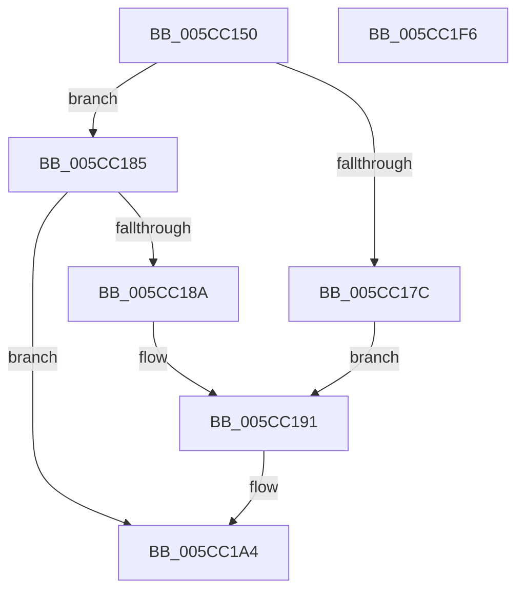

# KseDsCallbackHookIrpPnpFunction

- RVA: `0x005CC150`–`0x005CC1F7` (길이 `167` bytes)
- VA: `0x00000001405CC150`
- 실행 섹션: `.text`
- PDB 이름 있음: `예`; PDB Function 태그: `아니요`
- unwind 정보 RVA: `0x00066400`
- 디코드: `44`개 명령, `167/167` bytes 표시
- 미해석 바이트: `0` (있으면 어셈블리에 `.byte`로 보존)

> 이 문서는 커널 이미지의 기계어와 PDB 기호를 분석해 생성했습니다. 4번과 5번은 함수 원형과 자료형을 바이너리 사용 방식에서 추정한 C 해석이며 원본 소스 복구 결과는 아닙니다.

## 1. Dependencies

- 직접 호출 지점: **4**; 고유 호출 대상: **2**
- 직접 호출자로 확인된 함수: **0**
- RIP 상대 이미지 참조: **3**

### Outgoing calls
- `0x005CC19F` → [guard_dispatch_icall](../6B/guard_dispatch_icall_function_006BAAD0.md) (function, `0x006BAAD0`)
- `0x005CC1B2` → [guard_dispatch_icall](../6B/guard_dispatch_icall_function_006BAAD0.md) (function, `0x006BAAD0`)
- `0x005CC1C2` → [guard_dispatch_icall](../6B/guard_dispatch_icall_function_006BAAD0.md) (function, `0x006BAAD0`)
- `0x005CC1DA` → [KsepDsEventPnpIrp](KsepDsEventPnpIrp_function_005CCE10.md) (function, `0x005CCE10`)

### Direct callers
- 이 함수 시작 RVA로 연결되는 직접 call은 확인되지 않았습니다. 간접 호출은 완전히 역산할 수 없습니다.

### Static image references
- `0x005CC17C` → RVA `0x005CC330` (`KseDsCompletionHookForStartDevice`; read)
- `0x005CC18A` → RVA `0x005CC360` (`KseDsCompletionHookForStopDevice`; read)
- `0x005CC191` → RVA `0x00E01668` (`.data`; read)

## 2. Other-region calls and transfers

- 다른 실행 섹션으로 향하는 call: **0**
- 별도 외부 분기/꼬리 이동을 확인하지 못했습니다.

## 3. Assembly (complete function range)

```asm
005CC150  48 89 5C 24 08                  mov qword ptr [rsp + 8], rbx
005CC155  48 89 6C 24 10                  mov qword ptr [rsp + 0x10], rbp
005CC15A  48 89 74 24 18                  mov qword ptr [rsp + 0x18], rsi
005CC15F  57                              push rdi
005CC160  48 83 EC 30                     sub rsp, 0x30
005CC164  48 8B 82 B8 00 00 00            mov rax, qword ptr [rdx + 0xb8]
005CC16B  48 8B FA                        mov rdi, rdx
005CC16E  48 8B F1                        mov rsi, rcx
005CC171  0F B6 68 01                     movzx ebp, byte ptr [rax + 1]
005CC175  0F B6 18                        movzx ebx, byte ptr [rax]
005CC178  85 ED                           test ebp, ebp
005CC17A  75 09                           jne 0x1405cc185
005CC17C  4C 8D 05 AD 01 00 00            lea r8, [rip + 0x1ad]
005CC183  EB 0C                           jmp 0x1405cc191
005CC185  83 FD 04                        cmp ebp, 4
005CC188  75 1A                           jne 0x1405cc1a4
005CC18A  4C 8D 05 CF 01 00 00            lea r8, [rip + 0x1cf]
005CC191  48 8B 05 D0 54 83 00            mov rax, qword ptr [rip + 0x8354d0]
005CC198  45 33 C9                        xor r9d, r9d
005CC19B  48 8B 40 08                     mov rax, qword ptr [rax + 8]
005CC19F  E8 2C E9 0E 00                  call 0x1406baad0
005CC1A4  48 8B 05 BD 54 83 00            mov rax, qword ptr [rip + 0x8354bd]
005CC1AB  48 8B 4E 08                     mov rcx, qword ptr [rsi + 8]
005CC1AF  48 8B 00                        mov rax, qword ptr [rax]
005CC1B2  E8 19 E9 0E 00                  call 0x1406baad0
005CC1B7  48 8B D7                        mov rdx, rdi
005CC1BA  48 8B CE                        mov rcx, rsi
005CC1BD  48 8B 44 D8 20                  mov rax, qword ptr [rax + rbx*8 + 0x20]
005CC1C2  E8 09 E9 0E 00                  call 0x1406baad0
005CC1C7  48 8B 4E 08                     mov rcx, qword ptr [rsi + 8]
005CC1CB  44 8B CD                        mov r9d, ebp
005CC1CE  4C 8B C7                        mov r8, rdi
005CC1D1  89 44 24 20                     mov dword ptr [rsp + 0x20], eax
005CC1D5  48 8B D6                        mov rdx, rsi
005CC1D8  8B D8                           mov ebx, eax
005CC1DA  E8 31 0C 00 00                  call 0x1405cce10
005CC1DF  48 8B 6C 24 48                  mov rbp, qword ptr [rsp + 0x48]
005CC1E4  8B C3                           mov eax, ebx
005CC1E6  48 8B 5C 24 40                  mov rbx, qword ptr [rsp + 0x40]
005CC1EB  48 8B 74 24 50                  mov rsi, qword ptr [rsp + 0x50]
005CC1F0  48 83 C4 30                     add rsp, 0x30
005CC1F4  5F                              pop rdi
005CC1F5  C3                              ret
005CC1F6  CC                              int3
```

## 4. C-style interpretation (structured pseudocode)

```c
__int64 __fastcall KseDsCallbackHookIrpPnpFunction(__int64 a1, __int64 a2, __int64 a3, int a4)
{
    __int64 result;
    __int64 v_rsp;
    unsigned int v_stack_m18;
    unsigned __int64 v_stack_p10;
    unsigned __int64 v_stack_p18;
    unsigned __int64 v_stack_p8;

    v_stack_p8 = v_rbx;
    v_stack_p10 = v_rbp;
    v_stack_p18 = v_rsi;
    v_rsp = (v_rsp) - (48);
    if ((unsigned int)(*(unsigned __int8 *)(*(unsigned __int64 *)(a2 + 184) + 1)) != 0) goto loc_005CC185;
    goto loc_005CC191;
loc_005CC185:
    if (((unsigned int)(*(unsigned __int8 *)(*(unsigned __int64 *)(a2 + 184) + 1))) != 4) goto loc_005CC1A4;
loc_005CC191:
    a4 = 0;
    result = guard_dispatch_icall(a1, a2, v_rip + 463, a4);
loc_005CC1A4:
    result = guard_dispatch_icall(*(unsigned __int64 *)(a1 + 8), a2, v_rip + 463, a4);
    result = guard_dispatch_icall(a1, a2, v_rip + 463, a4);
    v_stack_m18 = (unsigned int)(result);
    result = KsepDsEventPnpIrp(*(unsigned __int64 *)(a1 + 8), a1, a2, (unsigned int)((unsigned int)(*(unsigned __int8 *)(*(unsigned __int64 *)(a2 + 184) + 1))));
    v_rsp = (v_rsp) + (48);
    return (unsigned int)((unsigned int)((unsigned int)((unsigned int)(result))));
}
```

## 5. (Beta) C Style

```c
int64_t KseDsCallbackHookIrpPnpFunction(void *Arg1, void *Arg2, int64_t Arg3, int32_t Arg4)
{
    uint8_t *arg1 = (uint8_t *)Arg1;
    uint8_t *arg2 = (uint8_t *)Arg2;

    int64_t result;
    int64_t local_rsp;
    uint32_t v_stack_m18;
    uint64_t v_stack_p10;
    uint64_t v_stack_p18;
    uint64_t v_stack_p8;

    v_stack_p8 = local_rbx;
    v_stack_p10 = local_rbp;
    v_stack_p18 = local_rsi;
    local_rsp = (local_rsp) - (48);
    if ((uint32_t)(*(uint8_t *)(*(uint64_t *)(arg2 + 0xB8) + 0x1)) != 0) goto loc_005CC185;
    goto loc_005CC191;
loc_005CC185:
    if (((uint32_t)(*(uint8_t *)(*(uint64_t *)(arg2 + 0xB8) + 0x1))) != 4) goto loc_005CC1A4;
loc_005CC191:
    Arg4 = 0;
    result = guard_dispatch_icall(Arg1, Arg2, v_rip + 463, Arg4);
loc_005CC1A4:
    result = guard_dispatch_icall(*(uint64_t *)(arg1 + 0x8), Arg2, v_rip + 463, Arg4);
    result = guard_dispatch_icall(Arg1, Arg2, v_rip + 463, Arg4);
    v_stack_m18 = (uint32_t)(result);
    result = KsepDsEventPnpIrp(*(uint64_t *)(arg1 + 0x8), Arg1, Arg2, (uint32_t)((uint32_t)(*(uint8_t *)(*(uint64_t *)(arg2 + 0xB8) + 0x1))));
    local_rsp = (local_rsp) + (48);
    return (uint32_t)((uint32_t)((uint32_t)((uint32_t)(result))));
}
```

### 관측된 메모리 오프셋

구조체 형식이 확인되지 않은 접근은 인자 기준의 오프셋으로만 기록했습니다.

| 기준 인자 | 오프셋 표현 | 폭 (bit) | 접근 |
|---|---:|---:|---|
| `Arg1` | `+ 0x8` | `64` | `R` |
| `Arg2` | `+ 0xB8` | `64` | `R` |

## 6. Execution-region graph

[열기: 2D/3D 그래프와 함수 탐색 컨트롤 패널](../../../control-panel.html?section=text&rva=0x005CC150&view=graph)

- 2D 그래프는 위에서 아래로 흐르고, 3D 그래프는 빈 공간을 드래그해 회전합니다. Shift+드래그는 이동, 휠은 확대·축소, 함수 노드 선택은 대상 보고서 이동입니다.

### Static fallback


