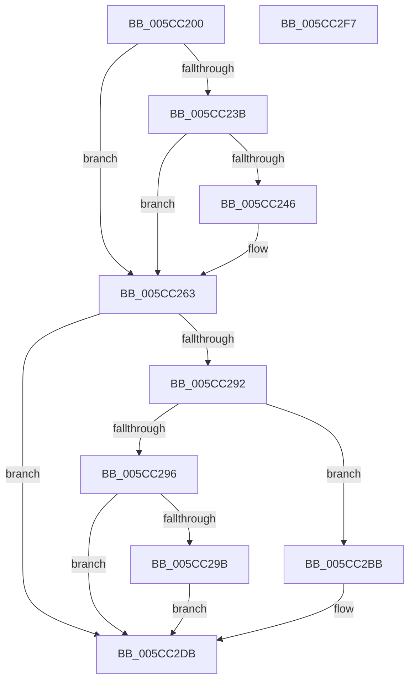

# KseDsCallbackHookIrpPowerFunction

- RVA: `0x005CC200`–`0x005CC2F8` (길이 `248` bytes)
- VA: `0x00000001405CC200`
- 실행 섹션: `.text`
- PDB 이름 있음: `예`; PDB Function 태그: `아니요`
- unwind 정보 RVA: `0x00093E28`
- 디코드: `70`개 명령, `248/248` bytes 표시
- 미해석 바이트: `0` (있으면 어셈블리에 `.byte`로 보존)

> 이 문서는 커널 이미지의 기계어와 PDB 기호를 분석해 생성했습니다. 4번과 5번은 함수 원형과 자료형을 바이너리 사용 방식에서 추정한 C 해석이며 원본 소스 복구 결과는 아닙니다.

## 1. Dependencies

- 직접 호출 지점: **5**; 고유 호출 대상: **3**
- 직접 호출자로 확인된 함수: **0**
- RIP 상대 이미지 참조: **2**

### Outgoing calls
- `0x005CC25E` → [guard_dispatch_icall](../6B/guard_dispatch_icall_function_006BAAD0.md) (function, `0x006BAAD0`)
- `0x005CC271` → [guard_dispatch_icall](../6B/guard_dispatch_icall_function_006BAAD0.md) (function, `0x006BAAD0`)
- `0x005CC281` → [guard_dispatch_icall](../6B/guard_dispatch_icall_function_006BAAD0.md) (function, `0x006BAAD0`)
- `0x005CC2B4` → [KsepDsEventDevicePowerIrp](KsepDsEventDevicePowerIrp_function_005CC95C.md) (function, `0x005CC95C`)
- `0x005CC2D6` → [KsepDsEventSystemPowerIrp](KsepDsEventSystemPowerIrp_function_005CD3A0.md) (function, `0x005CD3A0`)

### Direct callers
- 이 함수 시작 RVA로 연결되는 직접 call은 확인되지 않았습니다. 간접 호출은 완전히 역산할 수 없습니다.

### Static image references
- `0x005CC246` → RVA `0x00E01668` (`.data`; read)
- `0x005CC24D` → RVA `0x005CC300` (`KseDsCompletionHookForPowerDevice`; read)

## 2. Other-region calls and transfers

- 다른 실행 섹션으로 향하는 call: **0**
- 별도 외부 분기/꼬리 이동을 확인하지 못했습니다.

## 3. Assembly (complete function range)

```asm
005CC200  48 89 5C 24 08                  mov qword ptr [rsp + 8], rbx
005CC205  48 89 6C 24 10                  mov qword ptr [rsp + 0x10], rbp
005CC20A  48 89 74 24 18                  mov qword ptr [rsp + 0x18], rsi
005CC20F  57                              push rdi
005CC210  41 56                           push r14
005CC212  41 57                           push r15
005CC214  48 83 EC 40                     sub rsp, 0x40
005CC218  48 8B F1                        mov rsi, rcx
005CC21B  33 FF                           xor edi, edi
005CC21D  48 8B 8A B8 00 00 00            mov rcx, qword ptr [rdx + 0xb8]
005CC224  33 DB                           xor ebx, ebx
005CC226  48 8B EA                        mov rbp, rdx
005CC229  44 0F B6 71 01                  movzx r14d, byte ptr [rcx + 1]
005CC22E  44 0F B6 39                     movzx r15d, byte ptr [rcx]
005CC232  41 8D 46 FE                     lea eax, [r14 - 2]
005CC236  83 F8 01                        cmp eax, 1
005CC239  77 28                           ja 0x1405cc263
005CC23B  8B 79 10                        mov edi, dword ptr [rcx + 0x10]
005CC23E  8B 59 18                        mov ebx, dword ptr [rcx + 0x18]
005CC241  83 FF 01                        cmp edi, 1
005CC244  75 1D                           jne 0x1405cc263
005CC246  48 8B 05 1B 54 83 00            mov rax, qword ptr [rip + 0x83541b]
005CC24D  4C 8D 05 AC 00 00 00            lea r8, [rip + 0xac]
005CC254  45 33 C9                        xor r9d, r9d
005CC257  48 8B CE                        mov rcx, rsi
005CC25A  48 8B 40 08                     mov rax, qword ptr [rax + 8]
005CC25E  E8 6D E8 0E 00                  call 0x1406baad0
005CC263  48 8B 05 FE 53 83 00            mov rax, qword ptr [rip + 0x8353fe]
005CC26A  48 8B 4E 08                     mov rcx, qword ptr [rsi + 8]
005CC26E  48 8B 00                        mov rax, qword ptr [rax]
005CC271  E8 5A E8 0E 00                  call 0x1406baad0
005CC276  48 8B D5                        mov rdx, rbp
005CC279  48 8B CE                        mov rcx, rsi
005CC27C  4A 8B 44 F8 20                  mov rax, qword ptr [rax + r15*8 + 0x20]
005CC281  E8 4A E8 0E 00                  call 0x1406baad0
005CC286  41 8D 4E FE                     lea ecx, [r14 - 2]
005CC28A  44 8B F8                        mov r15d, eax
005CC28D  83 F9 01                        cmp ecx, 1
005CC290  77 49                           ja 0x1405cc2db
005CC292  85 FF                           test edi, edi
005CC294  74 25                           je 0x1405cc2bb
005CC296  83 FF 01                        cmp edi, 1
005CC299  75 40                           jne 0x1405cc2db
005CC29B  48 8B 4E 08                     mov rcx, qword ptr [rsi + 8]
005CC29F  45 8B CE                        mov r9d, r14d
005CC2A2  89 44 24 30                     mov dword ptr [rsp + 0x30], eax
005CC2A6  4C 8B C5                        mov r8, rbp
005CC2A9  89 5C 24 28                     mov dword ptr [rsp + 0x28], ebx
005CC2AD  48 8B D6                        mov rdx, rsi
005CC2B0  89 7C 24 20                     mov dword ptr [rsp + 0x20], edi
005CC2B4  E8 A3 06 00 00                  call 0x1405cc95c
005CC2B9  EB 20                           jmp 0x1405cc2db
005CC2BB  48 8B 4E 08                     mov rcx, qword ptr [rsi + 8]
005CC2BF  45 8B CE                        mov r9d, r14d
005CC2C2  44 89 7C 24 30                  mov dword ptr [rsp + 0x30], r15d
005CC2C7  4C 8B C5                        mov r8, rbp
005CC2CA  89 5C 24 28                     mov dword ptr [rsp + 0x28], ebx
005CC2CE  48 8B D6                        mov rdx, rsi
005CC2D1  83 64 24 20 00                  and dword ptr [rsp + 0x20], 0
005CC2D6  E8 C5 10 00 00                  call 0x1405cd3a0
005CC2DB  48 8B 5C 24 60                  mov rbx, qword ptr [rsp + 0x60]
005CC2E0  41 8B C7                        mov eax, r15d
005CC2E3  48 8B 6C 24 68                  mov rbp, qword ptr [rsp + 0x68]
005CC2E8  48 8B 74 24 70                  mov rsi, qword ptr [rsp + 0x70]
005CC2ED  48 83 C4 40                     add rsp, 0x40
005CC2F1  41 5F                           pop r15
005CC2F3  41 5E                           pop r14
005CC2F5  5F                              pop rdi
005CC2F6  C3                              ret
005CC2F7  CC                              int3
```

## 4. C-style interpretation (structured pseudocode)

```c
__int64 __fastcall KseDsCallbackHookIrpPowerFunction(__int64 a1, __int64 a2, __int64 a3, int a4)
{
    __int64 result;
    __int64 v_rbx;
    __int64 v_rdi;
    __int64 v_rsp;
    unsigned int v_stack_m28;
    unsigned int v_stack_m30;
    unsigned int v_stack_m38;
    unsigned __int64 v_stack_p10;
    unsigned __int64 v_stack_p18;
    unsigned __int64 v_stack_p8;

    v_stack_p8 = v_rbx;
    v_stack_p10 = v_rbp;
    v_stack_p18 = v_rsi;
    v_rsp = (v_rsp) - (64);
    v_rdi = 0;
    v_rbx = 0;
    if (((unsigned int)(*(unsigned __int8 *)(*(unsigned __int64 *)(a2 + 184) + 1) - 2)) > 1) goto loc_005CC263;
    result = *(unsigned __int8 *)(*(unsigned __int64 *)(a2 + 184) + 1) - 2;
    if (((unsigned int)((unsigned int)(*(unsigned int *)(*(unsigned __int64 *)(a2 + 184) + 16)))) == 1) {
        result = *(unsigned __int64 *)(v_rip + 8606747);
        a3 = v_rip + 172;
        a4 = 0;
        a1 = a1;
        result = *(unsigned __int64 *)(result + 8);
        result = guard_dispatch_icall(a1, a2, a3, a4);
    }
    result = guard_dispatch_icall(*(unsigned __int64 *)(a1 + 8), a2, a3, a4);
    result = guard_dispatch_icall(a1, a2, a3, a4);
    if (((unsigned int)(*(unsigned __int8 *)(*(unsigned __int64 *)(a2 + 184) + 1) - 2)) > 1) goto loc_005CC2DB;
    if ((unsigned int)((unsigned int)(*(unsigned int *)(*(unsigned __int64 *)(a2 + 184) + 16))) == 0) goto loc_005CC2BB;
    if (((unsigned int)((unsigned int)(*(unsigned int *)(*(unsigned __int64 *)(a2 + 184) + 16)))) != 1) goto loc_005CC2DB;
    v_stack_m28 = (unsigned int)(result);
    v_stack_m30 = (unsigned int)((unsigned int)(*(unsigned int *)(*(unsigned __int64 *)(a2 + 184) + 24)));
    v_stack_m38 = (unsigned int)((unsigned int)(*(unsigned int *)(*(unsigned __int64 *)(a2 + 184) + 16)));
    result = KsepDsEventDevicePowerIrp(*(unsigned __int64 *)(a1 + 8), a1, a2, (unsigned int)((unsigned int)(*(unsigned __int8 *)(*(unsigned __int64 *)(a2 + 184) + 1))));
    goto loc_005CC2DB;
loc_005CC2BB:
    v_stack_m28 = (unsigned int)((unsigned int)((unsigned int)(result)));
    v_stack_m30 = (unsigned int)((unsigned int)(*(unsigned int *)(*(unsigned __int64 *)(a2 + 184) + 24)));
    result = KsepDsEventSystemPowerIrp(*(unsigned __int64 *)(a1 + 8), a1, a2, (unsigned int)((unsigned int)(*(unsigned __int8 *)(*(unsigned __int64 *)(a2 + 184) + 1))));
loc_005CC2DB:
    v_rsp = (v_rsp) + (64);
    return (unsigned int)((unsigned int)((unsigned int)((unsigned int)(result))));
}
```

## 5. (Beta) C Style

```c
int64_t KseDsCallbackHookIrpPowerFunction(void *Arg1, void *Arg2, int64_t Arg3, int32_t Arg4)
{
    uint8_t *arg1 = (uint8_t *)Arg1;
    uint8_t *arg2 = (uint8_t *)Arg2;

    int64_t result;
    int64_t local_rbx;
    int64_t local_rdi;
    int64_t local_rsp;
    uint32_t v_stack_m28;
    uint32_t v_stack_m30;
    uint32_t v_stack_m38;
    uint64_t v_stack_p10;
    uint64_t v_stack_p18;
    uint64_t v_stack_p8;

    v_stack_p8 = local_rbx;
    v_stack_p10 = local_rbp;
    v_stack_p18 = local_rsi;
    local_rsp = (local_rsp) - (64);
    local_rdi = 0;
    local_rbx = 0;
    if (((uint32_t)(*(uint8_t *)(*(uint64_t *)(arg2 + 0xB8) + 0x1) - 2)) > 1) goto loc_005CC263;
    result = *(uint8_t *)(*(uint64_t *)(arg2 + 0xB8) + 0x1) - 2;
    if (((uint32_t)((uint32_t)(*(uint32_t *)(*(uint64_t *)(arg2 + 0xB8) + 0x10)))) == 1) {
        result = *(uint64_t *)(v_rip + 0x83541B);
        Arg3 = v_rip + 172;
        Arg4 = 0;
        Arg1 = Arg1;
        result = *(uint64_t *)(result + 0x8);
        result = guard_dispatch_icall(Arg1, Arg2, Arg3, Arg4);
    }
    result = guard_dispatch_icall(*(uint64_t *)(arg1 + 0x8), Arg2, Arg3, Arg4);
    result = guard_dispatch_icall(Arg1, Arg2, Arg3, Arg4);
    if (((uint32_t)(*(uint8_t *)(*(uint64_t *)(arg2 + 0xB8) + 0x1) - 2)) > 1) goto loc_005CC2DB;
    if ((uint32_t)((uint32_t)(*(uint32_t *)(*(uint64_t *)(arg2 + 0xB8) + 0x10))) == 0) goto loc_005CC2BB;
    if (((uint32_t)((uint32_t)(*(uint32_t *)(*(uint64_t *)(arg2 + 0xB8) + 0x10)))) != 1) goto loc_005CC2DB;
    v_stack_m28 = (uint32_t)(result);
    v_stack_m30 = (uint32_t)((uint32_t)(*(uint32_t *)(*(uint64_t *)(arg2 + 0xB8) + 0x18)));
    v_stack_m38 = (uint32_t)((uint32_t)(*(uint32_t *)(*(uint64_t *)(arg2 + 0xB8) + 0x10)));
    result = KsepDsEventDevicePowerIrp(*(uint64_t *)(arg1 + 0x8), Arg1, Arg2, (uint32_t)((uint32_t)(*(uint8_t *)(*(uint64_t *)(arg2 + 0xB8) + 0x1))));
    goto loc_005CC2DB;
loc_005CC2BB:
    v_stack_m28 = (uint32_t)((uint32_t)((uint32_t)(result)));
    v_stack_m30 = (uint32_t)((uint32_t)(*(uint32_t *)(*(uint64_t *)(arg2 + 0xB8) + 0x18)));
    result = KsepDsEventSystemPowerIrp(*(uint64_t *)(arg1 + 0x8), Arg1, Arg2, (uint32_t)((uint32_t)(*(uint8_t *)(*(uint64_t *)(arg2 + 0xB8) + 0x1))));
loc_005CC2DB:
    local_rsp = (local_rsp) + (64);
    return (uint32_t)((uint32_t)((uint32_t)((uint32_t)(result))));
}
```

### 관측된 메모리 오프셋

구조체 형식이 확인되지 않은 접근은 인자 기준의 오프셋으로만 기록했습니다.

| 기준 인자 | 오프셋 표현 | 폭 (bit) | 접근 |
|---|---:|---:|---|
| `Arg1` | `+ 0x8` | `64` | `R` |
| `Arg2` | `+ 0xB8` | `64` | `R` |

## 6. Execution-region graph

[열기: 2D/3D 그래프와 함수 탐색 컨트롤 패널](../../../control-panel.html?section=text&rva=0x005CC200&view=graph)

- 2D 그래프는 위에서 아래로 흐르고, 3D 그래프는 빈 공간을 드래그해 회전합니다. Shift+드래그는 이동, 휠은 확대·축소, 함수 노드 선택은 대상 보고서 이동입니다.

### Static fallback


