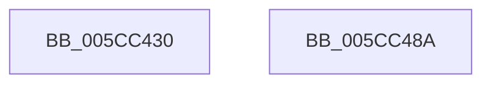

# KseDsHookExAllocatePoolWithTag

- RVA: `0x005CC430`–`0x005CC48B` (길이 `91` bytes)
- VA: `0x00000001405CC430`
- 실행 섹션: `.text`
- PDB 이름 있음: `예`; PDB Function 태그: `아니요`
- unwind 정보 RVA: `0x00066400`
- 디코드: `25`개 명령, `91/91` bytes 표시
- 미해석 바이트: `0` (있으면 어셈블리에 `.byte`로 보존)

> 이 문서는 커널 이미지의 기계어와 PDB 기호를 분석해 생성했습니다. 4번과 5번은 함수 원형과 자료형을 바이너리 사용 방식에서 추정한 C 해석이며 원본 소스 복구 결과는 아닙니다.

## 1. Dependencies

- 직접 호출 지점: **2**; 고유 호출 대상: **2**
- 직접 호출자로 확인된 함수: **0**
- RIP 상대 이미지 참조: **1**

### Outgoing calls
- `0x005CC453` → [guard_dispatch_icall](../6B/guard_dispatch_icall_function_006BAAD0.md) (function, `0x006BAAD0`)
- `0x005CC46D` → [KsepDsEventPoolAllocate](KsepDsEventPoolAllocate_function_005CD0D0.md) (function, `0x005CD0D0`)

### Direct callers
- 이 함수 시작 RVA로 연결되는 직접 call은 확인되지 않았습니다. 간접 호출은 완전히 역산할 수 없습니다.

### Static image references
- `0x005CC444` → RVA `0x00E015C8` (`.data`; read)

## 2. Other-region calls and transfers

- 다른 실행 섹션으로 향하는 call: **0**
- 별도 외부 분기/꼬리 이동을 확인하지 못했습니다.

## 3. Assembly (complete function range)

```asm
005CC430  48 89 5C 24 08                  mov qword ptr [rsp + 8], rbx
005CC435  48 89 6C 24 10                  mov qword ptr [rsp + 0x10], rbp
005CC43A  48 89 74 24 18                  mov qword ptr [rsp + 0x18], rsi
005CC43F  57                              push rdi
005CC440  48 83 EC 30                     sub rsp, 0x30
005CC444  48 8B 05 7D 51 83 00            mov rax, qword ptr [rip + 0x83517d]
005CC44B  41 8B F8                        mov edi, r8d
005CC44E  48 8B F2                        mov rsi, rdx
005CC451  8B E9                           mov ebp, ecx
005CC453  E8 78 E6 0E 00                  call 0x1406baad0
005CC458  48 8B 54 24 38                  mov rdx, qword ptr [rsp + 0x38]
005CC45D  4C 8B CE                        mov r9, rsi
005CC460  44 8B C5                        mov r8d, ebp
005CC463  89 7C 24 20                     mov dword ptr [rsp + 0x20], edi
005CC467  48 8B C8                        mov rcx, rax
005CC46A  48 8B D8                        mov rbx, rax
005CC46D  E8 5E 0C 00 00                  call 0x1405cd0d0
005CC472  48 8B 6C 24 48                  mov rbp, qword ptr [rsp + 0x48]
005CC477  48 8B C3                        mov rax, rbx
005CC47A  48 8B 5C 24 40                  mov rbx, qword ptr [rsp + 0x40]
005CC47F  48 8B 74 24 50                  mov rsi, qword ptr [rsp + 0x50]
005CC484  48 83 C4 30                     add rsp, 0x30
005CC488  5F                              pop rdi
005CC489  C3                              ret
005CC48A  CC                              int3
```

## 4. C-style interpretation (structured pseudocode)

```c
__int64 __fastcall KseDsHookExAllocatePoolWithTag(int a1, __int64 a2, int a3)
{
    __int64 result;
    __int64 v_rsp;
    unsigned int v_stack_m18;
    unsigned __int64 v_stack_p0;
    unsigned __int64 v_stack_p10;
    unsigned __int64 v_stack_p18;
    unsigned __int64 v_stack_p8;

    v_stack_p8 = v_rbx;
    v_stack_p10 = v_rbp;
    v_stack_p18 = v_rsi;
    v_rsp = (v_rsp) - (48);
    result = guard_dispatch_icall(a1, a2, a3, a4);
    v_stack_m18 = (unsigned int)((unsigned int)(a3));
    result = KsepDsEventPoolAllocate(result, v_stack_p0, (unsigned int)((unsigned int)((unsigned int)(a1))), a2);
    v_rsp = (v_rsp) + (48);
    return result;
}
```

## 5. (Beta) C Style

```c
int64_t KseDsHookExAllocatePoolWithTag(int32_t Arg1, int64_t Arg2, int32_t Arg3)
{
    int64_t result;
    int64_t local_rsp;
    uint32_t v_stack_m18;
    uint64_t v_stack_p0;
    uint64_t v_stack_p10;
    uint64_t v_stack_p18;
    uint64_t v_stack_p8;

    v_stack_p8 = local_rbx;
    v_stack_p10 = local_rbp;
    v_stack_p18 = local_rsi;
    local_rsp = (local_rsp) - (48);
    result = guard_dispatch_icall(Arg1, Arg2, Arg3, a4);
    v_stack_m18 = (uint32_t)((uint32_t)(Arg3));
    result = KsepDsEventPoolAllocate(result, v_stack_p0, (uint32_t)((uint32_t)((uint32_t)(Arg1))), Arg2);
    local_rsp = (local_rsp) + (48);
    return result;
}
```

## 6. Execution-region graph

[열기: 2D/3D 그래프와 함수 탐색 컨트롤 패널](../../../control-panel.html?section=text&rva=0x005CC430&view=graph)

- 2D 그래프는 위에서 아래로 흐르고, 3D 그래프는 빈 공간을 드래그해 회전합니다. Shift+드래그는 이동, 휠은 확대·축소, 함수 노드 선택은 대상 보고서 이동입니다.

### Static fallback


