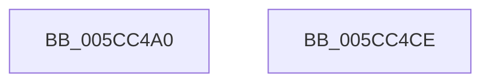

# KseDsHookExFreePool

- RVA: `0x005CC4A0`–`0x005CC4CF` (길이 `47` bytes)
- VA: `0x00000001405CC4A0`
- 실행 섹션: `.text`
- PDB 이름 있음: `예`; PDB Function 태그: `아니요`
- unwind 정보 RVA: `0x0005CF00`
- 디코드: `13`개 명령, `47/47` bytes 표시
- 미해석 바이트: `0` (있으면 어셈블리에 `.byte`로 보존)

> 이 문서는 커널 이미지의 기계어와 PDB 기호를 분석해 생성했습니다. 4번과 5번은 함수 원형과 자료형을 바이너리 사용 방식에서 추정한 C 해석이며 원본 소스 복구 결과는 아닙니다.

## 1. Dependencies

- 직접 호출 지점: **2**; 고유 호출 대상: **2**
- 직접 호출자로 확인된 함수: **0**
- RIP 상대 이미지 참조: **1**

### Outgoing calls
- `0x005CC4B0` → [guard_dispatch_icall](../6B/guard_dispatch_icall_function_006BAAD0.md) (function, `0x006BAAD0`)
- `0x005CC4C3` → [KsepDsEventPoolFree](KsepDsEventPoolFree_function_005CD1CC.md) (function, `0x005CD1CC`)

### Direct callers
- 이 함수 시작 RVA로 연결되는 직접 call은 확인되지 않았습니다. 간접 호출은 완전히 역산할 수 없습니다.

### Static image references
- `0x005CC4A6` → RVA `0x00E01628` (`.data`; read)

## 2. Other-region calls and transfers

- 다른 실행 섹션으로 향하는 call: **0**
- 별도 외부 분기/꼬리 이동을 확인하지 못했습니다.

## 3. Assembly (complete function range)

```asm
005CC4A0  40 53                           push rbx
005CC4A2  48 83 EC 20                     sub rsp, 0x20
005CC4A6  48 8B 05 7B 51 83 00            mov rax, qword ptr [rip + 0x83517b]
005CC4AD  48 8B D9                        mov rbx, rcx
005CC4B0  E8 1B E6 0E 00                  call 0x1406baad0
005CC4B5  48 8B 54 24 28                  mov rdx, qword ptr [rsp + 0x28]
005CC4BA  41 B8 4E 6F 6E 65               mov r8d, 0x656e6f4e
005CC4C0  48 8B CB                        mov rcx, rbx
005CC4C3  E8 04 0D 00 00                  call 0x1405cd1cc
005CC4C8  48 83 C4 20                     add rsp, 0x20
005CC4CC  5B                              pop rbx
005CC4CD  C3                              ret
005CC4CE  CC                              int3
```

## 4. C-style interpretation (structured pseudocode)

```c
__int64 __fastcall KseDsHookExFreePool(__int64 a1)
{
    __int64 result;
    __int64 v_rsp;
    unsigned __int64 v_stack_p0;

    v_rsp = (v_rsp) - (32);
    result = guard_dispatch_icall(a1, a2, a3, a4);
    result = KsepDsEventPoolFree(a1, v_stack_p0, (unsigned int)(0x656E6F4EULL), a4);
    v_rsp = (v_rsp) + (32);
    return result;
}
```

## 5. (Beta) C Style

```c
int64_t KseDsHookExFreePool(int64_t Arg1)
{
    int64_t result;
    int64_t local_rsp;
    uint64_t v_stack_p0;

    local_rsp = (local_rsp) - (32);
    result = guard_dispatch_icall(Arg1, a2, a3, a4);
    result = KsepDsEventPoolFree(Arg1, v_stack_p0, (uint32_t)(0x656E6F4EULL), a4);
    local_rsp = (local_rsp) + (32);
    return result;
}
```

## 6. Execution-region graph

[열기: 2D/3D 그래프와 함수 탐색 컨트롤 패널](../../../control-panel.html?section=text&rva=0x005CC4A0&view=graph)

- 2D 그래프는 위에서 아래로 흐르고, 3D 그래프는 빈 공간을 드래그해 회전합니다. Shift+드래그는 이동, 휠은 확대·축소, 함수 노드 선택은 대상 보고서 이동입니다.

### Static fallback


