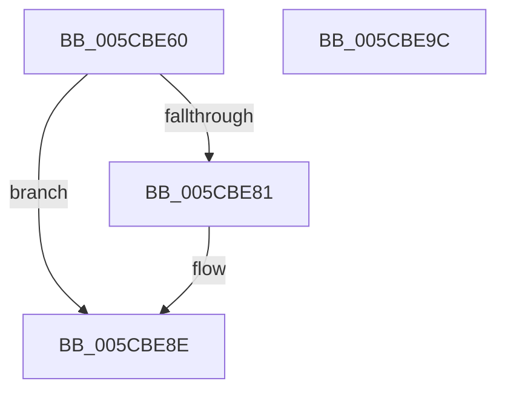

# KseHookExAllocatePoolWithTag

- RVA: `0x005CBE60`–`0x005CBE9D` (길이 `61` bytes)
- VA: `0x00000001405CBE60`
- 실행 섹션: `.text`
- PDB 이름 있음: `예`; PDB Function 태그: `아니요`
- unwind 정보 RVA: `0x0005CAAC`
- 디코드: `19`개 명령, `61/61` bytes 표시
- 미해석 바이트: `0` (있으면 어셈블리에 `.byte`로 보존)

> 이 문서는 커널 이미지의 기계어와 PDB 기호를 분석해 생성했습니다. 4번과 5번은 함수 원형과 자료형을 바이너리 사용 방식에서 추정한 C 해석이며 원본 소스 복구 결과는 아닙니다.

## 1. Dependencies

- 직접 호출 지점: **2**; 고유 호출 대상: **2**
- 직접 호출자로 확인된 함수: **0**
- RIP 상대 이미지 참조: **1**

### Outgoing calls
- `0x005CBE74` → [guard_dispatch_icall](../6B/guard_dispatch_icall_function_006BAAD0.md) (function, `0x006BAAD0`)
- `0x005CBE89` → [memset](../6C/memset_function_006C6C40.md) (function, `0x006C6C40`)

### Direct callers
- 이 함수 시작 RVA로 연결되는 직접 call은 확인되지 않았습니다. 간접 호출은 완전히 역산할 수 없습니다.

### Static image references
- `0x005CBE6A` → RVA `0x00E01428` (`.data`; read)

## 2. Other-region calls and transfers

- 다른 실행 섹션으로 향하는 call: **0**
- 별도 외부 분기/꼬리 이동을 확인하지 못했습니다.

## 3. Assembly (complete function range)

```asm
005CBE60  48 89 5C 24 08                  mov qword ptr [rsp + 8], rbx
005CBE65  57                              push rdi
005CBE66  48 83 EC 20                     sub rsp, 0x20
005CBE6A  48 8B 05 B7 55 83 00            mov rax, qword ptr [rip + 0x8355b7]
005CBE71  48 8B FA                        mov rdi, rdx
005CBE74  E8 57 EC 0E 00                  call 0x1406baad0
005CBE79  48 8B D8                        mov rbx, rax
005CBE7C  48 85 C0                        test rax, rax
005CBE7F  74 0D                           je 0x1405cbe8e
005CBE81  4C 8B C7                        mov r8, rdi
005CBE84  33 D2                           xor edx, edx
005CBE86  48 8B C8                        mov rcx, rax
005CBE89  E8 B2 AD 0F 00                  call 0x1406c6c40
005CBE8E  48 8B C3                        mov rax, rbx
005CBE91  48 8B 5C 24 30                  mov rbx, qword ptr [rsp + 0x30]
005CBE96  48 83 C4 20                     add rsp, 0x20
005CBE9A  5F                              pop rdi
005CBE9B  C3                              ret
005CBE9C  CC                              int3
```

## 4. C-style interpretation (structured pseudocode)

```c
__int64 __fastcall KseHookExAllocatePoolWithTag(__int64 a1, __int64 a2)
{
    __int64 result;
    __int64 v_rsp;
    unsigned __int64 v_stack_p8;

    v_stack_p8 = v_rbx;
    v_rsp = (v_rsp) - (32);
    result = guard_dispatch_icall(a1, a2, a3, a4);
    if (result != 0) {
        a3 = a2;
        a2 = 0;
        a1 = result;
        result = memset(a1, a2, a3, a4);
    }
    v_rsp = (v_rsp) + (32);
    return result;
}
```

## 5. (Beta) C Style

```c
int64_t KseHookExAllocatePoolWithTag(int64_t Arg1, int64_t Arg2)
{
    int64_t result;
    int64_t local_rsp;
    uint64_t v_stack_p8;

    v_stack_p8 = local_rbx;
    local_rsp = (local_rsp) - (32);
    result = guard_dispatch_icall(Arg1, Arg2, a3, a4);
    if (result != 0) {
        a3 = Arg2;
        Arg2 = 0;
        Arg1 = result;
        result = memset(Arg1, Arg2, a3, a4);
    }
    local_rsp = (local_rsp) + (32);
    return result;
}
```

## 6. Execution-region graph

[열기: 2D/3D 그래프와 함수 탐색 컨트롤 패널](../../../control-panel.html?section=text&rva=0x005CBE60&view=graph)

- 2D 그래프는 위에서 아래로 흐르고, 3D 그래프는 빈 공간을 드래그해 회전합니다. Shift+드래그는 이동, 휠은 확대·축소, 함수 노드 선택은 대상 보고서 이동입니다.

### Static fallback


