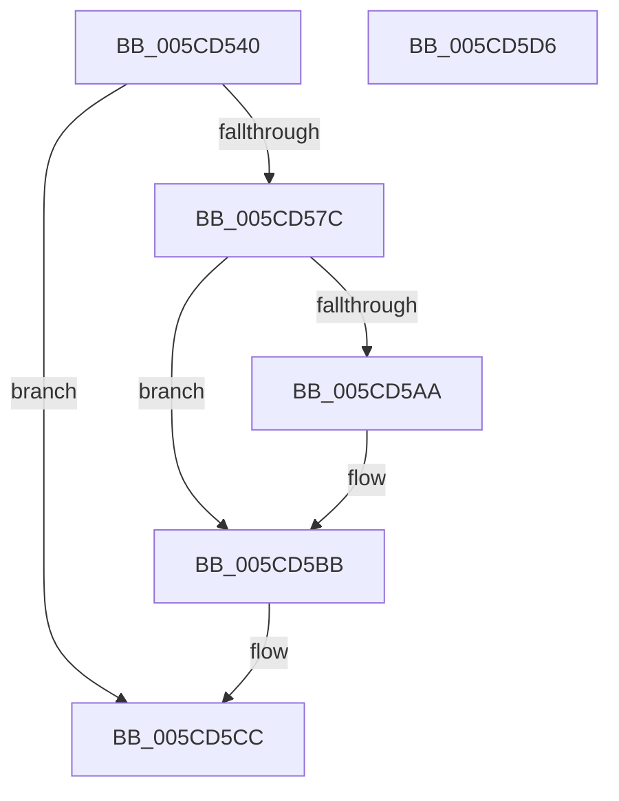

# KseKPSOHookDriverTargeted

- RVA: `0x005CD540`–`0x005CD5D7` (길이 `151` bytes)
- VA: `0x00000001405CD540`
- 실행 섹션: `.text`
- PDB 이름 있음: `예`; PDB Function 태그: `아니요`
- unwind 정보 RVA: `0x00063458`
- 디코드: `32`개 명령, `151/151` bytes 표시
- 미해석 바이트: `0` (있으면 어셈블리에 `.byte`로 보존)

> 이 문서는 커널 이미지의 기계어와 PDB 기호를 분석해 생성했습니다. 4번과 5번은 함수 원형과 자료형을 바이너리 사용 방식에서 추정한 C 해석이며 원본 소스 복구 결과는 아닙니다.

## 1. Dependencies

- 직접 호출 지점: **3**; 고유 호출 대상: **3**
- 직접 호출자로 확인된 함수: **0**
- RIP 상대 이미지 참조: **6**

### Outgoing calls
- `0x005CD573` → [RtlWriteRegistryValue](../../page/A6/RtlWriteRegistryValue_function_00A6C620.md) (function, `0x00A6C620`)
- `0x005CD5B6` → [KsepDebugPrint](../4D/KsepDebugPrint_function_004DCFF0.md) (function, `0x004DCFF0`)
- `0x005CD5C7` → [KsepLogError](../49/KsepLogError_function_00499A98.md) (function, `0x00499A98`)

### Direct callers
- 이 함수 시작 RVA로 연결되는 직접 call은 확인되지 않았습니다. 간접 호출은 완전히 역산할 수 없습니다.

### Static image references
- `0x005CD55C` → RVA `0x006CBE70` (` ?? ::FNODOBFM::`string'`; read)
- `0x005CD568` → RVA `0x006CBDD0` (` ?? ::FNODOBFM::`string'`; read)
- `0x005CD581` → RVA `0x00F101C0` (`.data`; read/write)
- `0x005CD58B` → RVA `0x00F101E0` (`.data`; read)
- `0x005CD599` → RVA `0x00E66CE8` (`.data`; read)
- `0x005CD5AA` → RVA `0x006CBE20` (` ?? ::FNODOBFM::`string'`; read)

## 2. Other-region calls and transfers

- 다른 실행 섹션으로 향하는 call: **1**
  - `0x005CD573` → [RtlWriteRegistryValue](../../page/A6/RtlWriteRegistryValue_function_00A6C620.md) (`.text` → `PAGE`)
- 별도 외부 분기/꼬리 이동을 확인하지 못했습니다.

## 3. Assembly (complete function range)

```asm
005CD540  48 83 EC 48                     sub rsp, 0x48
005CD544  41 B9 04 00 00 00               mov r9d, 4
005CD54A  C7 44 24 30 01 00 00 00         mov dword ptr [rsp + 0x30], 1
005CD552  48 8D 44 24 30                  lea rax, [rsp + 0x30]
005CD557  44 89 4C 24 28                  mov dword ptr [rsp + 0x28], r9d
005CD55C  4C 8D 05 0D E9 0F 00            lea r8, [rip + 0xfe90d]
005CD563  48 89 44 24 20                  mov qword ptr [rsp + 0x20], rax
005CD568  48 8D 15 61 E8 0F 00            lea rdx, [rip + 0xfe861]
005CD56F  41 8D 49 FE                     lea ecx, [r9 - 2]
005CD573  E8 A8 F0 49 00                  call 0x140a6c620
005CD578  85 C0                           test eax, eax
005CD57A  79 50                           jns 0x1405cd5cc
005CD57C  B9 01 00 00 00                  mov ecx, 1
005CD581  F0 0F C1 0D 37 2C 94 00         lock xadd dword ptr [rip + 0x942c37], ecx
005CD589  FF C1                           inc ecx
005CD58B  48 8D 15 4E 2C 94 00            lea rdx, [rip + 0x942c4e]
005CD592  83 E1 3F                        and ecx, 0x3f
005CD595  89 44 CA 04                     mov dword ptr [rdx + rcx*8 + 4], eax
005CD599  8B 05 49 97 89 00               mov eax, dword ptr [rip + 0x899749]
005CD59F  C7 04 CA 8F 00 12 00            mov dword ptr [rdx + rcx*8], 0x12008f
005CD5A6  A8 02                           test al, 2
005CD5A8  74 11                           je 0x1405cd5bb
005CD5AA  48 8D 15 6F E8 0F 00            lea rdx, [rip + 0xfe86f]
005CD5B1  B9 0C 00 00 00                  mov ecx, 0xc
005CD5B6  E8 35 FA F0 FF                  call 0x1404dcff0
005CD5BB  48 8D 15 5E E8 0F 00            lea rdx, [rip + 0xfe85e]
005CD5C2  B9 0C 00 00 00                  mov ecx, 0xc
005CD5C7  E8 CC C4 EC FF                  call 0x140499a98
005CD5CC  B8 6C 03 00 C0                  mov eax, 0xc000036c
005CD5D1  48 83 C4 48                     add rsp, 0x48
005CD5D5  C3                              ret
005CD5D6  CC                              int3
```

## 4. C-style interpretation (structured pseudocode)

```c
__int64 __fastcall KseKPSOHookDriverTargeted(void)
{
    __int64 result;
    __int64 v_rsp;
    unsigned int v_stack_m18;
    unsigned int v_stack_m20;
    unsigned __int64 v_stack_m28;

    v_rsp = (v_rsp) - (72);
    v_stack_m18 = 1;
    v_stack_m20 = 4;
    v_stack_m28 = v_stack_m18;
    result = RtlWriteRegistryValue(4 - 2, v_rip + 1042529, v_rip + 1042701, 4);
    if (!sign_flag) goto loc_005CD5CC;
    a1 = (unsigned int)((1) + 1);
    a1 = (unsigned int)((a1) & (63));
    *(unsigned int *)(v_rip + 9710670 + a1 * 8 + 4) = (unsigned int)(result);
    *(unsigned int *)(v_rip + 9710670 + a1 * 8) = 0x12008FULL;
    result = (unsigned int)(*(unsigned int *)(v_rip + 9017161));
    if ((((unsigned __int8)((unsigned int)(*(unsigned int *)(v_rip + 9017161)))) & (2)) != 0) {
        a2 = v_rip + 1042543;
        a1 = 12;
        result = KsepDebugPrint(a1, a2, v_rip + 1042701, 4);
    }
    result = KsepLogError(12, v_rip + 1042526, v_rip + 1042701, 4);
loc_005CD5CC:
    v_rsp = (v_rsp) + (72);
    return (unsigned int)(0xC000036CULL);
}
```

## 5. (Beta) C Style

```c
void KseKPSOHookDriverTargeted(void)
{
    int64_t result;
    int64_t local_rsp;
    uint32_t v_stack_m18;
    uint32_t v_stack_m20;
    uint64_t v_stack_m28;

    local_rsp = (local_rsp) - (72);
    v_stack_m18 = 1;
    v_stack_m20 = 4;
    v_stack_m28 = v_stack_m18;
    result = RtlWriteRegistryValue(4 - 2, v_rip + 1042529, v_rip + 1042701, 4);
    if (!sign_flag) goto loc_005CD5CC;
    a1 = (uint32_t)((1) + 1);
    a1 = (uint32_t)((a1) & (63));
    *(uint32_t *)(v_rip + 0x942C4E + a1 * 8 + 0x4) = (uint32_t)(result);
    *(uint32_t *)(v_rip + 0x942C4E + a1 * 8) = 0x12008FULL;
    result = (uint32_t)(*(uint32_t *)(v_rip + 0x899749));
    if ((((uint8_t)((uint32_t)(*(uint32_t *)(v_rip + 0x899749)))) & (2)) != 0) {
        a2 = v_rip + 1042543;
        a1 = 12;
        result = KsepDebugPrint(a1, a2, v_rip + 1042701, 4);
    }
    result = KsepLogError(12, v_rip + 1042526, v_rip + 1042701, 4);
loc_005CD5CC:
    local_rsp = (local_rsp) + (72);
    return (uint32_t)(0xC000036CULL);
}
```

## 6. Execution-region graph

[열기: 2D/3D 그래프와 함수 탐색 컨트롤 패널](../../../control-panel.html?section=text&rva=0x005CD540&view=graph)

- 2D 그래프는 위에서 아래로 흐르고, 3D 그래프는 빈 공간을 드래그해 회전합니다. Shift+드래그는 이동, 휠은 확대·축소, 함수 노드 선택은 대상 보고서 이동입니다.

### Static fallback


