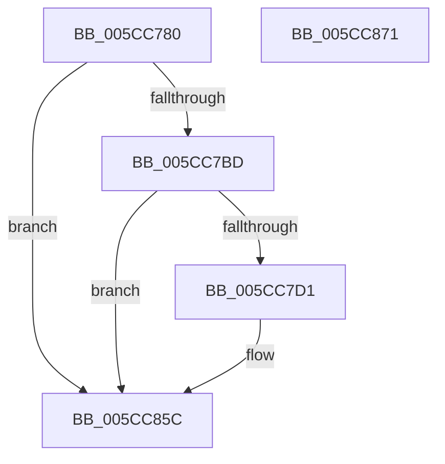

# KsepDsEventDataIrp

- RVA: `0x005CC780`–`0x005CC872` (길이 `242` bytes)
- VA: `0x00000001405CC780`
- 실행 섹션: `.text`
- PDB 이름 있음: `예`; PDB Function 태그: `아니요`
- unwind 정보 RVA: `0x000CB558`
- 디코드: `57`개 명령, `242/242` bytes 표시
- 미해석 바이트: `0` (있으면 어셈블리에 `.byte`로 보존)

> 이 문서는 커널 이미지의 기계어와 PDB 기호를 분석해 생성했습니다. 4번과 5번은 함수 원형과 자료형을 바이너리 사용 방식에서 추정한 C 해석이며 원본 소스 복구 결과는 아닙니다.

## 1. Dependencies

- 직접 호출 지점: **3**; 고유 호출 대상: **3**
- 직접 호출자로 확인된 함수: **2**
- RIP 상대 이미지 참조: **3**

### Outgoing calls
- `0x005CC7C4` → [EtwEventEnabled](../39/EtwEventEnabled_function_00392450.md) (function, `0x00392450`)
- `0x005CC857` → [EtwWriteEx](../25/EtwWriteEx_function_0025F0D0.md) (function, `0x0025F0D0`)
- `0x005CC863` → [_security_check_cookie](../6A/_security_check_cookie_function_006AC640.md) (function, `0x006AC640`)

### Direct callers
- [KseDsCallbackHookIrpDeviceControlFunction](KseDsCallbackHookIrpDeviceControlFunction_function_005CC040.md) at `0x005CC09A`
- [KseDsCallbackHookIrpFunction](KseDsCallbackHookIrpFunction_function_005CC0C0.md) at `0x005CC122`

### Static image references
- `0x005CC79F` → RVA `0x00E0A740` (`.data`; read)
- `0x005CC7AD` → RVA `0x00E66CE0` (`.data`; read)
- `0x005CC7BD` → RVA `0x00021470` (`.rdata`; read)

## 2. Other-region calls and transfers

- 다른 실행 섹션으로 향하는 call: **0**
- 별도 외부 분기/꼬리 이동을 확인하지 못했습니다.

## 3. Assembly (complete function range)

```asm
005CC780  48 8B C4                        mov rax, rsp
005CC783  44 89 48 20                     mov dword ptr [rax + 0x20], r9d
005CC787  4C 89 40 18                     mov qword ptr [rax + 0x18], r8
005CC78B  48 89 50 10                     mov qword ptr [rax + 0x10], rdx
005CC78F  48 89 48 08                     mov qword ptr [rax + 8], rcx
005CC793  55                              push rbp
005CC794  48 8D 68 A9                     lea rbp, [rax - 0x57]
005CC798  48 81 EC A0 00 00 00            sub rsp, 0xa0
005CC79F  48 8B 05 9A DF 83 00            mov rax, qword ptr [rip + 0x83df9a]
005CC7A6  48 33 C4                        xor rax, rsp
005CC7A9  48 89 45 3F                     mov qword ptr [rbp + 0x3f], rax
005CC7AD  48 8B 0D 2C A5 89 00            mov rcx, qword ptr [rip + 0x89a52c]
005CC7B4  48 85 C9                        test rcx, rcx
005CC7B7  0F 84 9F 00 00 00               je 0x1405cc85c
005CC7BD  48 8D 15 AC 4C A5 FF            lea rdx, [rip - 0x5ab354]
005CC7C4  E8 87 5C DC FF                  call 0x140392450
005CC7C9  84 C0                           test al, al
005CC7CB  0F 84 8B 00 00 00               je 0x1405cc85c
005CC7D1  83 65 FB 00                     and dword ptr [rbp - 5], 0
005CC7D5  48 8D 45 5F                     lea rax, [rbp + 0x5f]
005CC7D9  83 65 0B 00                     and dword ptr [rbp + 0xb], 0
005CC7DD  48 8D 15 8C 4C A5 FF            lea rdx, [rip - 0x5ab374]
005CC7E4  83 65 1B 00                     and dword ptr [rbp + 0x1b], 0
005CC7E8  B9 08 00 00 00                  mov ecx, 8
005CC7ED  83 65 2B 00                     and dword ptr [rbp + 0x2b], 0
005CC7F1  45 33 C9                        xor r9d, r9d
005CC7F4  83 65 3B 00                     and dword ptr [rbp + 0x3b], 0
005CC7F8  45 33 C0                        xor r8d, r8d
005CC7FB  48 89 45 EF                     mov qword ptr [rbp - 0x11], rax
005CC7FF  48 8D 45 67                     lea rax, [rbp + 0x67]
005CC803  48 89 45 FF                     mov qword ptr [rbp - 1], rax
005CC807  48 8D 45 6F                     lea rax, [rbp + 0x6f]
005CC80B  48 89 45 0F                     mov qword ptr [rbp + 0xf], rax
005CC80F  48 8D 45 77                     lea rax, [rbp + 0x77]
005CC813  48 89 45 1F                     mov qword ptr [rbp + 0x1f], rax
005CC817  48 8D 45 7F                     lea rax, [rbp + 0x7f]
005CC81B  89 4D F7                        mov dword ptr [rbp - 9], ecx
005CC81E  89 4D 07                        mov dword ptr [rbp + 7], ecx
005CC821  89 4D 17                        mov dword ptr [rbp + 0x17], ecx
005CC824  B9 04 00 00 00                  mov ecx, 4
005CC829  48 89 45 2F                     mov qword ptr [rbp + 0x2f], rax
005CC82D  48 8D 45 EF                     lea rax, [rbp - 0x11]
005CC831  48 89 44 24 38                  mov qword ptr [rsp + 0x38], rax
005CC836  C7 44 24 30 05 00 00 00         mov dword ptr [rsp + 0x30], 5
005CC83E  48 83 64 24 28 00               and qword ptr [rsp + 0x28], 0
005CC844  48 83 64 24 20 00               and qword ptr [rsp + 0x20], 0
005CC84A  89 4D 27                        mov dword ptr [rbp + 0x27], ecx
005CC84D  89 4D 37                        mov dword ptr [rbp + 0x37], ecx
005CC850  48 8B 0D 89 A4 89 00            mov rcx, qword ptr [rip + 0x89a489]
005CC857  E8 74 28 C9 FF                  call 0x14025f0d0
005CC85C  48 8B 4D 3F                     mov rcx, qword ptr [rbp + 0x3f]
005CC860  48 33 CC                        xor rcx, rsp
005CC863  E8 D8 FD 0D 00                  call 0x1406ac640
005CC868  48 81 C4 A0 00 00 00            add rsp, 0xa0
005CC86F  5D                              pop rbp
005CC870  C3                              ret
005CC871  CC                              int3
```

## 4. C-style interpretation (structured pseudocode)

```c
__int64 __fastcall KsepDsEventDataIrp(__int64 a1, __int64 a2, __int64 a3, int a4)
{
    __int64 result;
    __int64 v_rsp;
    unsigned __int64 v_stack_m70;
    unsigned int v_stack_m78;
    unsigned __int64 v_stack_m80;
    unsigned __int64 v_stack_m88;

    *(unsigned int *)(v_rsp + 32) = a4;
    *(unsigned __int64 *)(v_rsp + 24) = a3;
    *(unsigned __int64 *)(v_rsp + 16) = a2;
    *(unsigned __int64 *)(v_rsp + 8) = a1;
    v_rsp = (v_rsp) - (160);
    result = (*(unsigned __int64 *)(v_rip + 8642458)) ^ (v_rsp);
    *(unsigned __int64 *)(v_rsp - 87 + 63) = result;
    if (*(unsigned __int64 *)(v_rip + 9020716) == 0) goto loc_005CC85C;
    result = EtwEventEnabled(*(unsigned __int64 *)(v_rip + 9020716), v_rip - 5944148, a3, a4);
    if ((unsigned __int8)(result) != 0) {
        result = v_rsp - 87 + 95;
        a2 = v_rip - 5944180;
        a1 = 8;
        a4 = 0;
        a3 = 0;
        *(unsigned __int64 *)(v_rsp - 87 - 17) = result;
        result = v_rsp - 87 + 103;
        *(unsigned __int64 *)(v_rsp - 87 - 1) = result;
        result = v_rsp - 87 + 111;
        *(unsigned __int64 *)(v_rsp - 87 + 15) = result;
        result = v_rsp - 87 + 119;
        *(unsigned __int64 *)(v_rsp - 87 + 31) = result;
        result = v_rsp - 87 + 127;
        *(unsigned int *)(v_rsp - 87 - 9) = (unsigned int)(a1);
        *(unsigned int *)(v_rsp - 87 + 7) = (unsigned int)(a1);
        *(unsigned int *)(v_rsp - 87 + 23) = (unsigned int)(a1);
        a1 = 4;
        *(unsigned __int64 *)(v_rsp - 87 + 47) = result;
        result = v_rsp - 87 - 17;
        v_stack_m70 = result;
        v_stack_m78 = 5;
        *(unsigned int *)(v_rsp - 87 + 39) = (unsigned int)(a1);
        *(unsigned int *)(v_rsp - 87 + 55) = (unsigned int)(a1);
        a1 = *(unsigned __int64 *)(v_rip + 9020553);
        result = EtwWriteEx(a1, a2, a3, a4);
    }
    a1 = (*(unsigned __int64 *)(v_rsp - 87 + 63)) ^ (v_rsp);
    result = _security_check_cookie(a1, a2, a3, a4);
    v_rsp = (v_rsp) + (160);
    return result;
}
```

## 5. (Beta) C Style

```c
int64_t KsepDsEventDataIrp(int64_t Arg1, int64_t Arg2, int64_t Arg3, int32_t Arg4)
{
    int64_t result;
    int64_t local_rsp;
    uint64_t v_stack_m70;
    uint32_t v_stack_m78;
    uint64_t v_stack_m80;
    uint64_t v_stack_m88;

    *(uint32_t *)(local_rsp + 0x20) = Arg4;
    *(uint64_t *)(local_rsp + 0x18) = Arg3;
    *(uint64_t *)(local_rsp + 0x10) = Arg2;
    *(uint64_t *)(local_rsp + 0x8) = Arg1;
    local_rsp = (local_rsp) - (160);
    result = (*(uint64_t *)(v_rip + 0x83DF9A)) ^ (local_rsp);
    *(uint64_t *)(local_rsp - 0x57 + 0x3F) = result;
    if (*(uint64_t *)(v_rip + 0x89A52C) == 0) goto loc_005CC85C;
    result = EtwEventEnabled(*(uint64_t *)(v_rip + 0x89A52C), v_rip - 5944148, Arg3, Arg4);
    if ((uint8_t)(result) != 0) {
        result = local_rsp - 87 + 95;
        Arg2 = v_rip - 5944180;
        Arg1 = 8;
        Arg4 = 0;
        Arg3 = 0;
        *(uint64_t *)(local_rsp - 0x57 - 0x11) = result;
        result = local_rsp - 87 + 103;
        *(uint64_t *)(local_rsp - 0x57 - 0x1) = result;
        result = local_rsp - 87 + 111;
        *(uint64_t *)(local_rsp - 0x57 + 0xF) = result;
        result = local_rsp - 87 + 119;
        *(uint64_t *)(local_rsp - 0x57 + 0x1F) = result;
        result = local_rsp - 87 + 127;
        *(uint32_t *)(local_rsp - 0x57 - 0x9) = (uint32_t)(Arg1);
        *(uint32_t *)(local_rsp - 0x57 + 0x7) = (uint32_t)(Arg1);
        *(uint32_t *)(local_rsp - 0x57 + 0x17) = (uint32_t)(Arg1);
        Arg1 = 4;
        *(uint64_t *)(local_rsp - 0x57 + 0x2F) = result;
        result = local_rsp - 87 - 17;
        v_stack_m70 = result;
        v_stack_m78 = 5;
        *(uint32_t *)(local_rsp - 0x57 + 0x27) = (uint32_t)(Arg1);
        *(uint32_t *)(local_rsp - 0x57 + 0x37) = (uint32_t)(Arg1);
        Arg1 = *(uint64_t *)(v_rip + 0x89A489);
        result = EtwWriteEx(Arg1, Arg2, Arg3, Arg4);
    }
    Arg1 = (*(uint64_t *)(local_rsp - 0x57 + 0x3F)) ^ (local_rsp);
    result = _security_check_cookie(Arg1, Arg2, Arg3, Arg4);
    local_rsp = (local_rsp) + (160);
    return result;
}
```

## 6. Execution-region graph

[열기: 2D/3D 그래프와 함수 탐색 컨트롤 패널](../../../control-panel.html?section=text&rva=0x005CC780&view=graph)

- 2D 그래프는 위에서 아래로 흐르고, 3D 그래프는 빈 공간을 드래그해 회전합니다. Shift+드래그는 이동, 휠은 확대·축소, 함수 노드 선택은 대상 보고서 이동입니다.

### Static fallback


