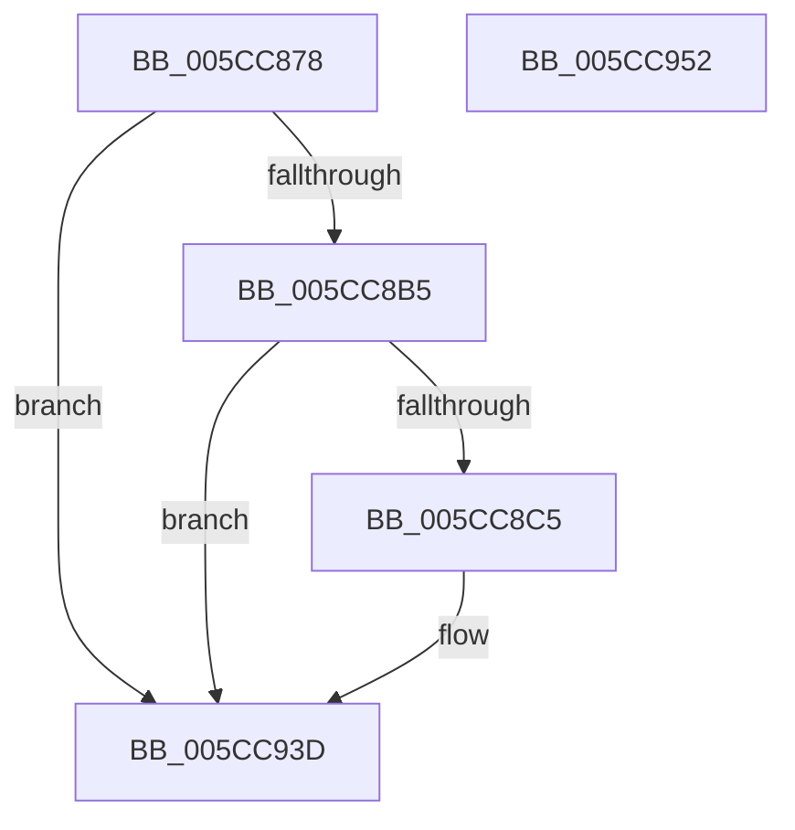

# KsepDsEventDevicePowerCompleted

- RVA: `0x005CC878`–`0x005CC953` (길이 `219` bytes)
- VA: `0x00000001405CC878`
- 실행 섹션: `.text`
- PDB 이름 있음: `예`; PDB Function 태그: `아니요`
- unwind 정보 RVA: `0x000BC734`
- 디코드: `53`개 명령, `219/219` bytes 표시
- 미해석 바이트: `0` (있으면 어셈블리에 `.byte`로 보존)

> 이 문서는 커널 이미지의 기계어와 PDB 기호를 분석해 생성했습니다. 4번과 5번은 함수 원형과 자료형을 바이너리 사용 방식에서 추정한 C 해석이며 원본 소스 복구 결과는 아닙니다.

## 1. Dependencies

- 직접 호출 지점: **3**; 고유 호출 대상: **3**
- 직접 호출자로 확인된 함수: **1**
- RIP 상대 이미지 참조: **3**

### Outgoing calls
- `0x005CC8BC` → [EtwEventEnabled](../39/EtwEventEnabled_function_00392450.md) (function, `0x00392450`)
- `0x005CC938` → [EtwWriteEx](../25/EtwWriteEx_function_0025F0D0.md) (function, `0x0025F0D0`)
- `0x005CC944` → [_security_check_cookie](../6A/_security_check_cookie_function_006AC640.md) (function, `0x006AC640`)

### Direct callers
- [KseDsCompletionHookForPowerDevice](KseDsCompletionHookForPowerDevice_function_005CC300.md) at `0x005CC312`

### Static image references
- `0x005CC897` → RVA `0x00E0A740` (`.data`; read)
- `0x005CC8A5` → RVA `0x00E66CE0` (`.data`; read)
- `0x005CC8B5` → RVA `0x00023538` (`.rdata`; read)

## 2. Other-region calls and transfers

- 다른 실행 섹션으로 향하는 call: **0**
- 별도 외부 분기/꼬리 이동을 확인하지 못했습니다.

## 3. Assembly (complete function range)

```asm
005CC878  48 8B C4                        mov rax, rsp
005CC87B  44 89 48 20                     mov dword ptr [rax + 0x20], r9d
005CC87F  4C 89 40 18                     mov qword ptr [rax + 0x18], r8
005CC883  48 89 50 10                     mov qword ptr [rax + 0x10], rdx
005CC887  48 89 48 08                     mov qword ptr [rax + 8], rcx
005CC88B  55                              push rbp
005CC88C  48 8D 68 A1                     lea rbp, [rax - 0x5f]
005CC890  48 81 EC 90 00 00 00            sub rsp, 0x90
005CC897  48 8B 05 A2 DE 83 00            mov rax, qword ptr [rip + 0x83dea2]
005CC89E  48 33 C4                        xor rax, rsp
005CC8A1  48 89 45 47                     mov qword ptr [rbp + 0x47], rax
005CC8A5  48 8B 0D 34 A4 89 00            mov rcx, qword ptr [rip + 0x89a434]
005CC8AC  48 85 C9                        test rcx, rcx
005CC8AF  0F 84 88 00 00 00               je 0x1405cc93d
005CC8B5  48 8D 15 7C 6C A5 FF            lea rdx, [rip - 0x5a9384]
005CC8BC  E8 8F 5B DC FF                  call 0x140392450
005CC8C1  84 C0                           test al, al
005CC8C3  74 78                           je 0x1405cc93d
005CC8C5  83 65 13 00                     and dword ptr [rbp + 0x13], 0
005CC8C9  48 8D 45 67                     lea rax, [rbp + 0x67]
005CC8CD  83 65 23 00                     and dword ptr [rbp + 0x23], 0
005CC8D1  48 8D 15 60 6C A5 FF            lea rdx, [rip - 0x5a93a0]
005CC8D8  83 65 33 00                     and dword ptr [rbp + 0x33], 0
005CC8DC  B9 08 00 00 00                  mov ecx, 8
005CC8E1  83 65 43 00                     and dword ptr [rbp + 0x43], 0
005CC8E5  45 33 C9                        xor r9d, r9d
005CC8E8  48 89 45 07                     mov qword ptr [rbp + 7], rax
005CC8EC  45 33 C0                        xor r8d, r8d
005CC8EF  89 4D 0F                        mov dword ptr [rbp + 0xf], ecx
005CC8F2  48 8D 45 6F                     lea rax, [rbp + 0x6f]
005CC8F6  48 89 45 17                     mov qword ptr [rbp + 0x17], rax
005CC8FA  48 8D 45 77                     lea rax, [rbp + 0x77]
005CC8FE  48 89 45 27                     mov qword ptr [rbp + 0x27], rax
005CC902  48 8D 45 7F                     lea rax, [rbp + 0x7f]
005CC906  89 4D 1F                        mov dword ptr [rbp + 0x1f], ecx
005CC909  89 4D 2F                        mov dword ptr [rbp + 0x2f], ecx
005CC90C  B9 04 00 00 00                  mov ecx, 4
005CC911  48 89 45 37                     mov qword ptr [rbp + 0x37], rax
005CC915  48 8D 45 07                     lea rax, [rbp + 7]
005CC919  48 89 44 24 38                  mov qword ptr [rsp + 0x38], rax
005CC91E  89 4C 24 30                     mov dword ptr [rsp + 0x30], ecx
005CC922  48 83 64 24 28 00               and qword ptr [rsp + 0x28], 0
005CC928  48 83 64 24 20 00               and qword ptr [rsp + 0x20], 0
005CC92E  89 4D 3F                        mov dword ptr [rbp + 0x3f], ecx
005CC931  48 8B 0D A8 A3 89 00            mov rcx, qword ptr [rip + 0x89a3a8]
005CC938  E8 93 27 C9 FF                  call 0x14025f0d0
005CC93D  48 8B 4D 47                     mov rcx, qword ptr [rbp + 0x47]
005CC941  48 33 CC                        xor rcx, rsp
005CC944  E8 F7 FC 0D 00                  call 0x1406ac640
005CC949  48 81 C4 90 00 00 00            add rsp, 0x90
005CC950  5D                              pop rbp
005CC951  C3                              ret
005CC952  CC                              int3
```

## 4. C-style interpretation (structured pseudocode)

```c
__int64 __fastcall KsepDsEventDevicePowerCompleted(__int64 a1, __int64 a2, __int64 a3, int a4)
{
    __int64 result;
    __int64 v_rsp;
    unsigned __int64 v_stack_m60;
    unsigned int v_stack_m68;
    unsigned __int64 v_stack_m70;
    unsigned __int64 v_stack_m78;

    *(unsigned int *)(v_rsp + 32) = a4;
    *(unsigned __int64 *)(v_rsp + 24) = a3;
    *(unsigned __int64 *)(v_rsp + 16) = a2;
    *(unsigned __int64 *)(v_rsp + 8) = a1;
    v_rsp = (v_rsp) - (144);
    result = (*(unsigned __int64 *)(v_rip + 8642210)) ^ (v_rsp);
    *(unsigned __int64 *)(v_rsp - 95 + 71) = result;
    if (*(unsigned __int64 *)(v_rip + 9020468) == 0) goto loc_005CC93D;
    result = EtwEventEnabled(*(unsigned __int64 *)(v_rip + 9020468), v_rip - 5936004, a3, a4);
    if ((unsigned __int8)(result) != 0) {
        result = v_rsp - 95 + 103;
        a2 = v_rip - 5936032;
        a1 = 8;
        a4 = 0;
        *(unsigned __int64 *)(v_rsp - 95 + 7) = result;
        a3 = 0;
        *(unsigned int *)(v_rsp - 95 + 15) = (unsigned int)(a1);
        result = v_rsp - 95 + 111;
        *(unsigned __int64 *)(v_rsp - 95 + 23) = result;
        result = v_rsp - 95 + 119;
        *(unsigned __int64 *)(v_rsp - 95 + 39) = result;
        result = v_rsp - 95 + 127;
        *(unsigned int *)(v_rsp - 95 + 31) = (unsigned int)(a1);
        *(unsigned int *)(v_rsp - 95 + 47) = (unsigned int)(a1);
        a1 = 4;
        *(unsigned __int64 *)(v_rsp - 95 + 55) = result;
        result = v_rsp - 95 + 7;
        v_stack_m60 = result;
        v_stack_m68 = (unsigned int)(a1);
        *(unsigned int *)(v_rsp - 95 + 63) = (unsigned int)(a1);
        a1 = *(unsigned __int64 *)(v_rip + 9020328);
        result = EtwWriteEx(a1, a2, a3, a4);
    }
    a1 = (*(unsigned __int64 *)(v_rsp - 95 + 71)) ^ (v_rsp);
    result = _security_check_cookie(a1, a2, a3, a4);
    v_rsp = (v_rsp) + (144);
    return result;
}
```

## 5. (Beta) C Style

```c
int64_t KsepDsEventDevicePowerCompleted(int64_t Arg1, int64_t Arg2, int64_t Arg3, int32_t Arg4)
{
    int64_t result;
    int64_t local_rsp;
    uint64_t v_stack_m60;
    uint32_t v_stack_m68;
    uint64_t v_stack_m70;
    uint64_t v_stack_m78;

    *(uint32_t *)(local_rsp + 0x20) = Arg4;
    *(uint64_t *)(local_rsp + 0x18) = Arg3;
    *(uint64_t *)(local_rsp + 0x10) = Arg2;
    *(uint64_t *)(local_rsp + 0x8) = Arg1;
    local_rsp = (local_rsp) - (144);
    result = (*(uint64_t *)(v_rip + 0x83DEA2)) ^ (local_rsp);
    *(uint64_t *)(local_rsp - 0x5F + 0x47) = result;
    if (*(uint64_t *)(v_rip + 0x89A434) == 0) goto loc_005CC93D;
    result = EtwEventEnabled(*(uint64_t *)(v_rip + 0x89A434), v_rip - 5936004, Arg3, Arg4);
    if ((uint8_t)(result) != 0) {
        result = local_rsp - 95 + 103;
        Arg2 = v_rip - 5936032;
        Arg1 = 8;
        Arg4 = 0;
        *(uint64_t *)(local_rsp - 0x5F + 0x7) = result;
        Arg3 = 0;
        *(uint32_t *)(local_rsp - 0x5F + 0xF) = (uint32_t)(Arg1);
        result = local_rsp - 95 + 111;
        *(uint64_t *)(local_rsp - 0x5F + 0x17) = result;
        result = local_rsp - 95 + 119;
        *(uint64_t *)(local_rsp - 0x5F + 0x27) = result;
        result = local_rsp - 95 + 127;
        *(uint32_t *)(local_rsp - 0x5F + 0x1F) = (uint32_t)(Arg1);
        *(uint32_t *)(local_rsp - 0x5F + 0x2F) = (uint32_t)(Arg1);
        Arg1 = 4;
        *(uint64_t *)(local_rsp - 0x5F + 0x37) = result;
        result = local_rsp - 95 + 7;
        v_stack_m60 = result;
        v_stack_m68 = (uint32_t)(Arg1);
        *(uint32_t *)(local_rsp - 0x5F + 0x3F) = (uint32_t)(Arg1);
        Arg1 = *(uint64_t *)(v_rip + 0x89A3A8);
        result = EtwWriteEx(Arg1, Arg2, Arg3, Arg4);
    }
    Arg1 = (*(uint64_t *)(local_rsp - 0x5F + 0x47)) ^ (local_rsp);
    result = _security_check_cookie(Arg1, Arg2, Arg3, Arg4);
    local_rsp = (local_rsp) + (144);
    return result;
}
```

## 6. Execution-region graph

[열기: 2D/3D 그래프와 함수 탐색 컨트롤 패널](../../../control-panel.html?section=text&rva=0x005CC878&view=graph)

- 2D 그래프는 위에서 아래로 흐르고, 3D 그래프는 빈 공간을 드래그해 회전합니다. Shift+드래그는 이동, 휠은 확대·축소, 함수 노드 선택은 대상 보고서 이동입니다.

### Static fallback


