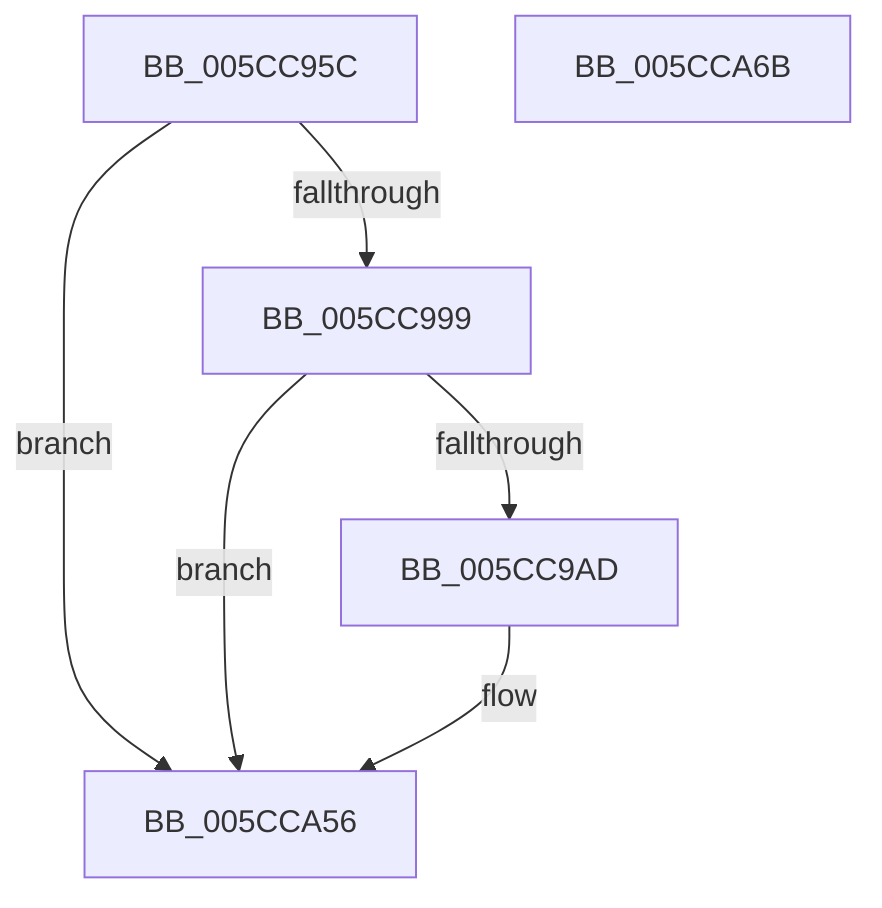

# KsepDsEventDevicePowerIrp

- RVA: `0x005CC95C`–`0x005CCA6C` (길이 `272` bytes)
- VA: `0x00000001405CC95C`
- 실행 섹션: `.text`
- PDB 이름 있음: `예`; PDB Function 태그: `아니요`
- unwind 정보 RVA: `0x000CB588`
- 디코드: `65`개 명령, `272/272` bytes 표시
- 미해석 바이트: `0` (있으면 어셈블리에 `.byte`로 보존)

> 이 문서는 커널 이미지의 기계어와 PDB 기호를 분석해 생성했습니다. 4번과 5번은 함수 원형과 자료형을 바이너리 사용 방식에서 추정한 C 해석이며 원본 소스 복구 결과는 아닙니다.

## 1. Dependencies

- 직접 호출 지점: **3**; 고유 호출 대상: **3**
- 직접 호출자로 확인된 함수: **1**
- RIP 상대 이미지 참조: **3**

### Outgoing calls
- `0x005CC9A0` → [EtwEventEnabled](../39/EtwEventEnabled_function_00392450.md) (function, `0x00392450`)
- `0x005CCA51` → [EtwWriteEx](../25/EtwWriteEx_function_0025F0D0.md) (function, `0x0025F0D0`)
- `0x005CCA5D` → [_security_check_cookie](../6A/_security_check_cookie_function_006AC640.md) (function, `0x006AC640`)

### Direct callers
- [KseDsCallbackHookIrpPowerFunction](KseDsCallbackHookIrpPowerFunction_function_005CC200.md) at `0x005CC2B4`

### Static image references
- `0x005CC97B` → RVA `0x00E0A740` (`.data`; read)
- `0x005CC989` → RVA `0x00E66CE0` (`.data`; read)
- `0x005CC999` → RVA `0x00022040` (`.rdata`; read)

## 2. Other-region calls and transfers

- 다른 실행 섹션으로 향하는 call: **0**
- 별도 외부 분기/꼬리 이동을 확인하지 못했습니다.

## 3. Assembly (complete function range)

```asm
005CC95C  48 8B C4                        mov rax, rsp
005CC95F  44 89 48 20                     mov dword ptr [rax + 0x20], r9d
005CC963  4C 89 40 18                     mov qword ptr [rax + 0x18], r8
005CC967  48 89 50 10                     mov qword ptr [rax + 0x10], rdx
005CC96B  48 89 48 08                     mov qword ptr [rax + 8], rcx
005CC96F  55                              push rbp
005CC970  48 8D 68 B9                     lea rbp, [rax - 0x47]
005CC974  48 81 EC C0 00 00 00            sub rsp, 0xc0
005CC97B  48 8B 05 BE DD 83 00            mov rax, qword ptr [rip + 0x83ddbe]
005CC982  48 33 C4                        xor rax, rsp
005CC985  48 89 45 2F                     mov qword ptr [rbp + 0x2f], rax
005CC989  48 8B 0D 50 A3 89 00            mov rcx, qword ptr [rip + 0x89a350]
005CC990  48 85 C9                        test rcx, rcx
005CC993  0F 84 BD 00 00 00               je 0x1405cca56
005CC999  48 8D 15 A0 56 A5 FF            lea rdx, [rip - 0x5aa960]
005CC9A0  E8 AB 5A DC FF                  call 0x140392450
005CC9A5  84 C0                           test al, al
005CC9A7  0F 84 A9 00 00 00               je 0x1405cca56
005CC9AD  83 65 CB 00                     and dword ptr [rbp - 0x35], 0
005CC9B1  48 8D 45 4F                     lea rax, [rbp + 0x4f]
005CC9B5  83 65 DB 00                     and dword ptr [rbp - 0x25], 0
005CC9B9  48 8D 15 80 56 A5 FF            lea rdx, [rip - 0x5aa980]
005CC9C0  83 65 EB 00                     and dword ptr [rbp - 0x15], 0
005CC9C4  B9 08 00 00 00                  mov ecx, 8
005CC9C9  83 65 FB 00                     and dword ptr [rbp - 5], 0
005CC9CD  45 33 C9                        xor r9d, r9d
005CC9D0  83 65 0B 00                     and dword ptr [rbp + 0xb], 0
005CC9D4  45 33 C0                        xor r8d, r8d
005CC9D7  83 65 1B 00                     and dword ptr [rbp + 0x1b], 0
005CC9DB  83 65 2B 00                     and dword ptr [rbp + 0x2b], 0
005CC9DF  48 89 45 BF                     mov qword ptr [rbp - 0x41], rax
005CC9E3  48 8D 45 57                     lea rax, [rbp + 0x57]
005CC9E7  48 89 45 CF                     mov qword ptr [rbp - 0x31], rax
005CC9EB  48 8D 45 5F                     lea rax, [rbp + 0x5f]
005CC9EF  48 89 45 DF                     mov qword ptr [rbp - 0x21], rax
005CC9F3  48 8D 45 67                     lea rax, [rbp + 0x67]
005CC9F7  48 89 45 EF                     mov qword ptr [rbp - 0x11], rax
005CC9FB  48 8D 45 6F                     lea rax, [rbp + 0x6f]
005CC9FF  48 89 45 FF                     mov qword ptr [rbp - 1], rax
005CCA03  48 8D 45 77                     lea rax, [rbp + 0x77]
005CCA07  48 89 45 0F                     mov qword ptr [rbp + 0xf], rax
005CCA0B  48 8D 45 7F                     lea rax, [rbp + 0x7f]
005CCA0F  89 4D C7                        mov dword ptr [rbp - 0x39], ecx
005CCA12  89 4D D7                        mov dword ptr [rbp - 0x29], ecx
005CCA15  89 4D E7                        mov dword ptr [rbp - 0x19], ecx
005CCA18  B9 04 00 00 00                  mov ecx, 4
005CCA1D  48 89 45 1F                     mov qword ptr [rbp + 0x1f], rax
005CCA21  48 8D 45 BF                     lea rax, [rbp - 0x41]
005CCA25  48 89 44 24 38                  mov qword ptr [rsp + 0x38], rax
005CCA2A  C7 44 24 30 07 00 00 00         mov dword ptr [rsp + 0x30], 7
005CCA32  48 83 64 24 28 00               and qword ptr [rsp + 0x28], 0
005CCA38  48 83 64 24 20 00               and qword ptr [rsp + 0x20], 0
005CCA3E  89 4D F7                        mov dword ptr [rbp - 9], ecx
005CCA41  89 4D 07                        mov dword ptr [rbp + 7], ecx
005CCA44  89 4D 17                        mov dword ptr [rbp + 0x17], ecx
005CCA47  89 4D 27                        mov dword ptr [rbp + 0x27], ecx
005CCA4A  48 8B 0D 8F A2 89 00            mov rcx, qword ptr [rip + 0x89a28f]
005CCA51  E8 7A 26 C9 FF                  call 0x14025f0d0
005CCA56  48 8B 4D 2F                     mov rcx, qword ptr [rbp + 0x2f]
005CCA5A  48 33 CC                        xor rcx, rsp
005CCA5D  E8 DE FB 0D 00                  call 0x1406ac640
005CCA62  48 81 C4 C0 00 00 00            add rsp, 0xc0
005CCA69  5D                              pop rbp
005CCA6A  C3                              ret
005CCA6B  CC                              int3
```

## 4. C-style interpretation (structured pseudocode)

```c
__int64 __fastcall KsepDsEventDevicePowerIrp(__int64 a1, __int64 a2, __int64 a3, int a4)
{
    __int64 result;
    __int64 v_rsp;
    unsigned __int64 v_stack_m90;
    unsigned int v_stack_m98;
    unsigned __int64 v_stack_mA0;
    unsigned __int64 v_stack_mA8;

    *(unsigned int *)(v_rsp + 32) = a4;
    *(unsigned __int64 *)(v_rsp + 24) = a3;
    *(unsigned __int64 *)(v_rsp + 16) = a2;
    *(unsigned __int64 *)(v_rsp + 8) = a1;
    v_rsp = (v_rsp) - (192);
    result = (*(unsigned __int64 *)(v_rip + 8641982)) ^ (v_rsp);
    *(unsigned __int64 *)(v_rsp - 71 + 47) = result;
    if (*(unsigned __int64 *)(v_rip + 9020240) == 0) goto loc_005CCA56;
    result = EtwEventEnabled(*(unsigned __int64 *)(v_rip + 9020240), v_rip - 5941600, a3, a4);
    if ((unsigned __int8)(result) != 0) {
        result = v_rsp - 71 + 79;
        a2 = v_rip - 5941632;
        a1 = 8;
        a4 = 0;
        a3 = 0;
        *(unsigned __int64 *)(v_rsp - 71 - 65) = result;
        result = v_rsp - 71 + 87;
        *(unsigned __int64 *)(v_rsp - 71 - 49) = result;
        result = v_rsp - 71 + 95;
        *(unsigned __int64 *)(v_rsp - 71 - 33) = result;
        result = v_rsp - 71 + 103;
        *(unsigned __int64 *)(v_rsp - 71 - 17) = result;
        result = v_rsp - 71 + 111;
        *(unsigned __int64 *)(v_rsp - 71 - 1) = result;
        result = v_rsp - 71 + 119;
        *(unsigned __int64 *)(v_rsp - 71 + 15) = result;
        result = v_rsp - 71 + 127;
        *(unsigned int *)(v_rsp - 71 - 57) = (unsigned int)(a1);
        *(unsigned int *)(v_rsp - 71 - 41) = (unsigned int)(a1);
        *(unsigned int *)(v_rsp - 71 - 25) = (unsigned int)(a1);
        a1 = 4;
        *(unsigned __int64 *)(v_rsp - 71 + 31) = result;
        result = v_rsp - 71 - 65;
        v_stack_m90 = result;
        v_stack_m98 = 7;
        *(unsigned int *)(v_rsp - 71 - 9) = (unsigned int)(a1);
        *(unsigned int *)(v_rsp - 71 + 7) = (unsigned int)(a1);
        *(unsigned int *)(v_rsp - 71 + 23) = (unsigned int)(a1);
        *(unsigned int *)(v_rsp - 71 + 39) = (unsigned int)(a1);
        a1 = *(unsigned __int64 *)(v_rip + 9020047);
        result = EtwWriteEx(a1, a2, a3, a4);
    }
    a1 = (*(unsigned __int64 *)(v_rsp - 71 + 47)) ^ (v_rsp);
    result = _security_check_cookie(a1, a2, a3, a4);
    v_rsp = (v_rsp) + (192);
    return result;
}
```

## 5. (Beta) C Style

```c
int64_t KsepDsEventDevicePowerIrp(int64_t Arg1, int64_t Arg2, int64_t Arg3, int32_t Arg4)
{
    int64_t result;
    int64_t local_rsp;
    uint64_t v_stack_m90;
    uint32_t v_stack_m98;
    uint64_t v_stack_mA0;
    uint64_t v_stack_mA8;

    *(uint32_t *)(local_rsp + 0x20) = Arg4;
    *(uint64_t *)(local_rsp + 0x18) = Arg3;
    *(uint64_t *)(local_rsp + 0x10) = Arg2;
    *(uint64_t *)(local_rsp + 0x8) = Arg1;
    local_rsp = (local_rsp) - (192);
    result = (*(uint64_t *)(v_rip + 0x83DDBE)) ^ (local_rsp);
    *(uint64_t *)(local_rsp - 0x47 + 0x2F) = result;
    if (*(uint64_t *)(v_rip + 0x89A350) == 0) goto loc_005CCA56;
    result = EtwEventEnabled(*(uint64_t *)(v_rip + 0x89A350), v_rip - 5941600, Arg3, Arg4);
    if ((uint8_t)(result) != 0) {
        result = local_rsp - 71 + 79;
        Arg2 = v_rip - 5941632;
        Arg1 = 8;
        Arg4 = 0;
        Arg3 = 0;
        *(uint64_t *)(local_rsp - 0x47 - 0x41) = result;
        result = local_rsp - 71 + 87;
        *(uint64_t *)(local_rsp - 0x47 - 0x31) = result;
        result = local_rsp - 71 + 95;
        *(uint64_t *)(local_rsp - 0x47 - 0x21) = result;
        result = local_rsp - 71 + 103;
        *(uint64_t *)(local_rsp - 0x47 - 0x11) = result;
        result = local_rsp - 71 + 111;
        *(uint64_t *)(local_rsp - 0x47 - 0x1) = result;
        result = local_rsp - 71 + 119;
        *(uint64_t *)(local_rsp - 0x47 + 0xF) = result;
        result = local_rsp - 71 + 127;
        *(uint32_t *)(local_rsp - 0x47 - 0x39) = (uint32_t)(Arg1);
        *(uint32_t *)(local_rsp - 0x47 - 0x29) = (uint32_t)(Arg1);
        *(uint32_t *)(local_rsp - 0x47 - 0x19) = (uint32_t)(Arg1);
        Arg1 = 4;
        *(uint64_t *)(local_rsp - 0x47 + 0x1F) = result;
        result = local_rsp - 71 - 65;
        v_stack_m90 = result;
        v_stack_m98 = 7;
        *(uint32_t *)(local_rsp - 0x47 - 0x9) = (uint32_t)(Arg1);
        *(uint32_t *)(local_rsp - 0x47 + 0x7) = (uint32_t)(Arg1);
        *(uint32_t *)(local_rsp - 0x47 + 0x17) = (uint32_t)(Arg1);
        *(uint32_t *)(local_rsp - 0x47 + 0x27) = (uint32_t)(Arg1);
        Arg1 = *(uint64_t *)(v_rip + 0x89A28F);
        result = EtwWriteEx(Arg1, Arg2, Arg3, Arg4);
    }
    Arg1 = (*(uint64_t *)(local_rsp - 0x47 + 0x2F)) ^ (local_rsp);
    result = _security_check_cookie(Arg1, Arg2, Arg3, Arg4);
    local_rsp = (local_rsp) + (192);
    return result;
}
```

## 6. Execution-region graph

[열기: 2D/3D 그래프와 함수 탐색 컨트롤 패널](../../../control-panel.html?section=text&rva=0x005CC95C&view=graph)

- 2D 그래프는 위에서 아래로 흐르고, 3D 그래프는 빈 공간을 드래그해 회전합니다. Shift+드래그는 이동, 휠은 확대·축소, 함수 노드 선택은 대상 보고서 이동입니다.

### Static fallback


