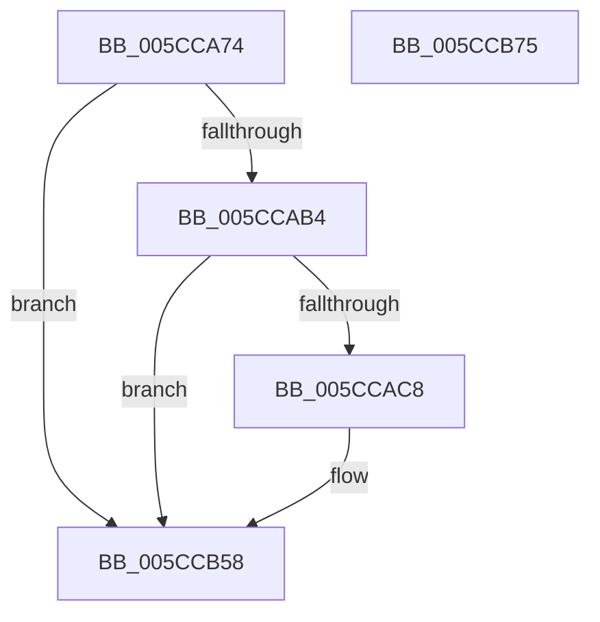

# KsepDsEventDriverLoad

- RVA: `0x005CCA74`–`0x005CCB76` (길이 `258` bytes)
- VA: `0x00000001405CCA74`
- 실행 섹션: `.text`
- PDB 이름 있음: `예`; PDB Function 태그: `아니요`
- unwind 정보 RVA: `0x000CB5CC`
- 디코드: `60`개 명령, `258/258` bytes 표시
- 미해석 바이트: `0` (있으면 어셈블리에 `.byte`로 보존)

> 이 문서는 커널 이미지의 기계어와 PDB 기호를 분석해 생성했습니다. 4번과 5번은 함수 원형과 자료형을 바이너리 사용 방식에서 추정한 C 해석이며 원본 소스 복구 결과는 아닙니다.

## 1. Dependencies

- 직접 호출 지점: **3**; 고유 호출 대상: **3**
- 직접 호출자로 확인된 함수: **1**
- RIP 상대 이미지 참조: **3**

### Outgoing calls
- `0x005CCABB` → [EtwEventEnabled](../39/EtwEventEnabled_function_00392450.md) (function, `0x00392450`)
- `0x005CCB53` → [EtwWriteEx](../25/EtwWriteEx_function_0025F0D0.md) (function, `0x0025F0D0`)
- `0x005CCB5F` → [_security_check_cookie](../6A/_security_check_cookie_function_006AC640.md) (function, `0x006AC640`)

### Direct callers
- [KseDsHookDriverTargeted](KseDsHookDriverTargeted_function_005CC390.md) at `0x005CC39C`

### Static image references
- `0x005CCA93` → RVA `0x00E0A740` (`.data`; read)
- `0x005CCAA4` → RVA `0x00E66CE0` (`.data`; read)
- `0x005CCAB4` → RVA `0x00021D08` (`.rdata`; read)

## 2. Other-region calls and transfers

- 다른 실행 섹션으로 향하는 call: **0**
- 별도 외부 분기/꼬리 이동을 확인하지 못했습니다.

## 3. Assembly (complete function range)

```asm
005CCA74  48 8B C4                        mov rax, rsp
005CCA77  48 89 58 08                     mov qword ptr [rax + 8], rbx
005CCA7B  44 89 48 20                     mov dword ptr [rax + 0x20], r9d
005CCA7F  44 89 40 18                     mov dword ptr [rax + 0x18], r8d
005CCA83  48 89 50 10                     mov qword ptr [rax + 0x10], rdx
005CCA87  55                              push rbp
005CCA88  48 8D 68 A9                     lea rbp, [rax - 0x57]
005CCA8C  48 81 EC A0 00 00 00            sub rsp, 0xa0
005CCA93  48 8B 05 A6 DC 83 00            mov rax, qword ptr [rip + 0x83dca6]
005CCA9A  48 33 C4                        xor rax, rsp
005CCA9D  48 89 45 3F                     mov qword ptr [rbp + 0x3f], rax
005CCAA1  48 8B D9                        mov rbx, rcx
005CCAA4  48 8B 0D 35 A2 89 00            mov rcx, qword ptr [rip + 0x89a235]
005CCAAB  48 85 C9                        test rcx, rcx
005CCAAE  0F 84 A4 00 00 00               je 0x1405ccb58
005CCAB4  48 8D 15 4D 52 A5 FF            lea rdx, [rip - 0x5aadb3]
005CCABB  E8 90 59 DC FF                  call 0x140392450
005CCAC0  84 C0                           test al, al
005CCAC2  0F 84 90 00 00 00               je 0x1405ccb58
005CCAC8  48 8B 43 08                     mov rax, qword ptr [rbx + 8]
005CCACC  48 8D 15 35 52 A5 FF            lea rdx, [rip - 0x5aadcb]
005CCAD3  83 65 FB 00                     and dword ptr [rbp - 5], 0
005CCAD7  B9 04 00 00 00                  mov ecx, 4
005CCADC  83 65 0B 00                     and dword ptr [rbp + 0xb], 0
005CCAE0  45 33 C9                        xor r9d, r9d
005CCAE3  83 65 1B 00                     and dword ptr [rbp + 0x1b], 0
005CCAE7  45 33 C0                        xor r8d, r8d
005CCAEA  83 65 2B 00                     and dword ptr [rbp + 0x2b], 0
005CCAEE  83 65 3B 00                     and dword ptr [rbp + 0x3b], 0
005CCAF2  48 89 45 EF                     mov qword ptr [rbp - 0x11], rax
005CCAF6  0F B7 03                        movzx eax, word ptr [rbx]
005CCAF9  83 C0 02                        add eax, 2
005CCAFC  89 4D 17                        mov dword ptr [rbp + 0x17], ecx
005CCAFF  89 45 F7                        mov dword ptr [rbp - 9], eax
005CCB02  48 8D 45 67                     lea rax, [rbp + 0x67]
005CCB06  48 89 45 FF                     mov qword ptr [rbp - 1], rax
005CCB0A  48 8D 45 6F                     lea rax, [rbp + 0x6f]
005CCB0E  48 89 45 0F                     mov qword ptr [rbp + 0xf], rax
005CCB12  48 8D 45 77                     lea rax, [rbp + 0x77]
005CCB16  48 89 45 1F                     mov qword ptr [rbp + 0x1f], rax
005CCB1A  48 8D 45 7F                     lea rax, [rbp + 0x7f]
005CCB1E  48 89 45 2F                     mov qword ptr [rbp + 0x2f], rax
005CCB22  48 8D 45 EF                     lea rax, [rbp - 0x11]
005CCB26  48 89 44 24 38                  mov qword ptr [rsp + 0x38], rax
005CCB2B  C7 44 24 30 05 00 00 00         mov dword ptr [rsp + 0x30], 5
005CCB33  48 83 64 24 28 00               and qword ptr [rsp + 0x28], 0
005CCB39  48 83 64 24 20 00               and qword ptr [rsp + 0x20], 0
005CCB3F  89 4D 27                        mov dword ptr [rbp + 0x27], ecx
005CCB42  89 4D 37                        mov dword ptr [rbp + 0x37], ecx
005CCB45  48 8B 0D 94 A1 89 00            mov rcx, qword ptr [rip + 0x89a194]
005CCB4C  C7 45 07 08 00 00 00            mov dword ptr [rbp + 7], 8
005CCB53  E8 78 25 C9 FF                  call 0x14025f0d0
005CCB58  48 8B 4D 3F                     mov rcx, qword ptr [rbp + 0x3f]
005CCB5C  48 33 CC                        xor rcx, rsp
005CCB5F  E8 DC FA 0D 00                  call 0x1406ac640
005CCB64  48 8B 9C 24 B0 00 00 00         mov rbx, qword ptr [rsp + 0xb0]
005CCB6C  48 81 C4 A0 00 00 00            add rsp, 0xa0
005CCB73  5D                              pop rbp
005CCB74  C3                              ret
005CCB75  CC                              int3
```

## 4. C-style interpretation (structured pseudocode)

```c
__int64 __fastcall KsepDsEventDriverLoad(__int64 a1, __int64 a2, int a3, int a4)
{
    __int64 result;
    __int64 v_rsp;
    unsigned __int64 v_stack_m70;
    unsigned int v_stack_m78;
    unsigned __int64 v_stack_m80;
    unsigned __int64 v_stack_m88;
    unsigned __int64 v_stack_p8;

    *(unsigned __int64 *)(v_rsp + 8) = v_rbx;
    *(unsigned int *)(v_rsp + 32) = a4;
    *(unsigned int *)(v_rsp + 24) = a3;
    *(unsigned __int64 *)(v_rsp + 16) = a2;
    v_rsp = (v_rsp) - (160);
    result = (*(unsigned __int64 *)(v_rip + 8641702)) ^ (v_rsp);
    *(unsigned __int64 *)(v_rsp - 87 + 63) = result;
    if (*(unsigned __int64 *)(v_rip + 9019957) == 0) goto loc_005CCB58;
    result = EtwEventEnabled(*(unsigned __int64 *)(v_rip + 9019957), v_rip - 5942707, a3, a4);
    if ((unsigned __int8)(result) != 0) {
        result = *(unsigned __int64 *)(a1 + 8);
        a2 = v_rip - 5942731;
        a1 = 4;
        a4 = 0;
        a3 = 0;
        *(unsigned __int64 *)(v_rsp - 87 - 17) = result;
        result = *(unsigned __int16 *)(a1);
        result = (unsigned int)((result) + (2));
        *(unsigned int *)(v_rsp - 87 + 23) = (unsigned int)(a1);
        *(unsigned int *)(v_rsp - 87 - 9) = (unsigned int)(result);
        result = v_rsp - 87 + 103;
        *(unsigned __int64 *)(v_rsp - 87 - 1) = result;
        result = v_rsp - 87 + 111;
        *(unsigned __int64 *)(v_rsp - 87 + 15) = result;
        result = v_rsp - 87 + 119;
        *(unsigned __int64 *)(v_rsp - 87 + 31) = result;
        result = v_rsp - 87 + 127;
        *(unsigned __int64 *)(v_rsp - 87 + 47) = result;
        result = v_rsp - 87 - 17;
        v_stack_m70 = result;
        v_stack_m78 = 5;
        *(unsigned int *)(v_rsp - 87 + 39) = (unsigned int)(a1);
        *(unsigned int *)(v_rsp - 87 + 55) = (unsigned int)(a1);
        a1 = *(unsigned __int64 *)(v_rip + 9019796);
        *(unsigned int *)(v_rsp - 87 + 7) = 8;
        result = EtwWriteEx(a1, a2, a3, a4);
    }
    a1 = (*(unsigned __int64 *)(v_rsp - 87 + 63)) ^ (v_rsp);
    result = _security_check_cookie(a1, a2, a3, a4);
    v_rsp = (v_rsp) + (160);
    return result;
}
```

## 5. (Beta) C Style

```c
int64_t KsepDsEventDriverLoad(void *Arg1, int64_t Arg2, int32_t Arg3, int32_t Arg4)
{
    uint8_t *arg1 = (uint8_t *)Arg1;

    int64_t result;
    int64_t local_rsp;
    uint64_t v_stack_m70;
    uint32_t v_stack_m78;
    uint64_t v_stack_m80;
    uint64_t v_stack_m88;
    uint64_t v_stack_p8;

    *(uint64_t *)(local_rsp + 0x8) = local_rbx;
    *(uint32_t *)(local_rsp + 0x20) = Arg4;
    *(uint32_t *)(local_rsp + 0x18) = Arg3;
    *(uint64_t *)(local_rsp + 0x10) = Arg2;
    local_rsp = (local_rsp) - (160);
    result = (*(uint64_t *)(v_rip + 0x83DCA6)) ^ (local_rsp);
    *(uint64_t *)(local_rsp - 0x57 + 0x3F) = result;
    if (*(uint64_t *)(v_rip + 0x89A235) == 0) goto loc_005CCB58;
    result = EtwEventEnabled(*(uint64_t *)(v_rip + 0x89A235), v_rip - 5942707, Arg3, Arg4);
    if ((uint8_t)(result) != 0) {
        result = *(uint64_t *)(arg1 + 0x8);
        Arg2 = v_rip - 5942731;
        Arg1 = 4;
        Arg4 = 0;
        Arg3 = 0;
        *(uint64_t *)(local_rsp - 0x57 - 0x11) = result;
        result = *(uint16_t *)(arg1);
        result = (uint32_t)((result) + (2));
        *(uint32_t *)(local_rsp - 0x57 + 0x17) = (uint32_t)(Arg1);
        *(uint32_t *)(local_rsp - 0x57 - 0x9) = (uint32_t)(result);
        result = local_rsp - 87 + 103;
        *(uint64_t *)(local_rsp - 0x57 - 0x1) = result;
        result = local_rsp - 87 + 111;
        *(uint64_t *)(local_rsp - 0x57 + 0xF) = result;
        result = local_rsp - 87 + 119;
        *(uint64_t *)(local_rsp - 0x57 + 0x1F) = result;
        result = local_rsp - 87 + 127;
        *(uint64_t *)(local_rsp - 0x57 + 0x2F) = result;
        result = local_rsp - 87 - 17;
        v_stack_m70 = result;
        v_stack_m78 = 5;
        *(uint32_t *)(local_rsp - 0x57 + 0x27) = (uint32_t)(Arg1);
        *(uint32_t *)(local_rsp - 0x57 + 0x37) = (uint32_t)(Arg1);
        Arg1 = *(uint64_t *)(v_rip + 0x89A194);
        *(uint32_t *)(local_rsp - 0x57 + 0x7) = 8;
        result = EtwWriteEx(Arg1, Arg2, Arg3, Arg4);
    }
    Arg1 = (*(uint64_t *)(local_rsp - 0x57 + 0x3F)) ^ (local_rsp);
    result = _security_check_cookie(Arg1, Arg2, Arg3, Arg4);
    local_rsp = (local_rsp) + (160);
    return result;
}
```

### 관측된 메모리 오프셋

구조체 형식이 확인되지 않은 접근은 인자 기준의 오프셋으로만 기록했습니다.

| 기준 인자 | 오프셋 표현 | 폭 (bit) | 접근 |
|---|---:|---:|---|
| `Arg1` | `+ 0x0` | `16` | `R` |
| `Arg1` | `+ 0x8` | `64` | `R` |

## 6. Execution-region graph

[열기: 2D/3D 그래프와 함수 탐색 컨트롤 패널](../../../control-panel.html?section=text&rva=0x005CCA74&view=graph)

- 2D 그래프는 위에서 아래로 흐르고, 3D 그래프는 빈 공간을 드래그해 회전합니다. Shift+드래그는 이동, 휠은 확대·축소, 함수 노드 선택은 대상 보고서 이동입니다.

### Static fallback


