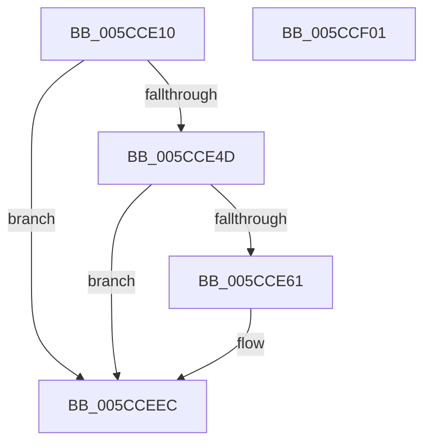

# KsepDsEventPnpIrp

- RVA: `0x005CCE10`–`0x005CCF02` (길이 `242` bytes)
- VA: `0x00000001405CCE10`
- 실행 섹션: `.text`
- PDB 이름 있음: `예`; PDB Function 태그: `아니요`
- unwind 정보 RVA: `0x000CB558`
- 디코드: `57`개 명령, `242/242` bytes 표시
- 미해석 바이트: `0` (있으면 어셈블리에 `.byte`로 보존)

> 이 문서는 커널 이미지의 기계어와 PDB 기호를 분석해 생성했습니다. 4번과 5번은 함수 원형과 자료형을 바이너리 사용 방식에서 추정한 C 해석이며 원본 소스 복구 결과는 아닙니다.

## 1. Dependencies

- 직접 호출 지점: **3**; 고유 호출 대상: **3**
- 직접 호출자로 확인된 함수: **1**
- RIP 상대 이미지 참조: **3**

### Outgoing calls
- `0x005CCE54` → [EtwEventEnabled](../39/EtwEventEnabled_function_00392450.md) (function, `0x00392450`)
- `0x005CCEE7` → [EtwWriteEx](../25/EtwWriteEx_function_0025F0D0.md) (function, `0x0025F0D0`)
- `0x005CCEF3` → [_security_check_cookie](../6A/_security_check_cookie_function_006AC640.md) (function, `0x006AC640`)

### Direct callers
- [KseDsCallbackHookIrpPnpFunction](KseDsCallbackHookIrpPnpFunction_function_005CC150.md) at `0x005CC1DA`

### Static image references
- `0x005CCE2F` → RVA `0x00E0A740` (`.data`; read)
- `0x005CCE3D` → RVA `0x00E66CE0` (`.data`; read)
- `0x005CCE4D` → RVA `0x00021540` (`.rdata`; read)

## 2. Other-region calls and transfers

- 다른 실행 섹션으로 향하는 call: **0**
- 별도 외부 분기/꼬리 이동을 확인하지 못했습니다.

## 3. Assembly (complete function range)

```asm
005CCE10  48 8B C4                        mov rax, rsp
005CCE13  44 89 48 20                     mov dword ptr [rax + 0x20], r9d
005CCE17  4C 89 40 18                     mov qword ptr [rax + 0x18], r8
005CCE1B  48 89 50 10                     mov qword ptr [rax + 0x10], rdx
005CCE1F  48 89 48 08                     mov qword ptr [rax + 8], rcx
005CCE23  55                              push rbp
005CCE24  48 8D 68 A9                     lea rbp, [rax - 0x57]
005CCE28  48 81 EC A0 00 00 00            sub rsp, 0xa0
005CCE2F  48 8B 05 0A D9 83 00            mov rax, qword ptr [rip + 0x83d90a]
005CCE36  48 33 C4                        xor rax, rsp
005CCE39  48 89 45 3F                     mov qword ptr [rbp + 0x3f], rax
005CCE3D  48 8B 0D 9C 9E 89 00            mov rcx, qword ptr [rip + 0x899e9c]
005CCE44  48 85 C9                        test rcx, rcx
005CCE47  0F 84 9F 00 00 00               je 0x1405cceec
005CCE4D  48 8D 15 EC 46 A5 FF            lea rdx, [rip - 0x5ab914]
005CCE54  E8 F7 55 DC FF                  call 0x140392450
005CCE59  84 C0                           test al, al
005CCE5B  0F 84 8B 00 00 00               je 0x1405cceec
005CCE61  83 65 FB 00                     and dword ptr [rbp - 5], 0
005CCE65  48 8D 45 5F                     lea rax, [rbp + 0x5f]
005CCE69  83 65 0B 00                     and dword ptr [rbp + 0xb], 0
005CCE6D  48 8D 15 CC 46 A5 FF            lea rdx, [rip - 0x5ab934]
005CCE74  83 65 1B 00                     and dword ptr [rbp + 0x1b], 0
005CCE78  B9 08 00 00 00                  mov ecx, 8
005CCE7D  83 65 2B 00                     and dword ptr [rbp + 0x2b], 0
005CCE81  45 33 C9                        xor r9d, r9d
005CCE84  83 65 3B 00                     and dword ptr [rbp + 0x3b], 0
005CCE88  45 33 C0                        xor r8d, r8d
005CCE8B  48 89 45 EF                     mov qword ptr [rbp - 0x11], rax
005CCE8F  48 8D 45 67                     lea rax, [rbp + 0x67]
005CCE93  48 89 45 FF                     mov qword ptr [rbp - 1], rax
005CCE97  48 8D 45 6F                     lea rax, [rbp + 0x6f]
005CCE9B  48 89 45 0F                     mov qword ptr [rbp + 0xf], rax
005CCE9F  48 8D 45 77                     lea rax, [rbp + 0x77]
005CCEA3  48 89 45 1F                     mov qword ptr [rbp + 0x1f], rax
005CCEA7  48 8D 45 7F                     lea rax, [rbp + 0x7f]
005CCEAB  89 4D F7                        mov dword ptr [rbp - 9], ecx
005CCEAE  89 4D 07                        mov dword ptr [rbp + 7], ecx
005CCEB1  89 4D 17                        mov dword ptr [rbp + 0x17], ecx
005CCEB4  B9 04 00 00 00                  mov ecx, 4
005CCEB9  48 89 45 2F                     mov qword ptr [rbp + 0x2f], rax
005CCEBD  48 8D 45 EF                     lea rax, [rbp - 0x11]
005CCEC1  48 89 44 24 38                  mov qword ptr [rsp + 0x38], rax
005CCEC6  C7 44 24 30 05 00 00 00         mov dword ptr [rsp + 0x30], 5
005CCECE  48 83 64 24 28 00               and qword ptr [rsp + 0x28], 0
005CCED4  48 83 64 24 20 00               and qword ptr [rsp + 0x20], 0
005CCEDA  89 4D 27                        mov dword ptr [rbp + 0x27], ecx
005CCEDD  89 4D 37                        mov dword ptr [rbp + 0x37], ecx
005CCEE0  48 8B 0D F9 9D 89 00            mov rcx, qword ptr [rip + 0x899df9]
005CCEE7  E8 E4 21 C9 FF                  call 0x14025f0d0
005CCEEC  48 8B 4D 3F                     mov rcx, qword ptr [rbp + 0x3f]
005CCEF0  48 33 CC                        xor rcx, rsp
005CCEF3  E8 48 F7 0D 00                  call 0x1406ac640
005CCEF8  48 81 C4 A0 00 00 00            add rsp, 0xa0
005CCEFF  5D                              pop rbp
005CCF00  C3                              ret
005CCF01  CC                              int3
```

## 4. C-style interpretation (structured pseudocode)

```c
__int64 __fastcall KsepDsEventPnpIrp(__int64 a1, __int64 a2, __int64 a3, int a4)
{
    __int64 result;
    __int64 v_rsp;
    unsigned __int64 v_stack_m70;
    unsigned int v_stack_m78;
    unsigned __int64 v_stack_m80;
    unsigned __int64 v_stack_m88;

    *(unsigned int *)(v_rsp + 32) = a4;
    *(unsigned __int64 *)(v_rsp + 24) = a3;
    *(unsigned __int64 *)(v_rsp + 16) = a2;
    *(unsigned __int64 *)(v_rsp + 8) = a1;
    v_rsp = (v_rsp) - (160);
    result = (*(unsigned __int64 *)(v_rip + 8640778)) ^ (v_rsp);
    *(unsigned __int64 *)(v_rsp - 87 + 63) = result;
    if (*(unsigned __int64 *)(v_rip + 9019036) == 0) goto loc_005CCEEC;
    result = EtwEventEnabled(*(unsigned __int64 *)(v_rip + 9019036), v_rip - 5945620, a3, a4);
    if ((unsigned __int8)(result) != 0) {
        result = v_rsp - 87 + 95;
        a2 = v_rip - 5945652;
        a1 = 8;
        a4 = 0;
        a3 = 0;
        *(unsigned __int64 *)(v_rsp - 87 - 17) = result;
        result = v_rsp - 87 + 103;
        *(unsigned __int64 *)(v_rsp - 87 - 1) = result;
        result = v_rsp - 87 + 111;
        *(unsigned __int64 *)(v_rsp - 87 + 15) = result;
        result = v_rsp - 87 + 119;
        *(unsigned __int64 *)(v_rsp - 87 + 31) = result;
        result = v_rsp - 87 + 127;
        *(unsigned int *)(v_rsp - 87 - 9) = (unsigned int)(a1);
        *(unsigned int *)(v_rsp - 87 + 7) = (unsigned int)(a1);
        *(unsigned int *)(v_rsp - 87 + 23) = (unsigned int)(a1);
        a1 = 4;
        *(unsigned __int64 *)(v_rsp - 87 + 47) = result;
        result = v_rsp - 87 - 17;
        v_stack_m70 = result;
        v_stack_m78 = 5;
        *(unsigned int *)(v_rsp - 87 + 39) = (unsigned int)(a1);
        *(unsigned int *)(v_rsp - 87 + 55) = (unsigned int)(a1);
        a1 = *(unsigned __int64 *)(v_rip + 9018873);
        result = EtwWriteEx(a1, a2, a3, a4);
    }
    a1 = (*(unsigned __int64 *)(v_rsp - 87 + 63)) ^ (v_rsp);
    result = _security_check_cookie(a1, a2, a3, a4);
    v_rsp = (v_rsp) + (160);
    return result;
}
```

## 5. (Beta) C Style

```c
int64_t KsepDsEventPnpIrp(int64_t Arg1, int64_t Arg2, int64_t Arg3, int32_t Arg4)
{
    int64_t result;
    int64_t local_rsp;
    uint64_t v_stack_m70;
    uint32_t v_stack_m78;
    uint64_t v_stack_m80;
    uint64_t v_stack_m88;

    *(uint32_t *)(local_rsp + 0x20) = Arg4;
    *(uint64_t *)(local_rsp + 0x18) = Arg3;
    *(uint64_t *)(local_rsp + 0x10) = Arg2;
    *(uint64_t *)(local_rsp + 0x8) = Arg1;
    local_rsp = (local_rsp) - (160);
    result = (*(uint64_t *)(v_rip + 0x83D90A)) ^ (local_rsp);
    *(uint64_t *)(local_rsp - 0x57 + 0x3F) = result;
    if (*(uint64_t *)(v_rip + 0x899E9C) == 0) goto loc_005CCEEC;
    result = EtwEventEnabled(*(uint64_t *)(v_rip + 0x899E9C), v_rip - 5945620, Arg3, Arg4);
    if ((uint8_t)(result) != 0) {
        result = local_rsp - 87 + 95;
        Arg2 = v_rip - 5945652;
        Arg1 = 8;
        Arg4 = 0;
        Arg3 = 0;
        *(uint64_t *)(local_rsp - 0x57 - 0x11) = result;
        result = local_rsp - 87 + 103;
        *(uint64_t *)(local_rsp - 0x57 - 0x1) = result;
        result = local_rsp - 87 + 111;
        *(uint64_t *)(local_rsp - 0x57 + 0xF) = result;
        result = local_rsp - 87 + 119;
        *(uint64_t *)(local_rsp - 0x57 + 0x1F) = result;
        result = local_rsp - 87 + 127;
        *(uint32_t *)(local_rsp - 0x57 - 0x9) = (uint32_t)(Arg1);
        *(uint32_t *)(local_rsp - 0x57 + 0x7) = (uint32_t)(Arg1);
        *(uint32_t *)(local_rsp - 0x57 + 0x17) = (uint32_t)(Arg1);
        Arg1 = 4;
        *(uint64_t *)(local_rsp - 0x57 + 0x2F) = result;
        result = local_rsp - 87 - 17;
        v_stack_m70 = result;
        v_stack_m78 = 5;
        *(uint32_t *)(local_rsp - 0x57 + 0x27) = (uint32_t)(Arg1);
        *(uint32_t *)(local_rsp - 0x57 + 0x37) = (uint32_t)(Arg1);
        Arg1 = *(uint64_t *)(v_rip + 0x899DF9);
        result = EtwWriteEx(Arg1, Arg2, Arg3, Arg4);
    }
    Arg1 = (*(uint64_t *)(local_rsp - 0x57 + 0x3F)) ^ (local_rsp);
    result = _security_check_cookie(Arg1, Arg2, Arg3, Arg4);
    local_rsp = (local_rsp) + (160);
    return result;
}
```

## 6. Execution-region graph

[열기: 2D/3D 그래프와 함수 탐색 컨트롤 패널](../../../control-panel.html?section=text&rva=0x005CCE10&view=graph)

- 2D 그래프는 위에서 아래로 흐르고, 3D 그래프는 빈 공간을 드래그해 회전합니다. Shift+드래그는 이동, 휠은 확대·축소, 함수 노드 선택은 대상 보고서 이동입니다.

### Static fallback


