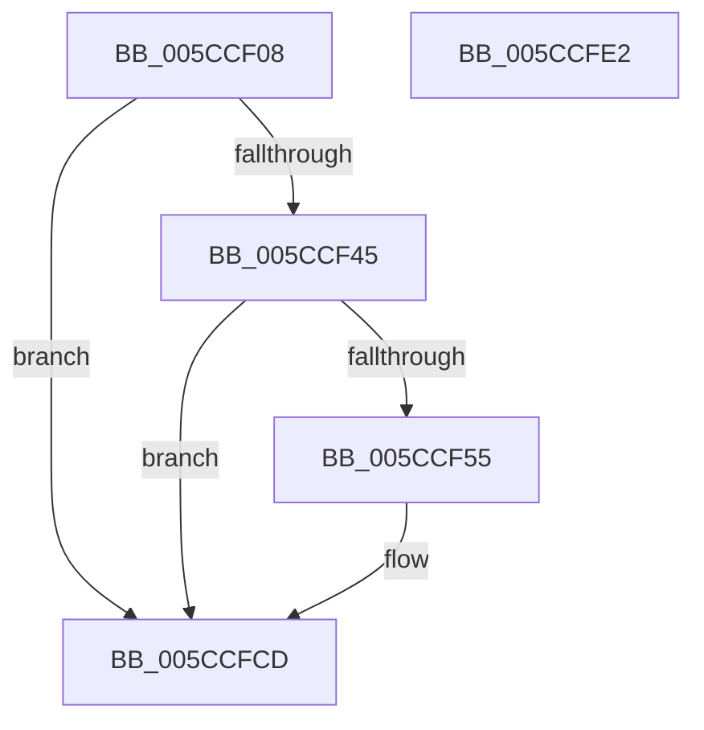

# KsepDsEventPnpStartDevice

- RVA: `0x005CCF08`–`0x005CCFE3` (길이 `219` bytes)
- VA: `0x00000001405CCF08`
- 실행 섹션: `.text`
- PDB 이름 있음: `예`; PDB Function 태그: `아니요`
- unwind 정보 RVA: `0x000BC734`
- 디코드: `53`개 명령, `219/219` bytes 표시
- 미해석 바이트: `0` (있으면 어셈블리에 `.byte`로 보존)

> 이 문서는 커널 이미지의 기계어와 PDB 기호를 분석해 생성했습니다. 4번과 5번은 함수 원형과 자료형을 바이너리 사용 방식에서 추정한 C 해석이며 원본 소스 복구 결과는 아닙니다.

## 1. Dependencies

- 직접 호출 지점: **3**; 고유 호출 대상: **3**
- 직접 호출자로 확인된 함수: **1**
- RIP 상대 이미지 참조: **3**

### Outgoing calls
- `0x005CCF4C` → [EtwEventEnabled](../39/EtwEventEnabled_function_00392450.md) (function, `0x00392450`)
- `0x005CCFC8` → [EtwWriteEx](../25/EtwWriteEx_function_0025F0D0.md) (function, `0x0025F0D0`)
- `0x005CCFD4` → [_security_check_cookie](../6A/_security_check_cookie_function_006AC640.md) (function, `0x006AC640`)

### Direct callers
- [KseDsCompletionHookForStartDevice](KseDsCompletionHookForStartDevice_function_005CC330.md) at `0x005CC342`

### Static image references
- `0x005CCF27` → RVA `0x00E0A740` (`.data`; read)
- `0x005CCF35` → RVA `0x00E66CE0` (`.data`; read)
- `0x005CCF45` → RVA `0x00021D38` (`.rdata`; read)

## 2. Other-region calls and transfers

- 다른 실행 섹션으로 향하는 call: **0**
- 별도 외부 분기/꼬리 이동을 확인하지 못했습니다.

## 3. Assembly (complete function range)

```asm
005CCF08  48 8B C4                        mov rax, rsp
005CCF0B  44 89 48 20                     mov dword ptr [rax + 0x20], r9d
005CCF0F  4C 89 40 18                     mov qword ptr [rax + 0x18], r8
005CCF13  48 89 50 10                     mov qword ptr [rax + 0x10], rdx
005CCF17  48 89 48 08                     mov qword ptr [rax + 8], rcx
005CCF1B  55                              push rbp
005CCF1C  48 8D 68 A1                     lea rbp, [rax - 0x5f]
005CCF20  48 81 EC 90 00 00 00            sub rsp, 0x90
005CCF27  48 8B 05 12 D8 83 00            mov rax, qword ptr [rip + 0x83d812]
005CCF2E  48 33 C4                        xor rax, rsp
005CCF31  48 89 45 47                     mov qword ptr [rbp + 0x47], rax
005CCF35  48 8B 0D A4 9D 89 00            mov rcx, qword ptr [rip + 0x899da4]
005CCF3C  48 85 C9                        test rcx, rcx
005CCF3F  0F 84 88 00 00 00               je 0x1405ccfcd
005CCF45  48 8D 15 EC 4D A5 FF            lea rdx, [rip - 0x5ab214]
005CCF4C  E8 FF 54 DC FF                  call 0x140392450
005CCF51  84 C0                           test al, al
005CCF53  74 78                           je 0x1405ccfcd
005CCF55  83 65 13 00                     and dword ptr [rbp + 0x13], 0
005CCF59  48 8D 45 67                     lea rax, [rbp + 0x67]
005CCF5D  83 65 23 00                     and dword ptr [rbp + 0x23], 0
005CCF61  48 8D 15 D0 4D A5 FF            lea rdx, [rip - 0x5ab230]
005CCF68  83 65 33 00                     and dword ptr [rbp + 0x33], 0
005CCF6C  B9 08 00 00 00                  mov ecx, 8
005CCF71  83 65 43 00                     and dword ptr [rbp + 0x43], 0
005CCF75  45 33 C9                        xor r9d, r9d
005CCF78  48 89 45 07                     mov qword ptr [rbp + 7], rax
005CCF7C  45 33 C0                        xor r8d, r8d
005CCF7F  89 4D 0F                        mov dword ptr [rbp + 0xf], ecx
005CCF82  48 8D 45 6F                     lea rax, [rbp + 0x6f]
005CCF86  48 89 45 17                     mov qword ptr [rbp + 0x17], rax
005CCF8A  48 8D 45 77                     lea rax, [rbp + 0x77]
005CCF8E  48 89 45 27                     mov qword ptr [rbp + 0x27], rax
005CCF92  48 8D 45 7F                     lea rax, [rbp + 0x7f]
005CCF96  89 4D 1F                        mov dword ptr [rbp + 0x1f], ecx
005CCF99  89 4D 2F                        mov dword ptr [rbp + 0x2f], ecx
005CCF9C  B9 04 00 00 00                  mov ecx, 4
005CCFA1  48 89 45 37                     mov qword ptr [rbp + 0x37], rax
005CCFA5  48 8D 45 07                     lea rax, [rbp + 7]
005CCFA9  48 89 44 24 38                  mov qword ptr [rsp + 0x38], rax
005CCFAE  89 4C 24 30                     mov dword ptr [rsp + 0x30], ecx
005CCFB2  48 83 64 24 28 00               and qword ptr [rsp + 0x28], 0
005CCFB8  48 83 64 24 20 00               and qword ptr [rsp + 0x20], 0
005CCFBE  89 4D 3F                        mov dword ptr [rbp + 0x3f], ecx
005CCFC1  48 8B 0D 18 9D 89 00            mov rcx, qword ptr [rip + 0x899d18]
005CCFC8  E8 03 21 C9 FF                  call 0x14025f0d0
005CCFCD  48 8B 4D 47                     mov rcx, qword ptr [rbp + 0x47]
005CCFD1  48 33 CC                        xor rcx, rsp
005CCFD4  E8 67 F6 0D 00                  call 0x1406ac640
005CCFD9  48 81 C4 90 00 00 00            add rsp, 0x90
005CCFE0  5D                              pop rbp
005CCFE1  C3                              ret
005CCFE2  CC                              int3
```

## 4. C-style interpretation (structured pseudocode)

```c
__int64 __fastcall KsepDsEventPnpStartDevice(__int64 a1, __int64 a2, __int64 a3, int a4)
{
    __int64 result;
    __int64 v_rsp;
    unsigned __int64 v_stack_m60;
    unsigned int v_stack_m68;
    unsigned __int64 v_stack_m70;
    unsigned __int64 v_stack_m78;

    *(unsigned int *)(v_rsp + 32) = a4;
    *(unsigned __int64 *)(v_rsp + 24) = a3;
    *(unsigned __int64 *)(v_rsp + 16) = a2;
    *(unsigned __int64 *)(v_rsp + 8) = a1;
    v_rsp = (v_rsp) - (144);
    result = (*(unsigned __int64 *)(v_rip + 8640530)) ^ (v_rsp);
    *(unsigned __int64 *)(v_rsp - 95 + 71) = result;
    if (*(unsigned __int64 *)(v_rip + 9018788) == 0) goto loc_005CCFCD;
    result = EtwEventEnabled(*(unsigned __int64 *)(v_rip + 9018788), v_rip - 5943828, a3, a4);
    if ((unsigned __int8)(result) != 0) {
        result = v_rsp - 95 + 103;
        a2 = v_rip - 5943856;
        a1 = 8;
        a4 = 0;
        *(unsigned __int64 *)(v_rsp - 95 + 7) = result;
        a3 = 0;
        *(unsigned int *)(v_rsp - 95 + 15) = (unsigned int)(a1);
        result = v_rsp - 95 + 111;
        *(unsigned __int64 *)(v_rsp - 95 + 23) = result;
        result = v_rsp - 95 + 119;
        *(unsigned __int64 *)(v_rsp - 95 + 39) = result;
        result = v_rsp - 95 + 127;
        *(unsigned int *)(v_rsp - 95 + 31) = (unsigned int)(a1);
        *(unsigned int *)(v_rsp - 95 + 47) = (unsigned int)(a1);
        a1 = 4;
        *(unsigned __int64 *)(v_rsp - 95 + 55) = result;
        result = v_rsp - 95 + 7;
        v_stack_m60 = result;
        v_stack_m68 = (unsigned int)(a1);
        *(unsigned int *)(v_rsp - 95 + 63) = (unsigned int)(a1);
        a1 = *(unsigned __int64 *)(v_rip + 9018648);
        result = EtwWriteEx(a1, a2, a3, a4);
    }
    a1 = (*(unsigned __int64 *)(v_rsp - 95 + 71)) ^ (v_rsp);
    result = _security_check_cookie(a1, a2, a3, a4);
    v_rsp = (v_rsp) + (144);
    return result;
}
```

## 5. (Beta) C Style

```c
int64_t KsepDsEventPnpStartDevice(int64_t Arg1, int64_t Arg2, int64_t Arg3, int32_t Arg4)
{
    int64_t result;
    int64_t local_rsp;
    uint64_t v_stack_m60;
    uint32_t v_stack_m68;
    uint64_t v_stack_m70;
    uint64_t v_stack_m78;

    *(uint32_t *)(local_rsp + 0x20) = Arg4;
    *(uint64_t *)(local_rsp + 0x18) = Arg3;
    *(uint64_t *)(local_rsp + 0x10) = Arg2;
    *(uint64_t *)(local_rsp + 0x8) = Arg1;
    local_rsp = (local_rsp) - (144);
    result = (*(uint64_t *)(v_rip + 0x83D812)) ^ (local_rsp);
    *(uint64_t *)(local_rsp - 0x5F + 0x47) = result;
    if (*(uint64_t *)(v_rip + 0x899DA4) == 0) goto loc_005CCFCD;
    result = EtwEventEnabled(*(uint64_t *)(v_rip + 0x899DA4), v_rip - 5943828, Arg3, Arg4);
    if ((uint8_t)(result) != 0) {
        result = local_rsp - 95 + 103;
        Arg2 = v_rip - 5943856;
        Arg1 = 8;
        Arg4 = 0;
        *(uint64_t *)(local_rsp - 0x5F + 0x7) = result;
        Arg3 = 0;
        *(uint32_t *)(local_rsp - 0x5F + 0xF) = (uint32_t)(Arg1);
        result = local_rsp - 95 + 111;
        *(uint64_t *)(local_rsp - 0x5F + 0x17) = result;
        result = local_rsp - 95 + 119;
        *(uint64_t *)(local_rsp - 0x5F + 0x27) = result;
        result = local_rsp - 95 + 127;
        *(uint32_t *)(local_rsp - 0x5F + 0x1F) = (uint32_t)(Arg1);
        *(uint32_t *)(local_rsp - 0x5F + 0x2F) = (uint32_t)(Arg1);
        Arg1 = 4;
        *(uint64_t *)(local_rsp - 0x5F + 0x37) = result;
        result = local_rsp - 95 + 7;
        v_stack_m60 = result;
        v_stack_m68 = (uint32_t)(Arg1);
        *(uint32_t *)(local_rsp - 0x5F + 0x3F) = (uint32_t)(Arg1);
        Arg1 = *(uint64_t *)(v_rip + 0x899D18);
        result = EtwWriteEx(Arg1, Arg2, Arg3, Arg4);
    }
    Arg1 = (*(uint64_t *)(local_rsp - 0x5F + 0x47)) ^ (local_rsp);
    result = _security_check_cookie(Arg1, Arg2, Arg3, Arg4);
    local_rsp = (local_rsp) + (144);
    return result;
}
```

## 6. Execution-region graph

[열기: 2D/3D 그래프와 함수 탐색 컨트롤 패널](../../../control-panel.html?section=text&rva=0x005CCF08&view=graph)

- 2D 그래프는 위에서 아래로 흐르고, 3D 그래프는 빈 공간을 드래그해 회전합니다. Shift+드래그는 이동, 휠은 확대·축소, 함수 노드 선택은 대상 보고서 이동입니다.

### Static fallback


