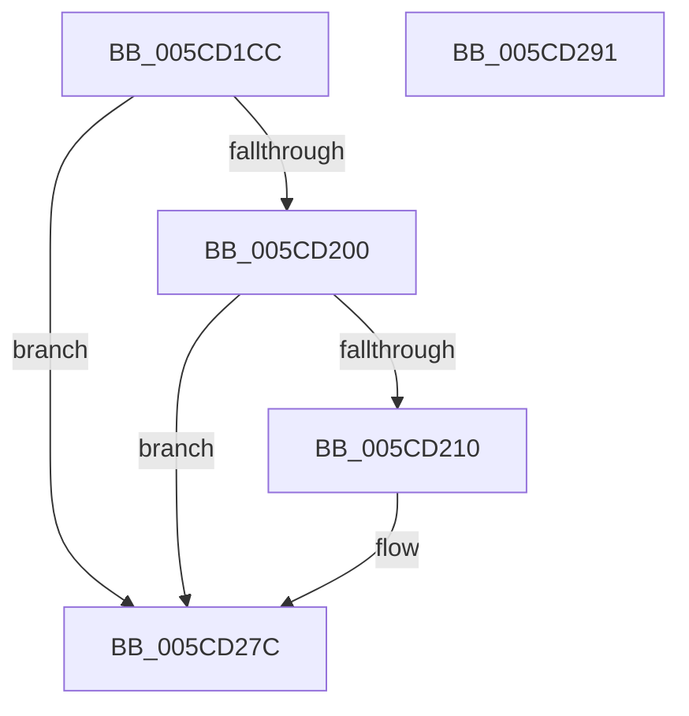

# KsepDsEventPoolFree

- RVA: `0x005CD1CC`–`0x005CD292` (길이 `198` bytes)
- VA: `0x00000001405CD1CC`
- 실행 섹션: `.text`
- PDB 이름 있음: `예`; PDB Function 태그: `아니요`
- unwind 정보 RVA: `0x000BF3D4`
- 디코드: `46`개 명령, `198/198` bytes 표시
- 미해석 바이트: `0` (있으면 어셈블리에 `.byte`로 보존)

> 이 문서는 커널 이미지의 기계어와 PDB 기호를 분석해 생성했습니다. 4번과 5번은 함수 원형과 자료형을 바이너리 사용 방식에서 추정한 C 해석이며 원본 소스 복구 결과는 아닙니다.

## 1. Dependencies

- 직접 호출 지점: **3**; 고유 호출 대상: **3**
- 직접 호출자로 확인된 함수: **2**
- RIP 상대 이미지 참조: **3**

### Outgoing calls
- `0x005CD207` → [EtwEventEnabled](../39/EtwEventEnabled_function_00392450.md) (function, `0x00392450`)
- `0x005CD277` → [EtwWriteEx](../25/EtwWriteEx_function_0025F0D0.md) (function, `0x0025F0D0`)
- `0x005CD283` → [_security_check_cookie](../6A/_security_check_cookie_function_006AC640.md) (function, `0x006AC640`)

### Direct callers
- [KseDsHookExFreePool](KseDsHookExFreePool_function_005CC4A0.md) at `0x005CC4C3`
- [KseDsHookExFreePoolWithTag](KseDsHookExFreePoolWithTag_function_005CC4E0.md) at `0x005CC506`

### Static image references
- `0x005CD1E6` → RVA `0x00E0A740` (`.data`; read)
- `0x005CD1F4` → RVA `0x00E66CE0` (`.data`; read)
- `0x005CD200` → RVA `0x00020FD8` (`.rdata`; read)

## 2. Other-region calls and transfers

- 다른 실행 섹션으로 향하는 call: **0**
- 별도 외부 분기/꼬리 이동을 확인하지 못했습니다.

## 3. Assembly (complete function range)

```asm
005CD1CC  44 89 44 24 18                  mov dword ptr [rsp + 0x18], r8d
005CD1D1  48 89 54 24 10                  mov qword ptr [rsp + 0x10], rdx
005CD1D6  48 89 4C 24 08                  mov qword ptr [rsp + 8], rcx
005CD1DB  55                              push rbp
005CD1DC  48 8B EC                        mov rbp, rsp
005CD1DF  48 81 EC 80 00 00 00            sub rsp, 0x80
005CD1E6  48 8B 05 53 D5 83 00            mov rax, qword ptr [rip + 0x83d553]
005CD1ED  48 33 C4                        xor rax, rsp
005CD1F0  48 89 45 F0                     mov qword ptr [rbp - 0x10], rax
005CD1F4  48 8B 0D E5 9A 89 00            mov rcx, qword ptr [rip + 0x899ae5]
005CD1FB  48 85 C9                        test rcx, rcx
005CD1FE  74 7C                           je 0x1405cd27c
005CD200  48 8D 15 D1 3D A5 FF            lea rdx, [rip - 0x5ac22f]
005CD207  E8 44 52 DC FF                  call 0x140392450
005CD20C  84 C0                           test al, al
005CD20E  74 6C                           je 0x1405cd27c
005CD210  83 65 CC 00                     and dword ptr [rbp - 0x34], 0
005CD214  48 8D 45 10                     lea rax, [rbp + 0x10]
005CD218  83 65 DC 00                     and dword ptr [rbp - 0x24], 0
005CD21C  48 8D 15 B5 3D A5 FF            lea rdx, [rip - 0x5ac24b]
005CD223  83 65 EC 00                     and dword ptr [rbp - 0x14], 0
005CD227  B9 08 00 00 00                  mov ecx, 8
005CD22C  48 89 45 C0                     mov qword ptr [rbp - 0x40], rax
005CD230  45 33 C9                        xor r9d, r9d
005CD233  48 8D 45 18                     lea rax, [rbp + 0x18]
005CD237  89 4D C8                        mov dword ptr [rbp - 0x38], ecx
005CD23A  48 89 45 D0                     mov qword ptr [rbp - 0x30], rax
005CD23E  45 33 C0                        xor r8d, r8d
005CD241  48 8D 45 20                     lea rax, [rbp + 0x20]
005CD245  89 4D D8                        mov dword ptr [rbp - 0x28], ecx
005CD248  48 8B 0D 91 9A 89 00            mov rcx, qword ptr [rip + 0x899a91]
005CD24F  48 89 45 E0                     mov qword ptr [rbp - 0x20], rax
005CD253  48 8D 45 C0                     lea rax, [rbp - 0x40]
005CD257  48 89 44 24 38                  mov qword ptr [rsp + 0x38], rax
005CD25C  C7 44 24 30 03 00 00 00         mov dword ptr [rsp + 0x30], 3
005CD264  48 83 64 24 28 00               and qword ptr [rsp + 0x28], 0
005CD26A  48 83 64 24 20 00               and qword ptr [rsp + 0x20], 0
005CD270  C7 45 E8 04 00 00 00            mov dword ptr [rbp - 0x18], 4
005CD277  E8 54 1E C9 FF                  call 0x14025f0d0
005CD27C  48 8B 4D F0                     mov rcx, qword ptr [rbp - 0x10]
005CD280  48 33 CC                        xor rcx, rsp
005CD283  E8 B8 F3 0D 00                  call 0x1406ac640
005CD288  48 81 C4 80 00 00 00            add rsp, 0x80
005CD28F  5D                              pop rbp
005CD290  C3                              ret
005CD291  CC                              int3
```

## 4. C-style interpretation (structured pseudocode)

```c
__int64 __fastcall KsepDsEventPoolFree(__int64 a1, __int64 a2, int a3, int a4)
{
    __int64 result;
    __int64 v_rsp;
    unsigned __int64 v_stack_m18;
    unsigned int v_stack_m1C;
    unsigned int v_stack_m20;
    unsigned __int64 v_stack_m28;
    unsigned int v_stack_m2C;
    unsigned int v_stack_m30;
    unsigned __int64 v_stack_m38;
    unsigned int v_stack_m3C;
    unsigned int v_stack_m40;
    unsigned __int64 v_stack_m48;
    unsigned __int64 v_stack_m50;
    unsigned int v_stack_m58;
    unsigned __int64 v_stack_m60;
    unsigned __int64 v_stack_m68;
    unsigned __int64 v_stack_p10;
    unsigned int v_stack_p18;
    unsigned __int64 v_stack_p8;

    v_stack_p18 = a3;
    v_stack_p10 = a2;
    v_stack_p8 = a1;
    v_rsp = (v_rsp) - (128);
    result = (*(unsigned __int64 *)(v_rip + 8639827)) ^ (v_rsp);
    v_stack_m18 = result;
    if (*(unsigned __int64 *)(v_rip + 9018085) == 0) goto loc_005CD27C;
    result = EtwEventEnabled(*(unsigned __int64 *)(v_rip + 9018085), v_rip - 5947951, a3, a4);
    if ((unsigned __int8)(result) != 0) {
        result = v_stack_p8;
        a2 = v_rip - 5947979;
        a1 = 8;
        v_stack_m48 = result;
        a4 = 0;
        result = v_stack_p10;
        v_stack_m40 = (unsigned int)(a1);
        v_stack_m38 = result;
        a3 = 0;
        result = v_stack_p18;
        v_stack_m30 = (unsigned int)(a1);
        a1 = *(unsigned __int64 *)(v_rip + 9018001);
        v_stack_m28 = result;
        result = v_stack_m48;
        v_stack_m50 = result;
        v_stack_m58 = 3;
        v_stack_m20 = 4;
        result = EtwWriteEx(a1, a2, a3, a4);
    }
    a1 = (v_stack_m18) ^ (v_rsp);
    result = _security_check_cookie(a1, a2, a3, a4);
    v_rsp = (v_rsp) + (128);
    return result;
}
```

## 5. (Beta) C Style

```c
int64_t KsepDsEventPoolFree(int64_t Arg1, int64_t Arg2, int32_t Arg3, int32_t Arg4)
{
    int64_t result;
    int64_t local_rsp;
    uint64_t v_stack_m18;
    uint32_t v_stack_m1C;
    uint32_t v_stack_m20;
    uint64_t v_stack_m28;
    uint32_t v_stack_m2C;
    uint32_t v_stack_m30;
    uint64_t v_stack_m38;
    uint32_t v_stack_m3C;
    uint32_t v_stack_m40;
    uint64_t v_stack_m48;
    uint64_t v_stack_m50;
    uint32_t v_stack_m58;
    uint64_t v_stack_m60;
    uint64_t v_stack_m68;
    uint64_t v_stack_p10;
    uint32_t v_stack_p18;
    uint64_t v_stack_p8;

    v_stack_p18 = Arg3;
    v_stack_p10 = Arg2;
    v_stack_p8 = Arg1;
    local_rsp = (local_rsp) - (128);
    result = (*(uint64_t *)(v_rip + 0x83D553)) ^ (local_rsp);
    v_stack_m18 = result;
    if (*(uint64_t *)(v_rip + 0x899AE5) == 0) goto loc_005CD27C;
    result = EtwEventEnabled(*(uint64_t *)(v_rip + 0x899AE5), v_rip - 5947951, Arg3, Arg4);
    if ((uint8_t)(result) != 0) {
        result = v_stack_p8;
        Arg2 = v_rip - 5947979;
        Arg1 = 8;
        v_stack_m48 = result;
        Arg4 = 0;
        result = v_stack_p10;
        v_stack_m40 = (uint32_t)(Arg1);
        v_stack_m38 = result;
        Arg3 = 0;
        result = v_stack_p18;
        v_stack_m30 = (uint32_t)(Arg1);
        Arg1 = *(uint64_t *)(v_rip + 0x899A91);
        v_stack_m28 = result;
        result = v_stack_m48;
        v_stack_m50 = result;
        v_stack_m58 = 3;
        v_stack_m20 = 4;
        result = EtwWriteEx(Arg1, Arg2, Arg3, Arg4);
    }
    Arg1 = (v_stack_m18) ^ (local_rsp);
    result = _security_check_cookie(Arg1, Arg2, Arg3, Arg4);
    local_rsp = (local_rsp) + (128);
    return result;
}
```

## 6. Execution-region graph

[열기: 2D/3D 그래프와 함수 탐색 컨트롤 패널](../../../control-panel.html?section=text&rva=0x005CD1CC&view=graph)

- 2D 그래프는 위에서 아래로 흐르고, 3D 그래프는 빈 공간을 드래그해 회전합니다. Shift+드래그는 이동, 휠은 확대·축소, 함수 노드 선택은 대상 보고서 이동입니다.

### Static fallback


