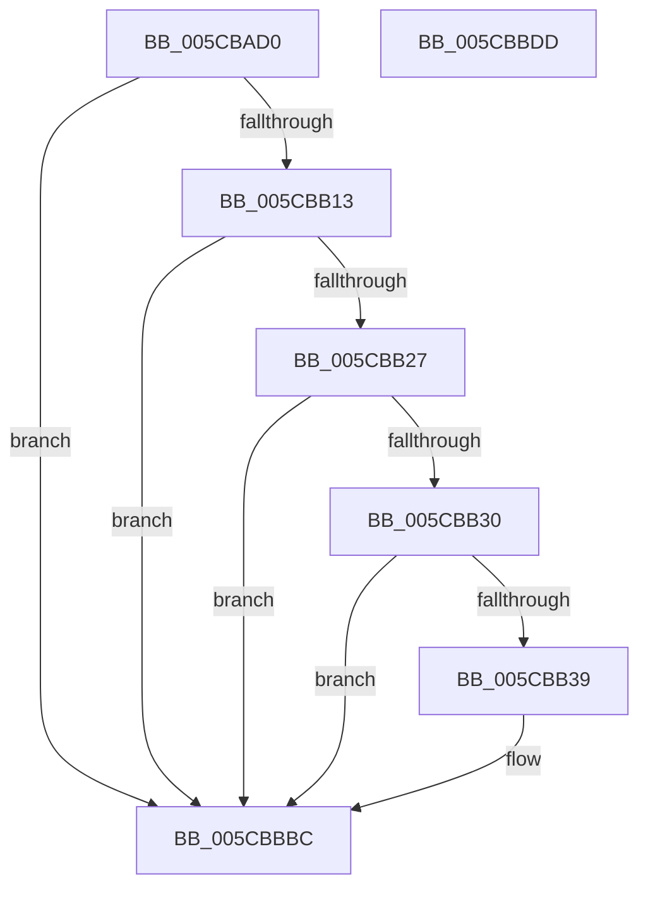

# KsepEvntLogFlagsApplied

- RVA: `0x005CBAD0`–`0x005CBBDE` (길이 `270` bytes)
- VA: `0x00000001405CBAD0`
- 실행 섹션: `.text`
- PDB 이름 있음: `예`; PDB Function 태그: `아니요`
- unwind 정보 RVA: `0x000CB4B4`
- 디코드: `65`개 명령, `270/270` bytes 표시
- 미해석 바이트: `0` (있으면 어셈블리에 `.byte`로 보존)

> 이 문서는 커널 이미지의 기계어와 PDB 기호를 분석해 생성했습니다. 4번과 5번은 함수 원형과 자료형을 바이너리 사용 방식에서 추정한 C 해석이며 원본 소스 복구 결과는 아닙니다.

## 1. Dependencies

- 직접 호출 지점: **3**; 고유 호출 대상: **3**
- 직접 호출자로 확인된 함수: **1**
- RIP 상대 이미지 참조: **3**

### Outgoing calls
- `0x005CBB1A` → [EtwEventEnabled](../39/EtwEventEnabled_function_00392450.md) (function, `0x00392450`)
- `0x005CBBB7` → [EtwWriteEx](../25/EtwWriteEx_function_0025F0D0.md) (function, `0x0025F0D0`)
- `0x005CBBC3` → [_security_check_cookie](../6A/_security_check_cookie_function_006AC640.md) (function, `0x006AC640`)

### Direct callers
- [sub_00B277B0](../../page/B2/Unknown_function_00B277B0.md) at `0x00B27804`

### Static image references
- `0x005CBAEF` → RVA `0x00E0A740` (`.data`; read)
- `0x005CBB03` → RVA `0x00E66CE0` (`.data`; read)
- `0x005CBB13` → RVA `0x00022F00` (`.rdata`; read)

## 2. Other-region calls and transfers

- 다른 실행 섹션으로 향하는 call: **0**
- 별도 외부 분기/꼬리 이동을 확인하지 못했습니다.

## 3. Assembly (complete function range)

```asm
005CBAD0  48 8B C4                        mov rax, rsp
005CBAD3  48 89 58 08                     mov qword ptr [rax + 8], rbx
005CBAD7  48 89 78 10                     mov qword ptr [rax + 0x10], rdi
005CBADB  4C 89 48 20                     mov qword ptr [rax + 0x20], r9
005CBADF  44 89 40 18                     mov dword ptr [rax + 0x18], r8d
005CBAE3  55                              push rbp
005CBAE4  48 8D 68 A1                     lea rbp, [rax - 0x5f]
005CBAE8  48 81 EC 90 00 00 00            sub rsp, 0x90
005CBAEF  48 8B 05 4A EC 83 00            mov rax, qword ptr [rip + 0x83ec4a]
005CBAF6  48 33 C4                        xor rax, rsp
005CBAF9  48 89 45 47                     mov qword ptr [rbp + 0x47], rax
005CBAFD  48 8B F9                        mov rdi, rcx
005CBB00  48 8B DA                        mov rbx, rdx
005CBB03  48 8B 0D D6 B1 89 00            mov rcx, qword ptr [rip + 0x89b1d6]
005CBB0A  48 85 C9                        test rcx, rcx
005CBB0D  0F 84 A9 00 00 00               je 0x1405cbbbc
005CBB13  48 8D 15 E6 73 A5 FF            lea rdx, [rip - 0x5a8c1a]
005CBB1A  E8 31 69 DC FF                  call 0x140392450
005CBB1F  84 C0                           test al, al
005CBB21  0F 84 95 00 00 00               je 0x1405cbbbc
005CBB27  48 85 FF                        test rdi, rdi
005CBB2A  0F 84 8C 00 00 00               je 0x1405cbbbc
005CBB30  48 85 DB                        test rbx, rbx
005CBB33  0F 84 83 00 00 00               je 0x1405cbbbc
005CBB39  48 8B 47 08                     mov rax, qword ptr [rdi + 8]
005CBB3D  48 8D 15 BC 73 A5 FF            lea rdx, [rip - 0x5a8c44]
005CBB44  83 65 13 00                     and dword ptr [rbp + 0x13], 0
005CBB48  B9 04 00 00 00                  mov ecx, 4
005CBB4D  83 65 23 00                     and dword ptr [rbp + 0x23], 0
005CBB51  45 33 C9                        xor r9d, r9d
005CBB54  83 65 33 00                     and dword ptr [rbp + 0x33], 0
005CBB58  45 33 C0                        xor r8d, r8d
005CBB5B  83 65 43 00                     and dword ptr [rbp + 0x43], 0
005CBB5F  48 89 45 07                     mov qword ptr [rbp + 7], rax
005CBB63  0F B7 07                        movzx eax, word ptr [rdi]
005CBB66  83 C0 02                        add eax, 2
005CBB69  89 4D 2F                        mov dword ptr [rbp + 0x2f], ecx
005CBB6C  89 45 0F                        mov dword ptr [rbp + 0xf], eax
005CBB6F  48 8B 43 08                     mov rax, qword ptr [rbx + 8]
005CBB73  48 89 45 17                     mov qword ptr [rbp + 0x17], rax
005CBB77  0F B7 03                        movzx eax, word ptr [rbx]
005CBB7A  83 C0 02                        add eax, 2
005CBB7D  C7 45 3F 08 00 00 00            mov dword ptr [rbp + 0x3f], 8
005CBB84  89 45 1F                        mov dword ptr [rbp + 0x1f], eax
005CBB87  48 8D 45 77                     lea rax, [rbp + 0x77]
005CBB8B  48 89 45 27                     mov qword ptr [rbp + 0x27], rax
005CBB8F  48 8D 45 7F                     lea rax, [rbp + 0x7f]
005CBB93  48 89 45 37                     mov qword ptr [rbp + 0x37], rax
005CBB97  48 8D 45 07                     lea rax, [rbp + 7]
005CBB9B  48 89 44 24 38                  mov qword ptr [rsp + 0x38], rax
005CBBA0  89 4C 24 30                     mov dword ptr [rsp + 0x30], ecx
005CBBA4  48 83 64 24 28 00               and qword ptr [rsp + 0x28], 0
005CBBAA  48 83 64 24 20 00               and qword ptr [rsp + 0x20], 0
005CBBB0  48 8B 0D 29 B1 89 00            mov rcx, qword ptr [rip + 0x89b129]
005CBBB7  E8 14 35 C9 FF                  call 0x14025f0d0
005CBBBC  48 8B 4D 47                     mov rcx, qword ptr [rbp + 0x47]
005CBBC0  48 33 CC                        xor rcx, rsp
005CBBC3  E8 78 0A 0E 00                  call 0x1406ac640
005CBBC8  4C 8D 9C 24 90 00 00 00         lea r11, [rsp + 0x90]
005CBBD0  49 8B 5B 10                     mov rbx, qword ptr [r11 + 0x10]
005CBBD4  49 8B 7B 18                     mov rdi, qword ptr [r11 + 0x18]
005CBBD8  49 8B E3                        mov rsp, r11
005CBBDB  5D                              pop rbp
005CBBDC  C3                              ret
005CBBDD  CC                              int3
```

## 4. C-style interpretation (structured pseudocode)

```c
__int64 __fastcall KsepEvntLogFlagsApplied(__int64 a1, __int64 a2, int a3, __int64 a4)
{
    __int64 result;
    __int64 v_rsp;
    unsigned __int64 v_stack_m60;
    unsigned int v_stack_m68;
    unsigned __int64 v_stack_m70;
    unsigned __int64 v_stack_m78;
    unsigned __int64 v_stack_m8;

    *(unsigned __int64 *)(v_rsp + 8) = v_rbx;
    *(unsigned __int64 *)(v_rsp + 16) = v_rdi;
    *(unsigned __int64 *)(v_rsp + 32) = a4;
    *(unsigned int *)(v_rsp + 24) = a3;
    v_rsp = (v_rsp) - (144);
    result = (*(unsigned __int64 *)(v_rip + 8645706)) ^ (v_rsp);
    *(unsigned __int64 *)(v_rsp - 95 + 71) = result;
    if (*(unsigned __int64 *)(v_rip + 9023958) == 0) goto loc_005CBBBC;
    result = EtwEventEnabled(*(unsigned __int64 *)(v_rip + 9023958), v_rip - 5934106, a3, a4);
    if ((unsigned __int8)(result) == 0) goto loc_005CBBBC;
    if (a1 == 0) goto loc_005CBBBC;
    if (a2 != 0) {
        result = *(unsigned __int64 *)(a1 + 8);
        a2 = v_rip - 5934148;
        a1 = 4;
        a4 = 0;
        a3 = 0;
        *(unsigned __int64 *)(v_rsp - 95 + 7) = result;
        result = *(unsigned __int16 *)(a1);
        result = (unsigned int)((result) + (2));
        *(unsigned int *)(v_rsp - 95 + 47) = (unsigned int)(a1);
        *(unsigned int *)(v_rsp - 95 + 15) = (unsigned int)(result);
        result = *(unsigned __int64 *)(a2 + 8);
        *(unsigned __int64 *)(v_rsp - 95 + 23) = result;
        result = *(unsigned __int16 *)(a2);
        result = (unsigned int)((result) + (2));
        *(unsigned int *)(v_rsp - 95 + 63) = 8;
        *(unsigned int *)(v_rsp - 95 + 31) = (unsigned int)(result);
        result = v_rsp - 95 + 119;
        *(unsigned __int64 *)(v_rsp - 95 + 39) = result;
        result = v_rsp - 95 + 127;
        *(unsigned __int64 *)(v_rsp - 95 + 55) = result;
        result = v_rsp - 95 + 7;
        v_stack_m60 = result;
        v_stack_m68 = (unsigned int)(a1);
        a1 = *(unsigned __int64 *)(v_rip + 9023785);
        result = EtwWriteEx(a1, a2, a3, a4);
    }
    a1 = (*(unsigned __int64 *)(v_rsp - 95 + 71)) ^ (v_rsp);
    result = _security_check_cookie(a1, a2, a3, a4);
    return result;
}
```

## 5. (Beta) C Style

```c
int64_t KsepEvntLogFlagsApplied(int64_t Arg1, int64_t Arg2, int32_t Arg3, int64_t Arg4)
{
    int64_t result;
    int64_t local_rsp;
    uint64_t v_stack_m60;
    uint32_t v_stack_m68;
    uint64_t v_stack_m70;
    uint64_t v_stack_m78;
    uint64_t v_stack_m8;

    *(uint64_t *)(local_rsp + 0x8) = local_rbx;
    *(uint64_t *)(local_rsp + 0x10) = local_rdi;
    *(uint64_t *)(local_rsp + 0x20) = Arg4;
    *(uint32_t *)(local_rsp + 0x18) = Arg3;
    local_rsp = (local_rsp) - (144);
    result = (*(uint64_t *)(v_rip + 0x83EC4A)) ^ (local_rsp);
    *(uint64_t *)(local_rsp - 0x5F + 0x47) = result;
    if (*(uint64_t *)(v_rip + 0x89B1D6) == 0) goto loc_005CBBBC;
    result = EtwEventEnabled(*(uint64_t *)(v_rip + 0x89B1D6), v_rip - 5934106, Arg3, Arg4);
    if ((uint8_t)(result) == 0) goto loc_005CBBBC;
    if (Arg1 == 0) goto loc_005CBBBC;
    if (Arg2 != 0) {
        result = *(uint64_t *)(Arg1 + 0x8);
        Arg2 = v_rip - 5934148;
        Arg1 = 4;
        Arg4 = 0;
        Arg3 = 0;
        *(uint64_t *)(local_rsp - 0x5F + 0x7) = result;
        result = *(uint16_t *)(Arg1);
        result = (uint32_t)((result) + (2));
        *(uint32_t *)(local_rsp - 0x5F + 0x2F) = (uint32_t)(Arg1);
        *(uint32_t *)(local_rsp - 0x5F + 0xF) = (uint32_t)(result);
        result = *(uint64_t *)(Arg2 + 0x8);
        *(uint64_t *)(local_rsp - 0x5F + 0x17) = result;
        result = *(uint16_t *)(Arg2);
        result = (uint32_t)((result) + (2));
        *(uint32_t *)(local_rsp - 0x5F + 0x3F) = 8;
        *(uint32_t *)(local_rsp - 0x5F + 0x1F) = (uint32_t)(result);
        result = local_rsp - 95 + 119;
        *(uint64_t *)(local_rsp - 0x5F + 0x27) = result;
        result = local_rsp - 95 + 127;
        *(uint64_t *)(local_rsp - 0x5F + 0x37) = result;
        result = local_rsp - 95 + 7;
        v_stack_m60 = result;
        v_stack_m68 = (uint32_t)(Arg1);
        Arg1 = *(uint64_t *)(v_rip + 0x89B129);
        result = EtwWriteEx(Arg1, Arg2, Arg3, Arg4);
    }
    Arg1 = (*(uint64_t *)(local_rsp - 0x5F + 0x47)) ^ (local_rsp);
    result = _security_check_cookie(Arg1, Arg2, Arg3, Arg4);
    return result;
}
```

## 6. Execution-region graph

[열기: 2D/3D 그래프와 함수 탐색 컨트롤 패널](../../../control-panel.html?section=text&rva=0x005CBAD0&view=graph)

- 2D 그래프는 위에서 아래로 흐르고, 3D 그래프는 빈 공간을 드래그해 회전합니다. Shift+드래그는 이동, 휠은 확대·축소, 함수 노드 선택은 대상 보고서 이동입니다.

### Static fallback


