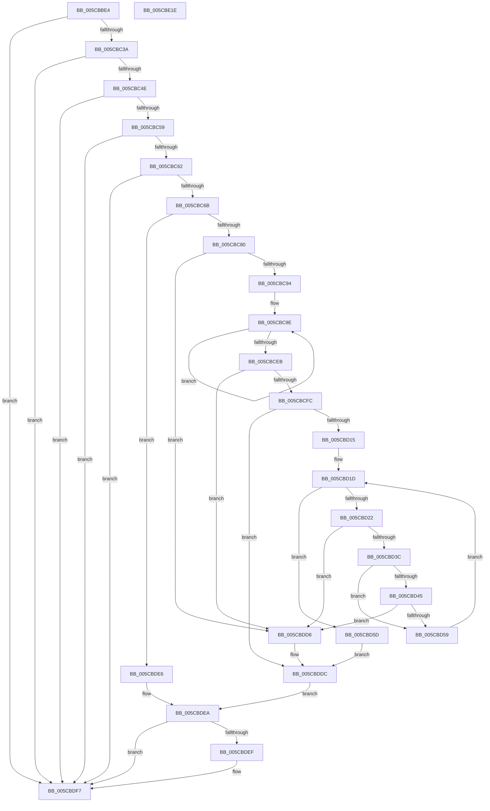

# KsepEvntLogShimsApplied

- RVA: `0x005CBBE4`–`0x005CBE1F` (길이 `571` bytes)
- VA: `0x00000001405CBBE4`
- 실행 섹션: `.text`
- PDB 이름 있음: `예`; PDB Function 태그: `아니요`
- unwind 정보 RVA: `0x000CB48C`
- 디코드: `155`개 명령, `571/571` bytes 표시
- 미해석 바이트: `0` (있으면 어셈블리에 `.byte`로 보존)

> 이 문서는 커널 이미지의 기계어와 PDB 기호를 분석해 생성했습니다. 4번과 5번은 함수 원형과 자료형을 바이너리 사용 방식에서 추정한 C 해석이며 원본 소스 복구 결과는 아닙니다.

## 1. Dependencies

- 직접 호출 지점: **10**; 고유 호출 대상: **8**
- 직접 호출자로 확인된 함수: **1**
- RIP 상대 이미지 참조: **4**

### Outgoing calls
- `0x005CBC41` → [EtwEventEnabled](../39/EtwEventEnabled_function_00392450.md) (function, `0x00392450`)
- `0x005CBC6F` → [KsepPoolAllocatePaged](../4A/KsepPoolAllocatePaged_function_004A9EFC.md) (function, `0x004A9EFC`)
- `0x005CBCCD` → [RtlStringFromGUIDEx](../../page/91/RtlStringFromGUIDEx_function_00915450.md) (function, `0x00915450`)
- `0x005CBD00` → [KsepPoolAllocatePaged](../4A/KsepPoolAllocatePaged_function_004A9EFC.md) (function, `0x004A9EFC`)
- `0x005CBD2F` → [RtlAppendUnicodeStringToString](../40/RtlAppendUnicodeStringToString_function_0040FA50.md) (function, `0x0040FA50`)
- `0x005CBD50` → [RtlAppendUnicodeToString](../40/RtlAppendUnicodeToString_function_0040F990.md) (function, `0x0040F990`)
- `0x005CBDD1` → [EtwWriteEx](../25/EtwWriteEx_function_0025F0D0.md) (function, `0x0025F0D0`)
- `0x005CBDDF` → [KsepPoolFreePaged](../4B/KsepPoolFreePaged_function_004B0E10.md) (function, `0x004B0E10`)
- `0x005CBDF2` → [KsepPoolFreePaged](../4B/KsepPoolFreePaged_function_004B0E10.md) (function, `0x004B0E10`)
- `0x005CBDFE` → [_security_check_cookie](../6A/_security_check_cookie_function_006AC640.md) (function, `0x006AC640`)

### Direct callers
- [KseDriverLoadImage](../../page/95/KseDriverLoadImage_function_009588C0.md) at `0x00958A35`

### Static image references
- `0x005CBC00` → RVA `0x00E0A740` (`.data`; read)
- `0x005CBC1C` → RVA `0x00E66CE0` (`.data`; read)
- `0x005CBC3A` → RVA `0x00022768` (`.rdata`; read)
- `0x005CBD45` → RVA `0x006CBDB0` (` ?? ::FNODOBFM::`string'`; read)

## 2. Other-region calls and transfers

- 다른 실행 섹션으로 향하는 call: **1**
  - `0x005CBCCD` → [RtlStringFromGUIDEx](../../page/91/RtlStringFromGUIDEx_function_00915450.md) (`.text` → `PAGE`)
- 별도 외부 분기/꼬리 이동을 확인하지 못했습니다.

## 3. Assembly (complete function range)

```asm
005CBBE4  48 89 5C 24 08                  mov qword ptr [rsp + 8], rbx
005CBBE9  55                              push rbp
005CBBEA  56                              push rsi
005CBBEB  57                              push rdi
005CBBEC  41 54                           push r12
005CBBEE  41 55                           push r13
005CBBF0  41 56                           push r14
005CBBF2  41 57                           push r15
005CBBF4  48 8D 6C 24 D9                  lea rbp, [rsp - 0x27]
005CBBF9  48 81 EC B0 00 00 00            sub rsp, 0xb0
005CBC00  48 8B 05 39 EB 83 00            mov rax, qword ptr [rip + 0x83eb39]
005CBC07  48 33 C4                        xor rax, rsp
005CBC0A  48 89 45 17                     mov qword ptr [rbp + 0x17], rax
005CBC0E  45 33 E4                        xor r12d, r12d
005CBC11  48 89 4D CF                     mov qword ptr [rbp - 0x31], rcx
005CBC15  4C 8B F9                        mov r15, rcx
005CBC18  44 89 45 B7                     mov dword ptr [rbp - 0x49], r8d
005CBC1C  48 8B 0D BD B0 89 00            mov rcx, qword ptr [rip + 0x89b0bd]
005CBC23  0F 57 C0                        xorps xmm0, xmm0
005CBC26  4C 8B EA                        mov r13, rdx
005CBC29  45 0F B7 F4                     movzx r14d, r12w
005CBC2D  0F 11 45 BF                     movups xmmword ptr [rbp - 0x41], xmm0
005CBC31  48 85 C9                        test rcx, rcx
005CBC34  0F 84 BD 01 00 00               je 0x1405cbdf7
005CBC3A  48 8D 15 27 6B A5 FF            lea rdx, [rip - 0x5a94d9]
005CBC41  E8 0A 68 DC FF                  call 0x140392450
005CBC46  84 C0                           test al, al
005CBC48  0F 84 A9 01 00 00               je 0x1405cbdf7
005CBC4E  8B 45 B7                        mov eax, dword ptr [rbp - 0x49]
005CBC51  85 C0                           test eax, eax
005CBC53  0F 84 9E 01 00 00               je 0x1405cbdf7
005CBC59  4D 85 ED                        test r13, r13
005CBC5C  0F 84 95 01 00 00               je 0x1405cbdf7
005CBC62  4D 85 FF                        test r15, r15
005CBC65  0F 84 8C 01 00 00               je 0x1405cbdf7
005CBC6B  48 6B C8 5E                     imul rcx, rax, 0x5e
005CBC6F  E8 88 E2 ED FF                  call 0x1404a9efc
005CBC74  48 8B F0                        mov rsi, rax
005CBC77  48 85 C0                        test rax, rax
005CBC7A  0F 84 66 01 00 00               je 0x1405cbde6
005CBC80  8B 4D B7                        mov ecx, dword ptr [rbp - 0x49]
005CBC83  8B F9                           mov edi, ecx
005CBC85  48 C1 E7 04                     shl rdi, 4
005CBC89  48 03 F8                        add rdi, rax
005CBC8C  85 C9                           test ecx, ecx
005CBC8E  0F 84 44 01 00 00               je 0x1405cbdd8
005CBC94  41 8D 54 24 4E                  lea edx, [r12 + 0x4e]
005CBC99  45 8D 7C 24 04                  lea r15d, [r12 + 4]
005CBC9E  0F 57 C0                        xorps xmm0, xmm0
005CBCA1  41 8B DC                        mov ebx, r12d
005CBCA4  48 C1 E3 04                     shl rbx, 4
005CBCA8  45 33 C0                        xor r8d, r8d
005CBCAB  48 03 DE                        add rbx, rsi
005CBCAE  41 8B CC                        mov ecx, r12d
005CBCB1  48 8D 0C 89                     lea rcx, [rcx + rcx*4]
005CBCB5  0F 11 03                        movups xmmword ptr [rbx], xmm0
005CBCB8  48 89 7B 08                     mov qword ptr [rbx + 8], rdi
005CBCBC  48 03 FA                        add rdi, rdx
005CBCBF  48 C1 E1 04                     shl rcx, 4
005CBCC3  66 89 53 02                     mov word ptr [rbx + 2], dx
005CBCC7  49 03 CD                        add rcx, r13
005CBCCA  48 8B D3                        mov rdx, rbx
005CBCCD  E8 7E 97 34 00                  call 0x140915450
005CBCD2  0F B7 03                        movzx eax, word ptr [rbx]
005CBCD5  41 FF C4                        inc r12d
005CBCD8  66 41 03 C7                     add ax, r15w
005CBCDC  BA 4E 00 00 00                  mov edx, 0x4e
005CBCE1  66 44 03 F0                     add r14w, ax
005CBCE5  44 3B 65 B7                     cmp r12d, dword ptr [rbp - 0x49]
005CBCE9  72 B3                           jb 0x1405cbc9e
005CBCEB  4C 8B 7D CF                     mov r15, qword ptr [rbp - 0x31]
005CBCEF  45 33 E4                        xor r12d, r12d
005CBCF2  66 45 85 F6                     test r14w, r14w
005CBCF6  0F 84 DC 00 00 00               je 0x1405cbdd8
005CBCFC  41 0F B7 CE                     movzx ecx, r14w
005CBD00  E8 F7 E1 ED FF                  call 0x1404a9efc
005CBD05  48 89 45 C7                     mov qword ptr [rbp - 0x39], rax
005CBD09  48 8B D8                        mov rbx, rax
005CBD0C  48 85 C0                        test rax, rax
005CBD0F  0F 84 C7 00 00 00               je 0x1405cbddc
005CBD15  66 44 89 75 C1                  mov word ptr [rbp - 0x3f], r14w
005CBD1A  41 8B DC                        mov ebx, r12d
005CBD1D  3B 5D B7                        cmp ebx, dword ptr [rbp - 0x49]
005CBD20  73 3B                           jae 0x1405cbd5d
005CBD22  8B D3                           mov edx, ebx
005CBD24  48 8D 4D BF                     lea rcx, [rbp - 0x41]
005CBD28  48 C1 E2 04                     shl rdx, 4
005CBD2C  48 03 D6                        add rdx, rsi
005CBD2F  E8 1C 3D E4 FF                  call 0x14040fa50
005CBD34  85 C0                           test eax, eax
005CBD36  0F 88 9C 00 00 00               js 0x1405cbdd8
005CBD3C  8B 45 B7                        mov eax, dword ptr [rbp - 0x49]
005CBD3F  FF C8                           dec eax
005CBD41  3B D8                           cmp ebx, eax
005CBD43  74 14                           je 0x1405cbd59
005CBD45  48 8D 15 64 00 10 00            lea rdx, [rip + 0x100064]
005CBD4C  48 8D 4D BF                     lea rcx, [rbp - 0x41]
005CBD50  E8 3B 3C E4 FF                  call 0x14040f990
005CBD55  85 C0                           test eax, eax
005CBD57  78 7F                           js 0x1405cbdd8
005CBD59  FF C3                           inc ebx
005CBD5B  EB C0                           jmp 0x1405cbd1d
005CBD5D  49 8B 47 08                     mov rax, qword ptr [r15 + 8]
005CBD61  48 8D 15 00 6A A5 FF            lea rdx, [rip - 0x5a9600]
005CBD68  48 8B 5D C7                     mov rbx, qword ptr [rbp - 0x39]
005CBD6C  B9 04 00 00 00                  mov ecx, 4
005CBD71  48 89 45 D7                     mov qword ptr [rbp - 0x29], rax
005CBD75  45 33 C9                        xor r9d, r9d
005CBD78  41 0F B7 07                     movzx eax, word ptr [r15]
005CBD7C  45 33 C0                        xor r8d, r8d
005CBD7F  83 C0 02                        add eax, 2
005CBD82  48 89 4D EF                     mov qword ptr [rbp - 0x11], rcx
005CBD86  89 45 DF                        mov dword ptr [rbp - 0x21], eax
005CBD89  49 8D 45 44                     lea rax, [r13 + 0x44]
005CBD8D  48 89 45 E7                     mov qword ptr [rbp - 0x19], rax
005CBD91  48 8D 45 B7                     lea rax, [rbp - 0x49]
005CBD95  48 89 45 F7                     mov qword ptr [rbp - 9], rax
005CBD99  0F B7 45 BF                     movzx eax, word ptr [rbp - 0x41]
005CBD9D  83 C0 02                        add eax, 2
005CBDA0  48 89 4D FF                     mov qword ptr [rbp - 1], rcx
005CBDA4  89 45 0F                        mov dword ptr [rbp + 0xf], eax
005CBDA7  48 8D 45 D7                     lea rax, [rbp - 0x29]
005CBDAB  48 89 44 24 38                  mov qword ptr [rsp + 0x38], rax
005CBDB0  89 4C 24 30                     mov dword ptr [rsp + 0x30], ecx
005CBDB4  48 8B 0D 25 AF 89 00            mov rcx, qword ptr [rip + 0x89af25]
005CBDBB  4C 89 64 24 28                  mov qword ptr [rsp + 0x28], r12
005CBDC0  4C 89 64 24 20                  mov qword ptr [rsp + 0x20], r12
005CBDC5  44 89 65 E3                     mov dword ptr [rbp - 0x1d], r12d
005CBDC9  48 89 5D 07                     mov qword ptr [rbp + 7], rbx
005CBDCD  44 89 65 13                     mov dword ptr [rbp + 0x13], r12d
005CBDD1  E8 FA 32 C9 FF                  call 0x14025f0d0
005CBDD6  EB 04                           jmp 0x1405cbddc
005CBDD8  48 8B 5D C7                     mov rbx, qword ptr [rbp - 0x39]
005CBDDC  48 8B CE                        mov rcx, rsi
005CBDDF  E8 2C 50 EE FF                  call 0x1404b0e10
005CBDE4  EB 04                           jmp 0x1405cbdea
005CBDE6  48 8B 5D C7                     mov rbx, qword ptr [rbp - 0x39]
005CBDEA  48 85 DB                        test rbx, rbx
005CBDED  74 08                           je 0x1405cbdf7
005CBDEF  48 8B CB                        mov rcx, rbx
005CBDF2  E8 19 50 EE FF                  call 0x1404b0e10
005CBDF7  48 8B 4D 17                     mov rcx, qword ptr [rbp + 0x17]
005CBDFB  48 33 CC                        xor rcx, rsp
005CBDFE  E8 3D 08 0E 00                  call 0x1406ac640
005CBE03  48 8B 9C 24 F0 00 00 00         mov rbx, qword ptr [rsp + 0xf0]
005CBE0B  48 81 C4 B0 00 00 00            add rsp, 0xb0
005CBE12  41 5F                           pop r15
005CBE14  41 5E                           pop r14
005CBE16  41 5D                           pop r13
005CBE18  41 5C                           pop r12
005CBE1A  5F                              pop rdi
005CBE1B  5E                              pop rsi
005CBE1C  5D                              pop rbp
005CBE1D  C3                              ret
005CBE1E  CC                              int3
```

## 4. C-style interpretation (structured pseudocode)

```c
__int64 __fastcall KsepEvntLogShimsApplied(__int64 a1, __int64 a2, int a3, int a4)
{
    __int64 result;
    __int64 v_r12;
    __int64 v_r14;
    __int64 v_rbx;
    __int64 v_rdi;
    __int64 v_rsp;
    unsigned __int64 v_stack_m48;
    unsigned int v_stack_m4C;
    unsigned int v_stack_m50;
    unsigned __int64 v_stack_m58;
    unsigned __int64 v_stack_m5F;
    unsigned __int64 v_stack_m60;
    unsigned __int64 v_stack_m68;
    unsigned __int64 v_stack_m70;
    unsigned __int64 v_stack_m78;
    unsigned int v_stack_m7C;
    unsigned int v_stack_m80;
    unsigned __int64 v_stack_m88;
    unsigned __int64 v_stack_m90;
    unsigned __int64 v_stack_m98;
    unsigned __int16 v_stack_m9E;
    unsigned __int64 v_stack_mA0;
    unsigned int v_stack_mA8;
    unsigned __int64 v_stack_mB0;
    unsigned int v_stack_mB8;
    unsigned __int64 v_stack_mC0;
    unsigned __int64 v_stack_mC8;
    unsigned __int64 v_stack_p8;

    v_stack_p8 = v_rbx;
    v_rsp = (v_rsp) - (176);
    result = (*(unsigned __int64 *)(v_rip + 8645433)) ^ (v_rsp);
    v_stack_m48 = result;
    v_r12 = 0;
    v_stack_m90 = a1;
    v_stack_mA8 = a3;
    v_stack_mA0 = v_xmm0;
    if (*(unsigned __int64 *)(v_rip + 9023677) == 0) goto loc_005CBDF7;
    result = EtwEventEnabled(*(unsigned __int64 *)(v_rip + 9023677), v_rip - 5936345, a3, a4);
    if ((unsigned __int8)(result) == 0) goto loc_005CBDF7;
    if ((unsigned int)((unsigned int)(v_stack_mA8)) == 0) goto loc_005CBDF7;
    if (a2 == 0) goto loc_005CBDF7;
    if (a1 == 0) goto loc_005CBDF7;
    a1 = (*(unsigned __int64 *)(v_rip + 9023677)) * ((unsigned int)(v_stack_mA8));
    result = KsepPoolAllocatePaged(a1, v_rip - 5936345, a3, a4);
    if (result == 0) goto loc_005CBDE6;
    v_rdi = ((unsigned int)((unsigned int)((unsigned int)(v_stack_mA8)))) << (4);
    v_rdi = (v_rdi) + (result);
    if ((unsigned int)((unsigned int)(v_stack_mA8)) == 0) goto loc_005CBDD8;
loc_005CBC9E:
    v_rbx = (0) << (4);
    a3 = 0;
    v_rbx = (v_rbx) + (result);
    *(unsigned __int64 *)(v_rbx) = v_xmm0;
    *(unsigned __int64 *)(v_rbx + 8) = v_rdi;
    v_rdi = (v_rdi) + (v_r12 + 78);
    a1 = (0 + 0 * 4) << (4);
    *(unsigned __int16 *)(v_rbx + 2) = (unsigned __int16)(v_r12 + 78);
    a1 = (a1) + (a2);
    result = RtlStringFromGUIDEx(a1, v_rbx, a3, a4);
    v_r12 = (unsigned int)((v_r12) + 1);
    result = (unsigned __int16)((*(unsigned __int16 *)(v_rbx)) + ((unsigned __int16)(v_r12 + 4)));
    v_r14 = (unsigned __int16)((0) + ((unsigned __int16)(result)));
    if (((unsigned int)(v_r12)) < v_stack_mA8) goto loc_005CBC9E;
    v_r12 = 0;
    if ((unsigned __int16)(v_r14) == 0) goto loc_005CBDD8;
    result = KsepPoolAllocatePaged((unsigned __int16)(v_r14), 78, a3, a4);
    v_stack_m98 = result;
    if (result == 0) goto loc_005CBDDC;
    v_stack_m9E = (unsigned __int16)(v_r14);
loc_005CBD1D:
    if (0 >= v_stack_mA8) goto loc_005CBD5D;
    a2 = (0) << (4);
    a2 = (a2) + (result);
    result = RtlAppendUnicodeStringToString(v_stack_mA0, a2, a3, a4);
    if (sign_flag) goto loc_005CBDD8;
    result = (unsigned int)(((unsigned int)(v_stack_mA8)) - 1);
    if (0 == ((unsigned int)(result))) goto loc_005CBD59;
    result = RtlAppendUnicodeToString(v_stack_mA0, v_rip + 1048676, a3, a4);
    if (sign_flag) goto loc_005CBDD8;
loc_005CBD59:
    v_rbx = (unsigned int)((0) + 1);
    goto loc_005CBD1D;
loc_005CBD5D:
    v_stack_m88 = *(unsigned __int64 *)(v_stack_m90 + 8);
    a4 = 0;
    a3 = 0;
    result = (unsigned int)((*(unsigned __int16 *)(v_stack_m90)) + (2));
    v_stack_m70 = 4;
    v_stack_m80 = (unsigned int)(result);
    v_stack_m78 = a2 + 68;
    v_stack_m68 = v_stack_mA8;
    result = (unsigned int)((v_stack_mA0) + (2));
    v_stack_m60 = 4;
    v_stack_m50 = (unsigned int)(result);
    v_stack_mB0 = v_stack_m88;
    v_stack_mB8 = 4;
    v_stack_mC0 = 0;
    v_stack_mC8 = 0;
    v_stack_m7C = 0;
    v_stack_m58 = v_stack_m98;
    v_stack_m4C = 0;
    result = EtwWriteEx(*(unsigned __int64 *)(v_rip + 9023269), v_rip - 5936640, a3, a4);
    goto loc_005CBDDC;
loc_005CBDD8:
loc_005CBDDC:
    result = KsepPoolFreePaged(result, v_rip - 5936640, a3, a4);
    goto loc_005CBDEA;
loc_005CBDE6:
loc_005CBDEA:
    if (v_stack_m98 != 0) {
        a1 = v_stack_m98;
        result = KsepPoolFreePaged(a1, v_rip - 5936640, a3, a4);
    }
    a1 = (v_stack_m48) ^ (v_rsp);
    result = _security_check_cookie(a1, v_rip - 5936640, a3, a4);
    v_rsp = (v_rsp) + (176);
    return result;
}
```

## 5. (Beta) C Style

```c
int64_t KsepEvntLogShimsApplied(int64_t Arg1, int64_t Arg2, int32_t Arg3, int32_t Arg4)
{
    int64_t result;
    int64_t local_r12;
    int64_t local_r14;
    int64_t local_rbx;
    int64_t local_rdi;
    int64_t local_rsp;
    uint64_t v_stack_m48;
    uint32_t v_stack_m4C;
    uint32_t v_stack_m50;
    uint64_t v_stack_m58;
    uint64_t v_stack_m5F;
    uint64_t v_stack_m60;
    uint64_t v_stack_m68;
    uint64_t v_stack_m70;
    uint64_t v_stack_m78;
    uint32_t v_stack_m7C;
    uint32_t v_stack_m80;
    uint64_t v_stack_m88;
    uint64_t v_stack_m90;
    uint64_t v_stack_m98;
    uint16_t v_stack_m9E;
    uint64_t v_stack_mA0;
    uint32_t v_stack_mA8;
    uint64_t v_stack_mB0;
    uint32_t v_stack_mB8;
    uint64_t v_stack_mC0;
    uint64_t v_stack_mC8;
    uint64_t v_stack_p8;

    v_stack_p8 = local_rbx;
    local_rsp = (local_rsp) - (176);
    result = (*(uint64_t *)(v_rip + 0x83EB39)) ^ (local_rsp);
    v_stack_m48 = result;
    local_r12 = 0;
    v_stack_m90 = Arg1;
    v_stack_mA8 = Arg3;
    v_stack_mA0 = v_xmm0;
    if (*(uint64_t *)(v_rip + 0x89B0BD) == 0) goto loc_005CBDF7;
    result = EtwEventEnabled(*(uint64_t *)(v_rip + 0x89B0BD), v_rip - 5936345, Arg3, Arg4);
    if ((uint8_t)(result) == 0) goto loc_005CBDF7;
    if ((uint32_t)((uint32_t)(v_stack_mA8)) == 0) goto loc_005CBDF7;
    if (Arg2 == 0) goto loc_005CBDF7;
    if (Arg1 == 0) goto loc_005CBDF7;
    Arg1 = (*(uint64_t *)(v_rip + 0x89B0BD)) * ((uint32_t)(v_stack_mA8));
    result = KsepPoolAllocatePaged(Arg1, v_rip - 5936345, Arg3, Arg4);
    if (result == 0) goto loc_005CBDE6;
    local_rdi = ((uint32_t)((uint32_t)((uint32_t)(v_stack_mA8)))) << (4);
    local_rdi = (local_rdi) + (result);
    if ((uint32_t)((uint32_t)(v_stack_mA8)) == 0) goto loc_005CBDD8;
loc_005CBC9E:
    local_rbx = (0) << (4);
    Arg3 = 0;
    local_rbx = (local_rbx) + (result);
    *(uint64_t *)(local_rbx) = v_xmm0;
    *(uint64_t *)(local_rbx + 0x8) = local_rdi;
    local_rdi = (local_rdi) + (local_r12 + 78);
    Arg1 = (0 + 0 * 4) << (4);
    *(uint16_t *)(local_rbx + 0x2) = (uint16_t)(local_r12 + 78);
    Arg1 = (Arg1) + (Arg2);
    result = RtlStringFromGUIDEx(Arg1, local_rbx, Arg3, Arg4);
    local_r12 = (uint32_t)((local_r12) + 1);
    result = (uint16_t)((*(uint16_t *)(local_rbx)) + ((uint16_t)(local_r12 + 4)));
    local_r14 = (uint16_t)((0) + ((uint16_t)(result)));
    if (((uint32_t)(local_r12)) < v_stack_mA8) goto loc_005CBC9E;
    local_r12 = 0;
    if ((uint16_t)(local_r14) == 0) goto loc_005CBDD8;
    result = KsepPoolAllocatePaged((uint16_t)(local_r14), 78, Arg3, Arg4);
    v_stack_m98 = result;
    if (result == 0) goto loc_005CBDDC;
    v_stack_m9E = (uint16_t)(local_r14);
loc_005CBD1D:
    if (0 >= v_stack_mA8) goto loc_005CBD5D;
    Arg2 = (0) << (4);
    Arg2 = (Arg2) + (result);
    result = RtlAppendUnicodeStringToString(v_stack_mA0, Arg2, Arg3, Arg4);
    if (sign_flag) goto loc_005CBDD8;
    result = (uint32_t)(((uint32_t)(v_stack_mA8)) - 1);
    if (0 == ((uint32_t)(result))) goto loc_005CBD59;
    result = RtlAppendUnicodeToString(v_stack_mA0, v_rip + 1048676, Arg3, Arg4);
    if (sign_flag) goto loc_005CBDD8;
loc_005CBD59:
    local_rbx = (uint32_t)((0) + 1);
    goto loc_005CBD1D;
loc_005CBD5D:
    v_stack_m88 = *(uint64_t *)(v_stack_m90 + 0x8);
    Arg4 = 0;
    Arg3 = 0;
    result = (uint32_t)((*(uint16_t *)(v_stack_m90)) + (2));
    v_stack_m70 = 4;
    v_stack_m80 = (uint32_t)(result);
    v_stack_m78 = Arg2 + 68;
    v_stack_m68 = v_stack_mA8;
    result = (uint32_t)((v_stack_mA0) + (2));
    v_stack_m60 = 4;
    v_stack_m50 = (uint32_t)(result);
    v_stack_mB0 = v_stack_m88;
    v_stack_mB8 = 4;
    v_stack_mC0 = 0;
    v_stack_mC8 = 0;
    v_stack_m7C = 0;
    v_stack_m58 = v_stack_m98;
    v_stack_m4C = 0;
    result = EtwWriteEx(*(uint64_t *)(v_rip + 0x89AF25), v_rip - 5936640, Arg3, Arg4);
    goto loc_005CBDDC;
loc_005CBDD8:
loc_005CBDDC:
    result = KsepPoolFreePaged(result, v_rip - 5936640, Arg3, Arg4);
    goto loc_005CBDEA;
loc_005CBDE6:
loc_005CBDEA:
    if (v_stack_m98 != 0) {
        Arg1 = v_stack_m98;
        result = KsepPoolFreePaged(Arg1, v_rip - 5936640, Arg3, Arg4);
    }
    Arg1 = (v_stack_m48) ^ (local_rsp);
    result = _security_check_cookie(Arg1, v_rip - 5936640, Arg3, Arg4);
    local_rsp = (local_rsp) + (176);
    return result;
}
```

## 6. Execution-region graph

[열기: 2D/3D 그래프와 함수 탐색 컨트롤 패널](../../../control-panel.html?section=text&rva=0x005CBBE4&view=graph)

- 2D 그래프는 위에서 아래로 흐르고, 3D 그래프는 빈 공간을 드래그해 회전합니다. Shift+드래그는 이동, 휠은 확대·축소, 함수 노드 선택은 대상 보고서 이동입니다.

### Static fallback


