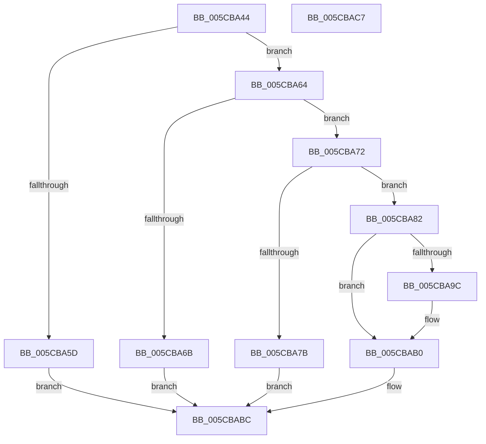

# KsepLoadShimProvider

- RVA: `0x005CBA44`–`0x005CBAC8` (길이 `132` bytes)
- VA: `0x00000001405CBA44`
- 실행 섹션: `.text`
- PDB 이름 있음: `예`; PDB Function 태그: `아니요`
- unwind 정보 RVA: `0x0006E5F8`
- 디코드: `40`개 명령, `132/132` bytes 표시
- 미해석 바이트: `0` (있으면 어셈블리에 `.byte`로 보존)

> 이 문서는 커널 이미지의 기계어와 PDB 기호를 분석해 생성했습니다. 4번과 5번은 함수 원형과 자료형을 바이너리 사용 방식에서 추정한 C 해석이며 원본 소스 복구 결과는 아닙니다.

## 1. Dependencies

- 직접 호출 지점: **3**; 고유 호출 대상: **3**
- 직접 호출자로 확인된 함수: **1**
- RIP 상대 이미지 참조: **1**

### Outgoing calls
- `0x005CBA91` → [KsepStringConcatenate](../../page/95/KsepStringConcatenate_function_0095A8A0.md) (function, `0x0095A8A0`)
- `0x005CBAA1` → [ZwLoadDriver](../6A/ZwLoadDriver_function_006AF290.md) (function, `0x006AF290`)
- `0x005CBAB5` → [KsepStringFree](../../page/95/KsepStringFree_function_0095A1B8.md) (function, `0x0095A1B8`)

### Direct callers
- [KsepResolveApplicableShimsForDriver](../../page/74/KsepResolveApplicableShimsForDriver_function_0074A168.md) at `0x0074A296`

### Static image references
- `0x005CBA85` → RVA `0x006CBD40` (` ?? ::FNODOBFM::`string'`; read)

## 2. Other-region calls and transfers

- 다른 실행 섹션으로 향하는 call: **2**
  - `0x005CBA91` → [KsepStringConcatenate](../../page/95/KsepStringConcatenate_function_0095A8A0.md) (`.text` → `PAGE`)
  - `0x005CBAB5` → [KsepStringFree](../../page/95/KsepStringFree_function_0095A1B8.md) (`.text` → `PAGE`)
- 별도 외부 분기/꼬리 이동을 확인하지 못했습니다.

## 3. Assembly (complete function range)

```asm
005CBA44  48 89 5C 24 08                  mov qword ptr [rsp + 8], rbx
005CBA49  57                              push rdi
005CBA4A  48 83 EC 30                     sub rsp, 0x30
005CBA4E  33 FF                           xor edi, edi
005CBA50  0F 57 C0                        xorps xmm0, xmm0
005CBA53  0F 11 44 24 20                  movups xmmword ptr [rsp + 0x20], xmm0
005CBA58  48 85 C9                        test rcx, rcx
005CBA5B  75 07                           jne 0x1405cba64
005CBA5D  B8 0D 00 00 C0                  mov eax, 0xc000000d
005CBA62  EB 58                           jmp 0x1405cbabc
005CBA64  8B 41 40                        mov eax, dword ptr [rcx + 0x40]
005CBA67  A8 02                           test al, 2
005CBA69  75 07                           jne 0x1405cba72
005CBA6B  B8 BB 00 00 C0                  mov eax, 0xc00000bb
005CBA70  EB 4A                           jmp 0x1405cbabc
005CBA72  4C 8B 41 28                     mov r8, qword ptr [rcx + 0x28]
005CBA76  4D 85 C0                        test r8, r8
005CBA79  75 07                           jne 0x1405cba82
005CBA7B  B8 01 00 00 C0                  mov eax, 0xc0000001
005CBA80  EB 3A                           jmp 0x1405cbabc
005CBA82  45 33 C9                        xor r9d, r9d
005CBA85  48 8D 15 B4 02 10 00            lea rdx, [rip + 0x1002b4]
005CBA8C  48 8D 4C 24 20                  lea rcx, [rsp + 0x20]
005CBA91  E8 0A EE 38 00                  call 0x14095a8a0
005CBA96  8B D8                           mov ebx, eax
005CBA98  85 C0                           test eax, eax
005CBA9A  78 14                           js 0x1405cbab0
005CBA9C  48 8D 4C 24 20                  lea rcx, [rsp + 0x20]
005CBAA1  E8 EA 37 0E 00                  call 0x1406af290
005CBAA6  3D 0E 01 00 C0                  cmp eax, 0xc000010e
005CBAAB  8B D8                           mov ebx, eax
005CBAAD  0F 44 DF                        cmove ebx, edi
005CBAB0  48 8D 4C 24 20                  lea rcx, [rsp + 0x20]
005CBAB5  E8 FE E6 38 00                  call 0x14095a1b8
005CBABA  8B C3                           mov eax, ebx
005CBABC  48 8B 5C 24 40                  mov rbx, qword ptr [rsp + 0x40]
005CBAC1  48 83 C4 30                     add rsp, 0x30
005CBAC5  5F                              pop rdi
005CBAC6  C3                              ret
005CBAC7  CC                              int3
```

## 4. C-style interpretation (structured pseudocode)

```c
__int64 __fastcall KsepLoadShimProvider(__int64 a1, __int64 a2, __int64 a3, int a4)
{
    __int64 result;
    __int64 v_rbx;
    __int64 v_rdi;
    __int64 v_rsp;
    unsigned __int64 v_stack_m18;
    unsigned __int64 v_stack_p8;

    v_stack_p8 = v_rbx;
    v_rsp = (v_rsp) - (48);
    v_rdi = 0;
    v_stack_m18 = v_xmm0;
    if (a1 != 0) goto loc_005CBA64;
    goto loc_005CBABC;
loc_005CBA64:
    if ((((unsigned __int8)((unsigned int)(*(unsigned int *)(a1 + 64)))) & (2)) != 0) goto loc_005CBA72;
    goto loc_005CBABC;
loc_005CBA72:
    if (*(unsigned __int64 *)(a1 + 40) != 0) goto loc_005CBA82;
    goto loc_005CBABC;
loc_005CBA82:
    a4 = 0;
    result = KsepStringConcatenate(v_stack_m18, v_rip + 1049268, *(unsigned __int64 *)(a1 + 40), a4);
    v_rbx = (unsigned int)((unsigned int)(result));
    if (!(sign_flag)) {
        a1 = v_stack_m18;
        result = ZwLoadDriver(a1, v_rip + 1049268, *(unsigned __int64 *)(a1 + 40), a4);
        v_rbx = (unsigned int)(result);
        if (((unsigned int)(result)) == 0xC000010EULL) { v_rbx = 0; }
    }
    result = KsepStringFree(v_stack_m18, v_rip + 1049268, *(unsigned __int64 *)(a1 + 40), a4);
loc_005CBABC:
    v_rsp = (v_rsp) + (48);
    return (unsigned int)((unsigned int)(v_rbx));
}
```

## 5. (Beta) C Style

```c
int64_t KsepLoadShimProvider(int64_t Arg1, int64_t Arg2, int64_t Arg3, int32_t Arg4)
{
    int64_t result;
    int64_t local_rbx;
    int64_t local_rdi;
    int64_t local_rsp;
    uint64_t v_stack_m18;
    uint64_t v_stack_p8;

    v_stack_p8 = local_rbx;
    local_rsp = (local_rsp) - (48);
    local_rdi = 0;
    v_stack_m18 = v_xmm0;
    if (Arg1 != 0) goto loc_005CBA64;
    goto loc_005CBABC;
loc_005CBA64:
    if ((((uint8_t)((uint32_t)(*(uint32_t *)(Arg1 + 0x40)))) & (2)) != 0) goto loc_005CBA72;
    goto loc_005CBABC;
loc_005CBA72:
    if (*(uint64_t *)(Arg1 + 0x28) != 0) goto loc_005CBA82;
    goto loc_005CBABC;
loc_005CBA82:
    Arg4 = 0;
    result = KsepStringConcatenate(v_stack_m18, v_rip + 1049268, *(uint64_t *)(Arg1 + 0x28), Arg4);
    local_rbx = (uint32_t)((uint32_t)(result));
    if (!(sign_flag)) {
        Arg1 = v_stack_m18;
        result = ZwLoadDriver(Arg1, v_rip + 1049268, *(uint64_t *)(Arg1 + 0x28), Arg4);
        local_rbx = (uint32_t)(result);
        if (((uint32_t)(result)) == 0xC000010EULL) { local_rbx = 0; }
    }
    result = KsepStringFree(v_stack_m18, v_rip + 1049268, *(uint64_t *)(Arg1 + 0x28), Arg4);
loc_005CBABC:
    local_rsp = (local_rsp) + (48);
    return (uint32_t)((uint32_t)(local_rbx));
}
```

## 6. Execution-region graph

[열기: 2D/3D 그래프와 함수 탐색 컨트롤 패널](../../../control-panel.html?section=text&rva=0x005CBA44&view=graph)

- 2D 그래프는 위에서 아래로 흐르고, 3D 그래프는 빈 공간을 드래그해 회전합니다. Shift+드래그는 이동, 휠은 확대·축소, 함수 노드 선택은 대상 보고서 이동입니다.

### Static fallback


