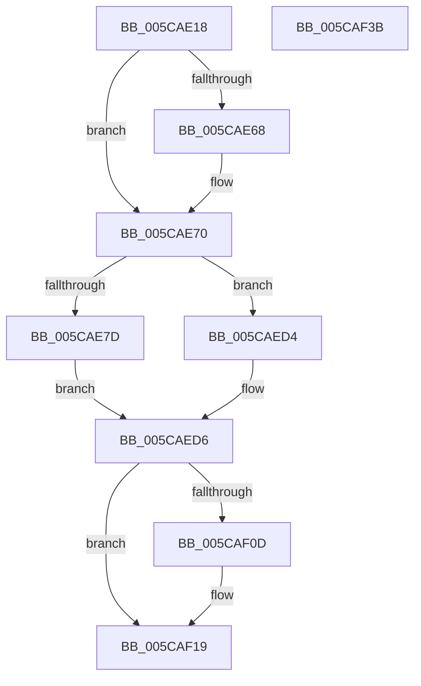

# KxFlushSingleTb

- RVA: `0x005CAE18`–`0x005CAF3C` (길이 `292` bytes)
- VA: `0x00000001405CAE18`
- 실행 섹션: `.text`
- PDB 이름 있음: `예`; PDB Function 태그: `아니요`
- unwind 정보 RVA: `0x0007EE78`
- 디코드: `75`개 명령, `292/292` bytes 표시
- 미해석 바이트: `0` (있으면 어셈블리에 `.byte`로 보존)

> 이 문서는 커널 이미지의 기계어와 PDB 기호를 분석해 생성했습니다. 4번과 5번은 함수 원형과 자료형을 바이너리 사용 방식에서 추정한 C 해석이며 원본 소스 복구 결과는 아닙니다.

## 1. Dependencies

- 직접 호출 지점: **6**; 고유 호출 대상: **6**
- 직접 호출자로 확인된 함수: **1**
- RIP 상대 이미지 참조: **2**

### Outgoing calls
- `0x005CAE6B` → [KiRaiseIrqlProcessIrqlFlags](../4F/KiRaiseIrqlProcessIrqlFlags_function_004F56FC.md) (function, `0x004F56FC`)
- `0x005CAEB0` → [memset](../6C/memset_function_006C6C40.md) (function, `0x006C6C40`)
- `0x005CAEBF` → [KiCopyAffinityEx](../2C/KiCopyAffinityEx_function_002CE860.md) (function, `0x002CE860`)
- `0x005CAECA` → [KeRemoveProcessorAffinityEx](../30/KeRemoveProcessorAffinityEx_function_00304E10.md) (function, `0x00304E10`)
- `0x005CAEFF` → [KiIpiSendRequestEx](../31/KiIpiSendRequestEx_function_003112D0.md) (function, `0x003112D0`)
- `0x005CAF14` → [KiLowerIrqlProcessIrqlFlags](../4F/KiLowerIrqlProcessIrqlFlags_function_004F5698.md) (function, `0x004F5698`)

### Direct callers
- [KeFlushSingleTb](../5B/KeFlushSingleTb_function_005BDE84.md) at `0x005BDFCB`

### Static image references
- `0x005CAE5F` → RVA `0x00FC6D20` (`ALMOSTRO`; read)
- `0x005CAEE8` → RVA `0x005CAD90` (`KiFlushSingleTbWorker`; read)

## 2. Other-region calls and transfers

- 다른 실행 섹션으로 향하는 call: **0**
- 별도 외부 분기/꼬리 이동을 확인하지 못했습니다.

## 3. Assembly (complete function range)

```asm
005CAE18  48 8B C4                        mov rax, rsp
005CAE1B  48 89 58 08                     mov qword ptr [rax + 8], rbx
005CAE1F  48 89 68 10                     mov qword ptr [rax + 0x10], rbp
005CAE23  48 89 70 18                     mov qword ptr [rax + 0x18], rsi
005CAE27  57                              push rdi
005CAE28  41 56                           push r14
005CAE2A  41 57                           push r15
005CAE2C  48 83 EC 50                     sub rsp, 0x50
005CAE30  83 60 E4 00                     and dword ptr [rax - 0x1c], 0
005CAE34  41 BE 02 00 00 80               mov r14d, 0x80000002
005CAE3A  89 50 E0                        mov dword ptr [rax - 0x20], edx
005CAE3D  41 8B D8                        mov ebx, r8d
005CAE40  48 89 48 D8                     mov qword ptr [rax - 0x28], rcx
005CAE44  B8 02 00 00 00                  mov eax, 2
005CAE49  44 8D 78 FF                     lea r15d, [rax - 1]
005CAE4D  45 3B C7                        cmp r8d, r15d
005CAE50  44 0F 45 F0                     cmovne r14d, eax
005CAE54  44 0F 20 C7                     mov rdi, cr8
005CAE58  8D 50 0A                        lea edx, [rax + 0xa]
005CAE5B  44 0F 22 C2                     mov cr8, rdx
005CAE5F  83 3D BA BE 9F 00 00            cmp dword ptr [rip + 0x9fbeba], 0
005CAE66  74 08                           je 0x1405cae70
005CAE68  40 8A CF                        mov cl, dil
005CAE6B  E8 8C A8 F2 FF                  call 0x1404f56fc
005CAE70  65 48 8B 2C 25 20 00 00 00      mov rbp, qword ptr gs:[0x20]
005CAE79  85 DB                           test ebx, ebx
005CAE7B  75 57                           jne 0x1405caed4
005CAE7D  F0 09 1C 24                     lock or dword ptr [rsp], ebx
005CAE81  48 8B 45 08                     mov rax, qword ptr [rbp + 8]
005CAE85  48 8D B5 B8 2D 00 00            lea rsi, [rbp + 0x2db8]
005CAE8C  33 D2                           xor edx, edx
005CAE8E  41 B8 00 01 00 00               mov r8d, 0x100
005CAE94  48 8B 88 B8 00 00 00            mov rcx, qword ptr [rax + 0xb8]
005CAE9B  48 8B 99 80 00 00 00            mov rbx, qword ptr [rcx + 0x80]
005CAEA2  48 8D 4E 08                     lea rcx, [rsi + 8]
005CAEA6  83 66 04 00                     and dword ptr [rsi + 4], 0
005CAEAA  C7 06 01 00 20 00               mov dword ptr [rsi], 0x200001
005CAEB0  E8 8B BD 0F 00                  call 0x1406c6c40
005CAEB5  0F B7 56 02                     movzx edx, word ptr [rsi + 2]
005CAEB9  4C 8B C3                        mov r8, rbx
005CAEBC  48 8B CE                        mov rcx, rsi
005CAEBF  E8 9C 39 D0 FF                  call 0x1402ce860
005CAEC4  8B 55 24                        mov edx, dword ptr [rbp + 0x24]
005CAEC7  48 8B CE                        mov rcx, rsi
005CAECA  E8 41 9F D3 FF                  call 0x140304e10
005CAECF  45 33 FF                        xor r15d, r15d
005CAED2  EB 02                           jmp 0x1405caed6
005CAED4  33 F6                           xor esi, esi
005CAED6  48 8D 44 24 40                  lea rax, [rsp + 0x40]
005CAEDB  4C 8B C6                        mov r8, rsi
005CAEDE  48 89 44 24 30                  mov qword ptr [rsp + 0x30], rax
005CAEE3  4C 8D 4C 24 40                  lea r9, [rsp + 0x40]
005CAEE8  48 8D 05 A1 FE FF FF            lea rax, [rip - 0x15f]
005CAEEF  41 8B D7                        mov edx, r15d
005CAEF2  48 89 44 24 28                  mov qword ptr [rsp + 0x28], rax
005CAEF7  48 8B CD                        mov rcx, rbp
005CAEFA  4C 89 74 24 20                  mov qword ptr [rsp + 0x20], r14
005CAEFF  E8 CC 63 D4 FF                  call 0x1403112d0
005CAF04  83 3D 15 BE 9F 00 00            cmp dword ptr [rip + 0x9fbe15], 0
005CAF0B  74 0C                           je 0x1405caf19
005CAF0D  44 0F 20 C1                     mov rcx, cr8
005CAF11  40 8A D7                        mov dl, dil
005CAF14  E8 7F A7 F2 FF                  call 0x1404f5698
005CAF19  40 0F B6 C7                     movzx eax, dil
005CAF1D  44 0F 22 C0                     mov cr8, rax
005CAF21  4C 8D 5C 24 50                  lea r11, [rsp + 0x50]
005CAF26  49 8B 5B 20                     mov rbx, qword ptr [r11 + 0x20]
005CAF2A  49 8B 6B 28                     mov rbp, qword ptr [r11 + 0x28]
005CAF2E  49 8B 73 30                     mov rsi, qword ptr [r11 + 0x30]
005CAF32  49 8B E3                        mov rsp, r11
005CAF35  41 5F                           pop r15
005CAF37  41 5E                           pop r14
005CAF39  5F                              pop rdi
005CAF3A  C3                              ret
005CAF3B  CC                              int3
```

## 4. C-style interpretation (structured pseudocode)

```c
__int64 __fastcall KxFlushSingleTb(__int64 a1, int a2, int a3)
{
    __int64 result;
    __int64 v_r14;
    __int64 v_r15;
    __int64 v_rsi;
    __int64 v_rsp;
    unsigned __int64 v_stack_m18;
    unsigned __int64 v_stack_m28;
    unsigned __int64 v_stack_m38;
    unsigned __int64 v_stack_m40;
    unsigned __int64 v_stack_m48;
    unsigned int v_stack_m68;

    *(unsigned __int64 *)(v_rsp + 8) = v_rbx;
    *(unsigned __int64 *)(v_rsp + 16) = v_rbp;
    *(unsigned __int64 *)(v_rsp + 24) = v_rsi;
    v_rsp = (v_rsp) - (80);
    *(unsigned int *)(v_rsp - 32) = a2;
    *(unsigned __int64 *)(v_rsp - 40) = a1;
    v_r14 = (unsigned int)(0x80000002ULL);
    if (a3 != ((unsigned int)(2 - 1))) { v_r14 = 2; }
    result = 2;
    if ((*(unsigned int *)(v_rip + 10469050)) != 0) {
        a1 = (unsigned __int8)(v_cr8);
        result = KiRaiseIrqlProcessIrqlFlags(a1, 2 + 10, a3, a4);
    }
    if ((unsigned int)((unsigned int)(a3)) != 0) goto loc_005CAED4;
    a2 = 0;
    *(unsigned int *)(*(unsigned __int64 *)(gs_base + (0 + 32)) + 11704) = 0x200001ULL;
    result = memset(*(unsigned __int64 *)(gs_base + (0 + 32)) + 11704 + 8, a2, 256, a4);
    result = KiCopyAffinityEx(*(unsigned __int64 *)(gs_base + (0 + 32)) + 11704, *(unsigned __int16 *)(*(unsigned __int64 *)(gs_base + (0 + 32)) + 11704 + 2), *(unsigned __int64 *)(*(unsigned __int64 *)(*(unsigned __int64 *)(*(unsigned __int64 *)(gs_base + (0 + 32)) + 8) + 184) + 128), a4);
    result = KeRemoveProcessorAffinityEx(*(unsigned __int64 *)(gs_base + (0 + 32)) + 11704, (unsigned int)(*(unsigned int *)(*(unsigned __int64 *)(gs_base + (0 + 32)) + 36)), *(unsigned __int64 *)(*(unsigned __int64 *)(*(unsigned __int64 *)(*(unsigned __int64 *)(gs_base + (0 + 32)) + 8) + 184) + 128), a4);
    v_r15 = 0;
    goto loc_005CAED6;
loc_005CAED4:
    v_rsi = 0;
loc_005CAED6:
    v_stack_m38 = v_stack_m28;
    v_stack_m40 = v_rip - 351;
    v_stack_m48 = v_r14;
    result = KiIpiSendRequestEx(*(unsigned __int64 *)(gs_base + (0 + 32)), 0, 0, v_stack_m28);
    if ((*(unsigned int *)(v_rip + 10468885)) != 0) {
        a1 = 2 + 10;
        a2 = (unsigned __int8)(v_cr8);
        result = KiLowerIrqlProcessIrqlFlags(a1, a2, 0, v_stack_m28);
    }
    return (unsigned __int8)(v_cr8);
}
```

## 5. (Beta) C Style

```c
int64_t KxFlushSingleTb(int64_t Arg1, int32_t Arg2, int32_t Arg3)
{
    int64_t result;
    int64_t local_r14;
    int64_t local_r15;
    int64_t local_rsi;
    int64_t local_rsp;
    uint64_t v_stack_m18;
    uint64_t v_stack_m28;
    uint64_t v_stack_m38;
    uint64_t v_stack_m40;
    uint64_t v_stack_m48;
    uint32_t v_stack_m68;

    *(uint64_t *)(local_rsp + 0x8) = local_rbx;
    *(uint64_t *)(local_rsp + 0x10) = local_rbp;
    *(uint64_t *)(local_rsp + 0x18) = local_rsi;
    local_rsp = (local_rsp) - (80);
    *(uint32_t *)(local_rsp - 0x20) = Arg2;
    *(uint64_t *)(local_rsp - 0x28) = Arg1;
    local_r14 = (uint32_t)(0x80000002ULL);
    if (Arg3 != ((uint32_t)(2 - 1))) { local_r14 = 2; }
    result = 2;
    if ((*(uint32_t *)(v_rip + 0x9FBEBA)) != 0) {
        Arg1 = (uint8_t)(v_cr8);
        result = KiRaiseIrqlProcessIrqlFlags(Arg1, 2 + 10, Arg3, a4);
    }
    if ((uint32_t)((uint32_t)(Arg3)) != 0) goto loc_005CAED4;
    Arg2 = 0;
    *(uint32_t *)(*(uint64_t *)(gs_base + (0 + 0x20)) + 0x2DB8) = 0x200001ULL;
    result = memset(*(uint64_t *)(gs_base + (0 + 0x20)) + 11704 + 8, Arg2, 256, a4);
    result = KiCopyAffinityEx(*(uint64_t *)(gs_base + (0 + 0x20)) + 11704, *(uint16_t *)(*(uint64_t *)(gs_base + (0 + 0x20)) + 0x2DB8 + 0x2), *(uint64_t *)(*(uint64_t *)(*(uint64_t *)(*(uint64_t *)(gs_base + (0 + 0x20)) + 0x8) + 0xB8) + 0x80), a4);
    result = KeRemoveProcessorAffinityEx(*(uint64_t *)(gs_base + (0 + 0x20)) + 11704, (uint32_t)(*(uint32_t *)(*(uint64_t *)(gs_base + (0 + 0x20)) + 0x24)), *(uint64_t *)(*(uint64_t *)(*(uint64_t *)(*(uint64_t *)(gs_base + (0 + 0x20)) + 0x8) + 0xB8) + 0x80), a4);
    local_r15 = 0;
    goto loc_005CAED6;
loc_005CAED4:
    local_rsi = 0;
loc_005CAED6:
    v_stack_m38 = v_stack_m28;
    v_stack_m40 = v_rip - 351;
    v_stack_m48 = local_r14;
    result = KiIpiSendRequestEx(*(uint64_t *)(gs_base + (0 + 0x20)), 0, 0, v_stack_m28);
    if ((*(uint32_t *)(v_rip + 0x9FBE15)) != 0) {
        Arg1 = 2 + 10;
        Arg2 = (uint8_t)(v_cr8);
        result = KiLowerIrqlProcessIrqlFlags(Arg1, Arg2, 0, v_stack_m28);
    }
    return (uint8_t)(v_cr8);
}
```

## 6. Execution-region graph

[열기: 2D/3D 그래프와 함수 탐색 컨트롤 패널](../../../control-panel.html?section=text&rva=0x005CAE18&view=graph)

- 2D 그래프는 위에서 아래로 흐르고, 3D 그래프는 빈 공간을 드래그해 회전합니다. Shift+드래그는 이동, 휠은 확대·축소, 함수 노드 선택은 대상 보고서 이동입니다.

### Static fallback


