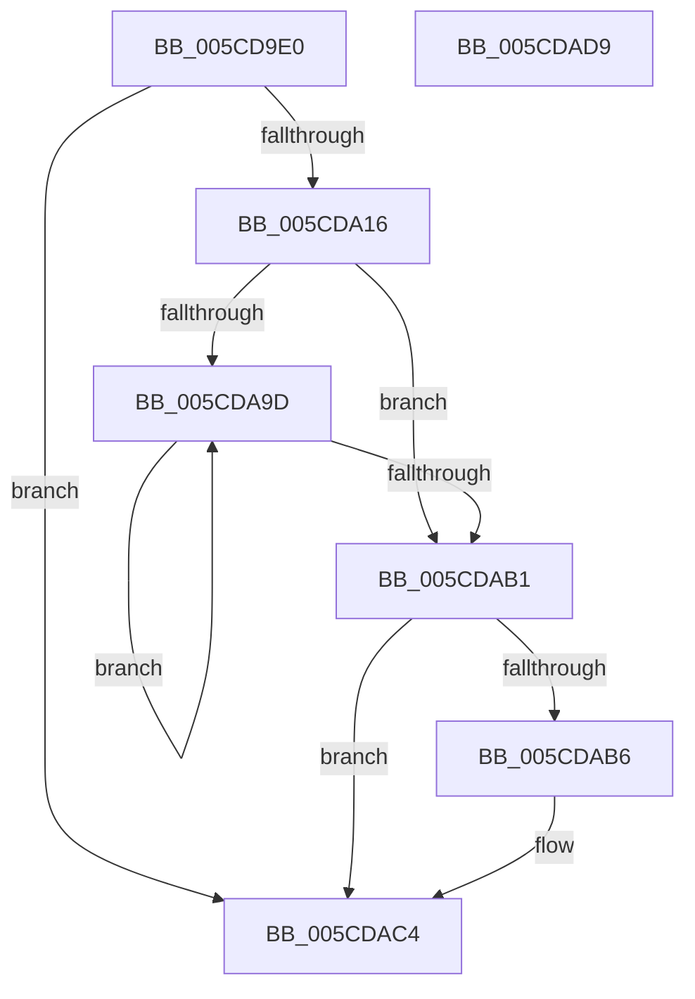

# ObpDeferPushRefDerefInfo

- RVA: `0x005CD9E0`–`0x005CDADA` (길이 `250` bytes)
- VA: `0x00000001405CD9E0`
- 실행 섹션: `.text`
- PDB 이름 있음: `예`; PDB Function 태그: `아니요`
- unwind 정보 RVA: `0x0005C954`
- 디코드: `59`개 명령, `250/250` bytes 표시
- 미해석 바이트: `0` (있으면 어셈블리에 `.byte`로 보존)

> 이 문서는 커널 이미지의 기계어와 PDB 기호를 분석해 생성했습니다. 4번과 5번은 함수 원형과 자료형을 바이너리 사용 방식에서 추정한 C 해석이며 원본 소스 복구 결과는 아닙니다.

## 1. Dependencies

- 직접 호출 지점: **2**; 고유 호출 대상: **2**
- 직접 호출자로 확인된 함수: **1**
- RIP 상대 이미지 참조: **3**

### Outgoing calls
- `0x005CDA08` → [ExpInterlockedPopEntrySList](../6B/ExpInterlockedPopEntrySList_function_006BA570.md) (function, `0x006BA570`)
- `0x005CDABF` → [ExQueueWorkItem](../2F/ExQueueWorkItem_function_002F9520.md) (function, `0x002F9520`)

### Direct callers
- [ObpPushStackInfo](../21/ObpPushStackInfo_function_002109E4.md) at `0x00210AD8`

### Static image references
- `0x005CD9FA` → RVA `0x00E27600` (`.data`; read)
- `0x005CDA85` → RVA `0x00F0F540` (`.data`; read)
- `0x005CDAB8` → RVA `0x00F0F560` (`.data`; read)

## 2. Other-region calls and transfers

- 다른 실행 섹션으로 향하는 call: **0**
- 별도 외부 분기/꼬리 이동을 확인하지 못했습니다.

## 3. Assembly (complete function range)

```asm
005CD9E0  48 89 5C 24 08                  mov qword ptr [rsp + 8], rbx
005CD9E5  48 89 6C 24 10                  mov qword ptr [rsp + 0x10], rbp
005CD9EA  48 89 74 24 18                  mov qword ptr [rsp + 0x18], rsi
005CD9EF  57                              push rdi
005CD9F0  48 83 EC 20                     sub rsp, 0x20
005CD9F4  48 8B E9                        mov rbp, rcx
005CD9F7  41 8B D9                        mov ebx, r9d
005CD9FA  48 8D 0D FF 9B 85 00            lea rcx, [rip + 0x859bff]
005CDA01  41 0F B7 F8                     movzx edi, r8w
005CDA05  40 8A F2                        mov sil, dl
005CDA08  E8 63 CB 0E 00                  call 0x1406ba570
005CDA0D  48 85 C0                        test rax, rax
005CDA10  0F 84 AE 00 00 00               je 0x1405cdac4
005CDA16  4C 8D 50 10                     lea r10, [rax + 0x10]
005CDA1A  8B 44 24 58                     mov eax, dword ptr [rsp + 0x58]
005CDA1E  41 89 42 14                     mov dword ptr [r10 + 0x14], eax
005CDA22  48 8B 44 24 50                  mov rax, qword ptr [rsp + 0x50]
005CDA27  49 89 6A 08                     mov qword ptr [r10 + 8], rbp
005CDA2B  41 88 72 10                     mov byte ptr [r10 + 0x10], sil
005CDA2F  66 41 89 7A 12                  mov word ptr [r10 + 0x12], di
005CDA34  41 89 5A 18                     mov dword ptr [r10 + 0x18], ebx
005CDA38  0F 28 00                        movaps xmm0, xmmword ptr [rax]
005CDA3B  41 0F 11 42 20                  movups xmmword ptr [r10 + 0x20], xmm0
005CDA40  0F 28 48 10                     movaps xmm1, xmmword ptr [rax + 0x10]
005CDA44  41 0F 11 4A 30                  movups xmmword ptr [r10 + 0x30], xmm1
005CDA49  0F 28 40 20                     movaps xmm0, xmmword ptr [rax + 0x20]
005CDA4D  41 0F 11 42 40                  movups xmmword ptr [r10 + 0x40], xmm0
005CDA52  0F 28 48 30                     movaps xmm1, xmmword ptr [rax + 0x30]
005CDA56  41 0F 11 4A 50                  movups xmmword ptr [r10 + 0x50], xmm1
005CDA5B  0F 28 40 40                     movaps xmm0, xmmword ptr [rax + 0x40]
005CDA5F  41 0F 11 42 60                  movups xmmword ptr [r10 + 0x60], xmm0
005CDA64  0F 28 48 50                     movaps xmm1, xmmword ptr [rax + 0x50]
005CDA68  41 0F 11 4A 70                  movups xmmword ptr [r10 + 0x70], xmm1
005CDA6D  0F 28 40 60                     movaps xmm0, xmmword ptr [rax + 0x60]
005CDA71  41 0F 11 82 80 00 00 00         movups xmmword ptr [r10 + 0x80], xmm0
005CDA79  0F 28 48 70                     movaps xmm1, xmmword ptr [rax + 0x70]
005CDA7D  41 0F 11 8A 90 00 00 00         movups xmmword ptr [r10 + 0x90], xmm1
005CDA85  48 8B 0D B4 1A 94 00            mov rcx, qword ptr [rip + 0x941ab4]
005CDA8C  49 89 0A                        mov qword ptr [r10], rcx
005CDA8F  48 8B C1                        mov rax, rcx
005CDA92  F0 4C 0F B1 15 A5 1A 94 00      lock cmpxchg qword ptr [rip + 0x941aa5], r10
005CDA9B  74 14                           je 0x1405cdab1
005CDA9D  48 8B C8                        mov rcx, rax
005CDAA0  49 89 02                        mov qword ptr [r10], rax
005CDAA3  F0 4C 0F B1 15 94 1A 94 00      lock cmpxchg qword ptr [rip + 0x941a94], r10
005CDAAC  48 3B C1                        cmp rax, rcx
005CDAAF  75 EC                           jne 0x1405cda9d
005CDAB1  48 85 C9                        test rcx, rcx
005CDAB4  75 0E                           jne 0x1405cdac4
005CDAB6  33 D2                           xor edx, edx
005CDAB8  48 8D 0D A1 1A 94 00            lea rcx, [rip + 0x941aa1]
005CDABF  E8 5C BA D2 FF                  call 0x1402f9520
005CDAC4  48 8B 5C 24 30                  mov rbx, qword ptr [rsp + 0x30]
005CDAC9  48 8B 6C 24 38                  mov rbp, qword ptr [rsp + 0x38]
005CDACE  48 8B 74 24 40                  mov rsi, qword ptr [rsp + 0x40]
005CDAD3  48 83 C4 20                     add rsp, 0x20
005CDAD7  5F                              pop rdi
005CDAD8  C3                              ret
005CDAD9  CC                              int3
```

## 4. C-style interpretation (structured pseudocode)

```c
__int64 __fastcall ObpDeferPushRefDerefInfo(__int64 a1, int a2, unsigned __int16 a3, int a4, __int64 a5, unsigned int a6)
{
    __int64 result;
    __int64 v_rsp;
    unsigned __int64 v_stack_p10;
    unsigned __int64 v_stack_p18;
    unsigned __int64 v_stack_p8;

    v_stack_p8 = v_rbx;
    v_stack_p10 = v_rbp;
    v_stack_p18 = v_rsi;
    v_rsp = (v_rsp) - (32);
    result = ExpInterlockedPopEntrySList(v_rip + 8756223, a2, a3, a4);
    if (result == 0) goto loc_005CDAC4;
    *(unsigned int *)(result + 16 + 20) = (unsigned int)((unsigned int)(a6));
    *(unsigned __int64 *)(result + 16 + 8) = a1;
    *(unsigned __int8 *)(result + 16 + 16) = (unsigned __int8)((unsigned __int8)(a2));
    *(unsigned __int16 *)(result + 16 + 18) = a3;
    *(unsigned int *)(result + 16 + 24) = (unsigned int)((unsigned int)(a4));
    *(unsigned __int64 *)(result + 16 + 32) = v_xmm0;
    *(unsigned __int64 *)(result + 16 + 48) = v_xmm1;
    *(unsigned __int64 *)(result + 16 + 64) = v_xmm0;
    *(unsigned __int64 *)(result + 16 + 80) = v_xmm1;
    *(unsigned __int64 *)(result + 16 + 96) = v_xmm0;
    *(unsigned __int64 *)(result + 16 + 112) = v_xmm1;
    *(unsigned __int64 *)(result + 16 + 128) = v_xmm0;
    *(unsigned __int64 *)(result + 16 + 144) = v_xmm1;
    *(unsigned __int64 *)(result + 16) = *(unsigned __int64 *)(v_rip + 9706164);
    if (result == 0) goto loc_005CDAB1;
loc_005CDA9D:
    *(unsigned __int64 *)(result + 16) = *(unsigned __int64 *)(v_rip + 9706164);
    if ((*(unsigned __int64 *)(v_rip + 9706164)) != (*(unsigned __int64 *)(v_rip + 9706164))) goto loc_005CDA9D;
loc_005CDAB1:
    result = *(unsigned __int64 *)(v_rip + 9706164);
    if (*(unsigned __int64 *)(v_rip + 9706164) == 0) {
        a2 = 0;
        a1 = v_rip + 9706145;
        result = ExQueueWorkItem(a1, a2, a3, a4);
    }
    v_rsp = (v_rsp) + (32);
    return result;
}
```

## 5. (Beta) C Style

```c
int64_t ObpDeferPushRefDerefInfo(int64_t Arg1, int32_t Arg2, uint16_t Arg3, int32_t Arg4, void *Arg5, uint32_t Arg6)
{
    uint8_t *arg5 = (uint8_t *)Arg5;

    int64_t result;
    int64_t local_rsp;
    uint64_t v_stack_p10;
    uint64_t v_stack_p18;
    uint64_t v_stack_p8;

    v_stack_p8 = local_rbx;
    v_stack_p10 = local_rbp;
    v_stack_p18 = local_rsi;
    local_rsp = (local_rsp) - (32);
    result = ExpInterlockedPopEntrySList(v_rip + 8756223, Arg2, Arg3, Arg4);
    if (result == 0) goto loc_005CDAC4;
    *(uint32_t *)(result + 0x10 + 0x14) = (uint32_t)((uint32_t)(Arg6));
    *(uint64_t *)(result + 0x10 + 0x8) = Arg1;
    *(uint8_t *)(result + 0x10 + 0x10) = (uint8_t)((uint8_t)(Arg2));
    *(uint16_t *)(result + 0x10 + 0x12) = Arg3;
    *(uint32_t *)(result + 0x10 + 0x18) = (uint32_t)((uint32_t)(Arg4));
    *(uint64_t *)(result + 0x10 + 0x20) = v_xmm0;
    *(uint64_t *)(result + 0x10 + 0x30) = v_xmm1;
    *(uint64_t *)(result + 0x10 + 0x40) = v_xmm0;
    *(uint64_t *)(result + 0x10 + 0x50) = v_xmm1;
    *(uint64_t *)(result + 0x10 + 0x60) = v_xmm0;
    *(uint64_t *)(result + 0x10 + 0x70) = v_xmm1;
    *(uint64_t *)(result + 0x10 + 0x80) = v_xmm0;
    *(uint64_t *)(result + 0x10 + 0x90) = v_xmm1;
    *(uint64_t *)(result + 0x10) = *(uint64_t *)(v_rip + 0x941AB4);
    if (result == 0) goto loc_005CDAB1;
loc_005CDA9D:
    *(uint64_t *)(result + 0x10) = *(uint64_t *)(v_rip + 0x941AB4);
    if ((*(uint64_t *)(v_rip + 0x941AB4)) != (*(uint64_t *)(v_rip + 0x941AB4))) goto loc_005CDA9D;
loc_005CDAB1:
    result = *(uint64_t *)(v_rip + 0x941AB4);
    if (*(uint64_t *)(v_rip + 0x941AB4) == 0) {
        Arg2 = 0;
        Arg1 = v_rip + 9706145;
        result = ExQueueWorkItem(Arg1, Arg2, Arg3, Arg4);
    }
    local_rsp = (local_rsp) + (32);
    return result;
}
```

### 관측된 메모리 오프셋

구조체 형식이 확인되지 않은 접근은 인자 기준의 오프셋으로만 기록했습니다.

| 기준 인자 | 오프셋 표현 | 폭 (bit) | 접근 |
|---|---:|---:|---|
| `Arg5` | `+ 0x0` | `128` | `R` |
| `Arg5` | `+ 0x10` | `128` | `R` |
| `Arg5` | `+ 0x20` | `128` | `R` |
| `Arg5` | `+ 0x30` | `128` | `R` |
| `Arg5` | `+ 0x40` | `128` | `R` |
| `Arg5` | `+ 0x50` | `128` | `R` |
| `Arg5` | `+ 0x60` | `128` | `R` |
| `Arg5` | `+ 0x70` | `128` | `R` |

## 6. Execution-region graph

[열기: 2D/3D 그래프와 함수 탐색 컨트롤 패널](../../../control-panel.html?section=text&rva=0x005CD9E0&view=graph)

- 2D 그래프는 위에서 아래로 흐르고, 3D 그래프는 빈 공간을 드래그해 회전합니다. Shift+드래그는 이동, 휠은 확대·축소, 함수 노드 선택은 대상 보고서 이동입니다.

### Static fallback


