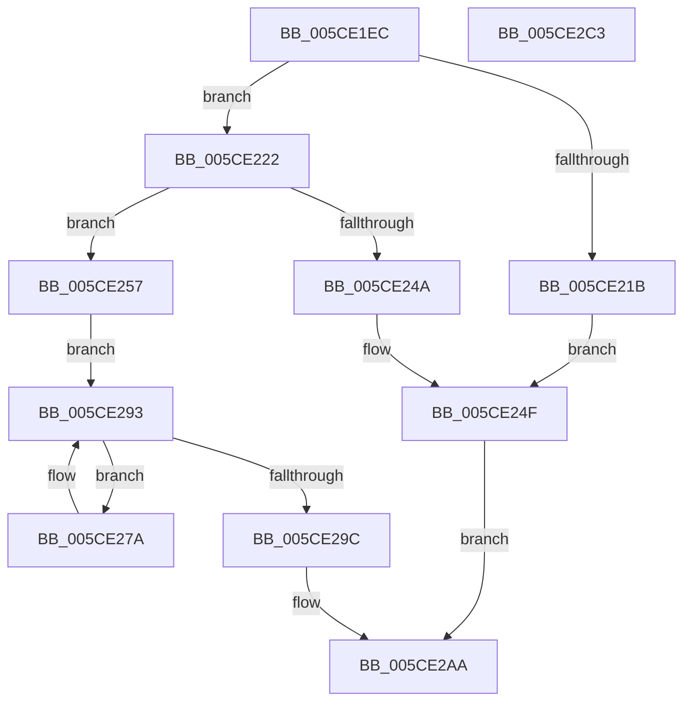

# PfFbBufferListAllocate

- RVA: `0x005CE1EC`–`0x005CE2C4` (길이 `216` bytes)
- VA: `0x00000001405CE1EC`
- 실행 섹션: `.text`
- PDB 이름 있음: `예`; PDB Function 태그: `아니요`
- unwind 정보 RVA: `0x00084C9C`
- 디코드: `67`개 명령, `216/216` bytes 표시
- 미해석 바이트: `0` (있으면 어셈블리에 `.byte`로 보존)

> 이 문서는 커널 이미지의 기계어와 PDB 기호를 분석해 생성했습니다. 4번과 5번은 함수 원형과 자료형을 바이너리 사용 방식에서 추정한 C 해석이며 원본 소스 복구 결과는 아닙니다.

## 1. Dependencies

- 직접 호출 지점: **3**; 고유 호출 대상: **3**
- 직접 호출자로 확인된 함수: **1**
- RIP 상대 이미지 참조: **0**

### Outgoing calls
- `0x005CE23D` → [ExAllocatePool2](../../poolcode/B8/ExAllocatePool2_function_00B820F0.md) (function, `0x00B820F0`)
- `0x005CE28B` → [PfFbBufferListInsertInFree](../48/PfFbBufferListInsertInFree_function_00484210.md) (function, `0x00484210`)
- `0x005CE2A3` → [ExpInterlockedPushEntrySList](../6B/ExpInterlockedPushEntrySList_function_006BA5B0.md) (function, `0x006BA5B0`)

### Direct callers
- [PfTStart](../../page/75/PfTStart_function_007517AC.md) at `0x00751A3D`
- [PfTStart](../../page/75/PfTStart_function_007517AC.md) at `0x00751A75`

### Static image references
- 디코드된 RIP-relative 메모리 참조가 없습니다.

## 2. Other-region calls and transfers

- 다른 실행 섹션으로 향하는 call: **1**
  - `0x005CE23D` → [ExAllocatePool2](../../poolcode/B8/ExAllocatePool2_function_00B820F0.md) (`.text` → `POOLCODE`)
- 별도 외부 분기/꼬리 이동을 확인하지 못했습니다.

## 3. Assembly (complete function range)

```asm
005CE1EC  48 89 5C 24 08                  mov qword ptr [rsp + 8], rbx
005CE1F1  48 89 6C 24 10                  mov qword ptr [rsp + 0x10], rbp
005CE1F6  48 89 74 24 18                  mov qword ptr [rsp + 0x18], rsi
005CE1FB  57                              push rdi
005CE1FC  41 56                           push r14
005CE1FE  41 57                           push r15
005CE200  48 83 EC 30                     sub rsp, 0x30
005CE204  48 63 FA                        movsxd rdi, edx
005CE207  45 8B F0                        mov r14d, r8d
005CE20A  8B C7                           mov eax, edi
005CE20C  48 8B D9                        mov rbx, rcx
005CE20F  F0 0F C1 41 70                  lock xadd dword ptr [rcx + 0x70], eax
005CE214  03 C7                           add eax, edi
005CE216  3B 41 58                        cmp eax, dword ptr [rcx + 0x58]
005CE219  7E 07                           jle 0x1405ce222
005CE21B  B8 2D 01 00 C0                  mov eax, 0xc000012d
005CE220  EB 2D                           jmp 0x1405ce24f
005CE222  44 8B 41 44                     mov r8d, dword ptr [rcx + 0x44]
005CE226  8D 47 E0                        lea eax, [rdi - 0x20]
005CE229  48 8B 49 48                     mov rcx, qword ptr [rcx + 0x48]
005CE22D  33 D2                           xor edx, edx
005CE22F  41 F7 F6                        div r14d
005CE232  48 8B D7                        mov rdx, rdi
005CE235  4C 8B FF                        mov r15, rdi
005CE238  8B E8                           mov ebp, eax
005CE23A  83 E5 F0                        and ebp, 0xfffffff0
005CE23D  E8 AE 3E 5B 00                  call 0x140b820f0
005CE242  48 8B F0                        mov rsi, rax
005CE245  48 85 C0                        test rax, rax
005CE248  75 0D                           jne 0x1405ce257
005CE24A  B8 9A 00 00 C0                  mov eax, 0xc000009a
005CE24F  F7 DF                           neg edi
005CE251  F0 01 7B 70                     lock add dword ptr [rbx + 0x70], edi
005CE255  EB 53                           jmp 0x1405ce2aa
005CE257  48 83 20 00                     and qword ptr [rax], 0
005CE25B  48 83 60 08 00                  and qword ptr [rax + 8], 0
005CE260  83 60 1C 00                     and dword ptr [rax + 0x1c], 0
005CE264  44 89 70 10                     mov dword ptr [rax + 0x10], r14d
005CE268  4C 03 FE                        add r15, rsi
005CE26B  89 78 18                        mov dword ptr [rax + 0x18], edi
005CE26E  48 8D 78 20                     lea rdi, [rax + 0x20]
005CE272  44 8B F5                        mov r14d, ebp
005CE275  89 68 14                        mov dword ptr [rax + 0x14], ebp
005CE278  EB 19                           jmp 0x1405ce293
005CE27A  83 64 24 20 00                  and dword ptr [rsp + 0x20], 0
005CE27F  45 33 C9                        xor r9d, r9d
005CE282  44 8B C5                        mov r8d, ebp
005CE285  48 8B D7                        mov rdx, rdi
005CE288  48 8B CB                        mov rcx, rbx
005CE28B  E8 80 5F EB FF                  call 0x140484210
005CE290  49 03 FE                        add rdi, r14
005CE293  48 8D 04 2F                     lea rax, [rdi + rbp]
005CE297  49 3B C7                        cmp rax, r15
005CE29A  76 DE                           jbe 0x1405ce27a
005CE29C  48 8D 4B 30                     lea rcx, [rbx + 0x30]
005CE2A0  48 8B D6                        mov rdx, rsi
005CE2A3  E8 08 C3 0E 00                  call 0x1406ba5b0
005CE2A8  33 C0                           xor eax, eax
005CE2AA  48 8B 5C 24 50                  mov rbx, qword ptr [rsp + 0x50]
005CE2AF  48 8B 6C 24 58                  mov rbp, qword ptr [rsp + 0x58]
005CE2B4  48 8B 74 24 60                  mov rsi, qword ptr [rsp + 0x60]
005CE2B9  48 83 C4 30                     add rsp, 0x30
005CE2BD  41 5F                           pop r15
005CE2BF  41 5E                           pop r14
005CE2C1  5F                              pop rdi
005CE2C2  C3                              ret
005CE2C3  CC                              int3
```

## 4. C-style interpretation (structured pseudocode)

```c
__int64 __fastcall PfFbBufferListAllocate(__int64 a1, int a2, int a3, int a4)
{
    __int64 result;
    __int64 v_r15;
    __int64 v_rbp;
    __int64 v_rdi;
    __int64 v_rsp;
    unsigned int v_stack_m28;
    unsigned __int64 v_stack_p10;
    unsigned __int64 v_stack_p18;
    unsigned __int64 v_stack_p8;

    v_stack_p8 = v_rbx;
    v_stack_p10 = v_rbp;
    v_stack_p18 = v_rsi;
    v_rsp = (v_rsp) - (48);
    result = (unsigned int)(((unsigned int)((unsigned int)((int)(a2)))) + ((unsigned int)((int)(a2))));
    if (((unsigned int)(result)) <= (*(unsigned int *)(a1 + 88))) goto loc_005CE222;
    goto loc_005CE24F;
loc_005CE222:
    a2 = 0;
    v_rbp = (unsigned int)(((unsigned int)((unsigned int)((int)(a2) - 32))) & (0xFFFFFFF0ULL));
    result = ExAllocatePool2(*(unsigned __int64 *)(a1 + 72), (int)(a2), (unsigned int)(*(unsigned int *)(a1 + 68)), a4);
    if (result != 0) goto loc_005CE257;
loc_005CE24F:
    v_rdi = (unsigned int)(-((int)(a2)));
    goto loc_005CE2AA;
loc_005CE257:
    *(unsigned int *)((unsigned int)(0xC000009AULL) + 16) = (unsigned int)((unsigned int)(a3));
    v_r15 = ((int)(a2)) + (result);
    *(unsigned int *)((unsigned int)(0xC000009AULL) + 24) = (unsigned int)(v_rdi);
    *(unsigned int *)((unsigned int)(0xC000009AULL) + 20) = (unsigned int)(v_rbp);
    goto loc_005CE293;
loc_005CE27A:
    a4 = 0;
    result = PfFbBufferListInsertInFree(a1, (unsigned int)(0xC000009AULL) + 32, (unsigned int)((unsigned int)(v_rbp)), a4);
    v_rdi = ((unsigned int)(0xC000009AULL) + 32) + ((unsigned int)((unsigned int)(v_rbp)));
loc_005CE293:
    if ((v_rdi + v_rbp * 1) <= v_r15) goto loc_005CE27A;
    result = ExpInterlockedPushEntrySList(a1 + 48, result, (unsigned int)((unsigned int)(v_rbp)), a4);
    result = 0;
loc_005CE2AA:
    v_rsp = (v_rsp) + (48);
    return result;
}
```

## 5. (Beta) C Style

```c
int64_t PfFbBufferListAllocate(void *Arg1, void *Arg2, int32_t Arg3, int32_t Arg4)
{
    uint8_t *arg1 = (uint8_t *)Arg1;
    uint8_t *arg2 = (uint8_t *)Arg2;

    int64_t result;
    int64_t local_r15;
    int64_t local_rbp;
    int64_t local_rdi;
    int64_t local_rsp;
    uint32_t v_stack_m28;
    uint64_t v_stack_p10;
    uint64_t v_stack_p18;
    uint64_t v_stack_p8;

    v_stack_p8 = local_rbx;
    v_stack_p10 = local_rbp;
    v_stack_p18 = local_rsi;
    local_rsp = (local_rsp) - (48);
    result = (uint32_t)(((uint32_t)((uint32_t)((int32_t)(Arg2)))) + ((uint32_t)((int32_t)(Arg2))));
    if (((uint32_t)(result)) <= (*(uint32_t *)(arg1 + 0x58))) goto loc_005CE222;
    goto loc_005CE24F;
loc_005CE222:
    Arg2 = 0;
    local_rbp = (uint32_t)(((uint32_t)((uint32_t)((int32_t)(Arg2) - 32))) & (0xFFFFFFF0ULL));
    result = ExAllocatePool2(*(uint64_t *)(arg1 + 0x48), (int32_t)(Arg2), (uint32_t)(*(uint32_t *)(arg1 + 0x44)), Arg4);
    if (result != 0) goto loc_005CE257;
loc_005CE24F:
    local_rdi = (uint32_t)(-((int32_t)(Arg2)));
    goto loc_005CE2AA;
loc_005CE257:
    *(uint32_t *)((uint32_t)(0xC000009AULL) + 0x10) = (uint32_t)((uint32_t)(Arg3));
    local_r15 = ((int32_t)(Arg2)) + (result);
    *(uint32_t *)((uint32_t)(0xC000009AULL) + 0x18) = (uint32_t)(local_rdi);
    *(uint32_t *)((uint32_t)(0xC000009AULL) + 0x14) = (uint32_t)(local_rbp);
    goto loc_005CE293;
loc_005CE27A:
    Arg4 = 0;
    result = PfFbBufferListInsertInFree(Arg1, (uint32_t)(0xC000009AULL) + 32, (uint32_t)((uint32_t)(local_rbp)), Arg4);
    local_rdi = ((uint32_t)(0xC000009AULL) + 32) + ((uint32_t)((uint32_t)(local_rbp)));
loc_005CE293:
    if ((local_rdi + local_rbp * 1) <= local_r15) goto loc_005CE27A;
    result = ExpInterlockedPushEntrySList(Arg1 + 48, result, (uint32_t)((uint32_t)(local_rbp)), Arg4);
    result = 0;
loc_005CE2AA:
    local_rsp = (local_rsp) + (48);
    return result;
}
```

### 관측된 메모리 오프셋

구조체 형식이 확인되지 않은 접근은 인자 기준의 오프셋으로만 기록했습니다.

| 기준 인자 | 오프셋 표현 | 폭 (bit) | 접근 |
|---|---:|---:|---|
| `Arg1` | `+ 0x30` | `64` | `R` |
| `Arg1` | `+ 0x44` | `32` | `R` |
| `Arg1` | `+ 0x48` | `64` | `R` |
| `Arg1` | `+ 0x58` | `32` | `R` |
| `Arg1` | `+ 0x70` | `32` | `R/W` |
| `Arg2` | `- 0x20` | `32` | `R` |

## 6. Execution-region graph

[열기: 2D/3D 그래프와 함수 탐색 컨트롤 패널](../../../control-panel.html?section=text&rva=0x005CE1EC&view=graph)

- 2D 그래프는 위에서 아래로 흐르고, 3D 그래프는 빈 공간을 드래그해 회전합니다. Shift+드래그는 이동, 휠은 확대·축소, 함수 노드 선택은 대상 보고서 이동입니다.

### Static fallback


